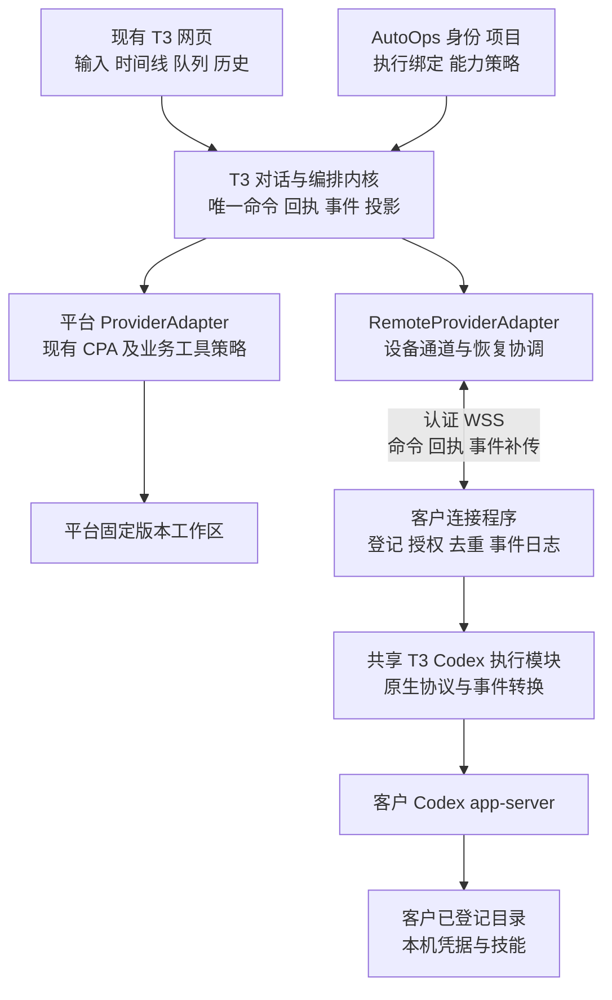

# AutoOps 客户 Agent 接入架构整合方案

方案日期：2026 年 10 月 22 日；实施记录更新于 2026 年 10 月 23 日。用户已批准本方案，首版代码已接入现有 T3 中心，并以独立客户安装包进行真实 Codex/CPA 验收。普通公网 HTTPS/WSS 和 Windows 的实机验收尚未完成，不能将本机通过等同于客户发布就绪。

采用**现有模块化单体中心服务，加一个客户本机连接程序**。T3 继续负责唯一的对话、排队、历史和界面；客户连接程序复用 T3 的 Codex 适配逻辑，负责本机执行。Multica 提供设备接入和连接可靠性的参考，不引入它的第二套任务系统。

核心原则是：**平台执行和客户执行共用上层流程，但分别拥有执行策略、凭据和工作区。** 扩展点落在现有 ProviderAdapterV2 边界，不复制一套聊天应用，也不把客户目录伪装成服务器目录。

## 已确认的产品边界

客户在本机选择并登记目录，中心只显示已登记的工作区。一个设备可以登记多个工作区，一个工作区可以建立多段对话；每段对话首条消息被接受后，固定绑定设备、工作区和运行器。同一客户工作区首版串行执行。

| 范围 | 客户首版处理方式 |
| --- | --- |
| 开发执行 | Codex 在客户本机读取和修改代码、执行命令、测试与构建；权限由本机配置控制 |
| 对话体验 | 沿用 T3 输入、草稿、真实流式、工具详情、滚动、历史、引导、队列、停止和权限问答 |
| 本地技能 | 保留 `$` 名称搜索、描述、显式调用；本机发现并执行，不做中心安装、编辑或同步技能库 |
| 模型与思考强度 | 读取客户运行器的实际能力目录，中心缓存；执行前本机复核，不自动替换模型或档位 |
| 执行结果 | 展示真实文本、命令结果和运行器返回的代码变更；报告先作为普通对话正文 |
| 文件交互 | 在已登记目录内按需浏览、搜索、预览并通过 `@` 引用；发送后由本机读取当前文件，不上传整库 |
| 输入附件 | 复用 T3 选择文件、拖拽、粘贴截图与发送；中心只向本轮绑定电脑提供已发送附件，连接程序自动接收并交给原生 Codex 图片输入或文件读取 |
| 平台资料和交付物 | 暂不接平台资料工具、正式报告入库及本机产物回传；用户主动上传的 PDF 等文件属于本私有会话附件 |
| 管理范围 | 首版仅设备所有者控制、私有对话；不接管客户已打开的任意 Codex CLI 或桌面会话 |
| 其他能力 | 不开放独立终端、Git 管理、分支回退、子 Agent、工作区加工、跨设备迁移或额外审批 Agent |

平台现有内部原始、外部脱敏工作区及部署包设计保持不变。这里的“客户本机”是执行位置，“外部脱敏”是平台数据加工类型，两者不能混用。

本方案补充 [工作台设计](project-workbench-design.md) 中此前暂缓的客户接入阶段，不把这些新能力视为现有 [平台精简版](agent-demo-lite-profile.md) 已经开放。

## 架构决策

| 决策 | 选择及原因 |
| --- | --- |
| 部署形态 | 延续 Node.js 与 SQLite 的中心服务及现有 T3 worker；逻辑上分模块，首版不拆微服务，不增加 Redis、消息中间件或 Multica 的 PostgreSQL 后端 |
| 客户程序 | TypeScript 无界面连接程序，先提供本地交互式登记和状态查看；运行时及分发包随程序管理，不要求客户运行整个工作台 |
| 对话与调度 | 只有 T3 一套；客户程序不维护可编辑的业务任务队列，不自主领取和重试另一套任务 |
| Codex 集成 | 从锁定的 T3 CodexAdapterV2 抽出共享执行模块，在客户本机调用 Codex app-server；中心新增 RemoteProviderAdapter 接回同结构事件 |
| 网络边界 | 客户主动连接中心的认证 WSS；浏览器继续只连接中心，不直连客户电脑，不要求公网 IP、端口映射或 ZeroTier |
| 状态持久化 | 中心保留对话事实；客户保留原生会话身份、命令去重记录和待回传事件；二者通过真实运行身份对账 |
| 能力开放 | 按执行目标计算能力，不全局解除平台只读限制；未实现的客户功能同时在界面和服务端关闭 |
| 扩展方式 | 首版只接客户 Codex；将来增加运行器实现，不提前建设任意插件市场、通用远程桌面或文件同步系统 |



这是新增的逻辑边界，不要求每个方框都部署为独立服务。中心设备通道和 RemoteProviderAdapter 与 T3 worker 同一部署单元，统一经现有网关暴露；不再增加一个 Go 中继服务。

中心需要可从普通公网访问的 HTTPS/WSS 地址。部署时检查反向代理的 WebSocket Upgrade、空闲超时和消息大小限制，心跳周期与代理超时协调。现有仅内网或 ZeroTier 可达的 Demo 地址不能替代这项验证；客户端仅需主动出站连接，支持环境代理的情况也纳入接入测试。

## 开源复用方式

### T3 是交互和执行协议的主参考

基准为仓库锁定的 T3 Code v0.1.1，提交 `fe27e8e3dc12dcbb108e9a28fd9b8cb65f34ae92`；以当前 AutoOps 适配代码为实际迁移起点，遵循 [T3 UI 规范](t3-ui-standard.md)。

直接复用原生对话协议、组件、事件结构、Codex 协议客户端、工具展示、权限请求与轮次控制。共享 Codex 模块只维护一份源码，平台与客户通过不同的宿主策略接入，不能复制两份 CodexAdapterV2 后分别修改。

现有 CodexAdapterV2 已有 `clientFactory` 和构造参数，但仍直接依赖平台技能、业务 MCP、配置和其他宿主模块。实施时需把这些依赖收口为少量明确的宿主接口：启动配置、运行策略、技能解析及已开放的工具上下文。客户实现使用本机配置；平台实现保留现有行为。不要为了抽取首版再造一个庞大的 Agent 框架。

抽取验收必须包含客户程序的独立构建：不能通过间接依赖把中心 `ServerConfig`、附件存储、平台 MCP 会话实现、平台 CODEX_HOME 策略带入客户包。单独替换 `clientFactory` 不足以完成解耦；纯身份分配、事件转换与宿主配置应分别明确依赖。

### Multica 用于接入机制的参考

核对版本为 `88de9d371359d028a54dd839f843a86c75b24df1`。

| Multica 部分 | 采用方式 | 不直接搬入的原因 |
| --- | --- | --- |
| 设备主动连接、鉴权、心跳、退避重连 | 参考其完整连接流程，落在现有 TypeScript 网络栈内 | `wakeup.go` 与其 Daemon、任务领取及后端结构耦合，不是独立可引入的连接库 |
| 本地目录关联设备与项目 | 采用本地登记、中心选用的模式，使用 AutoOps 工作区 ID | Multica 的组织 workspace 与本项目文件工作区不是同一概念 |
| 终态回传队列 | 借鉴先落盘再发送、确认后清理 | 原 `terminal_report_queue.go` 面向任务最终报告，不等于可恢复完整对话事件流 |
| Go Codex runner | 首版不采用 | 核对版本会自动接受部分命令、文件修改及权限请求，与本项目保留人工权限问答的要求不一致 |
| 工单、任务看板、调度数据库、前端 | 不引入 | 会与 T3 的会话、队列和历史形成两个事实来源 |

因此，“复用开源”具体是复用 T3 的执行和交互模块、参考 Multica 已验证的接入模式，再编写必要的业务绑定和可靠投递层。不能把原封不动运行 Multica daemon 当成已经适配，也不能把事件重放能力归功于它现有的终态报告队列。

### 不采用中心直通客户 stdio

T3 的底层客户端支持注入 stdio，但请求等待表、请求序号、权限应答和终止信号仍保存在运行进程内。简单地把 stdio 包进 WebSocket，会让中心重启或公网断线影响未完成 RPC 的身份和结果判断。

首版把 Codex 协议客户端和事件转换留在客户本机。网络断开时，本机 Codex 与适配器仍在同一运行上下文中，回传的是带身份和序号的 T3 Provider 事件。中心只做可靠投递与恢复，不维护第二份 Codex 原生协议状态。

## 模块边界与现有代码接入点

以下是模块职责。已落地的文件和维护入口见文末实施记录。

| 模块 | 职责 | 与现有代码的关系 |
| --- | --- | --- |
| 执行绑定与策略 | 用户、项目、设备、目录、运行器绑定和能力计算 | 扩展 `agent-demo/t3-adapters/access.mjs`、`rpc-policy.mjs`、`product-profile.mjs`；不把新逻辑继续堆进聊天组件 |
| 设备登记模块 | 配对、设备身份、工作区元数据、撤销、能力缓存 | 置于 AutoOps 业务边界，通过内部接口供 T3 使用 |
| 远程协议模块 | 有版本的命令、回执、事件、恢复合同及编解码 | 中心和客户共用；复用现有 Effect Schema、RPC/WebSocket 基础设施，不另造浏览器聊天协议 |
| RemoteProviderAdapter | 实现首版需要的 ProviderAdapterV2 子集，连接状态与运行状态分开 | 接入 `ProviderAdapterRegistry`；driver 仍是 `codex`，remote 表示执行位置 |
| 共享 Codex 执行模块 | 原生 thread、turn、技能输入、审批、工具事件转换 | 从 `Adapters/CodexAdapterV2.ts` 及相关辅助模块抽取；继续使用 `effect-codex-app-server` |
| 客户连接程序 | 本地目录登记与解析、有效权限、执行锁、日志、连接与恢复 | 使用共享 Codex 模块，不引入中心数据库、T3 调度器、平台报告或项目资料模块 |
| T3 界面适配 | 新对话选择已登记工作区，能力菜单，设备状态和恢复提示 | 复用 `ThreadScopeControl`、`ComposerSurface.ContextStrip`、原聊天和设置组件 |

中心已有对话内的排队由 T3 管理。跨对话的工作区串行条件作为 T3 启动前的准入条件，客户只做最终互斥校验；两边都不能独立决定下一条用户任务是什么。

依赖方向固定为：界面 → 中心业务/编排 → Provider 接口；客户程序 → 共享协议/执行模块。共享模块不能反向导入 AutoOps 网页、平台资料库或服务器 Secret。

## 数据身份与归属

### 业务范围与执行目标分开

现有 `projectId`、`environmentId`、`agentId` 和可见范围继续表示业务范围。`agentId` 是项目助手等业务角色，不能改成设备 ID；`environmentId` 是业务环境，不能拿来表示客户电脑。

新增的执行绑定采用两种互斥形态：

```ts
type ExecutionBinding =
  | { kind: "platform"; workspaceType?: "internal" | "external"; workspaceVersionId?: string }
  | {
      kind: "customer";
      deviceId: string;
      registeredWorkspaceId: string;
      workspaceBindingRevision: number;
      runtimeId: string;
    };
```

这是领域示意，正式 Schema 应复用已有身份类型与校验。存量会话缺少新字段时解释为平台执行；没有绑定平台工作区的旧会话继续沿用其现有资料范围。

客户绑定固定目录身份，**不冻结文件内容**。目录实际绝对路径由客户本机根据登记 ID 解析；中心传递的路径展示文字不能成为执行参数。工作区迁移、更换实际目录时产生新绑定，不把已开始的会话偷偷重定向到新目录。单纯改显示名称不必生成新绑定。

目录身份版本与权限版本分开：绑定不可变不代表旧权限永久有效。客户收紧或撤销权限后，后续命令必须立即按本机最新权限判断。

### 各类数据的权威来源

| 数据 | 权威来源 | 中心保存什么 |
| --- | --- | --- |
| 用户输入、队列、可见性、对话历史 | T3 与 AutoOps 中心 | 继续保存现有命令、事件和投影 |
| 实际目录、目录授权、本机凭据 | 客户连接程序 | 登记 ID、显示名称、状态和必要的能力摘要；不保存凭据 |
| 原生 Codex thread 和实际进程 | 客户运行器 | 带设备/运行器命名空间的原生身份映射及最后确认状态 |
| 模型、档位和技能目录 | 客户运行器发现 | 带版本及更新时间的缓存 |
| 命令是否被客户接收或已启动 | 客户持久回执和原生运行证据 | 投递与确认状态，不能用中心收到请求代替 |
| 完成、失败、停止 | 客户确认的真实执行结果 | 写入 T3 现有历史 |
| 源码文件本体 | 客户本机 | 不同步工作区；模型回复、工具输出和 diff 可能包含代码并进入对话历史 |

### 最小存储增量

中心业务库增加设备、已登记工作区、运行器能力缓存和执行绑定；T3 持久化层增加远程投递所需的去重键、游标及工作区占用记录。客户使用本地 SQLite 保存目录登记、命令接收记录、执行身份、待回传事件与同步游标，凭据使用独立的本机受保护存储。

客户的记录是恢复日志，不是第二套对话数据库。不能新增一套 `remote_conversations / remote_messages / remote_runs` 再与 T3 双写。

中心“接收远程事件、去重、写入 T3 事件”必须有一致的提交边界；提交成功后才能 ACK。若业务登记库与 T3 核心库保持分离，通过已有持久 effect 与幂等接口衔接，不假设跨两个 SQLite 文件存在原子事务。登记成功但会话尚未创建等中间状态必须可重试和对账。

## 命令与事件协议

保留浏览器到中心的 T3 原生协议。中心到客户新增有限的设备协议，复用 ProviderAdapterV2 的输入和事件类型，传输时只序列化数据，不跨网传递 Effect 或函数对象。

| 合同 | 首版用途 |
| --- | --- |
| 连接握手与能力快照 | 协议版本、设备身份、运行器版本、在线状态及目录/模型/技能摘要 |
| 会话建立与恢复 | 确保或恢复固定绑定的原生 thread，读取状态快照 |
| 开始轮次 | 文本、附件清单、所选模型/档位、显式技能引用及固定执行目标 |
| 引导、停止、权限应答 | 指定真实 run、attempt、turn 或 request，禁止笼统作用于“当前任意任务” |
| 执行回执与 Provider 事件 | 已接收、真实启动、消息、工具、权限请求及终态 |
| 恢复对账 | 活跃执行清单、事件游标、未确认命令及待处理请求 |

合同不开放任意原生 RPC 转发，不接受浏览器传入的任意 `cwd`、启动命令、环境变量或登录凭据。附件清单随原命令固定，内容经独立设备凭据的 HTTPS 下载，仅可读取发给该设备、归属该私有会话的文件；不开放任意 URL 下载或路径写入。连接程序校验大小与 SHA-256，写入私有有界缓存后才开始原生执行，失败不启动 Agent、不自动重做原命令。单文件沿用 T3 限制，单次总量 100 MB，本机缓存上限 1 GB，运行中引用保留；旧连接程序不宣告附件能力。

客户回传的 Provider 事件属于不可信输入，不能因为符合 T3 Schema 就直接写入核心。RemoteProviderAdapter 必须核对设备归属、固定执行绑定、run/attempt、允许的事件集合与身份映射；中心分配或校验权威实体 ID，再进入原生事件处理。首版不允许客户通过 `app_thread.created` 等事件私自创建额外会话、子 Agent，或改变 owner、项目和执行目标；未下发过的运行身份、越界事件及超限消息应被拒绝。

必须区分三组身份：

- **业务身份**：thread、run、attempt、command、request，沿用 T3。
- **执行身份**：设备、运行器、登记工作区、原生 thread/turn、运行器进程代次。延迟引导、停止和审批只能命中原执行。
- **传输身份**：连接代次、事件 ID、每个执行流的连续序号及已确认游标。重连淘汰旧连接，但不改变仍活着的本机执行身份。

网络重连不能自动作废一个仍在本机等待的审批；运行器进程真正重启后，旧审批也不能误用于新进程。中心只用 `codex + nativeThreadId` 作为全局唯一身份是不够的，必须纳入设备和运行器范围。

可靠事件按执行流连续编号，易失日志使用独立通道标识，不占用可靠事件的连续序号。中心发现序号缺口时请求补传，终态不能越过未补齐的必要结果直接完成投影；确实无法补齐时通过本机快照核实并明确标记缺失，不伪造完整记录。

### 一次发送的确认边界

1. 中心验证用户与绑定，持久接受 T3 command；此时只表示已接受。
2. T3 检查队列和工作区占用条件，持久记录投递意图。
3. 客户先校验本机有效授权、目录身份、模型和技能，再将 command 去重记录落盘。
4. 客户取得工作区锁，调用本机 Codex；收到真实证据后才报告开始。
5. 客户将结果事件写入待回传日志，分批上传；中心按事件 ID 去重，提交后确认。
6. 客户确认实际执行及其受管进程结束后释放本机占用；中心收到对应证据后释放准入占用。

传输可以至少一次投递，但不能宣称命令副作用端到端恰好执行一次。若本机在 Codex 已接收请求之后、记录确认之前崩溃，必须查询原运行证据；无法确认时保持“结果待确认”，冻结该工作区后续执行，不能自动再发同一提示词或命令。

### 输出、背压与存储上限

沿用 T3 事件合并和工具详情懒加载，回传按小批次发送。持久事件与实时输出分开：正文、工具最终结果、权限请求和终态需要可补传；原生 `command_output.delta` 是实时输出通道，不承诺永久保存每个中间片段。长输出采用有明确标记的截断或尾部窗口，不能静默丢正文或最终结果。

控制消息优先于日志发送，限制单批大小和待发送字节；持续拥塞时可以暂停或舍弃已声明为易失的日志片段。若单连接压力测试仍阻塞停止和审批，再拆控制与批量事件通道，首版不预先维护两套连接。

客户日志和中心投递日志均设容量及保留策略。已确认事件可清理；接近容量高水位时提前停止接收新轮次，预留控制回执、停止和终态的存储空间，必要时有序中断当前运行并明确提示，不能等磁盘完全写满才处理。遇到意外磁盘故障且无法可靠记录时进入异常核实流程，不能伪造完整终态。已读历史继续由中心提供。

## 公网与运行生命周期

### 连接状态和执行状态是两个维度

设备状态可为在线、重连中、离线；运行仍可能是执行中、等待权限、已完成或待核实。断线只改变连接状态，不直接生成完成、失败或停止事件。

| 场景 | 首版行为 |
| --- | --- |
| 打开网页时设备离线 | 可读历史和编辑草稿；新请求留在草稿，不声称开始执行 |
| 已接受请求之后断线 | 保留投递记录，显示等待设备或状态待确认；恢复后先对账 |
| 本机执行中网络断开 | 本机可继续当前已授权轮次并缓存结果；需要权限应答时等待，不自动批准 |
| 离线时点击停止 | 保存停止意图，显示“等待设备确认停止”；重连后先处理，不能提前显示已停止 |
| 离线时尝试引导 | 不声称引导成功；保留输入供用户排队或重连后再发，避免迟到指令落入错误轮次 |
| 已有队列遇到断线 | 断线期间暂停后续启动；短暂重连且对账完全一致时可继续已接受队列，长离线、重启或结果不明时由用户恢复 |
| 中心服务重启 | 对照原 run 和客户状态恢复事件；不自动取消仍在客户执行的轮次，不重发用户输入 |
| 客户连接程序或 Codex 崩溃 | 核实真实进程和原生会话；可恢复历史不代表能恢复原命令。无法证实结束时保持未知和占用，不自动重跑 |
| 本机原生会话被删除 | 中心历史仍可读；明确无法原生续接，建立新对话，不拼接历史冒充恢复 |

本机继续执行以客户机器与模型服务仍可用为前提；中心断线不等于模型推理可以离线运行。

短暂重连窗口建议初始设为 60 秒，经公网测试调整；它只用于恢复体验，不用于判断进程死亡或释放锁。自动恢复还要求本机运行代次、绑定和有效权限一致，没有未处理的停止、撤销或失效请求。超过窗口及任意不确定状态保持队列暂停，避免久未联网的设备突然执行旧请求；普通短抖动也不必反复要求用户点击恢复。

连接故障造成的暂停按工作区记录，恢复入口明确展示受影响的排队会话。恢复只解除这一层故障暂停，不能顺带取消用户原本对单个对话设置的暂停或跳过仍未解决的权限请求。

### Agent 和进程的存活

离开页面或关闭浏览器不会自动关闭 Agent。对话身份与原生会话持久保存；运行时进程按需要启动，空闲后可以释放，下一轮使用原生 thread 恢复。空闲释放必须确认没有活动工具、待答请求或受管子进程。

客户程序持有 Codex 的本机连接；公网重连不重启它。首版不承诺连接程序崩溃或升级时正在执行的 shell 命令可以无损续跑，也不为此建设额外的多层守护系统。升级前排空活动任务；异常退出后先对账和处理遗留进程。

### 工作区串行

中心负责业务排队，本机持有按规范化真实目录识别的锁。首版拒绝重复登记同一目录和父子重叠的目录；处理符号链接及 Windows 路径大小写等别名，不能只按两个不同工作区 ID 认为互不影响。

跨对话调度使用已有持久队列记录：从各个可执行会话的队首中，按中心接受序号选出下一轮，再原子取得工作区占用。其余显示“等待工作区空闲”，不把 effect 失败后的不断重试当作排队。对话内编辑和排序继续由 T3 决定队首；暂停的会话不参与选择，不新建一套客户任务队列。

同一目录的多个对话轮流执行。网络断开或租约到期不能证明原进程已经停止；没有真实结束证据，不能让另一个执行覆盖上来。控制消息不进入普通任务队列，停止与权限应答不能被正在等待的任务堵住。

互斥只覆盖本连接程序管理的任务，不能保证用户自己打开的 IDE、终端或另一个 Agent 不修改文件。首版不宣称独占客户整个工作区。明确退出或用户在本机处理遗留进程后，才能解除无法核实的占用。

“结果待确认”必须有退出流程：网页给出本机检查指引，连接程序显示原执行身份和仍可识别的受管进程；确认旧进程结束后记录人工核实结果、保留已经发生的文件修改，才允许恢复后续队列。该动作不把旧运行标成成功，也不自动回滚或重做原命令。

已核实进程结束但缺少完整结果时，以带明确恢复原因的中断或失败结束旧运行，保留结果缺失说明；不能释放工作区后仍把旧运行显示为执行中。

## 权限与能力隔离

有效能力计算为：**产品首版范围 ∩ 用户和项目权利 ∩ 客户登记授权 ∩ 实际运行器能力**。能力由中心返回给网页，本机在执行前再验证一次。

平台配置继续使用 CPA、平台技能和业务工具限制。客户配置使用本机 Codex 的模型、凭据、技能和有效权限，不能经过平台 `prepareAutoOpsCodexRequest` 后被覆盖成平台模型、只读策略或平台 MCP。

本机登记目录确定工作目标，本身不等于操作系统沙盒。是否能访问目录之外或执行网络操作取决于本机运行策略，网页不能通过绑定目录制造“已经隔离”的假象。所选权限模式在当前系统不受支持时应拒绝或要求客户在本机调整，不静默回退为完全访问。

权限问答复用 T3 请求流程。网页所有者只能回答本机策略允许的请求；需要扩大登记范围或改变权限上限时回到本机修改。没有响应不能视为批准；重复回答只生效一次。客户可在本机停止和撤销，中心无权重新开启。

配对使用绑定当前账号的短期一次性流程；客户保存独立设备凭据，不能把浏览器 Cookie 或中心管理员 Token 当设备凭据。WSS 复用中心 TLS 与身份校验，重连重新验证设备和撤销状态。

中心撤销会立即阻止新调度，但网络断开时无法保证已在本机执行的操作瞬间终止。本机撤销立即拒绝新轮次和新的授权响应，并请求停止活动运行；停止确认前不能保证正在运行的工具或进程已经终止，实际已完成的文件修改也不能自动撤销。界面分别显示撤销与真实停止结果。

停用设备或撤销目录授权与彻底吊销设备凭据应分别处理。前者保留仅针对已发出运行的停止、对账和结果回收通道，不能继续接新任务；后者拒绝设备重新认证，未确认的活动运行需由客户在本机核实，不承诺还能通过已吊销连接取得终态。

## 模型和技能的低延迟接入

客户在连接、新建会话需要刷新时以及用户主动刷新时发现能力，中心按设备、运行器、工作区和配置版本缓存。打开选择器直接读缓存，不要求每一次按键都跨公网访问客户电脑。

模型目录保留实际支持的思考档位及运行器报告的默认档位，默认值必须属于同一模型的可选档位。网页未手动选择时展示已报告默认值，用户显式选择优先；旧客户端未报告默认值时仅显示“默认”，不推测成低、中或高；技能目录只上传必要的身份、名称和描述。显式技能引用通过本机稳定身份解析到真实路径，仍调用 Codex 的技能输入，不把 `$技能` 降级成一段提示词。技能正文、脚本和依赖留在本机执行；缺失依赖或技能被删除时返回可理解的错误。

缓存显示更新时间。模型、档位或技能已失效时保留输入，让用户重新选择；不能静默换成 Grok、CPA 默认模型或另一个同名技能。技能自身能力仍受本机有效权限约束。

平台项目和环境在客户对话中只提供业务归属，不自动携带平台资料、环境凭据或工具。当前报告助手等依赖平台专属工具的角色，不因共享一个项目就自动在客户侧开放。

## 必须消除的现有本机假设

这些是源码核对发现的接入工作，不能只新增一个 Adapter 后宣称已经完成。

| 现有位置 | 当前假设或策略 | 远程适配要求 |
| --- | --- | --- |
| `RuntimePolicy.ts` | 从项目根目录或 worktreePath 取得 cwd | 平台继续原逻辑；客户只传登记身份，本机解析目录 |
| `ProviderTurnStartService.ts` | 启动前可能执行中心登录、Git/worktree、路径操作和本机租约 | 按执行目标分流；客户不在中心创建替身目录或执行这些本机副作用 |
| `ProviderTurnControlService.ts` | 无 live session 时可能把停止当成已经成功 | 客户场景先对账或保存停止意图，真实确认前不结束状态 |
| `RunExecutionService.ts`、`ProviderSessionManager.ts` | provider 事件流结束可视为运行错误 | 逻辑执行流跨 WebSocket 重连保持，socket 关闭不等于 provider 终止 |
| `ProviderRuntimeRecoveryService.ts` | 中心退出/启动时恢复按本机运行生命周期处理 | 客户执行改为核实原运行，不自动取消、继续一轮或重启推理 |
| `CodexProvider.ts`、`CodexAdapterV2.ts` | 直接挂接平台请求改写、技能和业务工具 | 抽离共享执行部分，平台策略只对平台实例生效 |
| `access.mjs`、`threadReservations.ts` | 提交范围主要是现有业务字段 | 把执行绑定纳入 `draft → submitting → locked` 和范围指纹；结果未知时不解锁 |
| `rpc-policy.mjs`、`product-profile.mjs` | 全局平台运行器与能力配置 | 引入目标级能力判断；客户可执行命令不等于全局开放 shell 或独立终端 API |

Git 检查点继续使用 AutoOps 已有的 conversation-only 分支。代码改动展示来自 Codex 实际事件，不把“显示了 diff”解释为具备远程文件回退能力。

## 兼容升级与维护

协议采用显式版本及能力协商。首版维护当前与上一兼容客户端的测试矩阵；遇到不兼容的大版本拒绝新执行、保留中心历史，并显示升级路径，不猜测字段含义或自动降级为另一运行器。Codex CLI 版本也纳入兼容矩阵；未验证版本先完成探测，不承诺任意最新版都支持。

服务端先支持新合同，再发布客户连接程序，最后开放网页入口。现有会话默认平台执行，使用增量数据库迁移；不重写历史，不自动转换会话归属。新客户能力使用独立开关，不能修改平台精简版全局开关来实现。

回滚先停止新登记和新轮次，排空或保留兼容版本的恢复通道。不能在客户仍执行时直接降级到不认识客户运行的旧 T3 recovery 逻辑。历史只读入口保留；不通过恢复旧数据库丢弃新会话。

共享模块的变更记录上游提交、提取范围、业务补丁及契约测试结果；保留许可与来源文件。一次上游升级同时验证平台和客户两条链路，避免客户功能修好却破坏现有 CPA Demo。

日志统一带 device、workspace、thread、run、attempt、command 和事件序号，以便定位“未投递、已接收未启动、执行中、回传滞后”。默认记录状态与耗时，不在运维日志重复写入提示词、文件内容、密钥和完整工具输出。队列等待、事件延迟、重连次数及日志容量应可查询，无需首版建设独立监控平台。

## 实施顺序与验收门槛

| 阶段 | 交付内容 | 通过条件 |
| --- | --- | --- |
| 1 共享执行模块验证 | 抽出 T3 Codex 执行部分，平台策略独立；一个本机无界面 runner | 与现有 T3 fixture 对齐文本、工具、权限、停止和引导；平台现有流程回归通过 |
| 2 一条公网纵向链路 | 一个设备、一个登记目录、一个真实 Codex 会话、中心 RemoteProviderAdapter | 真实改文件、执行命令；丢启动 ACK、断网、中心重启均不重复执行；停止只有本机确认后完成 |
| 3 产品整合 | 配对、多目录登记、绑定锁定、模型/技能缓存和原 T3 菜单 | 只显示已闭环入口；无平台权限串用、无假下载、无任意目录传参 |
| 4 恢复和发布 | 队列、撤销、日志限额、版本兼容、安装及升级流程 | 通过下列异常矩阵，再扩大给其他客户试用 |

先验证共享模块抽取和公网恢复，不先做完整设备管理页面。首版不以“文件已经搬过来”作为完成标准，也不在架构审查阶段给出未经验证的复用百分比。

必要验收矩阵：

1. **平台回归与绑定隔离**：已有 CPA、内部/外部工作区、技能、报告正常；客户账号不能使用他人设备，已开始对话不能换目标。
2. **真实多轮开发**：本机改代码、命令输出、测试成功和失败均正确显示；模型、档位及 `$` 技能确实作用于本机执行。
3. **启动结果不明**：重复投递、启动 ACK 丢失、客户在确认前崩溃，不产生第二轮或重复副作用；不能证明状态时明确阻塞。
4. **停止和审批竞态**：断线停止、晚到引导、旧审批重放及旧连接回包不会影响下一轮；控制消息不被长输出堵塞。
5. **事件恢复**：正文、工具最终结果、终态发生重复或补传，时间线不重复、不乱序；易失输出丢失有清晰边界。
6. **中心与客户分别重启**：中心重启不终止活跃本机任务；客户重启不宣称原 shell 已续跑，不自动重发输入。
7. **工作区与授权变化**：同目录别名、父子目录、目录移动、撤销、模型和技能变更均被正确识别；未知执行不因租约超时而释放。
8. **真实公网和 UI**：普通家庭/办公公网，并注入延迟、抖动、丢连接和大日志；检查输入、滚动、草稿、队列与恢复反馈，同时覆盖浅深色、窄屏、短窗口、中文输入、键盘和焦点。

记录首个可见输出耗时、模型首字耗时、回传延迟和界面更新耗时，分别判断模型慢还是链路慢；不能把模型等待计成前端卡顿。网络故障测试除局域网模拟外，至少完成一次真实公网往返。Windows 作为首批重点环境；其他系统只有跑过相同核心用例才列为已支持。

## 后续扩展的边界

客户 `@`、目录树与预览使用设备协议的按需只读合同，复用现有 T3 文件组件；不改变聊天和执行状态合同。加平台资料与报告时，单独设计有项目授权的工具桥和交付物传输，不把中心 Secret 或整个资料库同步到客户电脑。

增加其他运行器时，实现同一 Provider 边界并报告实际能力；不要求所有运行器假装支持 Codex 的技能或引导方式。增加共享控制时，在现有设备所有权之外设计委托权限和控制冲突，不靠把私有会话改成项目共享直接开放。

只有实测出现单机连接数、数据库写入或部署隔离的瓶颈后，再考虑独立设备网关和存储迁移。首版保持中心一个业务控制面、客户一个执行程序、共享一份协议与 Codex 执行模块。

## 源码核对入口

- 本仓库：[现有 T3 协议](agent-demo-t3-protocol.md)、[ProviderAdapterV2](../vendor/t3code/packages/provider-core/src/server/ProviderAdapter.ts)、[CodexAdapterV2](../vendor/t3code/apps/server/src/orchestration-v2/Adapters/CodexAdapterV2.ts)、[Codex 客户端](../vendor/t3code/packages/effect-codex-app-server/src/client.ts)、[进程内协议状态](../vendor/t3code/packages/effect-codex-app-server/src/protocol.ts)。
- 本仓库：[执行开始](../vendor/t3code/apps/server/src/orchestration-v2/ProviderTurnStartService.ts)、[执行控制](../vendor/t3code/apps/server/src/orchestration-v2/ProviderTurnControlService.ts)、[恢复逻辑](../vendor/t3code/apps/server/src/orchestration-v2/ProviderRuntimeRecoveryService.ts)、[运行策略](../vendor/t3code/apps/server/src/orchestration-v2/RuntimePolicy.ts)。
- Multica 锁定版本：[连接与重连](https://github.com/multica-ai/multica/blob/88de9d371359d028a54dd839f843a86c75b24df1/server/internal/daemon/wakeup.go)、[终态报告队列](https://github.com/multica-ai/multica/blob/88de9d371359d028a54dd839f843a86c75b24df1/server/internal/daemon/terminal_report_queue.go)、[Codex runner 的请求处理](https://github.com/multica-ai/multica/blob/88de9d371359d028a54dd839f843a86c75b24df1/server/pkg/agent/codex.go#L2918)、[目录资源说明](https://github.com/multica-ai/multica/blob/88de9d371359d028a54dd839f843a86c75b24df1/apps/docs/content/docs/project-resources.mdx)。

## 首版实施记录

首版保存在 `feat/project-agent-workspaces` 的 `4c370053`；按用户后续要求，整合目标为 `feat/workspace-deployment-validation`，保留该分支的统一导航、部署发布与完整技能中央库。没有替换既有平台 Demo 的数据库或客户工作区。对话、运行、队列、审批与历史继续使用 T3 的事实和投影；远程模块只增加设备身份、命令回执、事件游标与目录占用。

| 维护入口 | 已落地职责 |
| --- | --- |
| `agent-demo/t3-adapters/customer-registry.mjs`、`access.mjs` | 配对、所有权、工作区登记、能力缓存和不可变执行绑定 |
| `agent-demo/t3-adapters/customer-target.mjs`、`rpc-policy.mjs` | 精确目标、模型/档位与操作准入；平台和客户策略分开 |
| `packages/contracts/src/autoopsRemote.ts` | 有版本的设备合同，中心与客户共用 |
| `agent-demo/t3-adapters/customer-transport.mjs` | SQLite 命令去重、可靠事件、连续 ACK 游标、工作区占用和停止意图 |
| `apps/server/src/autoops/RemoteDeviceService.ts`、`customerSocket.ts` | 认证连接、重连对账、限流和投递；连接断开不等于运行停止 |
| `RemoteProviderAdapter.ts`、`RemoteProviderRegistry.ts` | 动态客户 Provider 接入原 T3 编排；不把客户路径当中心 cwd |
| `CustomerEventValidation.ts`、`RemoteRunRecovery.ts`、`CustomerRunStop.ts` | 原生身份与 epoch 校验、恢复原 run/attempt、未知结果和停止竞态 |
| `apps/server/src/orchestration-v2/Adapters/CodexExecution.ts`、`provider/CodexProviderCore.ts` | 从锁定 T3 抽出的共享执行源码，平台适配器和客户运行器共同使用 |
| `provider/CodexExecutionHost.ts`、`HeadlessCodexRunner.ts` | 宿主策略边界；客户独立运行原生 Codex，平台保留 CPA/业务工具策略 |
| `agent-demo/customer-agent/` | 本机命令行、目录身份和互斥、有效权限、命令日志、事件补传、技能发现及异常核实 |
| `apps/web/src/autoops/CustomerDevicesSettings.tsx`、`routes/_chat.devices.tsx`、`ConversationWorkspaceControl.tsx` | 统一共享壳内的设备管理、原生弹窗、输入下方已登记工作区选择 |
| `customerAgents.ts`、`CustomerExecutionStatus.tsx`、`ThreadScopeControl.tsx` | 精确工作区的模型/技能缓存、离线与待核实提示、首条消息接受后的范围锁定 |
| `scripts/bundle-customer-agent.mjs` | 独立 ZIP、依赖隔离审计、许可证、逐文件及压缩包 SHA-256 |

表中 `apps/`、`packages/` 路径均相对于 `vendor/t3code/`。使用说明、安装命令、权限和恢复步骤见 [客户连接程序说明](../agent-demo/customer-agent/README.md)。项目 `AGENTS.md` 已加入共享源码、目标策略隔离和可靠 ACK 的维护要求。

### UI 复用与业务差异

设备管理在部署分支适配为 `/devices`「我的电脑」独立满高模块，使用同一 `AUTOOPS_AREAS` 注册表、共享顶部壳、连续设备列表及 T3 原生 `Dialog`、按钮和菜单。入口位于“更多功能”和窄屏“切换模块”，不增加顶部常用按钮或第二套侧栏。设备是当前账号的全局资源，顶部项目只保留返回上下文；常规设置不再重复展示完整设备管理。工作区选择沿用 `ComposerSurface.ContextStrip`、`ComposerControl` 与已有范围选择组件。输入、模型选择、技能标签、流式文本、工具活动、队列和审批仍是原 T3 组件，没有第二套客户聊天界面。

业务差异只有已登记设备/目录、私有范围、连接状态和客户能力边界。附件复用原生输入框按钮、拖放、粘贴截图、上传进度与失败重试，不增加手工传输步骤。客户仅开放已登记目录的受限预览，平台资料、正式报告和分支等未开放入口保持收起；平台文件引用、目录拖入及模型返回的文件链接仍遵守原授权边界。

### 与部署分支整合的约束

平台继续按会话绑定解析不可变技能版本和授权目录，保留中央库的停用、撤回、内部/外部分配与参考文件读取。共享 Codex 宿主接口只传递平台所需的上下文，不把平台目录或技能注入客户运行器；客户模型和技能仍来自其登记目录的真实能力快照。配置投影先做设备所有权过滤，再只对平台运行器覆盖平台技能，避免客户技能被清空或平台技能泄露到客户菜单。

中心发布脚本以显式 `--customer-agent-bundle` 参数纳入客户 ZIP，并验证包和逐文件哈希、许可及依赖隔离信息。默认发布保持客户接入关闭；合并代码不等于替换线上服务或公开客户入口。公网、Windows 和模型首反馈长尾的验收边界仍按下文保留。

### 实际验证环境与发布边界

本轮隔离中心使用回环网络 `127.0.0.1:19887`，独立数据目录；客户从 ZIP 解压后运行，使用独立状态目录、临时开发工作区和独立 Codex 配置。真实运行器为 Codex CLI `0.159.2`，通过已配置的 CPA 调用 `grok-4.6`；没有改动个人 Codex 配置或线上会话。

已完成的实测包括本机读写、多轮本机技能、中心重启后补传 35 条可靠事件且不重发原输入，以及实际排队、停止和继续。一次读写约 27.6 秒，多轮技能约 12.4 秒；这些是含模型推理的轮次耗时，不能当作前端或公网延迟。停止验证检查了后续测试文件未写入；人工核实恢复保留旧 run 和历史，排队消息未自行重做。

真实审批验证展示命令、目录与原因，批准后才完成测试文件写入；`medium` 思考强度在原生运行记录中核对生效。同轮引导在执行期间发送新要求，仍使用同一个 run 与原生 turn，实际生成引导要求的测试文件，没有另开一轮。安装包 HTTP 入口返回真实 ZIP，SHA-256 与本地构建产物一致，匿名下载返回 401；客户独立分发测试包含 68 项实际依赖的许可声明。

空闲客户程序重启后的续接也已实测：运行进程 epoch 更新，原生 thread ID 保持不变，中心按 `openSession → resumeThread → startTurn` 发送，新一轮读取原工作区并实际写入 `resumed.txt`，约 16.4 秒完成。恢复过程中发现并修复了重复人工核实记录导致状态回退、复用逻辑会话时漏掉原生恢复的问题。未投递的新轮次与已经发送但结果未知的轮次分别处理，不通过重发未知输入解决恢复。

修复后再次验证等待审批时停止：新轮次的审批请求先持久取消，随后运行记为已中断，未执行目标文件写入。修复前失败用例留下的旧 pending 记录保留在隔离验收库中，未手动批准、直接改数据库或以新结果覆盖旧证据。服务端 422 项相关基线检查通过；后续恢复修复的 12 项定向测试与服务端类型检查通过，二者存在重叠，不相加作总数。客户连接、真实 WebSocket 协议夹具与独立分发共 17 项测试通过。

另一个新建会话的补充审批用例等待 180 秒仍未收到原生正文或审批请求，因此该用例记为超时，不能写成全部真实用例通过。期间设备在线、原生轮次已启动，没有重复发送。随后通过正常停止取得原生 `turn_aborted`，中心显示已中断，无待答请求、无目标文件写入；实际网页的输入恢复，执行中标记消失。客户会话全部空闲、待回传事件为 0。已有原会话中的审批、停止和审批取消用例通过；新会话首反馈的长尾延迟仍需后续核查运行器/模型链路，不能把它计成已完成的公网流畅度验收。

平台回归使用隔离数据目录内的合成示例资料，发送前与仓库夹具逐字核对；真实执行 `list_project_materials`、`query_environment`、`read_project_material` 和 `create_report` 完成，生成的报告可下载，其他成员读取私有报告返回 404。平台技能 `autoops-release-readiness` 在原生 Codex 中以真实技能输入加载，继续使用平台工具与权限。

浏览器实际检查了浅/深色设置页、1440px 桌面、390px 窄屏和 1280×520 短窗口；覆盖设备配对/详情弹窗、模型菜单、本机技能搜索/标签/描述、固定范围、离线草稿提示与原生审批。工作区菜单切换及 Escape 关闭后恢复输入焦点；客户占位提示、附件/文件预览入口按目标区分。Web 类型检查、21 项相关单测和 14 项涉及文件的 React Compiler 检查通过，生产网页构建通过。没有把全仓基线测试记为全部通过。

验收过程中修复了动态客户 Provider 被平台静态配置误判停用、中心预分配线程 ID 校验不兼容，以及原生停止通知内等待后台 RPC 导致死锁等真实问题。后者按 T3 已有异步通知处理方式修复，没有以超时伪造“已停止”。

验证记录保存在本地忽略目录 `.test-artifacts/customer-real/`，不提交模型凭据、客户凭据、恢复数据库或完整原生日志。真实验收脚本可复跑，详见客户连接程序说明。发布前仍须补齐：独立公网 HTTPS/WSS 入口、普通家庭/办公网络的延迟与断线测试、Windows 的目录和沙盒实测，以及实际使用版本的兼容矩阵。现有旧公网域名指向另一个部署中心，不能未经核对直接替换其路由。


### 部署分支整合验收（2026-10-23）

本次合并以 `feat/workspace-deployment-validation` 的 `2b67eaa6` 为目标基线，合入客户接入提交 `4c370053`，保留该分支已经合并的技能中央库和统一模块规范。设备页面复用 `ProjectAreaTopbar`、`SidebarInset`、原生 `ScrollArea` 与 `Dialog`；只在同一功能注册表中新增全局账号范围的“我的电脑”。平台技能的固定版本、范围校验和撤回策略保留，客户本机技能通过另一宿主边界发现，互不覆盖。

验收使用独立回环中心 `127.0.0.1:19897` 与全新数据目录 `.test-artifacts/customer-merge/`。客户从独立 ZIP 运行，实际执行两轮：读取并写入本机合成文件约 28.2 秒，同一会话调用本机技能约 11.3 秒；原生记录确认 `grok-4.6` 与 `medium`。最终两轮均为 completed，设备在线、客户会话空闲，待审批、目录锁、待确认可靠事件均为 0。时间包含模型推理，不代表公网延迟。完整记录在忽略目录内，凭据与恢复库不进入 Git。

合并定向回归包括：平台/客户策略与技能整合 262 项（含两项真实原生元数据检查，不发送模型轮次）、部署生命周期与源码包 17 项、导航 16 项、相关 Web 31 项及长数据详情新增 2 项、发布检查 18 项、客户连接/独立分发 17 项；各套件独立记录，不与此前同名基线累加成全仓测试总数。服务端、Web、客户连接程序的类型检查及生产构建通过。默认完整发布包不含客户 ZIP，也不启用客户功能；显式带包的完整发布包包含真实 ZIP、614 个源码模块的依赖审计与 68 项许可，随包验证脚本可独立核验。打包验收未附 Linux 官方原生依赖，不等同于完成 Linux 远端部署。

浏览器检查了统一入口、全局设备与项目上下文切换、刷新与历史、平台技能中央库、工作区及部署独立页面，以及客户真实会话的历史、固定目标和本机 `$` 候选。常规设置已不再重复设备管理。响应式验证覆盖浅/深色、1440×900、390×700 和 1280×520，包含原生菜单、配对说明、详情弹窗、Escape 关闭及入口焦点恢复。长数据夹具使用一台未连接的测试设备和 30 个长名称目录，不访问任何额外用户目录。 实测发现原生滚动区的隐式 table 会把详情撑宽至约 2301px，已经按同一组件现有的 `contentSizing="viewport"` 模式修复：元数据换行，目录及项目名称在自身列内省略，完整名称保留；长标题缩为一行，完整设备名放入可滚正文。复验 390px 下内部宽度与视口均为 390px，无子元素越出横向边界，30 个目录可滚至最后一行，右侧状态与关闭按钮保持可见；1280×520 下正文独立滚动，关闭按钮仍在窗口内。

关闭功能的独立实例使用 `127.0.0.1:19899` 和全新 `data-off` 验证：导航隐藏入口，`/devices` 深链明确显示“客户设备接入未启用”；新配对及新客户会话返回 `409 CUSTOMER_AGENTS_DISABLED`，匿名读取返回 401。本人历史设备读取保留原所有权校验，停用不破坏回滚后的历史查看与恢复通道。该临时实例验证后关闭。

以上合并验收均在本机完成，当时未推送 Git、未切换 `8787`、`28887`、`18897` 或任何公网服务。此前记录的真实公网、Windows 与新会话首反馈长尾验证仍是发布前待办，没有因本次本机两轮通过而移除。

### ZeroTier 独立预览上线（2026-10-23）

用户反馈 `28887` 没有“我的电脑”后，确认该端口仍使用旧版本，现已将 `9085944f` 的完整整合发布包切换到原 `28887/28888`。入口为“更多功能 → 我的电脑”或 `http://172.29.22.6:28887/agent-demo.html#/devices`；设备属于当前账号，完成本机配对和目录登记后才会出现。平台工作区、技能库及部署数据保留，`8787`、`18897` 和部署站点未切换。

Linux 官方原生依赖、发布清单、客户 ZIP 与实际下载哈希均已验证。ZeroTier 网页入口及只读 API 检查通过；未在该环境新增设备或发起模型轮次，公网与 Windows 的限制仍保留。HTTP ZeroTier 测试连接需显式使用客户端现有 `--allow-insecure`，公网使用 HTTPS/WSS。完整发布、数据备份、恢复步骤及本次权限失败后的自动恢复记录见 [T3 部署说明](agent-demo-t3-deployment.md#当前预览客户-agent技能库与部署整合t3-customer-deployment-preview-1)。

### 客户目录引用与低带宽边界

2026-10-25 用户授权补齐客户电脑文件选择，并以普通 4G 体验作为验收条件。文件仍由客户已登记目录拥有；网页和中心只传必要目录项、搜索匹配与受限预览，不上传整棵目录或在中心创建源码副本。目录按需展开，搜索在本机有界执行，跳过依赖和构建目录；预览最多 16 KiB，返回明确的截断或二进制状态。

复用 T3 的文件树、搜索候选、文件标签和代码预览。文件选择与 `@` 引用使用同一登记身份和相对路径；真正执行前在客户本机重新核对目录身份、路径和引用归属。默认读取执行时的当前文件；历史标签只表示原路径，不能宣称内容是历史快照。删除、撤销、目录替换或越界时明确失败，不借用平台资料或另一个目录。

文件读取走现有 HTTPS/WSS 的有界只读请求，不进入 Agent 执行日志、创建运行器或争用任务占用；取消和超时只结束读取，不能停止 Agent。中心按当前用户、项目、环境和固定客户目标校验，结果返回前再次检查授权；客户端检查真实路径并拒绝符号链接越界。慢网测试覆盖延迟、限速、取消和断线，记录实际请求体积与耗时，不以局域网结果宣称全部移动网络达标。
