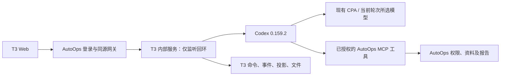

# T3 模块运行、迁移与恢复

实施基线：T3 Code v0.1.1 / `fe27e8e3dc12dcbb108e9a28fd9b8cb65f34ae92`。现行应用运行于测试服务器的 28887 入口；2026-10-24 经用户确认，旧主站、技能预览和上游对照环境已退役。早期构建、数据迁移与恢复记录保留在历史章节，不再代表可用的旧服务或恢复点。

## 独立验证：工作区部署发布（28887）

2026-10-22，在独立 worktree `deployment-validation`、分支 `feat/workspace-deployment-validation` 实现。访问 `http://172.29.22.6:28887/agent-demo.html#/deployments?projectId=p-autoops`，在顶部选择项目，进入“部署发布 → 服务发布 → 前端部署验证”。LAN 地址为 `192.168.31.157:28887`。示例站点为 `http://172.29.22.6:28890/`。这是独立数据的验证环境，未复制原会话或切换原 8787/18887 服务。

### 当前验证发行

本节是当前程序、网页、客户包及恢复配置的唯一现行记录。正式入口为 `https://auto.996788.xyz/`；`192.168.31.157:28887` 保留为后端地址，日常访问使用 HTTPS 域名。公网配置见[公网入口与旧环境清理](#公网入口与旧环境清理2026-10-24)，模块归属及验收分层见[部署核心适配运行记录](../docs/runtime-modules.md#main-部署核心适配2026-10-25)。历史记录不代表旧发行仍可执行恢复。

2026-10-27，测试站已严格切换至正式发行 `0dd9b107937bbdd8c24707759e51a2126539ece7`，目录 `/home/tao/autoops-agent-demo/releases/t3-confirmed-0dd9b107`，继续使用当前数据 `/home/tao/autoops-deployment-validation/data`。实际Web764959/ticks35968188、Worker启动器764808/ticks35966806、原生764820/ticks35966983均核对0dd目录（原生cwd为其vendor/t3code）。公网 `/agent-demo.html` SHA256 `4fdc991cae09b7590710a3f25cb2e316b4c380869abce2566e870f5a37318bb4`，健康engine=t3、workerReachable=true。原部署Agent59368及设备/state/profile保留。旧测试客户CLI446985/ticks34325587（0.4.2）已在全局九类活动全零、真实恢复原件和最新全账本核对后一次SIGTERM正常退出；全部本机/中心表、原stream及完整收据前后不变，原owned CID和名称已正常退出回收。原暂停控制器已确认默认终止信号后结束，两个已退出子进程无需再发信号，原操作锁已正常释放；原Mac自用继续保留。

恢复对象为原线程 `38c46e00-5bfe-446d-a6c4-c289bb7c5604`：本机原终态和三条命令/收据不变，原事件ACK8。原seq7已沿同设备/同epoch/同event key逐字发送一次并确认；独立只读核对原键领域记录唯一（sequence5048），原payload及最终providerTurn完整相等，状态failed、原完成时间00:14:32不变。真实五条DEFAULT_ASSISTANT_REQUIRED准备失败继续保留。尚未重发问题、回退游标或改库。原维护控制器744994/ticks35165935在恢复期间保留RAM及同一操作锁，完整恢复证明后已正常收尾，恢复前及修复版维护worker运行后的11库/531原文件/密钥完整门禁已通过；原生自动压缩18条事件已由完整4794原行hash和正式内存压缩器精确复验，收据删除0。原seq7领域终态及正常服务均已恢复；恢复后完整11库/531文件/原密钥、全部原收据和正式30表投影再次通过。真实恢复原件 `c6-truthful-recovery-v1/runtime/truthful-normal-restore-complete.json` 摘要 `dc05df41b94fd804a59f33d700adb5e02fc5346cd851a56cd8cea686b7d7f0d8`，原数据未回退，七事件全部投影仍明确为false，模型业务未通过。

固定现行发行 `0dd9b107937bbdd8c24707759e51a2126539ece7` 已正常推送；[质量CI](https://github.com/coco-ari/CodeMinificationRepository/actions/runs/40443244435)和[完整运行CI](https://github.com/coco-ari/CodeMinificationRepository/actions/runs/40443244369)均通过。独立Git归档的177项定向回归及完整服务类型通过，完整CI含Web680项及正式客户155项。正式切换收据 `switch-0dd9b107-stable1.json` SHA256 `a5d594e1752df582b9b970d9d92f4d6467be126a63179cc7b6f960e68ec1163a`，两阶段完整owner通过、保留问题为空，531原文件、11库及原行保留；发行清单 `b76c6bdc520e3bbfeb24b101516014197445f9bb6bde8172112df6f6ba4ce730`、原生清单 `3a5b3d5909b3b06354a65c506353af5f1404861bc084e3beff70f74a3df997dd` 已两次核验10488发行文件及2038官方原生文件/21包。原终态及正常服务恢复单项已通过，旧CLI停止原件 `bb059ce2…40c4f` 保留。正式CLI0.4.3同源网关的单次真实上游兼容HTTP200、自然流结束、completed1/failed0/error0、14.766秒通过，两owned容器已清理；答案未回传CLI，不计问答通过。四状态为代码固定、完整自动检查通过、正式部署通过、恢复单项真实通过；正式CLI0.4.3已沿原设备/state/profile正常运行765535/ticks36010276，真实提供者12模型/1技能、接收者不可调整已核；新线程b3dbda82-cf21-4525-b928-6ca3053b5805以原grok4.6/medium实际completed，接收者取回完整回答，技能/源码/附件有真实工具输出，追加写入只读拒绝，三条原收据正式投影通过，ACK40且空闲。原case只读复验11项通过且pending为空、未新派发/上传，提供者不能读取实际调用者私有会话。此为最小真实链路通过；随后实际RPC丢回执和设备丢原收据均正常重连，完整4条原收据正式投影通过、旧3行不变、ACK55、恢复轮唯一，root证明3543ca4a…e5e0。已恢复重试历史仍保留并经正式构造函数完整核对。随后在实际工具运行时撤回原共享，当前share停用rev2且旧成功收据保留rev1；原scope设备真实403、工具interrupted且无迟到输出、原生failed/本机idle/ACK34，root因果证明0307bb5f…39ea。该撤回单项通过，未重开原共享；账号共享后台撤权已实际通过，原账号正常恢复enabled/r5，仅新增共享和分配关闭，其他原授权保持；旧Cookie停用及恢复后HTTP/WS握手均401，新登录可读取原failed任务，原件bcee456b…1823。C7等其余矩阵仍待验；共享工具桥0.4.4仍未提交、未部署、未实际验收。完整四类状态和未完成项继续只在[已有交付清单](../docs/development.md#完整交付实施清单)维护。

### 历史批次：总体规划首次升级（2026-10-26）

2026-10-26，当前应用为 `be768c1972e0449272e089c3a2c6c6938b915fc4`，完整发行目录 `/home/tao/autoops-agent-demo/releases/t3-confirmed-be768c19`，数据继续使用 `/home/tao/autoops-deployment-validation/data`。网关 PID 354732、Worker 启动器 PID 353131、实际原生进程 PID 353143 已核对；Node 为 24.22.0。当前总体规划仍在真实业务验收，发行上线不等于完整交付。

| 本批发行证据 | 已核实结果 |
| --- | --- |
| 上传归档 SHA-256 | `db784609850482d46c1a986e88c066c2b6f1e477af4dfb1c7186a70ba6b6b115` |
| 完整清单 SHA-256 | `76bb0feb10ab224598c47c44aebad13727d647ba60447d70d039d166522eea2a` |
| 原生依赖清单 SHA-256 | `f16f9862feddb59b10f362e07db3b24a5ee3a2e7b7196ea7f2d014b4222ab3fb`；与存量官方 T3 0.1.1 Linux x64 依赖逐字核对 |
| 来源与发行 | 独立 Git archive 冻结 29473 个跟踪文件，源码和锁未变化；10468 个发行普通文件（含清单）、97 条内部相对链接全部摘要匹配 |
| 客户与部署包 | 客户 0.4.0 ZIP `bfced879bdd7052cb714212bcb3eeadfd6ae418e936deaabf16a3dbacdfa34d2`；部署 Agent 包 `eaeeb027464ca876a9ac900b955a43b24ffd1e7f3e618587e31b54feea02c783` |
| 实际入口 | 网关和 Worker 健康；HTML `dc05e0565c19587ffa4056cc3d476e0fdd9029cd5ac6005134c5a92c661c7ed9` 及两个 Web Worker 与发行字节一致 |
| 同提交 CI | [质量 40313314774](https://github.com/coco-ari/CodeMinificationRepository/actions/runs/40313314774)、[运行 40313314848](https://github.com/coco-ari/CodeMinificationRepository/actions/runs/40313314848) 均通过；Web 612/612、客户 73/73，Node 803 通过、2 项跳过 |

按用户本次授权直接 SSH，不使用 Agent Ops，不备份或恢复数据。旧两条 Git 来源的拆表迁移逐行重构摘要相等；4 条线程仅因正常附加原会话更新时间；14 份已真实完成的输入归还引用及 10 个保护引用能精确重构升级前摘要，原资料未被替换。12 条部署任务、9 个版本及原源码 ZIP 与原 Agent 持久账本一致；B4 只准入各项目原已绑定的节点，林晓和陈一继续待分配。原 Agent 仍直连 28889 并上报维护结果，旧部署整体 JSON 摘要无法逐字重构，未将它记为字节相等。逐项证明和明确边界见[本批升级核对](../docs/runtime-modules.md#总体规划发行升级与原收据实证2026-10-26)。

新版本已执行原生 068 和资料 3/4 等升级，不能套用下方历史发行的程序回滚预检。原切换脚本因旧列比较而保守拒绝后，保留当前数据及配置；按所有者完成只读迁移核对后恢复 Web。没有执行旧程序降级、数据覆盖、空库初始化或整分支合并。后续恢复须继续核对当前 schema 和活动任务。

### 历史批次：客户文件面板（2026-10-25）

2026-10-25，本批应用提交为 `5d10924242879cb4a7166788dbeb3dfabd1adcb0`，完整发行目录为 `/home/tao/autoops-agent-demo/releases/t3-deployment-ui-5d109242`，数据继续使用 `/home/tao/autoops-deployment-validation/data`。客户电脑文件的查看、目录浏览和引用已统一到问答原生侧栏；窄屏沿用原生侧面板。正文、目录、错误和引用边界保持原合同，不需升级现有 0.3.0 客户连接程序。具体操作步骤、原因与本机测试见[客户文件面板验收](../docs/runtime-modules.md#客户电脑文件面板统一2026-10-25)。

| 本批发行证据 | 已核实结果 |
| --- | --- |
| 归档 SHA-256 | `e9b685be4bc00b78d02b6874be7bbc5df4e726b8080846ef46103eccd08316b3` |
| 完整清单 SHA-256 | `94a685a58c09d6edf2addc8682288ae1b1511a593220335f9b3a631b6ffa2c1c` |
| 原生依赖清单 SHA-256 | `a821e3db9db7232d0c282e139338f3d3d0e7e61a2f5e4fa34dd66ea9a59ed505` |
| 来源与发行 | 29329 个跟踪文件核对无差异；11306 个发行文件、61 个相对链接；保留 7082 个旧静态资源 |
| 运行包 | 32 个 Worker 文件、客户 ZIP 0.3.0 与部署 Agent 包均与前一发行 822 逐字节一致；具体包摘要沿用下方历史表 |
| Linux 发行校验 | 实际 Worker 冷启动、隔离资料生成及原请求恢复、安装资源 GET/HEAD 通过；独立 cgroup 总内存 512 MiB、swap 0，实际存活阶段峰值 536870912 字节、内存限制触发 3823 次、OOM 0 |

实际网关 PID 251342、Worker PID 251341 的目录及有效配置已核实；公网网页 HTML SHA-256 为 `abd79ecbeeee7dc7df24fb20e5b5e1574bdd8b84049f473d32dd8be8ff4cd0ea`，网页和安装资源 GET/HEAD 均 200、字节一致，应用与 Worker 健康。348 个资料/技能文件、175 条消息、57 轮运行、531 条轮次条目、29 个会话绑定、8 项附件授权、1 台客户设备与工作区、35 条客户命令和全部部署配置/历史保留，无关服务 PID 不变。恢复备份为 `/home/tao/autoops-agent-demo/backups/t3-deployment-ui-5d109242-20261025`，程序回滚预检通过，未执行真实降级。

应用 `5d109242` 的[运行链路 40181423877](https://github.com/coco-ari/CodeMinificationRepository/actions/runs/40181423877)及[AutoOps 质量 40181423855](https://github.com/coco-ari/CodeMinificationRepository/actions/runs/40181423855)均成功。前一 `80e3860c` 的运行链路曾因旧 Markdown 客户引用用例未挂载侧栏失败，补齐真实预览容器后通过；未删除或放宽原正文和范围断言。

本批发行准备、预验、切换和恢复预检沿用同一文件锁串行执行；69 项离线运维脚本用例通过。程序恢复目标为前一完整发行 `t3-deployment-ui-8225043e`，继续使用回滚时的数据，不覆盖新增业务记录。本批不执行 Java/static 业务发布，部署核心的真实写入验收边界仍见下方记录。

### 历史批次：部署日志工具栏（2026-10-25）

2026-10-25，本批应用提交为 `cb2cda6a75bff612b3874445e806d2158a09cdd2`，完整发行目录为 `/home/tao/autoops-agent-demo/releases/t3-deployment-ui-cb2cda6a`，继续使用 `/home/tao/autoops-deployment-validation/data`。已成功切换；网关 PID 236561、Worker PID 236560 的实际工作目录与配置均指向本发行。

已确认方案中的服务与位置、Java/static 配置及发布入口、Git 来源、节点管理、历史档案与日志适配已实施，旧 Jenkins／脚本直取源码能力已退役；沿用原引擎、Agent、身份及业务存储。本次后续修正仅涉及日志工具栏布局和专有测试。完整发行中 32 个 Worker 文件、客户 ZIP 和部署 Agent 包均与已上线 8c 逐字节一致，不仅替换网页静态目录。

| 本批发行证据 | 已核实结果 |
| --- | --- |
| 归档 SHA-256 | `4a0ddda9f6c04b9c2ef97021ad163139055d6a5594073e7daff62eaa4befc31e` |
| 完整清单 SHA-256 | `eb051d8d0feed272424725fe68b50ac9cef3577097e8c9bf50c8d9cecb24b5bf` |
| 原生依赖清单 SHA-256 | `3cd007442c37b7cb9a39f3d9f32c5367aaf57b6bf6210753e029e7a86f5570e0` |
| 网页 HTML SHA-256 | `cd15802bb0c7bafbb74e7b9e5c9986b24e4b97c5d312fa510554437e0fbfac51`；公网 GET/HEAD 200，正文与发行目录一致 |
| 来源与发行 | 29329 个跟踪文件；10243 个发行文件、61 个相对链接；保留 6006 个旧静态资源 |
| 客户 ZIP | 0.3.0，1051718 字节；`f562543a616957782d608d755ba3cd0fbb5566876a6d6aeedcda59b24deb3dd1`；与 8c 字节一致 |
| 部署 Agent 包 | 33028 字节、20 个程序文件；`660a805240637e5d4e6c2b708761203758d964556d98a906a381d440cb2ca0b7`；与 8c 字节一致 |
| Linux 发行校验 | prepare/verify 通过；真实存活进程 cgroup 总内存上限 512 MiB、swap 0、OOM 0，峰值 348819456 字节（约 332.66 MiB） |
| 同提交 CI | [运行链路 40169667941](https://github.com/coco-ari/CodeMinificationRepository/actions/runs/40169667941) 已成功；[AutoOps 质量 40169667961](https://github.com/coco-ari/CodeMinificationRepository/actions/runs/40169667961) 已成功 |

切换前核对活动任务、停止接单并排空，创建一致性备份；348 个资料/技能文件、175 条消息、57 轮运行、531 条轮次条目、29 个绑定、8 项附件授权、1 台客户设备与工作区、35 条客户命令及全部部署配置/历史保留；部署执行器、共享 Docker 等无关服务 PID 及 28890 站点摘要不变。准备、校验、切换及恢复预检使用同一发行锁串行运行，保持独立 cgroup 总量限制。切换后应用与 Worker 健康、实际程序/网页/安装资源字节均通过；安装脚本和 Agent 包 GET/HEAD 与发行字节一致。

恢复点为 `/home/tao/autoops-agent-demo/backups/t3-deployment-ui-cb2cda6a-20261025`，`rollback-program.sh --check` 已通过；恢复目标为完整发行 `t3-deployment-core-8c434a1a`，继续使用回滚时数据，不覆盖新业务记录。本次未执行真实降级。既有唯一空会话未知收据和原人工核实证明保留，不改成成功或扩大例外。

8c 上线后，正式页面只读验证了服务与位置选择、9 条发布历史、历史冻结配置、运行信息、添加服务时的 Java/static 类型选择，以及 Esc 关闭与焦点恢复；没有保存服务、修改配置或执行发布/回退。新工具栏本机 `DeploymentLogs.browser.test.tsx` 14/14 通过，覆盖 1440px/390px × 浅深色、筛选、复制/下载、补读、错误、切范围及迟到响应。新发行线上实测 1440×600、390×600 浅深色，工具栏同行且无横向溢出；阶段筛选、搜索、复制及实际下载内容一致，Esc 返回阶段选择器；窄屏配置表单保持内部滚动和可达操作区。线上所选任务仅有 4 条日志，长日志内部滚动由本机浏览器回归覆盖，未宣称线上长日志已验证。

相同任务、权限和数据下，搜索并复制前后均为“输入筛选 → 复制”（2→2 次）；按阶段复制均为“打开阶段 → 选择阶段 → 复制”（3→3 次）。本次减少工具栏换行、增加日志空间，保留 T3 组件、ARIA、权限、错误及日志游标，不宣称点击或网络等待减少。开发者只需维护局部布局约束；AI Agent 继续通过原可访问名称和自动化交互判断结果。详细红绿证据见 `.deployment/deployment-core-20261025/log-toolbar-investigation.md`。

**核心迁移实现已完成；新增真实业务写入验收尚未全部闭环。** Java 多模块构建、发布、重启、回退与失败恢复，static 发布、回退与失败恢复，以及断线补报、原收据恢复和节点存储策略实际应用，仍需独立 Linux 目标逐项验证。本机单测、模拟 Agent、只读页面和程序回滚不替代这些业务操作，不宣布四批全部验收完成。

已有节点在线但存储维护失败：发布前备份与当前报告均为拉取 BuildKit 镜像访问 Docker Hub 超时，目标历史清理正常；实际 Agent 1.6.0 的 20 个程序文件与本批包一致。未修改策略、缓存、镜像或全局 Docker/网络，后续真实构建需先满足镜像供应条件。另，本批临时 Docker/slirp 验收设施的挂载传播事故已受控恢复，13 个系统挂载、PTY、cgroup 和应用健康已核对，临时进程已停止；该方案停用，不能在共享宿主重试。最初防火墙语义基线的证据缺口保留。调查与恢复记录位于 `.deployment/deployment-core-20261025/`，不把事故恢复计为部署业务验收成功。

### 历史批次：部署核心适配（2026-10-25）

`8c434a1a49d48729498d32e83f1e6e7dc26dc93f` 已部署到 `/home/tao/autoops-agent-demo/releases/t3-deployment-core-8c434a1a`，[CI 40168509811](https://github.com/coco-ari/CodeMinificationRepository/actions/runs/40168509811) 和 [CI 40168509844](https://github.com/coco-ari/CodeMinificationRepository/actions/runs/40168509844) 均成功。29329 个跟踪文件核对无差异，公网应用及 Worker 健康、网页与安装资源 GET/HEAD 通过。该批主要摘要保留如下，不能替代上方新网页的验收：

- 归档：`2e5534b7a5697a48cf659d57a820ee54818fa4e7e8852ce52ca88bf30369d961`；完整清单：`d66e00d5093f67364270e7b802546c259826cfb464964cc880f26c1d10c9647e`。
- 原生清单：`a73a7309d258ac7d7a1986930d6a51c68a73f98f34de98deb874aecf6a583993`；公网 HTML：`70613114f392ea7260b4a8175337f665799b63b476ad7ee90306ca6c5ee10a87`。
- 安装脚本：3710 字节，`408aac8e4c1ddeba7884a47d9e9ab43a1a630804c1705a2017fb3d6aec34b0e7`；部署 Agent 包与上方当前批次字节一致。

首次 `8b5b9e59` 候选因安装脚本 503 自动程序回滚至 `27fa5b34`，未恢复旧业务数据。随后分别修复打包后资产相对路径错误、部署监听器依赖首次页面请求的冷启动问题；最终实际 Worker 在访问 overview 前即可读取安装资源。8c 恢复点为 `/home/tao/autoops-agent-demo/backups/t3-deployment-core-8c434a1a-20261025`，回滚预检通过，程序恢复目标为 `t3-ui-alignment-27fa5b34`；未以程序恢复证明 Java/static 业务回退通过。具体结果见 `public-verification.json`、`failed-switch-restoration.json` 和安装入口调查记录。

### 历史批次：工作台原生呈现优化（2026-10-25）

2026-10-25，工作台原生呈现优化 `27fa5b349e9b5e0e30c105f453ffca45216f45ad` 已部署。网关、实际 Worker、网页统一使用 `/home/tao/autoops-agent-demo/releases/t3-ui-alignment-27fa5b34`；数据继续使用 `/home/tao/autoops-deployment-validation/data`。本批仅更新 UI；Worker 的 32 个构建文件和客户 ZIP 0.3.0 与前一发行逐字节相同，没有迁移 main 的新部署入口。

| 当前发行证据 | 实际结果 |
| --- | --- |
| 归档 SHA-256 | `b3aa6ec25b9973a0bacaa15121636ca3c9bc8bb1b5f7991863880abbbfa05261` |
| 完整清单 SHA-256 | `a376aecf4220cb78bab0ce154a2bc5c9aaaaf665be4baa7f382038bd7c945c42` |
| 原生依赖清单 SHA-256 | `3ce336fc017086a56ef6821c8ca8e021f5228b845637f1d5c0bea717c4c1925c` |
| 实际网页 HTML SHA-256 | `b2fec5f2191d23d9f1ec6b2d982bdf102a237496cbdf545ea39a54274d88d2d1`，公网与发行目录一致 |
| 客户 ZIP | 0.3.0，1051718 字节；`f562543a616957782d608d755ba3cd0fbb5566876a6d6aeedcda59b24deb3dd1`，未更新本机程序 |
| 来源与发行 | 29298 个跟踪文件与干净提交逐项一致；9822 个发行文件、61 个相对链接；保留 5589 个旧静态资源 |
| Linux 原生运行 | 官方 2038 个原生文件、21 包、实际 CLI、隔离资料与 ZIP Worker 通过 |
| CI | [运行链路 40162793902](https://github.com/coco-ari/CodeMinificationRepository/actions/runs/40162793902)、[AutoOps 质量 40162793949](https://github.com/coco-ari/CodeMinificationRepository/actions/runs/40162793949) 均通过 |

切换前检查空闲、停止接单、排空并一致备份；保留 348 个资料/技能文件、175 条消息、57 轮运行、531 条轮次条目、29 个绑定、8 项附件授权、1 台客户设备及其工作区、35 条客户命令与全部部署配置/记录。网关 PID 226509、Worker PID 226508；部署执行器、无关服务 PID 和 28890 站点摘要不变。准备、校验、切换及恢复预检按同一文件锁串行，使用独立 512 MiB、无 swap、100% CPU cgroup；切换阶段峰值约 224.4 MiB。公网 HTTPS 200、Worker 健康、实际网页摘要核对通过。

恢复点为 `/home/tao/autoops-agent-demo/backups/t3-ui-alignment-27fa5b34-20261025`。其中自包含 `rollback-program.sh --check` 已直接执行并通过，回退目标为上一完整发行 `t3-customer-files-8b5be65e`；只恢复程序配置，保留回滚时业务数据，不以旧备份覆盖新增记录。35 项离线用例覆盖脚本参数绑定、Worker/客户包不变、活动任务拒绝、备份与失败恢复。既有唯一空会话未知收据及原人工核实证明继续保留，具体边界见下一历史批次；未执行真实降级。

公网已实际打开新对话、技能库与部署页：重复欢迎标题不再出现，范围控件为可编辑的 14px/28px；技能分配状态与历史部署日志保留；执行器重连后恢复在线；运行信息按 Esc 关闭并回到触发按钮。本轮未对线上业务执行发布、回退或分配写入。浅深色、390px/短窗口、真实隔离技能分配与恢复、49 个浏览器用例、27 个单元/编译用例及操作步骤对比见[原生呈现验收](../docs/runtime-modules.md#工作台原生呈现优化2026-10-25)。证据保存于 `.deployment/t3-ui-alignment-20261025/`。本批是工作台呈现优化，不含后来实施的 main 部署核心适配；已确认范围和实施进度见[部署核心适配方案](deployment-core-adaptation-plan.md)及上方当前发行。

### 历史批次：客户电脑文件引用（2026-10-25）

2026-10-25，客户电脑文件选择与引用 `8b5be65ecaced6701dbccbae0b7a92d155ece513`（含主实现 `26308cda`、发送与引用修复 `f30a52b2`）已完整部署。网关、实际 Worker、网页统一使用 `/home/tao/autoops-agent-demo/releases/t3-customer-files-8b5be65e`，数据仍为 `/home/tao/autoops-deployment-validation/data`。客户包为 0.3.0，当前 Mac 已更新，原配对、目录与执行记录保留。使用附件菜单“引用电脑文件”或输入 `@`，只读取当前电脑已登记项目目录；上传附件入口继续保留。

| 当前发行证据 | 实际结果 |
| --- | --- |
| 归档 SHA-256 | `280355ee8c5a5330071919ec8ee6957e0c253277c7ce46b7bbb1856660535c51` |
| 完整清单 SHA-256 | `f8ad2fecbe49c25a8617834d08d185335b1bd76c014559a4e91456898c1fec7d` |
| 原生依赖清单 SHA-256 | `e978b831eed91b9ca5d2626aca3a6e78f7f0d26e98eae65f7a6458c19d35b96a` |
| 实际网页 HTML SHA-256 | `aafba3c44b984e579e114a417a68f8e58994bc353fd745065bc6f617093d04f3` |
| 客户 ZIP | 0.3.0，1051718 字节；`f562543a616957782d608d755ba3cd0fbb5566876a6d6aeedcda59b24deb3dd1` |
| 来源与发行 | 29295 个跟踪文件与干净提交逐项一致；9658 个发行文件、61 个相对链接；保留 5425 个旧静态资源 |
| Linux 原生运行 | 官方 2038 个原生文件、21 包、实际 CLI、隔离资料与 ZIP Worker 通过 |
| CI | [运行链路 40155498904](https://github.com/coco-ari/CodeMinificationRepository/actions/runs/40155498904)、[AutoOps 质量 40155498897](https://github.com/coco-ari/CodeMinificationRepository/actions/runs/40155498897) 均通过 |

切换前检查空闲、停止接单并一致备份，保留 348 个资料/技能文件、175 条消息、57 轮运行、531 条轮次条目、29 个绑定、8 项附件授权及设备、收据和部署数据。网关 PID 218459、Worker PID 218458，无关服务 PID 与 28890 站点摘要不变。准备、校验、切换及恢复预检串行使用独立 512 MiB、无 swap、100% CPU cgroup。公网 HTTPS 200、HTTP 308、匿名 401、Secure/HttpOnly/SameSite Cookie、WSS、旧会话绑定与资料读取通过。

恢复点为 `/home/tao/autoops-agent-demo/backups/t3-customer-files-8b5be65e-20261025`，`rollback-program.sh --check` 通过；实际执行恢复上一完整发行 `f30a52b2`，保留回滚时业务数据与 0.3.0 客户包，不恢复发布前数据库。当前脚本及恢复目录同时保存下述唯一命令的人工核实证明。退回更早客户包或发行前须重新核对这些已知收据和配置，不直接执行历史多层恢复链；未执行真实降级。

首次失败的测试空会话留有 1 条中心 `unknown` 的 `resumeThread` 历史收据，本机原生 CLI 已确认停止且无活动运行、待回传命令或目录锁。中心没有自动接受这类无 run 身份的核实结果，原记录继续保留。仅本批发布预检识别确切命令、会话、运行代次、空 run/attempt 及人工证明；不接受其他未知命令，不改写为成功。证明 `customer-command-reconciliation.json` 的 SHA-256 为 `7b2750d07cb64b86bd982b58b24ff4c81814f3f20cfab987a71c1bdecb973457`，随恢复脚本保留。30 项恢复脚本隔离测试覆盖该例外的身份、命令类型、代次与摘要拒绝。该空会话的自动恢复/收据收敛仍是已知边界，成功会话的三轮读取与重启恢复另外实测通过。

最终批仅重建网页；Worker 与客户 ZIP 沿用 `f30a52b2` 已校验且未修改的构建。实际网页中附件菜单选择、`@` 选择、历史预览、Esc 关闭和两种焦点恢复均已验证，主题与窗口恢复原状。本批定向测试、低带宽模拟和真实操作边界见[客户电脑文件引用](../docs/runtime-modules.md#客户电脑文件引用2026-10-25)。首份发行真实发送发现目录授权检查漏传绑定、旧 `@` 限制与历史普通链接，已在当前发行修正；首次失败记录保留。证据位于 `.deployment/customer-files/`、`.deployment/customer-files-r2/` 与 `.deployment/customer-files-r3/`。

### 历史批次：客户默认思考档位（2026-10-25）

2026-10-25，客户默认思考档位修复 `46ee03b27e317032dc8e05d1ed694d7ccb9eb3a2` 已完整部署。该批网关、实际 Worker、网页统一使用 `/home/tao/autoops-agent-demo/releases/t3-customer-reasoning-46ee03b2-r2`，数据仍为 `/home/tao/autoops-deployment-validation/data`。客户包为 0.2.1，当时 Mac 已更新，原配对、目录与执行记录保留。

| 当前发行证据 | 实际结果 |
| --- | --- |
| 归档 SHA-256 | `450d953d631809756b171b4e8b28b2dfa26a1d6c56494474adf69adb99a0336c` |
| 完整清单 SHA-256 | `f3eb2f1cbf89d75ccc3363277f292e8e200b6e49ba44d8774115f2062aec5466` |
| 原生依赖清单 SHA-256 | `abd1f46fb55e1dc2f693c294f45e3cc6fc382b817021cf9fa004562620b11ba7` |
| 实际网页 HTML SHA-256 | `3ba621db3d084f61cdd561fcc57649dde53442d49b73ffb054a0f3c555c1d50f` |
| 客户 ZIP | 0.2.1，1046520 字节；`561d3051ba4dce5a003f0c8039a84e16d11daadac0caebda4ec3c86dac79d233` |
| 来源与发行 | 29288 个跟踪文件与干净提交逐项一致；9074 个发行文件、61 个相对链接；保留 4845 个旧静态资源 |
| Linux 原生运行 | 官方 2038 个原生文件、21 包、实际 CLI、隔离资料与 ZIP Worker 通过 |
| CI | [运行链路 40110201943](https://github.com/coco-ari/CodeMinificationRepository/actions/runs/40110201943)、[AutoOps 质量 40110201947](https://github.com/coco-ari/CodeMinificationRepository/actions/runs/40110201947) 均通过 |

公网实际 Mac 目录报告 GPT-6-Astra 默认 `medium`，页面显示“中”，菜单标记“默认”；手动选择“高”后刷新仍保留。旧客户端未报告默认值时显示“默认”。本轮未发送模型请求，协议回归确认显式 `high` 到达原生 `turn/start`，不把模拟 CLI 称为真实模型执行。具体范围见[客户默认思考档位验收](../docs/runtime-modules.md#客户默认思考档位2026-10-25)。

切换前检查空闲、停止接单并一致备份，348 个资料/技能文件、164 条消息、52 轮运行、515 条轮次条目、27 个绑定、8 项附件授权及设备、收据和部署数据保留。最终网关 PID 178327、Worker PID 178326，无关服务 PID 不变。准备、校验、切换及恢复预检串行使用独立 512 MiB、无 swap、100% CPU cgroup。恢复点为 `/home/tao/autoops-agent-demo/backups/t3-customer-reasoning-46ee03b2-r2-20261025`，`rollback-program.sh --check` 通过，未实际降级。

第一份发行漏重建实际 Worker，编译包仍使用旧字段校验，导致 0.2.1 目录刷新被拒绝；旧缓存及会话保留。以 `-r2` 新目录重新构建、校验及部署实际 Worker 后，目录刷新和真实页面验证通过。客户注册目录虽在 `agent-demo/t3-adapters`，也会编入 Worker；修改其合同或实现必须重建实际 Worker，仅复制源码不能更新运行包。证据在 `.deployment/customer-reasoning/` 与 `.deployment/customer-reasoning-r2/`。

程序回滚分层保留当前数据：最终恢复脚本先回到本批第一份 `t3-customer-reasoning-46ee03b2`；完整退回批次前稳定版还须执行 `backups/t3-customer-reasoning-46ee03b2-20261025/rollback-program.sh`，恢复 `13c8e391`。两层预检均通过。完整退回时，空闲后的客户程序也恢复旧发行 ZIP 0.2.0，继续使用同一状态目录，避免旧 Worker 拒绝新增字段。不能用发布前数据库覆盖回滚时数据。

### 历史批次：客户图片与文件输入（2026-10-24）

2026-10-24，客户电脑图片与文件输入已完整部署，应用提交 `13c8e3916cdd0ce5b632727f3c7e054170276c6f`（包含主实现 `117826bc`）。网关、Worker、网页统一使用 `/home/tao/autoops-agent-demo/releases/t3-customer-attachments-13c8e391`；数据仍为 `/home/tao/autoops-deployment-validation/data`。客户包升级为 0.2.0，本次 Mac 测试设备已更新并通过公网 HTTPS/WSS 接入，原配对、目录和执行记录保留。

| 当前发行证据 | 实际结果 |
| --- | --- |
| 归档 SHA-256 | `2ca89f9ca0bb5b78a4099bb69adc0616074d8ea710b26bd9aba688204a509707` |
| 完整清单 SHA-256 | `c8f3a01e2e676f4127a45830a086fb7609b34c0a9817d3474711a37cba6de003` |
| 原生依赖清单 SHA-256 | `d5a921e349fc92dd7205629dce6a5f5defaeca5c3f51d9d0469d9bad739b615b` |
| 实际网页 HTML SHA-256 | `9c310824df74ebe5e409953a99565f5d60aaf752858ab1a3b345c5b4536b8a2b` |
| 客户 ZIP | 0.2.0，1046479 字节；`6690b5b9976cce18854a60920085090900c2ea834b6ec1ea8a007e5145ca455d` |
| 来源与发行 | 29288 个跟踪文件与干净提交逐项一致；8825 个发行文件、61 个相对链接；保留 4596 个旧静态资源 |
| Linux 原生运行 | 官方 2038 个原生文件、21 包、实际 CLI、隔离资料与 ZIP Worker 通过 |
| CI | [运行链路 40104605702](https://github.com/coco-ari/CodeMinificationRepository/actions/runs/40104605702)、[AutoOps 质量 40104605698](https://github.com/coco-ari/CodeMinificationRepository/actions/runs/40104605698) 均通过 |

真实网页选择文本文件、粘贴 PNG、继续输入后发送到当前 Mac 的 Codex / GPT-6-Astra，独立对话 `9296c973-4b5f-4ad8-b23d-71ae2ee8e51c` 完成。文件验收码 `FILE-927164`、图片验证码 `IMG-438926` 及 3 个蓝色方块均正确；原生执行记录显示只读取连接程序下载的文件缓存，未手工搬文件或写入测试项目。具体权限、故障与 UI 范围见[客户附件验收](../docs/runtime-modules.md#客户电脑图片与文件输入2026-10-24)。

切换前检查空闲、停止接单并一致备份，保留 348 个资料/技能文件、161 条消息、51 轮运行、511 条轮次条目、27 个绑定、4 项附件授权以及设备、收据和部署数据；其他服务 PID 不变。恢复点为 `/home/tao/autoops-agent-demo/backups/t3-customer-attachments-13c8e391-20261024`，其中 `rollback-program.sh --check` 已通过。实际回滚仅恢复上一完整发行 `117826bc`，继续使用回滚时的数据，不覆盖新产生的业务记录；未执行真实降级。

构建在 macOS 完成，服务器准备、校验、切换及恢复预检串行使用独立 512 MiB、无 swap、100% CPU cgroup。首次候选含 macOS `._` 元数据，被发行清单检查拒绝且未切换；关闭归档元数据后重新打包，完整校验通过再切换。前一应用 `117826bc` 的真实网页验收发现附件引用误经外部文本过滤，后续输入会移除文件；本次最终发行已修正并实测标签保留。证据位于 `.deployment/customer-attachments/` 和 `.deployment/customer-attachments-followup/`。

### 历史批次：中文对话标题（2026-10-24）

2026-10-24，中文对话标题修复 `ed4b944370a000edd1e61ce453ae0af36ea11747` 已完整部署。网关、Worker、网页统一使用 `/home/tao/autoops-agent-demo/releases/t3-chinese-titles-ed4b9443`，数据仍为 `/home/tao/autoops-deployment-validation/data`。本批重建实际 Worker；网页和客户包未修改，复用上一批已验证构建，网页摘要保持一致。

| 当前发行证据 | 实际结果 |
| --- | --- |
| 归档 SHA-256 | `277f65d19cca35c232d181f1604f100427425fa3f714791a250e978b48f557b9` |
| 完整清单 SHA-256 | `5dfc690b9db5afa5e7080b39d6ac002890224c64ed54466e0d73b38e8863abb5` |
| 原生依赖清单 SHA-256 | `ef13be1e55401a665cf2c1ac6e62759ab018828c31913231d5b968d9d941f8e0` |
| 实际网页 HTML SHA-256 | `123d094caf06330ada5464d8558f89d012a430fa2e0252343f1078290cb351d3` |
| 来源与发行 | 29282 个跟踪文件与提交逐项一致；8499 文件、61 相对链接；保留 4272 个旧静态资源 |
| Linux 原生运行 | 官方 2038 个原生文件、21 包、实际 CLI、隔离资料与 ZIP Worker 通过 |
| CI | [运行链路 40100247987](https://github.com/coco-ari/CodeMinificationRepository/actions/runs/40100247987)、[AutoOps 质量 40100247983](https://github.com/coco-ari/CodeMinificationRepository/actions/runs/40100247983) 均通过 |

标题首次生成与重新生成复用 T3 原生服务，只调整默认语言与中文占位标题的失败保护；生成失败保留原名，不批量重写历史。macOS 标题提示词/提供方定向 61 项、标题服务及 Codex/Claude 67 项、中文门禁 64+12 项、运行类型检查与 Worker 构建通过。首次提供方测试在受限沙盒中有 3 项监听端口 EPERM，按明确测试命令授权后全部通过；未把该环境失败计作产品缺陷。标题服务回归已加入中文门禁。

公网 HTTPS、登录、匿名拒绝、WSS、原会话绑定、技能和工作区读取通过。真实模型通过正式 RPC 将本任务独立验收对话 `1bea28c4-7ed3-4b71-90e5-cf3118e165de` 从“Gateway client class constructor”重新生成为“说明 client.ts 导出类与构造”，消息正文摘要前后一致。未修改用户其他旧标题。随后通过真实网页以英文提交独立只读问题，新对话 `6cb41649-ba82-49eb-91f1-9d33c7e621c9` 自动命名为“Git 分支与提交的区别”，回答正常完成。截图只证明呈现，原生生成结果与正式 RPC 收据分别保存在 `initial-title-result.json`、`regeneration-result.json`。

用户确认任务结束后再次核对空闲，停止接单并备份。348 个资料/技能文件、157 条消息、49 轮运行、502 条轮次条目、24 个绑定及客户设备/收据、部署记录保留；部署执行器与 28890 站点不变。两服务新增 `zzzzzzzzzzzzzzzzzzzzzzzzzzzzzzzzzzzzzzzzzzzz-chinese-titles-ed4b9443.conf`。恢复点 `/home/tao/autoops-agent-demo/backups/t3-chinese-titles-ed4b9443-20261024` 内的 `rollback-program.sh --check` 已通过，实际回滚仅恢复上一完整发行 `90cea0a6`，保留回滚时业务数据，不恢复旧数据库。29 项恢复脚本隔离测试通过，未执行真实降级。

准备、Linux 校验、切换和回滚预检全部串行，独立 cgroup 为 512 MiB、无 swap、100% CPU。候选 `8f93f116` 在补充中文占位标题保护后被最终发行取代，未切换线上。证据位于 `.deployment/chinese-titles/`。本批未修改布局或重跑整站浅深色/手机交互，不重复声明上一批 UI 证据。

### 历史批次：源码超时与手机阅读（2026-10-24）

2026-10-24，源码超时保留可用内容与手机阅读修复 `90cea0a6f3e3be6ae93b9f18d9f78a94f4cd5f07` 已完整部署。网关、Worker、网页统一使用 `/home/tao/autoops-agent-demo/releases/t3-workspace-mobile-90cea0a6`；客户包未改动，沿用已校验字节。数据继续使用 `/home/tao/autoops-deployment-validation/data`，公网代理与 Secure 登录配置保留。

| 当前发行证据 | 实际结果 |
| --- | --- |
| 归档 SHA-256 | `a25c2320d6d0760b68009fa2ee77f44ced2ec690d9e271bcf5dbac39bc4a3934` |
| 完整清单 SHA-256 | `6a39811b99fb88e517d23c57c0f8995de89fa3e04a2b96a5f633426ef87d77a6` |
| 原生依赖清单 SHA-256 | `877690b9658690ed02ccfba5b318a3c1277fa012b1665c182ebb466688d102e5` |
| 实际网页 HTML SHA-256 | `123d094caf06330ada5464d8558f89d012a430fa2e0252343f1078290cb351d3` |
| 文件与来源核对 | 29282 个跟踪文件与干净提交逐项一致；8499 个发行文件、61 个相对链接；保留 4272 个旧静态资源 |
| Linux 原生运行 | 2038 个原生文件、21 个包、实际 CLI、隔离资料与 ZIP Worker 通过 |
| CI | [运行链路 40087389609](https://github.com/coco-ari/CodeMinificationRepository/actions/runs/40087389609)、[AutoOps 质量 40087389620](https://github.com/coco-ari/CodeMinificationRepository/actions/runs/40087389620) 均通过 |

本机完成定向后端与 MCP 回归、完整运行类型、网页与实际 Worker 构建。公网已复验 HTTPS 200、HTTP 308、匿名 401、Secure/HttpOnly/SameSite Cookie、WSS 原会话、技能与工作区。真实页面浅深色、390×700、390×500、1440×900 的布局、草稿输入、回到底部与菜单 Esc/焦点通过；实体 iPhone 键盘、浏览器栏动态收缩及流式阅读位置尚未重测。

真实独立只读对话 `1bea28c4-7ed3-4b71-90e5-cf3118e165de` 再次遇到 `WORKSPACE_GIT_TIMEOUT`，本轮输入 `6b604ec7-eb10-4c12-b8bc-190054e66f48` 仍保留两个已同步仓库，仅记录更新警告。模型实际调用 `read_project_material` 读取 `demo-ai-gateway/src/client.ts` 成功，705 字节、SHA-256 `4eebe4a6fdb78582a66012a8c469b93df173d9d43fa198f6cc04caa39ca18fd9`；回答中的 `AliyunBailian`、`apiKey` 和构造函数行为与工具正文一致，并注明未确认远端最新。未人为切断线上网络，没有改写用户旧消息、源码或运行环境。证据见 `.deployment/workspace-mobile-fix/analysis-evidence.json`。

切换前两服务停止接单并排空，新恢复点为 `/home/tao/autoops-agent-demo/backups/t3-workspace-mobile-90cea0a6-20261024`。348 个工作区/技能文件、142 条消息、44 轮运行、464 条轮次条目、22 个绑定、客户收据和部署记录保留，部署执行器 PID 与 28890 站点不变。两服务新增 `zzzzzzzzzzzzzzzzzzzzzzzzzzzzzzzzzzzzzzzzzz-workspace-mobile-90cea0a6.conf`。程序回滚入口为该恢复点中的 `rollback-program.sh`：`--check` 已通过，实际执行会在空闲时仅移除本批配置，恢复 `33e30846` 后端与 `efaca41c` 网页，保留回滚时业务数据，不用发布前备份覆盖新数据。29 项恢复脚本隔离回归通过；未执行真实降级。

准备、校验和切换在共享服务器串行运行，使用独立 512 MiB、无 swap、100% CPU cgroup。首次校验发现旧环境清理已删除官方依赖对照目录，尚未切换服务即停止；随后使用本机保留的官方 v0.1.1 Linux x64 包恢复 `/home/tao/autoops-agent-demo/runtime/t3-0.1.1-linux-x64`，官方归档摘要与已登记可执行文件摘要均一致。重新按字节对照通过，未放宽校验、恢复旧服务或旧数据。该运行时目录作为后续发行的固定依赖参考保留。

### 历史批次：当前技能范围（2026-10-24）

2026-10-24，当前技能范围应用提交 `33e30846eedc82a00434b0b6b7bfe35e56fd3455` 已部署。该批网关、Worker、网页和重新打包的客户程序统一使用 `/home/tao/autoops-agent-demo/releases/t3-current-skills-33e30846`；后续公网登录页的独立静态发行见下方公网记录。数据仍为 `/home/tao/autoops-deployment-validation/data`。新旧对话都显示当前项目、助手和工作区的可用技能；停用或取消分配只移除对应项，不要求新建对话。重试同步更新业务分配和原生目录。详见[当前技能验收](../docs/runtime-modules.md#新旧对话使用当前技能2026-10-24)。

| 发行身份与校验 | 实际结果 |
| --- | --- |
| 归档 SHA-256 | `24692a05fba80e6e3456f12b6689546ee5643540a71aadc658941100cdf6afd0` |
| 完整清单 SHA-256 | `a9261a61fa0c9843419567e8f4a001c7d7d3a62fcd0554e4d931300d28991ad6` |
| 原生依赖清单 SHA-256 | `ae0f6b2c0d35c6fd4bb1c826047326bb2d7bfff6299589b84736f10435ea84ae` |
| 实际网页 HTML SHA-256 | `7bd07d43842a00ba92d996a8d8180d8a4a62241c113ee8d4eaeb6557a1369491` |
| 客户 ZIP SHA-256 / 字节 | `0c0ce1b5cfe82e44a8549646c2ce31d108608774fc4c741cde04cc5e53a1c8f9` / 1042410 |
| 文件与旧资源 | 8175 文件、61 相对链接；保留旧哈希资源，官方原生依赖 2038 文件/21 包通过 |
| 应用提交 CI | [AutoOps 质量检查 40078692265](https://github.com/coco-ari/CodeMinificationRepository/actions/runs/40078692265)、[工作台运行链路检查 40078692433](https://github.com/coco-ari/CodeMinificationRepository/actions/runs/40078692433) 均通过 |

macOS 完整运行类型、199 文件模块边界、46 项定向 Node、20 项授权目录与菜单浏览器、3 项执行协议回归通过；网页、Worker 和客户包构建完成，29279 个跟踪文件与提交逐项核对。Linux 完整清单、CLI、隔离资料与 ZIP Worker 通过；真实 Codex 0.159.2 在独立临时项目中完成技能版本更新、停用至空目录及同一原生会话恢复，注入的合成历史持久文件保留，未请求模型。首次验收将注入历史误当成可见轮次、将内置演示分配误当成空范围，修正验收夹具后通过；失败记录保留，不能把它们当成产品修复。

切换前确认空闲并备份业务库与文件。原 348 个工作区/技能文件、135 条消息、42 轮运行、422 条轮次条目、21 个绑定、客户设备与收据、部署配置和历史保留；其他四项服务 PID 和 28890 站点未变。服务器候选准备、校验及切换串行使用独立 512 MiB、无 swap、100% CPU cgroup，不在共享服务器安装依赖或跑整套回归。

线上旧对话返回当前唯一技能“项目资料解读”，与新对话一致；实际候选、选择标签和说明预览通过。独立浏览器注入失效目录后，单次“重试”重新读取当前分配并恢复选择，输入保留。用户旧页面未发送的 `¥` 保留；未向用户历史发送测试消息。上述页面验收和原生协议验收不表述为真实模型技能执行。

该技能修复批次原恢复目录 `/home/tao/autoops-agent-demo/backups/t3-current-skills-33e30846-20261024` 和旧程序 `t3-old-skills-2af191d9` 已在下述清理中移除，不再是可执行恢复点。当前程序配置仍为 `zzzzzzzzzzzzzzzzzzzzzzzzzzzzzzzz-current-skills-33e30846.conf`。当时的 29 项恢复脚本测试及回滚预检通过记录保留在 `.deployment/current-skills/`；不能据此恢复已删除的旧发行。本批未执行真实模型调用、客户本机写操作和真实降级。

### 公网入口与旧环境清理（2026-10-24）

已开放入口为 `https://auto.996788.xyz`。应用仍运行于 `192.168.31.157:28887`，公网机 `203.195.200.164` 的宝塔 Nginx 通过 ZeroTier 上游 `172.29.22.6:28887` 转发；公网机的 ZeroTier 地址为 `172.29.225.157`。没有切换独立后端身份或业务存储。

用户指定的 `admin` 登录凭据已配置并真实登录通过，旧演示口令返回 401。密码只保存在应用所有者的 `/home/tao/autoops-deployment-validation/public.env`（0600），不进入仓库、文档或验收输出；同一文件设置 `COOKIE_SECURE=1` 与 `AUTOOPS_DEPLOYMENT_PUBLIC_ORIGIN=https://auto.996788.xyz`，由网关和 Worker 的 `zzzzzzzzzzzzzzzzzzzzzzzzzzzzzzzzzz-public-origin.conf` 加载。现有运行身份仍采用共用密码配置，保留原账号与授权；本批没有建立独立账号密码库。

代理配置来源为 [`autoops-public-nginx.conf`](autoops-public-nginx.conf)，已启用于 `/www/server/panel/vhost/nginx/auto.996788.xyz.conf`。HTTP 返回 308 并跳转 HTTPS，HTTPS 首页返回 200，匿名业务请求返回 401；证书使用正常信任链校验，没有跳过 TLS 验证。保留 Host/Origin、WebSocket 升级，关闭响应缓存与缓冲，读写超时 3600 秒；写请求不自动转发重试，登录独立限流，Cookie 已实际核验 Secure/HttpOnly/SameSite=Strict。不记录访问查询参数，凭据不写入代理配置。

登录页发现并移除了失效的演示账号和口令提示，表单继续复用锁定 T3 的 Button/Input/Label，未改变认证逻辑或页面布局。网页提交 `efaca41cf880f750d6b3ef8c4331501603949d0a` 构建于 macOS，部署到独立静态发行 `/home/tao/autoops-agent-demo/releases/t3-public-login-efaca41c/dist/web`；当时后端、Worker 与客户包为 `33e30846`，现已由本页当前完整发行接替。网页归档 SHA-256 为 `40eaa26549eb6bbf8b4df4beaf0bf265871b85ab96314a3e78b4ef5e5779b52f`，实际 HTML SHA-256 为 `e8d60e50a8ca3e3090e73f769b88903b01114189bc7d13ab843a7276b38c76d4`。851 个构建文件逐项校验，保留 4110 个旧哈希资源供已打开页面使用；服务器准备过程串行、512 MiB cgroup 限额，无服务器依赖安装。

`pnpm check:runtime` 与 `pnpm build:ui` 通过；网页切换只重启网关，Worker PID 未变，工作区与凭据保留检查通过。首次网页切换因已有 ExecStart 显式覆盖 STATIC_DIR 而未生效，脚本自动恢复原配置；随后只替换有效启动命令中的静态目录并重新校验成功。公网真实 WSS 读取已有对话投影，当前技能、工作区读取及原绑定保留均通过；浏览器实际登录、退出后重新登录、已有对话加载、当前两个技能候选显示和工作区 README 文件预览通过。本批未发送模型请求、创建业务任务或执行客户设备动作，不把只读检查表述为模型执行验收。

网页提交两项 CI 已通过：[工作台运行链路检查 40084422441](https://github.com/coco-ari/CodeMinificationRepository/actions/runs/40084422441)、[AutoOps 质量检查 40084422445](https://github.com/coco-ari/CodeMinificationRepository/actions/runs/40084422445)。公网配置与证书维护提交 `5553eaba` 的两项 CI（40083756114、40083756108）也已通过。网页更改只删除过期辅助说明，不宣称重新完成全站浅深色、窄屏和全部上游交互验收。

该批历史网页配置回退入口为 `/home/tao/autoops-deployment-validation/operations/public-gateway-20261024/rollback-public-ui.py`，当前完整发行须使用上方程序回滚入口；以下为该批当时验证结果：以 tao 执行 `--check` 已通过，`--apply` 在空闲时仅移除本批静态目录配置并恢复 `33e30846` 网页，保留新登录凭据与当前业务数据，不恢复旧数据库。需要关闭公网访问时，root 可将 `/opt/autoops-public-proxy/maintenance-nginx.conf` 复制到本站 Nginx 配置，执行 `/www/server/nginx/sbin/nginx -t` 成功后再执行 `-s reload`；只切为本站维护页。正常运行时保留当前 HTTPS 配置，不移除公网认证配置。

复用宝塔现有 ACME 账号签发本站证书，有效期至 2027-01-22，文件位于 `/www/server/panel/vhost/cert/auto.996788.xyz/`。续期来源为 [`renew-autoops-certificate.py`](../scripts/renew-autoops-certificate.py)，部署在 `/opt/autoops-public-proxy/`；`/etc/cron.d/autoops-certificate-renew` 每日 03:27 按服务器时间检查，到期前 30 天续期并在校验后平滑加载 Nginx。仅处理本站订单，签发输出不包含私钥；其他 16 个站点配置摘要未变。

真实证书的正确域名通过、错误域名拒绝；Linux 独立临时目录中 5 项证书回归通过，覆盖域名、信任链、即将到期和文件缺失，并已加入质量 CI。macOS 自带 LibreSSL 3.3.6 缺少 `verify_hostname`，这组测试在本机明确跳过，不作为通过；首次负例发现 `x509 -checkhost` 的退出码不能用于拒绝，已改用 `openssl verify` 校验主机名及信任链。证书签发和轻量验收均使用独立 cgroup，不安装新依赖或执行整套重型回归。

用户明确确认永久删除后，已退役 `autoops-agent-demo`、`autoops-t3-worker`、`autoops-skill-management-gateway`、`autoops-skill-management-worker`、`t3-code-comparison` 五项用户服务。清理 102 个旧发行及旧主站、技能预览、对照环境、上传包和历史备份，共 302 个顶层目标，释放 28,350,767,104 字节（约 26.4 GiB）。第一次引用预检发现当前进程仍使用 `secrets`，在任何删除前停止并将其纳入保留范围；最终待删目标无进程、环境或打开文件引用。

保留当前资料目录 `/home/tao/autoops-deployment-validation/data`、模型凭据、运行时、当前发行 `t3-current-skills-33e30846` 和当前发行归档。`t3-deployment-validation-1` 仍被真实部署执行器使用，也保留；不能因为名称较旧就删除。当前网页摘要、网关/Worker PID 与健康检查在清理前后一致。服务器清理清单与结果位于 `/home/tao/autoops-agent-demo/operations/public-gateway-20261024/`，本地证据位于 `.deployment/public-gateway/`。历史备份已按授权删除，不得再把旧文档中的恢复目录当作现行回滚方案。

### 历史旧技能清单拒绝提示（t3-old-skills-2af191d9）

`2af191d98a335f218bd0dc9948ee287bf4d828dd` 曾完整部署，将旧对话的技能清单不一致改为明确拒绝；随后用户否定整份会话锁定规则，现由当前技能范围实现替代。该批两项 CI（40076197735、40076197746）、清单、健康及数据保留通过，恢复目录为 `/home/tao/autoops-agent-demo/backups/t3-old-skills-2af191d9-20261024`，证据在 `.deployment/old-skills/`。其拒绝规则不再作为现行规范。

### 历史技能候选等待恢复（t3-skill-picker-40b66307）

2026-10-24，技能候选等待恢复应用提交 `40b663079d19775b6721662b57498968b2651dcc` 已部署。网关、重新构建的 Worker、网页及客户包统一使用 `/home/tao/autoops-agent-demo/releases/t3-skill-picker-40b66307`，数据仍为 `/home/tao/autoops-deployment-validation/data`。缺失目录自动续试，读取总等待上限 30 秒，空目录与失败不再误显为同步中；失败提供一个“重试”按钮，保留输入、授权交集与客户本机隔离。详见[技能候选等待恢复](../docs/runtime-modules.md#技能候选等待恢复2026-10-24)。

| 发行身份与校验 | 实际结果 |
| --- | --- |
| 归档 SHA-256 | `6088bc6ef8d677e3c54b1fe7ad44193d593ddb7331d63109e83c875f9afc301a` |
| 完整清单 SHA-256 | `22a51fe4d5add8954f2a7f0c712f93d97d7413259e7629403204e6addbc510ea` |
| 原生依赖清单 SHA-256 | `acbce1be03e07481cf6a4ba2104fdaf0a72cf2cb66f4dbcbaa552a6634e29298` |
| 实际网页 HTML SHA-256 | `0ddcd05e68a8a0d4b8e41129fc65ff2a32eda53e7a8d3ca4045782a0092c178f` |
| 客户 ZIP SHA-256 / 字节 | `628529660b6ff3d142b6f0dfcbbba1937deb9bd58fdcbf82fa0da85bd5d4447a` / 1042167 |
| 文件与旧资源 | 7851 文件、61 相对链接；保留旧哈希网页资源，官方原生依赖 2038 文件/21 包通过 |
| 应用提交 CI | [工作台运行链路 40074476039](https://github.com/coco-ari/CodeMinificationRepository/actions/runs/40074476039)、[AutoOps 质量检查 40074475971](https://github.com/coco-ari/CodeMinificationRepository/actions/runs/40074475971) 均通过 |

macOS Web 类型、网页与 Worker 构建、199 文件边界及 26 项浏览器回归通过，29279 个跟踪文件与应用提交逐项核对。独立本机浏览器故障注入 3 项通过，包含挂起请求超时、真实主题开关下浅深色及 1440/390×560 布局、键盘重试保留输入和焦点、Esc 关闭。Linux 清单、CLI、隔离资料与 ZIP Worker 验证通过；服务器候选准备、隔离验证与切换串行运行于独立 512 MiB、无 swap、100% CPU cgroup，未在共享服务器安装依赖或运行整套重型回归。

切换前确认空闲、停止接单并备份业务库和文件；原 348 个工作区/技能文件、135 条消息、42 轮运行、422 条轮次条目、21 个绑定、客户设备与收据、部署配置和历史保留。其他四项服务 PID 与 28890 站点未变。线上真实验证技能候选、选择标签和固定说明预览，验收后恢复空白输入；没有发送消息或模型调用。间歇失败的复现与恢复证据来自本机故障注入，不表述为线上重新发生该故障。

该历史批次恢复目录 `/home/tao/autoops-agent-demo/backups/t3-skill-picker-40b66307-20261024`，程序回滚目标 `t3-language-b033e839`；本批配置 `zzzzzzzzzzzzzzzzzzzzzzzzzzzzzz-skill-picker-40b66307.conf`。29 项恢复脚本测试与 `rollback-program.sh --check` 通过，未执行真实降级；回滚仅撤销本批程序配置并保留当下业务数据，不恢复旧库。证据位于 `.deployment/skill-picker/`。未执行本批真实模型技能调用、客户本机写操作及全部 T3 上游测试。

### 历史界面中文与工作台用语（t3-language-b033e839）

2026-10-24，界面中文与工作台用语应用提交 `b033e83971e2c028fa6904b03e75ab5a8e9aaab2` 已部署。网关、重新构建的 Worker、网页及客户包统一使用 `/home/tao/autoops-agent-demo/releases/t3-language-b033e839`，数据仍为 `/home/tao/autoops-deployment-validation/data`。工具来源使用“工作台工具”，内置动作补齐中文；带来源的工具失败会保留失败标记。连接与模型服务提示中文化，原始错误保留详情；内置主题显示“默认”“柔和”，协议、历史及主题 ID 不变。详见[运行验收记录](../docs/runtime-modules.md#界面中文与工作台用语2026-10-24)。

| 发行身份与校验 | 实际结果 |
| --- | --- |
| 归档 SHA-256 | `391c2a087236c1d872cb54fc614cd8e60b1a18ef0858894b4f7980c3f663a800` |
| 完整清单 SHA-256 | `4da9dbd629f25237f2fb62b5b1d5eab99949eba7fdf2d2b921ef954ef7976e16` |
| 原生依赖清单 SHA-256 | `e0dd308cf1eea149aa17412eac4b4036d51334d5ef90a63f35dcf720d1c5c2af` |
| 实际网页 HTML SHA-256 | `f8b95b4749fe91ebf150d45956cbe3a3e70141497f1c7f2eaf332415673de47e` |
| 客户 ZIP SHA-256 / 字节 | `628529660b6ff3d142b6f0dfcbbba1937deb9bd58fdcbf82fa0da85bd5d4447a` / 1042167 |
| 文件与旧资源 | 7689 文件、61 相对链接；保留旧哈希网页资源，官方原生依赖 2038 文件/21 包通过 |
| 应用提交 CI | [工作台运行链路 40072604397](https://github.com/coco-ari/CodeMinificationRepository/actions/runs/40072604397)、[AutoOps 质量检查 40072604385](https://github.com/coco-ari/CodeMinificationRepository/actions/runs/40072604385) 均通过 |

macOS Web 类型、网页与 Worker 构建、199 文件边界和 36 项中文状态回归通过，29276 个跟踪文件与应用提交逐项核对。独立英文浏览器实际验证 6 组流程、9 张截图，含浅深色、桌面/390px 短窗口、主题导入与 Esc 焦点、原始错误展开、断网提示和自动重连。Linux 完整清单、原生 CLI、隔离资料与 ZIP Worker 通过。候选准备、隔离验证及切换串行运行于独立 512 MiB、无 swap、100% CPU 的 cgroup；共享服务器未安装依赖或运行整套重型回归。

切换前再次确认空闲，停止接单并备份全部非空 SQLite 和业务文件；原 348 个工作区/技能文件、135 条消息、42 轮运行、422 条轮次条目、21 个绑定、客户设备及收据、部署配置和历史保留。其他四项服务 PID 与 28890 站点未变；实际目录、网页摘要及服务健康通过。线上另只读核对常规设置、主题和真实模型菜单，不发送模型请求，不修改业务数据。

该历史批次恢复目录 `/home/tao/autoops-agent-demo/backups/t3-language-b033e839-20261024`，程序回滚目标 `t3-topbar-2eb08131`；本批配置 `zzzzzzzzzzzzzzzzzzzzzzzzzzzzz-language-b033e839.conf`。29 项恢复脚本测试及 `rollback-program.sh --check` 通过，未执行真实降级；回滚只撤销本批摘要未变的程序配置，保留当下业务数据，不恢复旧库。证据位于 `.deployment/ui-language/`。本批未进行模型实际调用、客户设备写操作、Windows 真机、实体手机、公网 HTTPS 或全部上游 T3 测试；不据此宣称所有原始模型/第三方错误均已翻译。

### 历史顶部导航直接切换（t3-topbar-2eb08131）

2026-10-24，顶部导航直接切换应用提交 `2eb08131800c8df194c527755e5e874ac378f005` 已部署。网关、Worker、网页及客户包统一使用 `/home/tao/autoops-agent-demo/releases/t3-topbar-2eb08131`；数据仍为 `/home/tao/autoops-deployment-validation/data`。项目选择器收紧，问答、工作区、部署、技能库直接可达；低频模块紧邻常用入口，窄屏通过当前模块菜单切换；设置、外观、归档及退出保留侧栏入口。业务权限与任务归属未改变。

| 发行身份与校验 | 实际结果 |
| --- | --- |
| 归档 SHA-256 | `71a497a56c136642f0a99bee76a8fa85cd4b4227d2fc802a913b25290850f263` |
| 完整清单 SHA-256 | `68af55f50043d358bb3603ed8d87074346d90a3185fd5be9b645f1388a3515b9` |
| 原生依赖清单 SHA-256 | `3792519bb6cec0b4e951b6fbe4b2ce365521faea41885d0fa248d443f8d1a3c0` |
| 实际网页 HTML SHA-256 | `6a267213e2181f5cc5e8a302d5ff700476ee1cb4e78358248b28dcaf12ec73ac` |
| 客户 ZIP SHA-256 / 字节 | `628529660b6ff3d142b6f0dfcbbba1937deb9bd58fdcbf82fa0da85bd5d4447a` / 1042167 |
| 文件与旧资源 | 7486 文件、61 相对链接；保留旧哈希资源，官方原生依赖 2038 文件/21 包通过 |
| 应用提交 CI | [工作台运行链路 40070247710](https://github.com/coco-ari/CodeMinificationRepository/actions/runs/40070247710)、[AutoOps 质量检查 40070247689](https://github.com/coco-ari/CodeMinificationRepository/actions/runs/40070247689) 均通过 |

macOS Web 类型、网页构建、199 文件模块边界、17 项项目导航回归和 7 组隔离浏览器验收通过，29274 个跟踪文件与提交逐项核对。Worker/客户源码未改，沿用已验证构建。Linux 完整清单、原生 CLI、隔离资料输入及 ZIP Worker 通过；准备、校验、切换串行使用独立 512 MiB、无 swap、100% CPU 的 cgroup。浅深色、320–1440px、短窗口、长项目名与菜单键盘/焦点有独立操作记录及 15 张截图；线上另只读复核实际含“我的电脑”的菜单与侧栏设置入口。

切换前确认空闲，停止接单并备份全部非空 SQLite 和业务文件；原 348 个工作区/技能文件、135 条消息、42 轮运行、422 条轮次条目、21 个绑定、客户设备/目录/收据及部署配置和历史保留。其他四项服务 PID 与 28890 站点未变；实际服务目录及网页摘要与本批一致，Worker 可达。

该历史批次恢复目录 `/home/tao/autoops-agent-demo/backups/t3-topbar-2eb08131-20261024`，程序回滚目标 `t3-skills-b973a0e1`；本批配置 `zzzzzzzzzzzzzzzzzzzzzzzzzzzz-topbar-2eb08131.conf`。29 项恢复脚本测试及 `rollback-program.sh --check` 通过，未实际降级；回滚仅撤销本批且摘要未变的程序配置，保留当下业务数据，不恢复旧库。本批没有模型调用或业务管理写入；Windows 真机、实体手机、公网 HTTPS 与全部 T3 上游测试未执行，按用户要求不作为本批范围。导航验收见[运行模块记录](../docs/runtime-modules.md#顶部导航直接切换2026-10-24)，证据在 `.deployment/topbar-direct/`。

### 历史技能库导航与卡片优化（t3-skills-b973a0e1）

2026-10-24，技能库导航与卡片优化应用提交 `b973a0e1fbf7538907ce7a6222975aa988161c46` 已部署。网关、Worker、网页及客户包统一使用 `/home/tao/autoops-agent-demo/releases/t3-skills-b973a0e1`；数据仍为 `/home/tao/autoops-deployment-validation/data`。侧栏补齐图标并改为“全部技能、助手分配、项目分配”；卡片集中图标、名称与简介，底部直接分配区分隔，使用原生描边切换按钮。业务权限、固定版本、分配范围与项目继承规则未改变。

| 发行身份与校验 | 实际结果 |
| --- | --- |
| 归档 SHA-256 | `834a87d3388fcac4d5cb95571bfd6e7b66ef1be4ff697165050e78eb35cac9d6` |
| 完整清单 SHA-256 | `ad8b1ff913dbb0f728ad8a451123d1e0500a5d203e81ecc049f461433210cddd` |
| 原生依赖清单 SHA-256 | `e7a448217bb0f5a12e13285aa4c02fd23a2ad9ffa8335aba02b464ead22d6eaa` |
| 实际网页 HTML SHA-256 | `df7f461158e151a496d977fe0028538965fdebf606dae70443a4c489d21eec2d` |
| 客户 ZIP SHA-256 / 字节 | `628529660b6ff3d142b6f0dfcbbba1937deb9bd58fdcbf82fa0da85bd5d4447a` / 1042167 |
| 文件与旧资源 | 7321 文件、61 相对链接；保留旧哈希资源，官方原生依赖 2038 文件/21 包通过 |
| 应用提交 CI | [工作台运行链路 40068254552](https://github.com/coco-ari/CodeMinificationRepository/actions/runs/40068254552)、[AutoOps 质量检查 40068254743](https://github.com/coco-ari/CodeMinificationRepository/actions/runs/40068254743) 均通过 |

macOS Web 类型、网页构建、199 文件模块边界及 13 项隔离管理验收通过，29274 个跟踪文件与提交逐项核对。Worker/客户源码未改，沿用已验证构建。Linux 完整清单、原生 CLI、隔离资料输入及 ZIP Worker 通过；准备、校验、切换串行使用独立 512 MiB、无 swap、100% CPU 的 cgroup。浅深色、桌面、390px 窄屏、短窗口、长内容、菜单/弹窗、滚动与焦点分别以截图和真实操作验收。

切换前确认空闲，停止接单并备份全部非空 SQLite 和业务文件；原 348 个工作区/技能文件、135 条消息、42 轮运行、422 条轮次条目、21 个绑定、客户设备/目录/收据及部署配置和历史保留。其他四项服务 PID 与 28890 站点未变。实际服务目录及网页摘要与本批发行一致，Worker 可达。线上管理页只读复核，写入验收均使用本地隔离 UUID 技能，结束已清理。

该历史批次恢复目录 `/home/tao/autoops-agent-demo/backups/t3-skills-b973a0e1-20261024`，程序回滚目标 `t3-skills-995e53b6`；本批配置 `zzzzzzzzzzzzzzzzzzzzzzzzzzz-skills-b973a0e1.conf`。29 项恢复脚本测试及 `rollback-program.sh --check` 通过，未实际降级；回滚仅撤销本批且摘要未变的程序配置，保留当下业务数据，不恢复旧库。未重验模型执行、客户设备及私有 Git 导入，具体边界见[技能管理验收](../docs/runtime-modules.md#技能库导航与卡片优化2026-10-24)。证据在 `.deployment/skill-visual-polish/`。

### 历史技能管理布局精简（t3-skills-995e53b6）

2026-10-24，技能管理布局精简应用提交 `995e53b6049c532c02ad4bfcb5e1fc961ecebb33` 已部署。网关、Worker、网页及客户包统一使用 `/home/tao/autoops-agent-demo/releases/t3-skills-995e53b6`；数据仍为 `/home/tao/autoops-deployment-validation/data`。技能卡片保留助手与当前项目快切，其他项目按需搜索；文件详情工具栏、侧栏及操作提示已收拢。业务权限、固定版本、分配范围与项目继承规则未改变。

| 发行身份与校验 | 实际结果 |
| --- | --- |
| 归档 SHA-256 | `ef0ea6443018eec225bca72f7b40e60443af7f67d3c4707ee12ac3955302d6ec` |
| 完整清单 SHA-256 | `c678a88e9762bf69675cb60e707f976a0c8d2ef140712787e4ca5294dfe44b43` |
| 原生依赖清单 SHA-256 | `65270092e4ad888040ff3b8c9655df13412ed605994412831d813ff43c3259ab` |
| 实际网页 HTML SHA-256 | `4330f24758de155b75eebed237e89663962874179beeaacb3ae0483c55e2e4f9` |
| 客户 ZIP SHA-256 / 字节 | `628529660b6ff3d142b6f0dfcbbba1937deb9bd58fdcbf82fa0da85bd5d4447a` / 1042167 |
| 文件与旧资源 | 7157 文件、61 相对链接；保留旧哈希资源，官方原生依赖 2038 文件/21 包通过 |
| 应用提交 CI | [工作台运行链路 40066978457](https://github.com/coco-ari/CodeMinificationRepository/actions/runs/40066978457)、[AutoOps 质量检查 40066978473](https://github.com/coco-ari/CodeMinificationRepository/actions/runs/40066978473) 均通过 |

macOS Web 类型、网页构建、199 文件模块边界、10 项定向回归及 13 项隔离管理验收通过，29274 个跟踪文件与提交逐项核对。Worker/客户源码未改，沿用已验证构建。Linux 完整清单、原生 CLI、隔离资料输入及 ZIP Worker 通过；准备、校验、切换串行使用独立 512 MiB、无 swap、100% CPU 的 cgroup。浅深色、桌面、390px 窄屏、短窗口、长内容、菜单/弹窗、滚动与焦点分别以截图和真实操作验收。

切换前确认空闲，停止接单并备份全部非空 SQLite 和业务文件；原 348 个工作区/技能文件、135 条消息、42 轮运行、422 条轮次条目、21 个绑定、客户设备/目录/收据及部署配置和历史保留。其他四项服务 PID 与 28890 站点未变。实际服务目录及网页摘要与本批发行一致，Worker 可达。线上管理页只读复核，写入验收均使用本地隔离 UUID 技能，结束已清理。

该历史批次恢复目录 `/home/tao/autoops-agent-demo/backups/t3-skills-995e53b6-20261024`，程序回滚目标 `t3-reference-17ea104c`；本批配置 `zzzzzzzzzzzzzzzzzzzzzzzzzz-skills-995e53b6.conf`。29 项恢复脚本测试及 `rollback-program.sh --check` 通过，未实际降级；回滚仅撤销本批且摘要未变的程序配置，保留当下业务数据，不恢复旧库。未重验模型执行、客户设备及私有 Git 导入，具体边界见[技能管理验收](../docs/runtime-modules.md#技能管理布局与操作精简2026-10-24)。证据在 `.deployment/skill-layout/`。

### 历史文件引用分析修复（t3-reference-17ea104c）

2026-10-24，文件引用分析修复应用提交 `17ea104c343e682af41bb8221124aca32be1b306` 已部署。网关和重构建的 T3 Worker 使用 `/home/tao/autoops-agent-demo/releases/t3-reference-17ea104c`；数据仍为 `/home/tao/autoops-deployment-validation/data`。原生文件标签随消息保留业务引用授权，工具可按所选路径读取原件；未切换账号后端或修改用户原失败消息。

| 发行身份与校验 | 实际结果 |
| --- | --- |
| 归档 SHA-256 | `16a5e6a44b6e8d123286682251fb277c99304f5926e06e3160f1b8dda4f95476` |
| 完整清单 SHA-256 | `774bf7cde56079b77e088256316049902879f4c0505990248680dafd93712b36` |
| 原生依赖清单 SHA-256 | `9195e93d192b53f90620ef65f76d0b0767085be9b5eca30c6b0366a754cb973f` |
| 实际网页 HTML SHA-256 | `923fb27ecad5dfb48193e01e001c502322df02faaa3a8b9832a1ff10039dee09` |
| 客户 ZIP SHA-256 / 字节 | `628529660b6ff3d142b6f0dfcbbba1937deb9bd58fdcbf82fa0da85bd5d4447a` / 1042167 |
| 文件与旧资源 | 6994 文件、61 相对链接；保留 2768 个旧哈希资源；官方原生依赖 2038 文件/21 包通过 |
| 应用提交 CI | [工作台运行链路 40063580023](https://github.com/coco-ari/CodeMinificationRepository/actions/runs/40063580023)、[AutoOps 质量检查 40063580007](https://github.com/coco-ari/CodeMinificationRepository/actions/runs/40063580007) 均通过 |

macOS 34 项资料/权限回归、9 项消息入口测试、运行链路检查及实际 Worker 构建通过，29274 个跟踪文件与提交核对。网页和客户包源码未改变，沿用已验证构建。Linux 完整发行通过清单、原生 CLI、独立资料输入和 ZIP Worker 冒烟；准备、校验、切换串行使用 512 MiB、无 swap、100% CPU 的独立 cgroup。

切换再次核对无活跃任务，正常停止接单并备份 15 个 SQLite 及业务文件。348 个工作区/技能文件、121 条消息、38 轮运行、367 条轮次条目、20 个绑定、3 份成果及客户设备/目录、13 条命令、3 个游标均保留；来源、原件、凭证与部署状态校验通过。其他四服务 PID 和 28890 站点未改变。两服务 active，重启计数 0，Worker 可达。

线上独立测试对话通过真实选择 `client.ts` → 发送分析 → 继续追问；两轮读取工具成功，所选原件摘要一致、答案与正文相符。引用授权已在真实消息和业务收据中保存；本轮新输入与已选原件身份各自保留。线上 Git 正常；Git 失败、未授权和撤权条件使用隔离回归，不能混称线上故障注入。未执行资料写入、部署业务任务、权限变更或客户操作。完整证据与未测边界见[引用分析修复](../docs/runtime-modules.md#引用文件分析链路修复2026-10-24)。

该历史批次恢复目录为 `/home/tao/autoops-agent-demo/backups/t3-reference-17ea104c-20261024`，程序回滚目标 `t3-mention-424f6b35`；本批配置 `zzzzzzzzzzzzzzzzzzzzzzzzz-reference-17ea104c.conf`。29 项恢复脚本测试及 `rollback-program.sh --check` 通过，未实际降级；回滚只撤销本批且摘要未变的程序配置，保留当下业务数据，不恢复旧库。证据在 `.deployment/reference-read-fix/`。

### 历史文件选择修复（t3-mention-424f6b35）

2026-10-24，新对话 `@` 文件选择修复已部署应用提交 `424f6b35959c380ab24d8a88a5b3cfff8e96b47d`。实际发行目录为 `/home/tao/autoops-agent-demo/releases/t3-mention-424f6b35`；数据继续使用 `/home/tao/autoops-deployment-validation/data`。修正未指定历史版本时的参数归一，使新对话读取当前资料；未改变现有权限、历史引用或资料内容。

| 发行身份与校验 | 实际结果 |
| --- | --- |
| 归档 SHA-256 | `acade035482095e59d021edad560e7d7abd380c74f4507094104acb55520a7dd` |
| 完整清单 SHA-256 | `581fdd3cd7709ac09fe6c961b8c6108e866d988a93cce61d88588537b1466f8e` |
| 原生依赖清单 SHA-256 | `d4c29ab52ffcb19e109bccda3f7279b8d0d13c590398667ada195fb181dc584a` |
| 实际网页 HTML SHA-256 | `923fb27ecad5dfb48193e01e001c502322df02faaa3a8b9832a1ff10039dee09` |
| 客户 ZIP SHA-256 / 字节 | `628529660b6ff3d142b6f0dfcbbba1937deb9bd58fdcbf82fa0da85bd5d4447a` / 1042167 |
| 文件与旧资源 | 6994 文件、61 相对链接；保留 2768 个旧哈希资源；官方原生依赖 2038 文件/21 包校验通过 |
| 应用提交 CI | [工作台运行链路 40060652414](https://github.com/coco-ari/CodeMinificationRepository/actions/runs/40060652414)、[AutoOps 质量检查 40060652417](https://github.com/coco-ari/CodeMinificationRepository/actions/runs/40060652417) 均通过 |

macOS 完成 26 项资料与工作区回归、`check:runtime` 及实际 Worker 重构建；29272 个跟踪文件与提交逐项核对。网页和客户代码未改，复用原构建。Linux 从完整候选发行通过清单、原生 CLI、独立资料输入与 ZIP Worker 冒烟。准备、验收和切换串行使用独立 `MemoryMax=512M / MemorySwapMax=0 / CPUQuota=100%` cgroup。

切换前核对任务空闲、正常排空并备份 15 个 SQLite 与业务文件。348 个原工作区/技能文件、113 条消息、36 轮运行、333 条轮次条目、18 个绑定、3 份成果及客户设备、13 条命令、3 个游标保留；资料原件、来源、凭证与部署状态检查通过。两服务 active、重启计数 0，28890 和其他四项服务未改变。

线上新草稿实际输入 `@`，两个 Git 根目录及 `docs` 正常显示；Tab 进入中文目录、Enter 选择上传 PDF、点击选择 Git README 及正文预览通过。PDF 固定资料 iframe 已打开，但内置浏览器显示空画面，不将其计为 PDF 渲染通过。测试草稿已清空，未发送对话，未执行上传、同步、发布或线上撤权；权限与固定内容覆盖来自本地隔离回归。

该批历史恢复目录为 `/home/tao/autoops-agent-demo/backups/t3-mention-424f6b35-20261024`，程序回滚目标为 `t3-layout-5ceb677d`；两个服务的本批配置为 `zzzzzzzzzzzzzzzzzzzzzzzz-mention-424f6b35.conf`。`rollback-program.sh --check` 及 29 项临时库/模拟服务恢复检查通过；未实际降级，回滚始终保留当下业务数据。证据位于 `.deployment/mention-picker-fix/`，含修复前两个真实失败用例、回归、构建源核对、发行/保留校验和实际 UI 截图。

### 历史资料页排版（t3-layout-5ceb677d）

2026-10-24，资料页排版应用提交 `5ceb677d36290d46cf104d023017bbee9a51b821` 已完整部署。网关、T3 Worker、网页与客户包统一使用 `/home/tao/autoops-agent-demo/releases/t3-layout-5ceb677d`；数据继续使用 `/home/tao/autoops-deployment-validation/data`。标题、上传和同步合并为一行，任务记录、新建对话和文件操作进入原生菜单，根目录移除重复路径横栏和重复刷新。子目录路径与搜索同行；打开文件仍沿用 T3 左预览、右目录，窄屏可返回目录。

| 发行身份与校验 | 实际结果 |
| --- | --- |
| 归档 SHA-256 | `c3ada8dec2bf85d6c25dc2bbc957e34cf29bb0e7c9803307df42fb01d3f316e6` |
| 完整清单 SHA-256 | `0c9d653054c9d9ce725552ea799211703c2a32a29ff13543d19468e8ea3841a0` |
| 原生依赖清单 SHA-256 | `2b071b7a31cd6800df1f1825efd1e4fcd71e9f6998f7a1abb2f77392da57faae` |
| 实际网页 HTML SHA-256 | `923fb27ecad5dfb48193e01e001c502322df02faaa3a8b9832a1ff10039dee09` |
| 客户 ZIP SHA-256 / 字节 | `628529660b6ff3d142b6f0dfcbbba1937deb9bd58fdcbf82fa0da85bd5d4447a` / 1042167 |
| 文件与旧资源 | 6994 文件、61 相对链接；保留 2768 个旧哈希资源；官方同版原生依赖 2038 文件/21 包校验通过 |
| 应用提交 CI | [工作台运行链路 40058908120](https://github.com/coco-ari/CodeMinificationRepository/actions/runs/40058908120)、[AutoOps 质量检查 40058908119](https://github.com/coco-ari/CodeMinificationRepository/actions/runs/40058908119) 均通过 |

本批先发布 `a4a0479e`，实际窄屏验收发现目录路径偏上后，以 `5ceb677d` 修正并补充垂直位置断言。macOS 的 `check:runtime`、网页构建和相关浏览器用例共 35 项通过；最后对齐调整复测整页 17/17。两次构建均将 29272 个跟踪文件与干净提交逐项核对。后端与客户代码未改动，沿用已验证的 Worker/客户包；完整发行在 Linux 重新通过清单、原生 CLI、隔离当前资料输入及 ZIP Worker 冒烟。服务器准备、验收和切换串行使用独立 `MemoryMax=512M / MemorySwapMax=0 / CPUQuota=100%` cgroup，未在共享服务器执行重型回归。

最后切换前核对活动任务并正常排空，备份 15 个非空 SQLite 与业务文件；仅为两个验证服务新增 `zzzzzzzzzzzzzzzzzzzzzzz-layout-5ceb677d.conf`。切换前后 348 个工作区/技能文件、113 条消息、36 轮运行、333 条轮次条目、18 个绑定、3 份成果、1 台客户设备及其目录、13 条客户命令和 3 个游标均保留；资料原件、Git 来源、部署配置与记录由原所有者继续维护。28890 站点及其他四项服务 PID 不变。两服务 active、重启计数 0、Worker 可达，实际网页摘要与最终发行一致。

线上实际检查浅深色、1440×600 桌面、390×480 窄屏短窗口、搜索、预览、返回目录、内部滚动、上传/新建目录弹窗、任务菜单与 Esc 焦点恢复。相同 1440×600 尺寸下，文件区域由 top=185/height=415 变为 top=104/height=496，增加 81px；最终子目录路径与搜索中心同为 y=123.5，390px 下搜索宽 152px、页面无横向溢出。现有长中文目录与 PDF 文件名及其文件操作菜单可用；本批未伪造超长业务数据。上传与新建目录只打开后关闭，未提交；未为排版验收重新发起同步或外部生成，也未对外发布待复核内容。此前真实同步/生成的收据证据保留在下方历史批次，不能把本批只读查看称为新增写流程通过。

本批历史恢复目录为 `/home/tao/autoops-agent-demo/backups/t3-layout-5ceb677d-20261024`，程序回滚目标为 `t3-layout-a4a0479e`。`rollback-program.sh --check` 已通过；只撤销本批且摘要未变的配置，保留回滚当下业务数据，不恢复旧库。未实际降级，原恢复辅助程序的 29 项临时库/模拟服务检查保持适用。中间 `a4a0479e` 及更早恢复点只保留历史证据，不越过当前配置层执行。

证据在 `.deployment/workspace-layout/`（首版构建、35 项定向回归、真实菜单/预览和发现的路径对齐问题）及 `.deployment/workspace-layout-final/`（最终源核对、发行清单、服务器验收、数据保留和 UI 截图/报告）。截图只证明静态呈现；真实操作与 DOM 几何分别记录。已恢复用户原浅色主题与浏览器尺寸。本批未执行真实撤权、断网、Windows 真机、实体手机、公网 HTTPS 或全部 T3 上游测试。

### 历史工作区操作简化（t3-workspace-db9a9968）

2026-10-24，工作区操作简化应用提交 `db9a9968be9afa370c827cd6fab54fcf0ed75f08` 已完整部署。网关、T3 Worker、网页与客户包统一使用 `/home/tao/autoops-agent-demo/releases/t3-workspace-db9a9968`；数据仍为 `/home/tao/autoops-deployment-validation/data`。内部同步和默认外部资料生成一键执行，自动查询原收据；失败显示简短原因。次要操作进入原生菜单，修复提示正文被误作图标而竖排溢出的缺陷，保留对外发布复核。

| 发行身份与校验 | 实际结果 |
| --- | --- |
| 归档 SHA-256 | `b35fd17cea7cc6f4b35d9a885eb5d2ea8a6c724e1ce0f56963e5078d6755abf3` |
| 完整清单 SHA-256 | `58b43e509378ca590b578ab50b75661c24d66add83e8a2f89bb08fb45efcf8a7` |
| 原生依赖清单 SHA-256 | `12c083f8cd3e5beddb93e42273427b82f7fd1b231774b192cc0b1d361c89b5a2` |
| 实际网页 HTML SHA-256 | `c13d8931a979b2cb36059bded1c20fcc1b4786ed7847c03649ca259b0a8543ee` |
| 客户 ZIP SHA-256 / 字节 | `628529660b6ff3d142b6f0dfcbbba1937deb9bd58fdcbf82fa0da85bd5d4447a` / 1042167 |
| 文件与旧资源 | 6670 文件、61 相对链接；保留 2444 个旧哈希资源；官方同版原生依赖 2038 文件/21 包校验通过 |
| 应用提交 CI | [工作台运行链路 40055680366](https://github.com/coco-ari/CodeMinificationRepository/actions/runs/40055680366)、[AutoOps 质量检查 40055680327](https://github.com/coco-ari/CodeMinificationRepository/actions/runs/40055680327) 均通过 |

构建在开发机完成，29272 个跟踪文件与干净提交逐项核对。服务器准备、Linux 发行校验、隔离资料输入与 ZIP Worker 冒烟及切换串行使用独立 `MemoryMax=512M / MemorySwapMax=0 / CPUQuota=100%` cgroup。macOS 打归档使用 `COPYFILE_DISABLE=1`；本批首次候选因 AppleDouble 附属文件被清单校验拒绝，未切换服务，重打干净归档后通过，不放宽清单校验。

本批先部署 `6c726034` 完成真实业务操作，再以 `db9a9968` 收拢窄屏的次要查看入口。最后切换前检查全部活动任务并正常排空，备份 15 个非空 SQLite 与业务文件；两个验证服务仅增加 `zzzzzzzzzzzzzzzzzzzzz-workspace-db9a9968.conf`，停止预算 90 秒。切换前后 348 个工作区/技能文件、113 条消息、36 轮运行、333 条轮次条目、18 个绑定、3 份成果、1 台客户设备及其目录、13 条客户命令和 3 个游标均保留；原部署配置与记录、28890 站点及其他四项服务 PID 不变。该批切换后两服务 active、重启计数 0，Worker 可达，实际网页摘要与新发行一致。

真实浏览器一次点击“同步源码”后，任务 `66064f79-f35c-4b3d-9091-285d5344a024` 完成，两个来源显示已同步：ai-gateway 为 `792144145a68f7c69271536a35ce5a86e653036e`，travel-map 为 `514e596978dc46ad494ad2904b8112b8d4d84689`。一次点击“更新外部工作区”后，任务 `c5bb14e9-a6a8-4d4d-a563-dac880fcf946` 完成，生成外部 v002 `54f468aa-8070-4a0f-8532-6f47976fb5b1` 并展示待复核内容。原 v001 仍已发布且可查看；新资料中的 PDF 尚需决定保留或排除，未执行对外发布。最后版本只调整菜单，未重复提交上述写操作；升级后两条成功收据、来源状态与原 PDF 摘要 `4bd5d8a8e80e8ee0b7dfeee3b85a9c7c8f88526c57f39116e224d8363938e482` 再次只读核对通过。

UI 实际核对浅深色、1440px 桌面、390×480 窄屏短窗口、已发布/待复核切换、菜单 Esc 与焦点恢复；复核弹窗的长文件名、内部滚动和固定底部操作已验证。最终窄屏待复核状态与主操作完整显示，页面无横向溢出。失败收据、网络恢复及换项目后的迟到结果由定向浏览器回归覆盖；未在真实业务环境故意断网或修改权限。截图证明静态呈现，前述真实点击与持久收据证明同步/生成成功，两者分别记录。

该批恢复目录为 `/home/tao/autoops-agent-demo/backups/t3-workspace-db9a9968-20261024`，程序回滚目标为 `t3-workspace-6c726034`。`rollback-program.sh --check` 已通过，仅撤销本批且摘要未变的配置，继续使用回滚当下数据，不覆盖新资料或恢复旧数据库。本批未实际降级；29 项恢复辅助脚本检查使用本地临时库和模拟服务。该恢复点已被后续发行替代，不可越过现行配置层执行。

证据在 `.deployment/workspace-flow-fix/`（故障调查、完整回归、首次部署与真实操作）和 `.deployment/workspace-flow-final/`（最终构建源核对、清单、服务器校验与切换、回滚预检、业务摘要和浅深色截图）。未执行 Windows 真机、实体手机、公网 HTTPS 或全部 T3 上游测试，未把本次生成成功表述为对外发布通过。

### 历史程序与网页：非工作区 UI 修复（t3-ui-b0cda944）

2026-10-24，合入非工作区 UI 修复后的应用提交 `b0cda944d5fcd6c46aef70a2b0d8ec0cb197aa1a` 已完整部署。网关、T3 Worker、网页与客户包统一使用 `/home/tao/autoops-agent-demo/releases/t3-ui-b0cda944`；数据仍为 `/home/tao/autoops-deployment-validation/data`，未切换身份后端或初始化空库。当前资料、每轮固定输入和独立 Git 部署来源继续保留。

| 发行身份与校验          | 实际结果                                                                                                                                                                                                                              |
| ----------------------- | ------------------------------------------------------------------------------------------------------------------------------------------------------------------------------------------------------------------------------------- |
| 归档 SHA-256            | `2f97c7e096335077df90b826aa4e2420a3b0c43022eb4eeec190ae7a50f96c9f`                                                                                                                                                                    |
| 完整清单 SHA-256        | `d9f99e194a96580dbdadab88a03e7c093135bc9641de31ff64403bf735711038`                                                                                                                                                                    |
| 原生依赖清单 SHA-256    | `c3f1f0e3b1915d29b282e421a8b0df8fb06a4b36541adcadc20d9224aba0db47`                                                                                                                                                                    |
| 实际网页 HTML SHA-256   | `6fcf70af44852f0bf8870317058a672b4d06a95fa0373a6ec4abbfb1fe04b36f`                                                                                                                                                                    |
| 客户 ZIP SHA-256 / 字节 | `c334eaaaa06c5d58c8cc306de4d38dc6acaab9e44ad68fa0bc5a5d76021c8446` / 1042167                                                                                                                                                          |
| 文件与旧资源            | 6346 文件、61 相对链接；保留 2120 个旧哈希资源；官方同版原生依赖 2038 文件/21 包校验通过                                                                                                                                              |
| 应用提交 CI             | [工作台运行链路 40049059663](https://github.com/coco-ari/CodeMinificationRepository/actions/runs/40049059663)、[AutoOps 质量检查 40049059777](https://github.com/coco-ari/CodeMinificationRepository/actions/runs/40049059777) 均通过 |

构建在开发机完成，源文件逐项与已验证合并树核对。服务器准备、发行冒烟及切换串行使用独立 `MemoryMax=512M / MemorySwapMax=0 / CPUQuota=100%` cgroup；发行目录的当前资料输入、旧输入保留、原请求不变、ZIP Worker 与 CLI 校验通过。切换前再次核对远端提交、原生运行、部署、客户租约/收据及资料捕获；两个验证服务增加 `zzzzzzzzzzzzzzzzzzz-ui-b0cda944.conf`，停止预算 90 秒。

正常停止接单并排空后，完成 15 个非空 SQLite 一致性备份与业务文件归档。切换前后 258 个业务文件、113 条消息、36 轮运行、333 条轮次条目、18 个会话绑定、3 份成果，以及客户设备、目录、13 条命令和 3 个游标均保留；部署配置和记录、28890 站点及其他四项服务 PID 不变。两项验证服务处于 active、重启计数为 0，实际网页字节与新发行一致，Worker 可达。

现行恢复目录为 `/home/tao/autoops-agent-demo/backups/t3-ui-b0cda944-20261024`，程序回滚目标为 `t3-current-b6e1ba4e`。该目录的 `rollback-program.sh --check` 已通过；实际回滚会以当时业务数据为基线，仅撤销本批且摘要未变的配置，不恢复旧数据库。本批未实际降级或整库恢复；29 项辅助脚本检查使用本地临时库和模拟服务，与服务器预检分别记录。

部署后通过真实浏览器刷新工作区，读取两个 Git 来源、展开目录并打开 README；我的电脑显示原设备在线，已登记目录可读，详情弹窗 Esc 后焦点恢复。只读冒烟没有发起配对、改权限、模型执行、同步或部署任务；原有 7 项异常任务及两个来源的同步失败提示仍保留，不能将其当作本次部署新增失败或成功恢复。未重复完整浅深色/窄屏交互矩阵。既有来源分支交互及合并回归证据见[非工作区 UI 修复验收](../docs/runtime-modules.md#非工作区-ui-修复验收2026-10-24)。

证据在 `.deployment/ui-merge-deploy/`：`build-source-attestation.json`、`archive.json`、`server-prepare.json`、`server-verify.json`、`server-switch.json`、`rollback-check.json`、`final-state.json`、`ui-report.json` 与 `workspace-after.png`。下方历史恢复脚本不得越层执行。

### 历史程序与网页：当前资料与部署来源拆分（t3-current-b6e1ba4e）

2026-10-24，当前资料与部署来源拆分应用提交 `b6e1ba4eebfbc405a62fe19cb86cb999086723e1` 已部署。网关、T3 Worker、网页与客户包统一使用 `/home/tao/autoops-agent-demo/releases/t3-current-b6e1ba4e`，业务数据继续使用 `/home/tao/autoops-deployment-validation/data`。日常工作区使用当前上传资料及 Git 来源，每个新 Agent 轮次捕获当时输入；部署单独选择 Git 引用与构建目录。未切换独立身份后端，未初始化空库。

| 发行身份与校验 | 实际结果 |
| --- | --- |
| 归档 SHA-256 | `4c6e1c120695dec67d2ba145e2d82d6d8f03ba70ebafb09e748fdd0d38f38e9f` |
| 完整清单 SHA-256 | `0ef21ba242f8807d18a00eea9ee9d1b4449062494d12b4c7a3741d729f428f94` |
| 原生依赖清单 SHA-256 | `7da76599f860be457041b6408c1f1f9dd07a31d4d4d277a4a0fd482788cb5be5` |
| 实际网页 HTML SHA-256 | `188686b18ef54faf449594c43ac83dc04ccddd0d80a2eb4217a3d28f50ddfbaf` |
| 客户 ZIP SHA-256 / 字节 | `48fb35c3e39fec059671b1825619e09a3b7a3114b9e91c75b2c34534c98481bb` / 1042160 |
| 清单与旧资源 | 6183 文件、61 相对链接；保留 1957 个旧哈希资源；官方同版原生依赖 2038 文件/21 包校验通过 |
| 应用提交 CI | [工作台运行链路 40000601180](https://github.com/coco-ari/CodeMinificationRepository/actions/runs/40000601180)、[AutoOps 质量检查 40000601154](https://github.com/coco-ari/CodeMinificationRepository/actions/runs/40000601154) 均通过 |

构建在开发机完成，服务器准备、隔离发行冒烟及切换串行使用独立 `MemoryMax=512M / MemorySwapMax=0 / CPUQuota=100%` cgroup。发行目录内实际验证资料更新后新输入变化、原输入保留、同请求不变及 ZIP Worker。两个验证服务增加 `zzzzzzzzzzzzzzzzzz-current-b6e1ba4e.conf`，停止预算 90 秒；切换前核对原生运行、部署、工作区任务、客户租约与收据。切换时 258 个业务文件、113 条消息、36 轮运行、333 条轮次条目、18 个绑定、3 份成果及客户状态均保留；部署配置与记录、28890 站点及其他四项服务 PID 不变。

仅修改 `p-autoops` 的两个既有公开来源为跟踪远端默认分支，保留挂载目录和用户 PDF，不改 `p-cabinet`。真实同步任务 `a4b4a469-63b1-4e49-8eb1-e7025ae757d2` 成功，ai-gateway 为 `792144145a68f7c69271536a35ce5a86e653036e`，travel-map 为 `514e596978dc46ad494ad2904b8112b8d4d84689`；同请求重复返回原任务。PDF 原件摘要 `4bd5d8a8e80e8ee0b7dfeee3b85a9c7c8f88526c57f39116e224d8363938e482` 不变，正文提取实际可读。GitHub 连接有间歇超时；原同步失败通过原 requestId 取得相同失败后释放捕获，再明确新请求同步，未替换未知收据或降低 Git 安全边界。

备份和引用预检后，通过工作区公开清理接口删除无引用旧版本 v002、v003、v004；v001 仍受会话、两个旧源码包和已发布外部版本保护，故保留。删除旧版本不改变当前上传资料、Git 配置、部署历史或任务输入。清理前恢复点为 `backups/t3-current-72ce0af2-20261024`；不得用它直接覆盖后续业务数据。

现行恢复目录为 `/home/tao/autoops-agent-demo/backups/t3-current-b6e1ba4e-20261024`，程序回滚目标为切换前的 `t3-current-c1fce77b`。`rollback-program.sh` 只撤销本批且摘要未变的配置，保留回滚当下的全部业务数据，不恢复旧库。先前 `t3-workspace-71d1b3b2` 等历史恢复脚本不得越层执行。本批未实际执行程序降级或整库恢复。

本批完成 `backups/t3-current-b6e1ba4e-20261024/post-seed` 一致性检查点：15 个非空 SQLite 与业务文件归档保留当前资料、来源、输入、失败收据及凭证密钥；各数据库 quick_check 通过。正常排空并重启同一发行后，健康、PDF 实际下载摘要、旧版本 404 和原失败任务收据再次通过，其他四项服务 PID 不变。`rollback-program.sh --check` 通过；只预检程序回滚，未执行降级或覆盖业务库。两条失败源码包捕获已由公开 GET/POST 原请求核对释放，补充只读审计确认 status=released，原 resolution 与任务失败事实保留。

实际业务补充验收与恢复检查点结果见[当前资料与部署来源拆分](../docs/runtime-modules.md#当前资料与部署来源拆分2026-10-24)。证据位于本 worktree `.deployment/current-workspace-deploy/`：`archive-release.json`、`server-prepare-release.json`、`server-verify-release.json`、`server-switch-release.json`、`sync-final.json`、`cleanup-result.json`、`reconcile-sync.json`、`reconcile-packages.json`、`checkpoint-release.json`、`rollback-check-release.json`、`after-checkpoint-data.json` 与 `ui-report.json`。

### 历史程序与网页：工作区来源与资料维护（t3-workspace-71d1b3b2）

2026-10-23 至 24 日，工作区来源与资料维护应用提交 `71d1b3b21750b033d68cdb87f6c8ac6b9781d251` 已部署。网关、T3 Worker、网页与客户包统一使用 `/home/tao/autoops-agent-demo/releases/t3-workspace-71d1b3b2`，业务数据沿用 `/home/tao/autoops-deployment-validation/data`。这次包含服务端新增模块、公共 SQLite 文件与文档 Worker；未初始化空库或切换独立身份后端。应用身份由发行记录、有效 WorkingDirectory 和实际网页字节核对；健康接口中的 `sourceCommit` 仍表示锁定 T3。

| 发行身份与校验 | 实际结果 |
| --- | --- |
| 归档 SHA-256 | `cbd05b2974d84c04344839bf2aadb5f0fc1d74a99fa81ba3e6975fb2e1408651` |
| 完整清单 SHA-256 | `2dd54a58683ceee070a77d18b58fc99db90ebec1c937d1aaa0641b2f7d971e44` |
| 原生依赖清单 SHA-256 | `eab67aec2e4a8c462b03ff83f599683c76b700618fa071397e7ac2c9a054e745` |
| 实际网页 HTML SHA-256 | `340e50ceda87ab2ea049478649fce192aa378cc0bf7576d25404bb7151e749a0` |
| 客户 ZIP SHA-256 / 字节 | `48fb35c3e39fec059671b1825619e09a3b7a3114b9e91c75b2c34534c98481bb` / 1042160 |
| 清单与旧资源 | 5929 文件、61 相对链接；保留 1705 个旧哈希资源；官方同版原生依赖 2038 文件/21 包校验通过 |
| 应用提交 CI | [工作台运行链路 39979040966](https://github.com/coco-ari/CodeMinificationRepository/actions/runs/39979040966)、[AutoOps 质量检查 39979040864](https://github.com/coco-ari/CodeMinificationRepository/actions/runs/39979040864) 均通过 |

构建在开发机完成；服务器准备、发行目录的原件上传与固定版本生成、ZIP Worker 冒烟、CLI 校验及切换串行进行，各自处于独立 `MemoryMax=512M / MemorySwapMax=0 / CPUQuota=100%` cgroup。两个验证服务仅增加本批 `zzzzzzzzzzzzzzz-workspace-71d1b3b2.conf`，正常停止接单并复核活动任务后切换，停止预算 90 秒。切换时原 235 个工作区/技能文件、99 条消息、32 轮运行、293 条轮次条目、17 个绑定、3 份成果，以及客户设备、目录、13 个命令和 3 个游标均保留；原部署配置与记录、28890 站点及另四项服务 PID 不变。

按用户授权，仅向 `p-autoops` 添加两个用户所属的公开仓库；未改动 `p-cabinet`，未执行仓库脚本或部署其业务。`travel-map` 是全栈示例，`ai-gateway` 是客户端 SDK，不把它们伪装成前后端配套服务。

| 来源与挂载目录 | 固定提交 |
| --- | --- |
| `coco-ari/travel-map` → `demo-travel-map` | `514e596978dc46ad494ad2904b8112b8d4d84689` |
| `coco-ari/ai-gateway` → `demo-ai-gateway` | `792144145a68f7c69271536a35ce5a86e653036e` |

首次请求 `34d28216-ce02-488c-81ef-4dffbe5f6aea` 失败，任务 `c732c77a-a205-44d7-b5bd-6c40cdbf234e` 保留失败终态；同期服务器直连 GitHub HTTPS 检查超时，业务错误未保存底层网络诊断。只读确认网络自行恢复、原任务确已失败后，显式新请求 `84cc0fa9-df88-44f9-931e-dd56201b0f04` 生成成功，任务 `7d7acf9f-1550-4853-bd97-e766cf437db2` 发布内部版本 v003 `7b42cc81-563f-4560-800a-7bc814ce31fa`。两来源均为 synced，固定 SHA 与配置相符，旧两个版本及摘要保留；当前资料的 `demo-travel-map/package.json` 与 `demo-ai-gateway/README.md` 均实际读取通过。没有修改代理、TLS、DNS 固定或 Git 访问边界。早期验收脚本误读 travel-map 不存在的 README，生成任务实际上已完成；修正路径后只核对原任务，没有重复生成。

本批程序恢复目录为 `/home/tao/autoops-agent-demo/backups/t3-workspace-71d1b3b2-20261023`，程序回退目标为切换前的 `t3-step2-73b119c4`。`rollback-program.sh` 只撤销本批且摘要未变的配置，继续使用回滚当下数据，保留新来源、资料、密钥和版本；旧程序暂不提供新增资料维护入口。不得执行下方历史批次脚本越层回退，也不得用旧数据库覆盖发布后新增资料。

添加来源后，又在同样独立 512MiB/no-swap cgroup 内创建 `backups/t3-workspace-71d1b3b2-20261023/post-seed` 一致性恢复点；15 个非空 SQLite 的备份均 quick_check 通过，包含新增资料与凭证库，默认主密钥随文件归档保留且权限为 0600。发布前备份不包含当时尚未懒初始化的新库与主密钥，因此不能替代此恢复点。检查点正常排空后重启同一发行，资料修订 2、两来源、v003、旧版本与成功/失败原收据再次通过公开接口核对，其他四项服务 PID 不变。`rollback-program.sh --check` 通过；本批未实际执行程序降级或整库恢复。部署辅助脚本另有 27 项本地临时库/模拟服务检查，不能称为远端恢复演练。

线上浏览器只读验收 5 项通过：两来源列表、实际目录展开与两文件原生预览、v003 选择与完整来源 SHA、首次失败任务历史、浅深色 1440px/390px 呈现；页面错误和被拦截业务写入为 0。来源配置与生成的真实写入由上述 API 记录证明，截图仅证明静态呈现。证据包括 `ui/report.json`、`checkpoint.log`、`rollback-check.log` 与 `after-checkpoint-import.json`。

证据位于本 worktree `.deployment/workspace-authoring-deploy/`：`archive.json`、`verify.json`、`switch.json`、`seed-repositories.json`、`retry-repositories.json` 与 `retry-verified.log`。新增能力、线上交互与未测边界统一见[工作区来源与资料维护验收](../docs/runtime-modules.md#工作区来源与资料维护验收)。

### 历史程序与网页：第二步最终发行（t3-step2-73b119c4）

2026-10-23，最终应用提交为 `73b119c40a62fb4374a78947b82e6e9e9aedfa09`，分支 `feat/workspace-deployment-validation`。网关、T3 Worker、网页与客户 ZIP 均使用 `/home/tao/autoops-agent-demo/releases/t3-step2-73b119c4`；业务数据继续使用 `/home/tao/autoops-deployment-validation/data`，未初始化空库或切换独立身份后端。完整发行含导入预算扫描、原生视口与冷刷新阅读恢复、部署提示布局修复；完整基线及客户、权限、技能、发布恢复流程的分批证据继续有效。

| 发行身份与校验 | 实际结果 |
| --- | --- |
| 归档 SHA-256 | `d4bb16ccab383946648f8b8897261669692191b136b93a38dadd1036fa2d7dca` |
| 完整清单 SHA-256 | `8015e7d30fdea6ec93a012400919328bfcb642242ab3a0d58a477cbbecd75bc3` |
| 原生依赖清单 SHA-256 | `8d74e8ae382390364d7fcb04a00b3d7008061fc8f3f2cf8f2ff667a2eacc1513` |
| 实际网页 HTML SHA-256 | `a34968593df6b4d0fa3df1dab46f49f35eee583d0231293628d9b87c2a5b822d` |
| 客户 ZIP SHA-256 / 字节 | `48fb35c3e39fec059671b1825619e09a3b7a3114b9e91c75b2c34534c98481bb` / 1042160 |
| 清单与旧资源 | 5657 文件、61 相对链接；保留 1454 个旧哈希资源；官方同版原生依赖 2038 文件/21 包校验通过 |
| 最终提交 CI | [工作台运行链路 39961511719](https://github.com/coco-ari/CodeMinificationRepository/actions/runs/39961511719)、[AutoOps 质量检查 39961511745](https://github.com/coco-ari/CodeMinificationRepository/actions/runs/39961511745) |

最终归档由 Python tarfile 生成，不附带 macOS 扩展元数据；开发机完成构建。Linux 目标按完整清单和官方同版原生依赖逐项校验，隔离打包 Worker 与 CLI 启动通过后才切换。服务器准备、校验与切换串行运行，各自使用独立 512MiB/no-swap cgroup；该限额不表示 Docker daemon 或业务构建容器共享同一个总限额。

当批两个验证服务增加 `zzzzzzzzzzzzzz-step2-73b119c4.conf`，停止预算 90 秒，继承 Worker 对锁定 Effect 正常中断的 `SuccessExitStatus=130`，其他错误仍按失败处理。切换前停止接单，复核平台/工作区/部署任务、客户租约与原收据；客户 completed/failed 历史允许保留，unknown/accepted、未应用事件或未追平游标会阻断切换。实际目录、健康、网页与当前数据保留均通过；235 个原工作区/技能文件、96 条消息、31 轮运行、289 条轮次条目、17 个会话绑定、3 份成果，以及 1 个客户设备、1 个目录、1 个传输会话、12 个命令和 3 个游标均保留，原部署配置与记录不变，其他四项服务 PID 不变。

当批恢复点 `/home/tao/autoops-agent-demo/backups/t3-step2-73b119c4-20261023` 包含有效服务配置、全部非空 SQLite 的一致性副本与 quick_check、其余业务文件归档及摘要，以及前后保留性记录和可执行 `rollback-program.sh`。文件归档只排除已单独一致性备份的具体数据库及其日志，不按 `.sqlite` 或 `.tmp` 字符串遗漏普通业务文件；原生 home 与其他业务文件随文件归档保留。

`/home/tao/autoops-agent-demo/backups/t3-step2-73b119c4-20261023/rollback-program.sh --check` 已通过。程序回滚目标是 `/home/tao/autoops-agent-demo/releases/t3-step2-61e9ed11`；脚本以回滚当下数据为基线，仅撤销本批且摘要未变化的配置，继续使用当前数据，遇外部配置改动保留并报告；不会用发布前数据库覆盖后来新增记录。程序恢复中途失败会尝试恢复原程序与服务。**本轮未实际执行程序降级或整库恢复**；17 项本地临时库/模拟服务检查以及真实部署目标的回退/恢复演练分别记录，不能互相替代。

最终无凭据证据为 `.deployment/step2-closeout/release/switch-73b119c4.json`、`.deployment/step2-closeout/release/verify-73b119c4.json`、`.deployment/step2-closeout/release/rollback-ready-73b119c4.json`、`.deployment/step2-closeout/release/retention-73b119c4.json`。macOS 专用客户电脑保持配对登记，仅授权独立临时工作目录；Windows、实体手机及普通公网 HTTPS/WSS 不在本轮已测环境内。

### 历史程序与网页：第二步模块化及标签修复（t3-step2-b6f25a04）

2026-10-23，先发布完整模块化基线 578a51f3，再发布技能换版标签修复 `b6f25a04dcf418c31535269644e029e65b46dceb`；该批程序目录为 `/home/tao/autoops-agent-demo/releases/t3-step2-b6f25a04`。归档 SHA-256 `37d3c8f731908eab2ac09af1a846ffdbb3e323d162c56298df2171cc5611c31f`，完整清单 `014eb6c1c075244faa6e4f2c95d0782f5441ba855268e177d7c467ef53dceaaf`，原生清单 `b0e395f21131afcb0ca5f00c44f8030870aed28cc10e489bc32f7576c821e5d3`；保留 1130 个旧哈希资源，该批 HTML 摘要 `ea4de16ec2cd0faef5631a8d2e7494b317523172b076d928093e8fcd0b77f324`。

该批 drop-in 为 `zzzzzzzzzzzz-step2-b6f25a04.conf`，恢复点为 `/home/tao/autoops-agent-demo/backups/t3-step2-b6f25a04-20261023`，当时程序回滚预检通过、未执行降级；后续已有新配置层，不能直接拿该脚本回滚现行版本。详细业务证据见[历史标签修复批次](../docs/runtime-modules.md#历史批次技能标签修复2026-10-23b6f25a04)。

### 历史程序与网页：导入与阅读修复（t3-step2-61e9ed11）

该批应用提交 `61e9ed11cd4cc5f97a2cbc368a78b74c0f53bedd`，目录 `/home/tao/autoops-agent-demo/releases/t3-step2-61e9ed11`；归档 SHA-256 `91065bd3331a59540d8ade51cbbb808322c5d7762cd6013e522b94d41decd1e1`，完整清单 `adf358d290df34b3cbf7219bff5e8345aaa0939c6fb708f337fc12161f95b318`，原生清单 `8ef2320491e2e64f92243afe36dff8e446533797868d9f4680bce6bb929274ba`。5495 文件、61 相对链接校验通过，保留 1292 个旧哈希资源；HTML SHA-256 `7ef9c20794b4c02e57f076e27f635413321c251dbbe069978cc62f3eb6607140`。

该批切换脚本运行 12.215 秒，206 个原工作区/技能文件及客户设备、目录、会话、12 命令和 3 游标保留；这不是精确停机时长。恢复点 `/home/tao/autoops-agent-demo/backups/t3-step2-61e9ed11-20261023` 的程序回滚预检通过，未执行降级。合法导入与跨页面阅读通过后，继续修复冷刷新阅读恢复和部署提示布局，当前状态以上方现行记录为准。证据：`.deployment/step2-closeout/release/switch-final.log`、`verify-final.json`、`rollback-ready-61e9ed11.json`。

### 历史程序与网页：技能标签和正文读取（t3-skill-flow-0714cc89）

2026-10-23，修复提交 `0714cc892b8cf268de58b1955f38c95e963ffbb0` 已推送后部署到 `172.29.22.6:28887/28888`，程序与网页使用 `/home/tao/autoops-agent-demo/releases/t3-skill-flow-0714cc89` 及其 `dist/web`。消息区改用会话授权技能快照，复用 T3 原生技能标签显示名称与图标，复制仍保留原始 `$技能名`。执行上下文明示 `instructionsPath`，模型通过现有 `read_project_material` 读取固定版本 `SKILL.md`，继续使用原生 skill 输入和只读权限。

前端构建、Web 类型、ChatView Compiler、服务端打包及 Linux 13 项技能/权限回归通过。本机修复后的界面读取真实历史消息，中文技能标签、原始复制标记、刷新和窄屏检查通过，访问标记写入在验收中被拦截。部署后独立私有会话实际完成 `SKILL.md` 正文读取、项目手册读取与 `query_environment`，随后仅清理该验收会话。旧验收助手缺少工作区固定版本时被服务端以 `WORKSPACE_REQUIRED` 拒绝；补齐授权版本后通过。两次 ZeroTier 浏览器首屏复核出现连接/加载超时，未计入通过；服务器本机实际 HTTP 入口及 7 个引用资源逐字节校验一致。

增量归档 SHA-256 为 `d085e7ecf7c38061b863921e99693201c451645fddafe9628043c1ade2938dfd`。完整发布和原生依赖清单已验证，848 个网页文件逐项校验，保留 349 个旧哈希资源。实际 HTML SHA-256 为 `baa8b00f2d55677d9333be846963a62c782eaaeb20c416e399e5fb69bf26fc53`。切换前确认执行空闲，仅停止并启动独立网关和 worker；原 21 条消息、9 条已完成运行、52 条轮次条目、325 条编排事件及会话绑定逐行保留，159 个工作区与技能文件摘要一致，部署配置和历史在排除已核对的心跳字段后保持一致。其它四项被核对服务的 PID、工作目录和状态，以及 28890 站点哈希不变。

恢复点为 `/home/tao/autoops-agent-demo/backups/t3-skill-flow-0714cc89-20261023T032334Z`，包含旧 unit 配置、六个数据库的一致性快照、文件归档和验证结果。仅回退本轮程序时，先确认平台与客户执行均空闲，再运行该目录的 `rollback-program.py`；它只移除本轮两项专用 drop-in 并重启独立 worker 与网关，恢复上轮程序和公共框架网页，继续使用当前业务数据。本地无密钥证据在 `.deployment/skill-flow-0714cc89-evidence/`，服务器另存 `target.json`、`result.json` 和 `after-validation.json`。

### 上一版网页：跨模块公共框架（t3-module-shell-517e3cdb-static）

2026-10-23，先将 UI 提交 `517e3cdb45c9fcf4480cf21ff9558b32e6c2f8fd` 推送至 `feat/workspace-deployment-validation`，再部署到 `172.29.22.6:28887`。网页目录为 `/home/tao/autoops-agent-demo/releases/t3-module-shell-517e3cdb-static/dist/web`；网关和 worker 程序继续使用 `t3-customer-deployment-preview-1`。本轮以问答为公共框架，统一工作区、部署发布、技能库、我的电脑及设置的顶栏、原生侧栏和内容头部，约束已同步 `AGENTS.md` 与 T3 UI 规范。部署业务功能的完整迁移仍需单独评估。

增量包 SHA-256 为 `b6abefff1448d76d8b65d96f8b7e1ec31d97ce7df76748cf2d467abcc8995847`；195 个变化文件上传，653 个未变化文件按哈希复用，完整 848 文件通过逐项校验。另保留 187 个旧哈希资源供已打开的浏览器继续加载，不覆盖原发布目录。新入口为 `agentDemo-BiNnOlcX.js`，实际 HTML SHA-256 为 `f3f1b490aef75513f021ebb3c5a0c129561c3645923816d3f9e268da0c206584`。

本地网页构建、类型检查及 18 项相关测试通过。实际服务器直连的浏览器验收 10/10，通过问答与各模块连续切换、侧栏偏好及刷新、发布确认与焦点、源码包清单、浅深色、1440px 桌面、390px 窄屏和 600px 短窗口；保存 21 张截图，页面运行错误、被阻止的业务写入和 RPC 均为 0。首轮经本机代理时登录后加载超时，未计入通过；上述结果来自直连 `172.29.22.6:28887`。实际手机、真实发布执行和模型对话未纳入本轮 UI 验收。

切换瞬间六个业务数据库的各表摘要与工作区、技能文件一致。最终验收期间已有新的配对码、会话和偏好更新，以及部署 Agent 心跳，因此不宣称活动库总摘要始终相同。原 113 条编排事件、6 条消息、2 条已完成运行、19 条轮次条目及会话绑定逐行保留，159 个原工作区和技能文件摘要一致；4 个部署任务、3 条发布记录及业务配置在排除已核对的心跳、巡检字段后完全一致。网页实际 HTML 和 7 个入口引用资源按 HTTP 字节校验通过，worker 与另四项被核对服务的 PID、工作目录及状态保持一致，28890 站点哈希不变。证据保存在本 worktree 的 `.deployment/module-shell-517e3cdb-evidence/`，服务器恢复点另有 `result.json` 和 `after-browser-verification.json`。

本次仅增加网页网关的 `zzzzzzz-module-shell-517e3cdb.conf`，只重启该网关。恢复点为 `/home/tao/autoops-agent-demo/backups/t3-module-shell-517e3cdb-20261023T022024Z`，保存旧配置、六个业务数据库的一致性快照、工作区和技能文件归档及前后摘要。仅回退网页时，先确认执行空闲，再运行该目录的 `rollback-static.py`，移除本轮单独配置并重新加载、重启网页网关即可；继续使用当前业务数据，不用旧库覆盖后续操作。

### 上一版程序与网页：客户 Agent、技能库与部署整合（t3-customer-deployment-preview-1）

2026-10-23，将合并提交 `9085944f` 部署到原独立预览 `28887/28888`，程序与网页统一使用 `/home/tao/autoops-agent-demo/releases/t3-customer-deployment-preview-1`。此前该端口仍是旧部署程序和顶部导航网页，所以没有客户接入入口。现在通过“更多功能 → 我的电脑”进入，也可直接访问 `http://172.29.22.6:28887/agent-demo.html#/devices`；这是账号级模块，不在外观设置内。新环境尚无已配对设备，需要客户在本机连接并登记目录后才会显示。

网关与 worker 同时显式启用 `AUTOOPS_CUSTOMER_AGENTS=1` 并指向随包 `dist/customer-agent.zip`，保留已有数据、端口、部署配置和平台技能中央库。新配置仅写各自用户级 unit 下的 `zzzzzz-customer-preview.conf`；未切换 `8787` 或技能预览 `18897`，未重启部署 Agent `28889` 或 Nginx 站点 `28890`。已有应用、服务、目标、4 个部署任务、3 条发布记录、源码包、项目工作区文件与绑定逐项比较一致，部署站点 SHA-256 仍为 `05cfb58e9c16ec826922bddbbb1240990f2b9fb024579cc5634532ff157c0545`。正式与技能预览进程 PID 前后均未变化。

完整发布清单 SHA-256 为 `312502ba055a78f95778f8525785939eff00384febb4c62e46a789994ef0fee3`，4178 文件、59 相对链接，以及官方同版 Linux 原生依赖 2038 文件/21 包校验通过。原生清单为 `63cf4ad2df72ab6bea04c0d24ce1af589210b20c3b63ec4a94ae56fc2f3dc35b`。入口 `agentDemo-C1Gveg97.js`，实际 HTML SHA-256 为 `0326c2c5460eeab6a64a2b3104c43f83491dfcc94a6f9e337530ef67cba982b5`。客户 ZIP 为 1,042,682 字节，SHA-256 `211ed216ea24c09c0019e76999828b21b4b99b830c569ba5890aa4be7ea53c95`。

实际 ZeroTier 网页刷新后检查了“更多功能 → 我的电脑”的导航、空列表和原部署详情；API 验证健康、启用标志、本人设备和目录列表、3 个平台技能/6 条分配及部署数据正常。认证下载的真实 ZIP 哈希一致，匿名设备读取和下载返回 401。没有在该预览配对电脑、创建对话或发送模型请求；真实客户多轮、审批及恢复结果仍以架构文档的隔离验收记录为准，不能据此宣称普通公网或 Windows 已通过。本次 ZeroTier HTTP 测试地址的客户端 `connect` 命令需显式加已有的 `--allow-insecure`；公网接入仍需 HTTPS/WSS，网页生成命令默认不添加该选项。

切换先关闭网关并复核对话、工作区加工及部署任务空闲，再关闭 worker，备份完整 `data` 与旧根状态文件。首次备份遇到旧 `state.json` 为 root 私有文件，脚本已自动恢复旧服务并确认健康；随后使用权限 0600 的受保护副本完成备份，未更改原文件权限。有效恢复点为 `/home/tao/autoops-agent-demo/backups/customer-deployment-preview-20261023-2/data-before.tgz`，7,102,533 字节，SHA-256 `e90ee1c9b91a5c8d0e1eeb59692ebd4437225ff3d2ec30c52b613904e4cfdd51`，394 个归档条目已验证。第一次失败目录只保留配置和恢复结果，不是完整恢复点。本次上传缓存、临时状态副本与半份归档已清理，最终可用磁盘约 315 MiB。

只回退本次程序时，先确认平台与客户运行均空闲，再移除上述两个 unit 的专用 drop-in，用户级 `daemon-reload` 并只重启这两项服务，即恢复旧部署程序和顶部导航网页。保留当前数据库与新 release，不用旧备份覆盖后续业务数据。旧程序无法提供客户接入界面，因此已有客户执行必须先妥善结束。发布、备份、保留性及 API 无密钥摘要保存在本 worktree 的 `.deployment/customer-preview-evidence/`。

### 历史顶部项目与模块导航（t3-top-navigation-2，仅网页）

2026-10-23，按确认后的结构，将全局项目选择和模块导航移到全宽 `52px` 顶部栏。桌面显示问答、工作区、部署发布及“更多功能”，窄屏合并为“切换模块”；搜索菜单只列已授权、已闭环功能，不增加 MCP 或插件占位。问答与设置保留自己的侧栏，工作区和部署不挂载空侧栏，正文占满剩余宽高，并移除重复的页面标题行。

复用锁定 T3 的 `WorkspacePageHeader`、项目 `Combobox`、原生 `ToggleGroup`、`SidebarTrigger`、文件工作区与设置返回流程；顶部模块编排是 AutoOps 适配。设置内切项目留在设置页，返回时按当前项目和权限恢复原区域。聊天的固定右面板按钮随正文下移，局部 absolute 控件保持原坐标，避免覆盖顶栏或重复偏移；独立 T3 默认坐标不变。

导航及设置返回定向逻辑 19/19、ChatView Compiler 回归 2/2、宿主/Web 类型检查、10 个相关组件实际 Compiler 零诊断且保留缓存、网页构建及锁定来源校验通过。最终 `.test-artifacts/top-project-navigation/ui-deep-link/report.json` **19/19**：1439/1440px 桌面浅深色、390px 触屏模拟、600px 短窗口、顶栏实际点击命中、原生搜索/方向键/Escape 焦点、三区与 A/B 项目联动、刷新/历史、无查询及携带原项目查询的设置返回、真实 HTML 内容、固定来源 Dialog、ZIP/清单下载、无效项目无回退及外部部署 API 403。页面错误、被阻止业务写入和既有会话激活为 0；未发送模型请求、生成源码包或提交部署。自有浏览器与临时 profile 均已关闭清理。实体 Windows/手机、大项目以及运行中流式切页时序未重复验证。

首轮 `ui-first` 在窄屏复现原固定右面板按钮遮挡模块入口，修正后通过；后续 `ui-verified` 的截图等待跨越 iframe 文档导航而失败，改为宿主页等待绘制并重新校验真实正文，未注入内容或放松内容断言。`ui-final`、`ui-complete` 各 18/18 通过，补充原始设置深链回归后最终 19/19。早期报告保留，最终构建与部署版逐文件哈希一致。

当时运行程序仍为 `t3-deployment-validation-1`，网页为 `releases/t3-top-navigation-2/dist/web`，基础为保留的 `t3-top-navigation-1`。最终增量归档 SHA-256 `76a115a3ce10cfe7efd83881ca90147b7f38626585429e8a8c84c405b4fe5a3c`，完整清单 `9b3af42d155de94788f927c995f0b0469fe72d3fde52e51c9ef1ec333e170ee2`，原生清单 `bcca38e3fa612dee42653e420d4c19f364ef5580b83d768b643ac709938186c8`。3893 文件、59 相对链接及官方同版原生依赖 2038 文件/21 包校验通过；实际 HTML SHA-256 `5612c74c2de35726d8c1324bb3b0e2e258be63a8e9418ae1b20d12472afc7905`。

本轮未主动重启 worker，但 `00:21:52` 内核 OOM 杀死验证 worker，systemd 于 `00:21:55` 自动恢复，MainPID 从 `202045` 变为 `205547`。静态切换脚本的进程保护断言正确失败，随后通过只读检查核实新网页、服务恢复与原部署站点不变，并保存真实原因到 `top-navigation-static-switch.json`。最终完整验收期间 `205547` 稳定，原部署站点 HTML SHA-256 仍为 `05cfb58e9c16ec826922bddbbb1240990f2b9fb024579cc5634532ff157c0545`。验收结束可用磁盘约 558 MiB（97%），可用内存约 78 MiB。没有清理共享数据或调整其它服务；不能宣称全程无重启。原 8787/18887 网关没有切换。

仅回退本轮顶部导航时，独立网关空闲后恢复 `/home/tao/autoops-deployment-validation/web-unit-before-top-navigation-1.txt`，用户级 `daemon-reload` 并只重启独立网关即可回到 `t3-project-areas-4`。`web-unit-before-top-navigation-2.txt` 仅恢复第一版顶部导航，仍有已发现的窄屏遮挡，不作为最终回退目标。保留当前业务数据和旧资源，不用旧数据库覆盖。

### 前一版项目导航与独立页面（t3-project-areas-4，仅网页）

按确认后的结构，将问答、工作区、部署发布改为项目下同级页面，统一侧栏顶部项目 Combobox；只有问答挂载原生紧凑会话列表，另外两页直接使用各自的满高目录/服务与详情分栏。工作区保留内部/外部与导入、脱敏、复核；源码包生成、下载、清单及相关任务移入独立部署页。复用 T3 `AppSidebarLayout`、`SettingsSidebarNav` 的原生导航模式、项目 Combobox、`WorkspacePageHeader` 和文件面板，不另加设计系统。项目切换与新建对话接入同一授权上下文，环境和已开始执行的绑定不变。

项目与查看状态按用户和资源隔离。原生会话优先真实 shell/明细或草稿归属，归档阅读仍保留项目导航；最近聊天恢复排除归档/删除，并重新核对原生资源归属。无效、歧义项目不会回退其它项目。浏览器历史、刷新与“设置 → 返回”保留当前区域；工作区与发布记录通过固定版本双向跳转，来源生成意图只消费一次。离开页面不取消服务端任务，不重写既有对话或发布记录。

定向导航逻辑 13/13、ChatView Compiler 回归 2/2、宿主/Web 类型、相关页面实际 Compiler 缓存及网页构建通过。最终 `.test-artifacts/project-areas/ui-keyboard/report.json` 14/14：真实授权项目 `p-autoops` / `p-cabinet` 的三区切换、原生未发送草稿、固定文件预览与任务恢复、前进后退、刷新、设置返回、来源交接 Dialog 与焦点、真实包/清单下载、无效项目无回退、外部部署 API 403，及浅深色、1440px、390px 触屏模拟、600px 短窗口。页面错误、被阻止业务写入及已有会话激活均为 0；没有发送模型请求、生成包或提交部署。仅一个已有内部版本，未造第二版本；归档/unlisted 明细身份有定向逻辑测试，没有激活用户历史做浏览器验收。实体手机、Windows、大数据量和运行中切页后的流式时序未测，不把保留原生逻辑当作这些场景已验收。

首轮 `ui-first` 发现项目筛选向兼容层传入对象，修正为名称字符串；`ui-picker` 的测试误把带同名 ARIA 的 cmdk 容器当输入，改为准确的 combobox 控件。补齐 cmdk 原生隐藏 label 后，`ui-history` 通过主要联动但复现 Enter 被 cmdk 根节点截获；现在 Trigger 隔离原生 Enter/空格激活，不拦截输入区选项键盘流程。最终全套通过，早期报告保留。类型检查早期暴露宽泛查询 Schema 污染其它路由类型，已改为明确的带品牌项目 ID 与版本字段；非法显式值保留为空并拒绝，不丢弃后回退。

运行程序仍为 `t3-deployment-validation-1`，网页为 `releases/t3-project-areas-4/dist/web`。本次仅网页与来源清单变化。最终增量归档 SHA-256 `37ca67bdcf0747f7955d8249fa60eb2f56ae790c1cdb06231efcfbfd48cddfcc`，基于保留的 `t3-project-areas-3`；完整清单 `9420a1a7f8ff3e61de990fb20d487421759c4b0db7cc4a441b9cdda9ed70b22e`，原生清单 `92de8fbb73e66b0e0bb99426cd121b547fc5212dadb4bbac6c9d4e953d9660f8`。3894 文件、59 链接及官方同版原生 2038 文件/21 包校验通过；实际 HTML SHA-256 `ed5d87bbb22566a58dfa14e41ffdc8762b4b5982df19826c525e4838d31311b2`。

未主动重启 worker，但宿主在 23:50:39 出现一次 OOM，独立 worker 从 `194908` 自动恢复为 `202045`；不能宣称本轮始终无进程重启。最终网页切换及完整浏览器验收期间 `202045` 稳定，已有包与四个部署任务继续可读，站点 HTML 哈希仍为 `05cfb58e9c16ec826922bddbbb1240990f2b9fb024579cc5634532ff157c0545`。证据为 `static-switch.json` 与服务器对应日志。验收结束磁盘约 603 MiB（97%），测试机可用内存不足 100 MiB；没有清理共享数据或调整其他服务，大型及真实执行联测前应先解决容量。

仅回退本轮页面组织时，空闲后恢复独立网关的 `/home/tao/autoops-deployment-validation/web-unit-before-project-areas-1.txt`，用户级 `daemon-reload` 并只重启独立网关，即回到 `t3-deployment-validation-2` 网页。各中间补丁也保存了对应配置恢复点；不要用旧库覆盖当前数据，不停止原 8787/18887 服务。保留原问答、工作区版本、发布记录和部署目录。

第一轮复用现有部署中心的任务、配置快照、源码档案、Agent 协议、Docker 静态构建、Nginx 版本切换、健康检查和回退。新增的业务适配层把已发布内部工作区的固定 ZIP 接入旧引擎，不再重新获取仓库或读取当前工作目录。包身份包含项目、内部版本、仓库提交、包 ID 与 SHA-256；任务固定配置键和真实操作人，同一请求重试返回原任务。原问答 Agent 继续只读，不能从对话直接部署。

UI 沿用锁定 T3 的 `WorkspacePageHeader`、工作区连续列表与分栏、原生 Toggle/Menu/Dialog、主题变量及焦点恢复。服务发布与原“源码包”并列，保留 ZIP、清单下载和来源追溯。这里没有可逐页照搬的 T3 部署业务页面，因此组合原生工作区模块适配业务，不将其称为上游已有部署功能。新增服务只开放静态前端；不展示未闭环的后端部署、取消、配置编辑或服务器安装入口。管理员与授权环境在每个 API 请求中校验，不能靠隐藏入口代替授权。

独立进程与数据：

| 资源 | 配置 |
| --- | --- |
| 用户级网关 | `autoops-deployment-validation-web.service`，28887 |
| 用户级 worker | `autoops-deployment-validation-worker.service`，28888 |
| 原 Agent 协议入口 | worker 内的 loopback 28889，仅本轮同机验证 |
| 系统级部署 Agent | `autoops-deployment-validation-agent.service`，使用现有 `agent/main.mjs` |
| 独立 Nginx 容器 | `autoops-deployment-validation-nginx`，28890，只挂载验证站点 |
| 数据与部署目录 | `/home/tao/autoops-deployment-validation`；业务数据在 `data` 下 |
| 当前程序 / 网页 | 统一见本页[当前验证发行](#当前验证发行)，网页为该目录的 `dist/web` |

固定包、映射、部署中心状态和 Agent 身份均保存在独立目录。CPA 沿用服务器既有凭据引用，仅复用模型能力缓存；密钥不进入代码、报告或源码包。首次服务器接入与站点映射由运维预置，不承诺 Web 自助安装、HTTPS 公网接入或自动生成 Nginx 配置。服务器注册与业务映射目前分两次持久化，中途崩溃可能产生孤立接入记录，后续开放安装流程前须补偿处理。

### 实际验证

测试使用平台内置、具有独立 Git 历史的可构建前端示例，不是用户真实项目。固定 ZIP 为 `23cb9219-3db4-4b7f-8273-9a0041e5a0e2`，SHA-256 为 `10552987e3061076dc073bc771c99b7e48438a3e8f133d639a5afedf9324df02`。使用真实 Docker、Node 镜像与 Nginx，没有 fakeDocker；Docker Hub 拉取超时后使用仓库已有的 ECR 镜像方案，实际构建快照固定 `public.ecr.aws/docker/library/node@sha256:06d7adf3e0ef61a13f1d28682726366f97a15aa1888c934d3ecec86c33918b53`、npm `11.19.1`。

| 验证 | 结果 |
| --- | --- |
| 浏览器发起首次真实发布 | `6497ce98-573d-4806-b9a7-f625cb4d1973` 成功，实际站点标记匹配 |
| 并发相同请求与再次构建 | 两次提交返回同一任务 `61bafc33-a77a-4c9c-bf15-0f5310fe436c`，发布成功 |
| 手动回退 | `44d8394b-94af-45df-9a05-9b2b38c7a19a` 成功，恢复首次产物标记 |
| 真实健康检查失败 | 仅对 `f01902da-264e-42bf-ae15-e79c63086653` 的健康查询返回 HTTP 503，任务为 `rolled_back`，恢复结果为 `succeeded` |
| 恢复一致性 | 当前逻辑版本、站点产物标记及 HTML SHA-256 与故障前一致；故障注入已清除 |
| 权限及配置负例 | 过期配置 409，外部账号 GET/POST 403，跨项目目标 GET/POST 404；拒绝请求不产生任务 |

定向检查包含新固定包核心 8/8、业务适配 4/4、相关旧部署与静态执行器回归、宿主/Web/原生服务类型检查、实际 React Compiler 缓存检查及网页/服务端构建。保留原有 Effect suggestions、CSS/chunk 提示，未执行仓库全量测试。

浏览器最终 `ui-verified/report.json` 8/8 通过：浅深色、1440px 桌面、390px 触屏模拟、600px 短窗口、原生菜单与确认弹窗、Escape 焦点恢复、刷新后的任务/移动详情恢复、真实日志内部滚动、ZIP 和清单下载、生产环境空态及外部权限。页面错误为 0，未发送模型请求、激活既有对话或进行业务写入。第一次真实发布另在 `ui-2` 中完成；最初测试错误地假设原生 Toggle 是 button、移动刷新后应返回列表，失败记录保留。实际发现并修复普通 HTTP 下缺少 `cookieStore` 的错误：API 可用时沿用原实现，否则回退至 shadcn 的 `document.cookie`，不使用测试 polyfill。

本轮未在向上阅读时观察到新日志，`streamingReadPosition=false`，只验收已完成日志的滚动。新增目标通过 API 建立，浏览器未重复提交新增表单；没有验证 Windows 实机、实体手机、Node/其他后端、大包性能、高并发、生产切换、实际断电或远端 Agent 中断恢复。最终报告在 worktree 的 `.test-artifacts/deployment-validation/live/report.json`、`live/static-switch.json` 与 `ui-verified/report.json`；图片和临时产物不提交仓库。

### 发布与恢复

程序包基于保留的 `t3-project-search-1`，新增完整 `agent/` 与 `src/` 运行模块。运行版 `t3-deployment-validation-1` 的增量归档 SHA-256 为 `1e86a84d496415e1228ccd63ed24948b40bfd7dcba710e99b1a34f8dd7f77960`，完整清单为 `2da1475de45f9997e9d9f0ddec98d7fffee64be2a9310ed87097e0f11ac48184`。网页补丁版 `t3-deployment-validation-2` 仅更新网页与来源清单，增量归档为 `136f6b49b04cad4b7d6ab8ed68c60243761dbefaaa10daf9bfb40e8a28fbe398`，完整清单为 `68618b7755ac3cc2dab6794a252c8797a88d326bf3abaf292f254c296fa7eef9`，原生清单为 `924df531ffa15d5bbcd3e7a49d406cbd891b9b9e7f06c5e3736470e1cc9f59ac`。两版均校验 3889 文件、59 相对链接及原生依赖 2038 文件/21 包；增量包不能脱离保留的基础版本运行。

网页补丁切换时独立 worker PID `194908` 不变，实际 HTML SHA-256 为 `0998f150cabfe31716f504746cbb37dcdb55e7f8676ca70383163f2e50ccd551`。只撤回该网页补丁时，在独立网关空闲后恢复 `/home/tao/autoops-deployment-validation/web-unit-before-static2.txt` 对应用户服务配置，执行用户级 `daemon-reload` 并仅重启独立网关；不替换当前数据。停用整个验证环境须先等待部署任务空闲，再停止上述两个独立用户服务、系统级验证 Agent 与指定 Nginx 容器，保留数据和发布目录。不得停止原 8787/18887 服务，也不以旧数据库覆盖当前记录。

首次部署链路验收时磁盘可用约 664 MiB（97%）；未清理原有数据、镜像或备份。后续项目导航验收的容量见上文，大型项目验证前需先扩容或另行确认可清理范围。

## 当前发布：项目搜索输入修复（t3-project-search-1，仅网页）

2026-10-22，验收 18887 与正式 ZeroTier 8787 已切换到 `releases/t3-project-search-1-static`。基于 `t3-sidebar-actions-1` 增量发布，保留工作区整页统一、紧凑侧栏和已读提示修复；后端仍运行 `t3-workspace-prefix-1`。仅在空闲时重启网页网关，验收/正式 worker PID `182970` / `183322` 前后不变，验收原两条暂停队列继续暂停。

复用锁定 T3 的 `CommandPalette`、`CommandInput` 与 `AutocompleteInput` 完整流程。迁入的共享 `Input` 把默认 `data-slot=input` 放在传入属性之后，覆盖了原组件的 `autocomplete-input`，导致原生返回图标避让样式失效。现在恢复上游的属性优先级，并将子菜单占位符改为“搜索…”。没有手写图标间距、替换项目筛选或新增键盘状态机；项目选择仍只生成本地未发送草稿，不启动 Agent。

相关搜索逻辑 40/40、ChatView Compiler 回归 2/2、Input/Autocomplete/Command/CommandPaletteContent/CommandPalette 五组件实际 Compiler 缓存检查、Web 与宿主类型检查及网页构建通过；保留既有 Effect suggestions、CSS/chunk 提示。来源适配清单已更新，第三方许可保留。

隔离浏览器脚本为 `test/t3-project-search-ui.mjs`。修复前 `.test-artifacts/project-search/before-3/report.json` 复现全部六种组合的重叠：桌面文字起点 453px、返回按钮右边界 463px；390px 窄屏分别为 37px / 49px，占位符为英文。修复后验收 `stage-1/report.json` 与正式 `production-1/report.json` 均通过：桌面文字起点 474px（按钮右侧留 11px），触屏 62px（留 13px），输入 slot 正确且占位中文。实际截图覆盖浅深色、1440px 桌面、390px 触屏及 600px 短窗口；检查逐字中英文筛选、无结果提示、清空恢复、Home/End/方向键、Backspace/按钮返回、Escape 焦点恢复与 Enter 选择真实机柜项目的本地草稿。页面错误、消息/运行/文件写入及被拦截业务 mutation 均为 0。未重复 Windows、实体手机、模型多轮或暂存读写测试。

首次基线脚本把空编辑器原生换行误判为内容；第二次将仅输入 `AutoOps` 必须收窄作为错误假设。原生搜索还匹配工作区路径，共有部署路径可使多个项目命中 `AutoOps`。脚本随后按授权项目元数据及原生延迟筛选等待准确结果集，完整真实标题和中文“机柜”均唯一匹配，早期失败证据保留在 `before/`、`before-2/`。根命令返回流程使用原生已有的 `new thread` 搜索词；本轮未扩展其他命令的中文检索词，不将此项声称为全命令中文搜索验收。

增量归档 SHA-256 `1530fffc26165d08c823d9f061526cc5b84a013e915ae9a5b0307bff760bb04d`，完整发布清单 `9edb95d0b088f1fba83400aa56f45f021bd60c7a031b694ba793ba66582c8f26`，原生依赖清单 `c03114837d7348543c52b91080f33f88e5a9895524263f3558c4d6dec4f7c11b`。3854 个文件、59 个相对链接及原生 2038 个文件/21 个包校验通过；两入口实际 HTML SHA-256 均为 `a0d56d11f7616072ec775aee6103ccb5c97c0eb3045bde9ee1a83c68804d770b`，保留旧哈希静态资源。

配置恢复点为 `backups/t3-project-search-1-stage-20261022T135420Z` 与 `backups/t3-project-search-1-production-20261022T135506Z`。正式原 23 个会话、146 条消息、51 个轮次及 188 个文件摘要一致，见服务器 `project-search-1-retention.json.verified.json`。只回退此次 UI 时，空闲后恢复对应快照内网关的 `zzzzzzzz-workspace-chat.conf`，执行用户级 `daemon-reload` 并重启网关，静态目录回到 `t3-sidebar-actions-1-static`；不重启 worker、不覆盖数据库，既有数据备份继续保留。

## 历史版本：紧凑侧栏尾槽复用（t3-sidebar-actions-1，仅网页）

2026-10-22，验收 18887 与正式 ZeroTier 8787 已切换到 `releases/t3-sidebar-actions-1-static`。基于最新 `t3-workspace-ui-1` 增量发布，保留工作区整页统一及已读提示修复；后端继续运行 `t3-workspace-prefix-1`。仅空闲时重启网页网关，验收/正式 worker PID `182970` / `183322` 前后不变，验收原两条暂停队列继续暂停。

沿用锁定 T3 的 `SidebarThreadRow` 单行布局、尾部区域切换方式和 `SidebarHeaderIconButton`。桌面状态与更多/删除操作在同一尾槽叠放，宽度取两者较大值，悬停和键盘聚焦不再增加独立操作列；草稿标记与删除遵循同一规则。保留桌面 36px、触屏至少 44px 行高及原有标题强调。触屏保持状态和操作并排，按钮实际占位为 44px，原扩展触区裁在操作区内；可交互提醒始终并排，避免隐藏的焦点目标。置顶、原菜单处理器、权限、拖拽和真实状态判断保持原流程。

Sidebar.logic 156 项、ChatView Compiler 回归 2 项、两类侧栏行实际 Compiler 缓存、Web 与宿主类型检查及宿主网页构建通过；类型检查仍有原有 Effect suggestions，构建保留原有 CSS/chunk 提示。只读浏览器基线位于 `.test-artifacts/sidebar-actions/before/` 与 `before-stage/`，验收 `stage-verified/report.json` 和正式 `production-complete/report.json` 覆盖浅深色、1440px 桌面、390px 触屏、560px 短窗口、长本地草稿、悬停/焦点宽度稳定、原菜单键盘与焦点恢复、内部滚动及真实省略。验收同一完成状态行的标题由 93px 增至 131px（+38px），桌面草稿由 99px 增至 133px（+34px）；触屏以明确的 44px 实际操作区为优先，空闲标题减少 16px、草稿减少 10px，不将触屏变化记为增宽。触屏实际滚动到已有完成状态行，验证状态与操作同时可见、实际点按菜单、标题及相邻行坐标不误触；正式当时没有未读完成行，不造状态。测试不激活既有对话，不发送消息或模型请求，不创建运行、写入文件或改动业务数据，仅清空自己的临时 profile 草稿。未重复 Windows、实体手机或模型多轮测试。

`stage-1` 保留首轮已通过但未滚到触屏完成状态行的覆盖记录；脚本随后补充真实行滚动。正式初次及两次复查（`production-verified`、`production-final`、`production-pass`）遇到历史草稿恢复通知及其退出阶段遮挡顶部草稿按钮，真实命中断言失败；证据全部保留。脚本复用已有验收的原生“关闭通知”流程，并按实际 T3/Radix 的 `data-slot` 等待通知内容移除后再测量，最终正式检查通过；不使用 CSS 隐藏通知或放松实际命中断言。

增量归档 SHA-256 `04bc06b9761375909258656e6ea896a63e19e1742c8eb71c30096ea11cc08cf5`，完整发布清单 `9b7ab6a5d693b6dc6316e4e0de60e9055355cf49c1f838b2e0c46035f76f2a50`，原生依赖清单 `51648a57ec6cc71d129ef1edf18800d136daf153e57081a006dac314c6de069d`。3854 个文件、59 个相对链接及原生 2038 个文件/21 个包校验通过；两入口实际 HTML SHA-256 均为 `042cdb6efc5903be662e142edeafca268e61866fc3c5d7df1e2a74da23659434`，保留旧哈希静态资源。

配置恢复点为 `backups/t3-sidebar-actions-1-stage-20261022T131755Z` 与 `backups/t3-sidebar-actions-1-production-20261022T132058Z`。正式原 23 个会话、146 条消息、51 个轮次及 188 个文件摘要一致，见服务器 `sidebar-actions-1-retention.json.verified.json`。只回退本次 UI 时，空闲后恢复对应快照内网关的 `zzzzzzzz-workspace-chat.conf`，执行用户级 `daemon-reload` 并重启网关，静态目录回到 `t3-workspace-ui-1-static`；不重启 worker、不覆盖数据库，已有数据归档继续保留。

## 历史版本：T3 工作区整页统一（t3-workspace-ui-1，仅网页）

2026-10-22，在独立 worktree `t3-workspace-ui` / 分支 `feat/t3-workspace-ui` 完成，基于原分支最新 `3aca52ac`，保留其已完成修复。验收 18887 与正式 ZeroTier 8787 均使用 `releases/t3-workspace-ui-1-static`；后端仍为 `t3-workspace-prefix-1`，验收/正式 worker PID `182970` / `183322` 未变化，原两条暂停队列继续暂停。

工作区管理复用 T3 `WorkspacePageHeader`、文件工具栏、`ReadOnlyWorkspaceFiles` 和原生 Dialog/Menu：目录与预览填满剩余窗口，版本与业务动作放紧凑工具栏；导入、脱敏、复核、任务、版本详情按需打开，完整哈希默认折叠。部署交付使用连续列表与原生源码预览，窄屏通过原生菜单和弹窗访问。业务差异仍是两类授权只读工作区和部署 ZIP，后端接口、版本绑定与权限保持原语义；没有上游完全相同的管理业务页，不将组合适配声称为逐页照搬。全局 AGENTS.md、仓库 AGENTS.md 与 `t3-ui-standard.md` 已明确整页布局、密度、滚动、焦点和响应式的统一要求。

Web 类型检查、实际 React Compiler 编译、宿主 Vite 构建及来源清单校验通过。构建使用既有锁定 SPDX 缓存，保留第三方许可；构建存在原有 CSS/chunk 提示。只读浏览器验收脚本 `test/t3-workspace-style-ui.mjs` 使用隔离 profile；基线 `before/report.json` 4/4，验收 `stage-2/report.json` 与正式 `production-verified/report.json` 均 8/8，覆盖浅深色、1440px 桌面、390px 粗指针、600px 短窗口、目录键盘、源码/受限 HTML 预览、管理弹窗、Tab/Escape/焦点恢复、20 条规则的真实内部滚动、交付清单下载和外部身份。均无未处理页面错误、消息发送或业务写入；遥测请求仅在测试浏览器本地返回 204。截图和报告位于新 worktree 的 `.test-artifacts/t3-workspace-style/`，不提交图片。

首次验收 12 条规则恰好能放入桌面窗口，测试错误要求必须滚动；扩大到 20 条后原断言通过。首次正式验收因通知自动消失产生测试 ElementHandle 竞态，改为 Locator 并仅接受确认消失的情况，失败证据分别保留在 `stage-1` / `production-final`。现有安全示例没有待复核版本，本轮未创建新版本或运行生成/取消/发布写操作；这些操作做接口与条件守恒审查，已发布报告和全部表单入口已实测。未重复模型请求、Windows 真机与实体手机测试。

增量基础为 `t3-thread-read-1`；归档 SHA-256 `03aed898c9dd2263954720a8445687cacb43716526134bab11b00a7083b2e68b`，完整发布清单 `011a51be8a718d4490d25312c4e156fb37bc7e89772a0c9fcdde9b4085d7c21a`，原生依赖清单 `d1a4d5533de96d1bc20548f2531471fd88ee4a6e18073043e00dbcfffe0c7f33`。3856 个文件、59 个相对链接及原生 2038 个文件/21 个包校验通过；实际 HTML SHA-256 `ad9000cd75395f6ab4ecb26451d22393693dd79e99af633c2961f9a4f611c5b4`，保留旧哈希静态资源。

配置恢复点为 `backups/t3-workspace-ui-1-stage-20261022T130647Z` 与 `backups/t3-workspace-ui-1-production-20261022T130956Z`。正式原 23 个会话、146 条消息、51 个轮次及 188 个文件摘要完全一致，见服务器 `workspace-ui-1-retention.json.verified.json`。只回退此次 UI 时，空闲后恢复对应快照内网关的 `zzzzzzzz-workspace-chat.conf`，执行用户级 `daemon-reload` 并重启网关，静态目录回到 `t3-thread-read-1-static`；无需重启 worker 或覆盖数据库，现有数据归档继续保留。

## 历史版本：打开对话后清除未读完成提示（t3-thread-read-1，仅网页）

2026-10-22，验收 18887 与正式 ZeroTier 8787 的静态目录已切换至 `releases/t3-thread-read-1-static`。后端与 worker 继续运行 `t3-workspace-prefix-1`；仅空闲时重启网页网关，验收 worker PID `182970`、正式 `183322` 前后均一致，验收原两条暂停队列保持暂停。

复用 T3 的 `ThreadVisitWatermark`、原生 `thread.visit` 与个人阅读水位。存量导入对话可能出现轮次完成时间晚于会话更新时间，原逻辑提前判为已读并跳过回执，导致侧栏的未读“已完成”提示始终保留。现在取两个有效服务端时间的较晚者，统一用于已读判断、回执、去重与旧服务本地回退；不使用客户端当前时间覆盖业务时间。当前页主动标记未读仍保持，新完成会提升目标水位并再次确认；不修改侧栏状态含义、样式或历史数据。

13 项水位回归、156 项侧栏测试、Web 与宿主类型检查、React Compiler 回归 2/2、实际 `ChatView` 与水位叶组件编译缓存检查及宿主网页构建通过。修复前 `.test-artifacts/read-watermark/before2/report.json` 真实点击目标后没有发出回执，徽标仍显示；修复后正式 `production-final/report.json` 记录同一目标的成功原生回执，水位由 `2026-10-21T03:44:51.185Z` 推进至实际完成时间 `2026-10-21T03:44:56.187Z`，徽标消失。该次脚本随后因假设历史页面有编辑器而超时；修正脚本支持原生只读历史提示，首次证据保留。验收 `stage-final/report.json` 与正式 `production-verified/report.json` 均验证点击、刷新及第二隔离 profile 的服务器个人已读持久化。首轮基线点击中心可能触达嵌套取消置顶按钮，已被脚本白名单阻止，后续均点击原生标题；未改变置顶。浏览器均使用独立临时 profile，不发送消息、不创建运行、不写文件，仅允许指定目标的个人阅读回执。此次未改变布局或视觉样式，不重复此前浅深色、窄屏与菜单的视觉验收，也未发起模型请求或 Windows 真机测试。

增量基础为 `t3-sidebar-density-3`；归档 SHA-256 为 `aadb2f5277110fb8a30af5daed27f24b64a0bac22bcd1464d7dbc0ce20be3a6a`，完整发布清单为 `3b969b6f0995f378ae3108d428cb9a64591561cf253e04d38984742b276c45cc`，原生依赖清单为 `5c35236ce095fa32680fb3a7b8019e9c39394c1806bfa79424aae66ee477187f`。3854 个文件、59 个相对链接及原生 2038 个文件/21 个包校验通过；两入口实际 HTML SHA-256 均为 `270fcb4951b91815071cec62f771a015ca7e85c524bc4525e6e61011cced6568`，保留旧哈希静态资源。

配置恢复点为 `backups/t3-thread-read-1-stage-20261022T125000Z` 与 `backups/t3-thread-read-1-production-20261022T125052Z`，不新增或覆盖数据归档。正式原 23 个会话、146 条消息、51 个轮次及 188 个文件摘要全部一致，见服务器 `thread-read-1-retention.json.verified.json`；个人阅读状态通过原服务持久化。仅回退本次网页时，空闲后恢复对应快照内网关的 `zzzzzzzz-workspace-chat.conf`，执行用户级 `daemon-reload` 并重启网关，静态目录回到 density3；不重启 worker、不覆盖数据库。此前配对数据恢复点继续保留。

## 历史版本：紧凑对话侧栏（t3-sidebar-density-3，仅网页）

2026-10-22，验收 18887 与正式 ZeroTier 8787 的静态目录已切换至 `releases/t3-sidebar-density-3-static`。后端与 worker 继续运行 `t3-workspace-prefix-1`，本轮仅在空闲时重启网关以选择新静态目录，两环境 worker PID 均保持不变。没有数据迁移或模型请求；此前的 `@` 前缀与 Tab 补全继续保留。

精简版活动、置顶与工作中对话复用 T3 原生 `slim` 行，桌面 36px，粗指针触屏最低 44px，标题保留原字号并单行省略。项目范围集中显示，行内保留项目图标和完整详情提示；空闲时间移入原详情，运行、等待、失败、未读完成及置顶继续保留原状态判定。草稿与更多操作沿用原 handler、原生按钮和触屏扩展区域。拖拽继续按实测行高计算，并修复空分区仍按卡片高度推算的问题。搜索保留真实命中摘要，移动搜索中的 Escape 沿用关闭侧栏的原生行为。

使用 Radix 已有的显式 Content 能力为侧栏约束滚动内容宽度，其他水平滚动表面保留默认行为，避免长草稿撑宽并裁掉右侧操作。原网页菜单补齐语义、首项焦点、方向/Home/End、子菜单返回及关闭后的焦点恢复；菜单挂入当前 Dialog/Sheet，沿用原焦点边界与菜单动作，Escape 优先关闭菜单，Tab 保留浏览器默认移动。

237 项侧栏与 29 项菜单/本地 API 定向测试、前端类型、实际组件编译缓存检查及宿主网页构建通过。基线报告为 `.test-artifacts/sidebar-density/before-r3/report.json`；验收 `stage-final/report.json` 与正式 `production-final/report.json` 的桌面、390px 触屏、浅深色、内部宽度/控件边界、真实省略、已有置顶、菜单键盘/触控/焦点及搜索均通过。验收桌面同高完整可见行由 9 增至 19，触屏由 8 增至 14；正式完整显示 13 个条目（含测试草稿），均符合 36/44px 行高。两环境页面错误、消息发送、轮次创建、文件写入与业务写请求均为 0，仅在隔离 profile 操作并清空自己的本地草稿。首次脚本初始化草稿、移动主题抽屉及遥测分类失败保留；`stage-1` 保留移动焦点问题证据，`stage-2` 保留移动 Escape 断言修正前证据。真实 Windows、实体手机及未实际出现的运行/失败状态未另造数据联测。定向 lint 因环境缺少 `@oxlint/plugins` 未执行规则，不记为通过。

增量基础为保留的 `t3-workspace-prefix-1`；归档 SHA-256 为 `7afba4f55228499e011b291ad4742e446101e28170b8148fba84fa4535b3e463`，完整发布清单为 `4fd6b25b90e11142c1e8dc032d8ebaaa14cc6cab11daac1799e84059bec9f519`，原生依赖清单为 `dd7e19ed9a428d81778d6662a2e26ef613c1868cc96ee6466dfd6860e5ca15fa`。3854 个文件、59 个相对链接及原生 2038 个文件/21 个包校验通过；两入口实际 HTML SHA-256 均为 `1315aa0969d80b1c1b89b164311ce3b5989fe672a85d29804ac24d12f73161de`，静态资源校验通过。

网关配置恢复点为 `backups/t3-sidebar-density-3-stage-20261022T122100Z` 与 `backups/t3-sidebar-density-3-production-20261022T122141Z`，这是配置快照，未生成或替换数据归档。正式原 23 个会话、146 条消息、51 个轮次及 188 个文件摘要全部一致；验收原两条队列继续暂停。仅回退此次网页时，空闲后恢复对应快照内网关的 `zzzzzzzz-workspace-chat.conf`、用户级 `daemon-reload` 并重启网关；不重启 worker、不覆盖数据库。正式恢复至原 prefix 静态目录，验收恢复至此前 density-2 静态目录。此前配对数据恢复点继续保留。

## 历史版本：当前目录前缀筛选与共同前缀补全（t3-workspace-prefix-1）

2026-10-22，验收 18887 与正式 8787 已切换到 `releases/t3-workspace-prefix-1` 和 `releases/t3-workspace-prefix-1-static`。修复 `@d` 混入会话引用、`backend` 等路径中间匹配项的问题：固定版本工作区的输入候选只按当前目录的名称前缀筛选，输入第一个字符即更新查询。`@d`、`@do`、`@doc`、`@docs` 均只显示根层 `docs`；无需方向键，Tab 可补成 `@docs/` 并继续列出直系子项。

复用 T3 原生查询、菜单、输入替换、焦点与旧结果校验。仅输入区固定工作区查询在线路上添加 `./` 标记，原始查询仍用于范围和版本校验；等待时清掉旧候选，避免 Tab 使用旧查询。右侧跨目录关键词搜索、普通宿主和历史资料搜索保持原行为。Tab 区分默认视觉高亮与明确选择：唯一未截断匹配直接补全；多个未明确选择项只延长共同前缀，无法延长则保留菜单，例如 `@frontend/pack` 补至 `@frontend/package`，再次 Tab 不擅自引用首项。方向键或鼠标明确选择后按项补全，Enter/点击仍按原生方式引用。技能、斜杠命令、Shift+Tab 与代码块缩进继续沿用原流程。

Web 定向 142/142、资源适配 4/4、Web 类型检查、React Compiler 回归 2/2、实际输入组件编译及宿主网页/服务端构建通过。验收与正式 ZeroTier 隔离浏览器各 3/3 通过，覆盖内部、切换既有外部版本及 guest 的逐字 `@d` 筛选、唯一项 Tab、多级目录、共同前缀、歧义保留、方向键明确选择、文件 Tab、目录 Enter、Escape、Shift+Tab 和权限菜单。两份报告为 `.test-artifacts/workspace-prefix/stage-final/report.json` 与 `production-final/report.json`；页面错误、发送、模型输入、文件写入和工作区生成均为 0。首次验收脚本把视觉首项当成已明确选择，失败证据保留在 `stage-verified`；最终脚本实际发送方向键后才验证选中项。本轮未重复模型多轮、Windows 真机、实体手机或中文空格目录的浏览器联测。

增量归档 SHA-256 为 `e0dc5818646dbdf154069a2f08d1b2e61305e3098cd1c2d90d87ed2ca914c12b`，基础为保留的 `t3-workspace-tab-1`；完整发布清单为 `b4d294915094fa14b265e89fe92415e4e5b158f00ced2f7ba479b3f2114ef8cf`，原生依赖清单为 `ca910b4e392a6c9b811860e2dee02741e00ceb5c3361a0ceb51fd7c951e43b06`，3855 个文件、59 个相对链接以及原生 2038 个文件/21 个包校验通过。配对恢复点为 `backups/t3-workspace-prefix-1-stage-20261022T114307Z` 和 `backups/t3-workspace-prefix-1-production-20261022T114552Z`。原 146 条消息、51 个轮次及 188 个文件摘要一致；正式停写归档的 23 个会话、146 条消息和 51 个轮次与发布后逐条一致。一条会话元数据在较早摘要与停写归档之间变化，不将较早摘要写成全部一致；验收原两条暂停队列保持暂停。

网关与 worker 继续使用 `zzzzzzzz-workspace-chat.conf`。仅回退本轮时，空闲停写后同时恢复本轮恢复点内两服务保存的同名 drop-in，执行用户级 `daemon-reload` 并启动原 worker/网关，恢复 `t3-workspace-tab-1`；继续使用当前数据，不覆盖数据库或单独撤网页。

## 历史版本：工作区目录 Tab 补全（t3-workspace-tab-1）

2026-10-22，验收 18887 与正式 8787 已切换到 `releases/t3-workspace-tab-1` 和 `releases/t3-workspace-tab-1-static`。在 T3 原生 `@` 候选内，方向键选择目录后按无修饰 Tab，将输入补成 `@frontend/` 并继续展示直系子项；选择文件后 Tab 确认固定版本引用。Enter/点击仍可直接引用整个目录。技能、斜杠命令、Shift+Tab、代码块缩进和原生旧搜索结果校验保留。补全仅适用于当前工作区根下的目录，同范围附件与报告目录保持原引用行为。

沿用原生 `applyPromptReplacement`、焦点与菜单高亮，提示复用 `CommandFooter` 和 `Kbd`。含空格或引号目录采用现有 quoted mention 转义约定，以未闭合查询继续补全，确认引用时仍生成 canonical 标签。后端复用右侧目录列表的直系子项算法，在匹配和类型过滤后再截候选数量，不从已截断的递归结果推算下一层；普通关键词继续搜索所有层级。

Web 定向 125/125、shared trigger/inline token 64/64、资源适配 4/4、Web/shared 类型检查、React Compiler 回归及宿主网页/服务端构建通过。单元测试包含中文空格与引号、控制字符、跨项目/版本、超过 80 条子项及深层关键词查找。验收与正式 ZeroTier 隔离浏览器各 3/3 通过，覆盖内部三级目录、外部和 guest 的目录 Tab、文件 Tab、目录 Enter、方向键、Escape 与 Shift+Tab；页面错误、发送、模型输入、文件写入和工作区生成均为 0。报告为 `.test-artifacts/workspace-tab/stage-verified/report.json`、`production-verified/report.json`。首次脚本读取兼容层 `aria-selected`，未使用 T3 受控 `data-active` 高亮，失败记录保留；最终结果按真实受控高亮验证。中文空格目录的浏览器联测、Windows 真机、实体手机与本轮模型多轮未重复执行。

增量归档 SHA-256 为 `4b2dd63ec0c4de5bedad413778314ee20b93fc92d3e7ed2350778eb197912d2e`，基础为保留的 `t3-workspace-at-1`；完整发布清单为 `adea4c8e61fd5534e6c4d3fd8a7915558cb5fb3b58aba070a80cebc5dd038d89`，原生依赖清单为 `126a5d43b26704aec157317eff7c9adaae34633f3c370a4ac67d76e035b2e5a0`。成对恢复点为 `backups/t3-workspace-tab-1-stage-20261022T111148Z`、`backups/t3-workspace-tab-1-production-20261022T111421Z`，归档校验通过，原暂停队列保留。原 143 条消息、50 个轮次及 188 个文件摘要一致；正式配对归档的 23 个会话、143 条消息和 50 个轮次与发布后逐条一致。一条会话元数据在较早摘要与停写归档之间变化，不将较早摘要写成全部一致。

服务继续使用 `zzzzzzzz-workspace-chat.conf`。仅回退本轮时，空闲停写后同时恢复两服务在本轮恢复点中保存的同名 drop-in，执行用户级 `daemon-reload` 并启动原 worker/网关，恢复 `t3-workspace-at-1`；继续使用当前数据，不覆盖数据库。

## 历史版本：工作区文件 @ 选择（t3-workspace-at-1）

2026-10-22，验收 18887 与正式 8787 均已使用 `releases/t3-workspace-at-1`，网页为 `releases/t3-workspace-at-1-static`。修复只输入 `@` 显示无匹配的问题：复用 T3 `useProjectPathSearch` 现有 `allowEmptyQuery`，仅对业务资料目录开放空查询，普通宿主目录行为保持不变。工作区候选排除四级平台祖先，按项目相对路径匹配，返回引用仍含固定版本身份；同范围附件、报告及旧会话的资料行为保留。

定向文件查询测试 11/11、资源适配测试 3/3、Web 类型检查、宿主网页及服务端构建通过。独立验收与正式 ZeroTier 浏览器各 3/3 通过，覆盖内部默认范围、切换到既有外部版本及 guest 默认外部范围的裸 `@`、筛选、原生标签选择、固定版本身份和菜单权限。页面错误、消息发送、模型输入、文件写入及工作区生成均为 0。报告为 `.test-artifacts/workspace-mentions/stage-verified/report.json` 与 `production-final/report.json`；早期脚本在原生防抖尚未结束时点击旧候选、用 DOM fill 清理 Lexical 标签的失败证据保留，最终脚本等待结果并使用键盘删除流程。未重复模型多轮、窄屏及完整工作区生成验收，原记录见下一节。

增量归档 SHA-256 为 `54ac3c523153f5b0bef2bb3a25783cb7cd46585f3290af54c6465a219d18c8d3`，基础为保留的 `t3-workspace-chat-3`，不能独立解压运行。完整发布清单 SHA-256 为 `15048bf5dd400753137526917eca6cd1a42da8520336ef7d0d4d8e55ae737c5b`，原生依赖清单为 `c901676ddaea3afe30e8c34d4a124e8659ae82e11c7ee9cd5d113b0a41fbf3b2`。两套成对恢复点为 `backups/t3-workspace-at-1-stage-20261022T104957Z` 和 `backups/t3-workspace-at-1-production-20261022T105245Z`，归档校验通过；验收原两条队列继续暂停。正式成对归档中的 23 个会话、138 条消息、48 个轮次与切换后逐条摘要一致，原 188 个文件摘要一致。较早的运行中基线有一条会话元数据在停写归档前变化，归档与发布后该记录一致，不将较早基线写成全部一致。

网关与 worker 继续使用 `zzzzzzzz-workspace-chat.conf`。仅回退此次修复时，先空闲停写，同时恢复上述恢复点中两服务的同名 drop-in，执行用户级 `daemon-reload` 并启动旧 worker/网关，恢复 `t3-workspace-chat-3`；保留当前数据，不覆盖数据库或单独撤网页。

## 历史版本：T3 工作区与对话适配（t3-workspace-chat-3）

2026-10-22，独立验收 18887 和正式 8787 已切换到 `t3-workspace-chat-3`，开发分支为 `feat/project-agent-workspaces`，产品配置继续使用 `project-assistant-lite-v1`。正式地址为 `http://172.29.22.6:8787/agent-demo.html`，局域网地址为 `http://192.168.31.157:8787/agent-demo.html`。

### 工作区、会话与目录

项目只提供内部原始、外部脱敏两类 Agent 工作区，以及独立的部署包出口。内部版本保留 Git 身份与提交；外部版本从固定内部来源单向生成，移除 Git 元数据并执行凭据与项目规则替换。不能可靠检查的图片等文件先进入人工复核，全部明确保留或排除后才发布；失败、中断与取消不替换上一个可用版本。示例项目明确标识为示例，包含真实的小型前后端 Git 仓库及虚构敏感值，不能当作用户实际项目源码。

新对话从 T3 原生输入区的上下文栏选择项目工作区版本、业务环境、可见范围与助手，模型及思考强度仍使用原生菜单。资料范围变化时，已有文字、附件或预览的草稿另建干净草稿，原草稿留在侧栏；首条消息被服务端接受后固定会话绑定。提交结果不确定时保持确认状态，由服务端复核是否已接受，不因网络错误擅自解锁。离开、刷新和重新打开继续沿用 T3 的持久会话及执行状态，不用页面离开事件关闭 Agent 或重新发送已有消息。

管理页与对话文件面板共用 T3 的 `FileBrowserPanel`、`@pierre/trees`、路径导航和只读多格式预览。目录根直接展示 `frontend`、`backend`、`docs`、`prototypes` 等项目路径；资料引用仍保留项目、版本与相对路径组成的 canonical 身份。单击只打开预览；明确添加、拖拽或 `@` 选择才成为输入引用。窄屏沿用右侧抽屉及目录到文件的导航，不把聊天、文件树与正文硬塞成三列。Markdown、源码、图片及受限静态 HTML 的预览复用现有 T3 组件；HTML 响应与 iframe 保留沙盒约束，不能访问宿主会话或执行任意网络请求。

只读业务预览不挂载原生可编辑文件界面，不开放 Markdown 勾选写回、外部编辑器或宿主目录跳转。资源加载成功后才能显式添加引用。固定版本之外的资料链接在当前对话面板拒绝预览；缺少合法范围时显示真实错误，不退回宿主文件面板。旧已绑定内部对话的授权资料、附件和报告仍可只读预览，不自动获得新工作区版本或目录访问。

对话的目录、搜索、预览和 `@` 请求使用同一份当前 scope。scope 必须作为前端 CWD 计算的显式依赖，避免 React Compiler 缓存初始化前不含版本的 CWD；右侧旧面板保留的 CWD 不得覆盖新的会话范围。

### 权限与数据

成员授权区分工作区访问范围、项目角色与允许的业务环境。内部管理员管理来源、生成、复核和原始部署包；普通内部成员只读获授权版本，外部成员只看已发布外部版本。界面与服务端同时判断，权限覆盖 bootstrap、工作区 HTTP、原生资源 RPC、MCP 工具、会话引用及附件；不能仅通过隐藏按钮阻止读取。项目共享也必须与允许的工作区和环境受众一致。

工作区状态与不可变文件保存在 `DATA/project-workspaces/`，会话授权继续保存在 `DATA/t3-autoops.sqlite`，原生执行仍使用 `DATA/t3/userdata/statev2.sqlite` 与对应的原生 home。工作区导入、生成和打包由受控平台任务执行，任务状态持久化并支持幂等与取消；Agent 继续只读分析与交付报告，不获得通用 shell、源码写入或外部主机权限。外部版本未发布时的复核接口只对管理员开放，Agent 的资料索引与读取接口只接受可用的固定版本。

前后端 ZIP 直接从内部固定版本导出，排除 Git 与缓存，保留服务构建上下文、依赖声明与必要共享目录；清单记录来源和包 SHA-256，不注入平台凭据。生成或下载源码包只表示交付包就绪，不表示已在目标服务器解压、构建或部署成功；目标服务器部署、健康检查及回退须有独立任务与验收记录。

### 本次验证与切换记录

本轮定向验证覆盖项目/角色/环境/版本边界、首次接受后的锁定及失败恢复、空会话保持可编辑、排队输入范围指纹、外部 wire 路径元数据、跨版本预览拒绝、只读工具实际读取固定资料，以及 T3 目录/搜索/预览/输入联动。已有版本持久化、脱敏与二进制发布门槛定向测试继续通过；本轮没有重新执行所有 Git 导入及 ZIP 构建集成场景。

预发布与正式 ZeroTier 隔离浏览器各 7/7 通过：管理目录与搜索、源码只读预览、待复核图片与实际 HTML 正文、发布、对话侧栏预览及明确添加/`@`、切换范围保留旧草稿并新建干净草稿、真实 Grok 首次发送及选项锁定、深色 390px 与键盘导航、guest 仅外部已发布目录。页面运行错误均为 0，没有发起文件写入 RPC，测试专属会话均已删除。浏览器仍有既存兼容层的 `flushSync` 与未知焦点事件警告，不据此宣称控制台完全无警告。guest 验证宽度为 1440px，390px 覆盖目录与对话布局；Windows 真机、实体手机输入法和软键盘未测。

独立预发布的 API 验收 3/3 通过，使用现有 Grok 4.6 真实完成两轮问答，包含读取外部 `backend/.env.example`、首条消息锁定、第二轮固定资料范围，以及管理员可见的授权共享。外部账号无法读取内部目录、原始资料、原始包或未授权环境，外部投影不含宿主工作目录。早期重复 key、CWD 初始化及测试候选定位失败记录保留，最终报告如下，不用旧报告替代本轮结果。

| 发布证据 | 本轮记录 |
| --- | --- |
| 目标发布名 | `t3-workspace-chat-3` |
| 验收/正式程序目录与 `STATIC_DIR` | 两套均为 `/home/tao/autoops-agent-demo/releases/t3-workspace-chat-3` 与 `releases/t3-workspace-chat-3-static`；独立数据目录保持分离 |
| 发布包 SHA-256 | 增量归档 `596437d5a58e01e344eec39b4aeabb71a79ab4b582aa501c8dd56255ccf81406`，基础为保留的 `t3-workspaces-1`，不能独立解压运行 |
| 完整清单及原生依赖清单 SHA-256 | `77b2cc3b64f699347e0a3c9e7e564ca4fde4f4b6b4883b7b5a411d48792f369a`；`4b341a14205a4403b054e9d8efbb328c4ee539027e8386d44e82359e135d5b97`，3,855 文件、59 相对链接，原生 2,038 文件、21 包 |
| 独立验收成对恢复点 | `backups/t3-workspace-chat-3-stage-20261022T101656Z`，`paired-data.tgz` SHA-256 校验通过 |
| 正式成对恢复点 | `backups/t3-workspace-chat-3-production-20261022T101852Z`，`paired-data.tgz` SHA-256 校验通过 |
| 最终定向测试、类型检查与构建 | 宿主、Web、服务端类型检查，宿主网页与服务端构建，React Compiler、membership、范围、资源、工作区、reservation、wire/projection 定向测试通过；未重跑整个上游测试集 |
| 隔离浏览器与真实模型验收 | `.test-artifacts/workspace-scope/stage-verified/report.json`、`production-verified/report.json` 各 7/7；`stage-api-verified/report.json` 3/3、真实两轮；目录相对 `.test-artifacts/workspace-scope/` |
| 正式入口及存量会话/文件/队列核对 | health 为 T3 且 worker 可达；原 21 会话、133 消息、46 轮次逐条摘要一致；原 96 文件除追加工作区索引外字节一致，索引原 2 版本、1 包、2 任务全部保持，仅新增 1 个合成外部版本与 1 个任务；验收原两条队列继续暂停 |

切换前已按下文空闲停写流程保存数据库、工作区状态与文件、原生 home 及服务配置的成对恢复点，确认既有暂停队列不会被启动。先独立验收再更新正式入口，保留此前发布与旧哈希资源。原生与业务库仍使用既有数据目录；只在不可变发布目录将内容、权限与所有者均相同的文件硬链接去重，未删版本路径、备份或用户文件。

本轮网关与 worker 均由用户服务的 `zzzzzzzz-workspace-chat.conf` 选择版本。需要回退时，先在无活动执行的条件下停写，同时撤回对应网关与 worker 的这两个 drop-in、执行用户级 `daemon-reload` 并重启原 worker/网关。正式配置退回 `t3-workspaces-1` 及其旧静态覆盖；验收配置恢复到其成对恢复点保存的上一配置。继续使用当前数据，不能用旧库覆盖发布后的历史，也不能只撤网页而留下不匹配的 worker。下文其他撤销命令仅为历史恢复记录。

## 历史版本：项目助手精简版及其后续补丁

2026-10-22，正式 8787 与独立验收 18887 均已使用 `project-assistant-lite-v1`。能力范围和恢复约束见 [精简版能力边界](agent-demo-lite-profile.md)。保留 T3 核心问答流程及可用外观设置，收起外围入口；本轮不删除上游模块或裁剪运行依赖。

### 模型菜单滚动修复

该次发布时两个网关的网页资源为 `releases/t3-model-scroll-3-static`，通过各自的 `zzzzz-model-scroll.conf` 选择；当时的网关程序与 worker 使用 `releases/t3-models-3`。沿用 T3 的模型选择器与 LegendList，修复兼容层额外容器未传递高度、短窗口菜单裁切，以及搜索框阻止冒泡时键盘导航未执行的问题；内边距通过虚拟列表原生接口参与定位计算。仅更新网页资源并重启空闲网关，两个 worker PID 保持不变，未迁移会话数据。

独立验收与正式 ZeroTier 入口均 7/7 通过：真实滚轮到底并选择最后一项、Home/End 与 Enter、搜索/清空/空结果、浅深色、390px、480px 短窗口和浏览器模拟触屏滑动。页面错误与消息发送均为 0；测试只操作独立浏览器草稿，未操作用户当前标签页。报告在 `.test-artifacts/t3-model-scroll/stage-v3/report.json`、`production/report.json`；18 项模型选择单元测试、1 项定向兼容层浏览器回归、Web 类型检查与宿主前端构建通过。早期失败记录保留，浏览器模拟不等同于 Windows 或实体手机真机测试。

网页增量包 SHA-256 为 `db9fffe8e0723a20268e49d7345f8a04575b42ac0b47b843aa39f1ffe3ebeb7c`，基于保留的 `t3-models-3-static`；旧哈希资源继续可用。配置恢复点为 `backups/t3-model-scroll-3-stage-20261022T044526Z`、`backups/t3-model-scroll-3-production-20261022T044610Z`。仅回退本轮网页时，移出对应网关的 `zzzzz-model-scroll.conf`，执行用户级 `daemon-reload` 并重启网关，即恢复模型能力发布的网页资源；不停止 worker，不覆盖数据库。其他版本回退须先处理此层网页覆盖。

### 模型与思考强度

模型能力发布时，网关及 worker 使用 `/home/tao/autoops-agent-demo/releases/t3-models-3`，网页资源为 `releases/t3-models-3-static`，通过两个服务的 `zzzz-models.conf` 选择；该次后续网页资源覆盖见上文历史记录。产品配置与数据目录保持不变。独立验收成对恢复点为 `backups/t3-models-3-stage-20261022T035315Z`，正式恢复点为 `backups/t3-models-3-production-20261022T035641Z`。旧程序、静态资源与此前 drop-in 均保留。

该次模型目录来自当时 CPA 的 `/v1/models?client_version=0.159.2`，采用其 [官方能力目录协议](https://github.com/router-for-me/pi-cliproxyapi-provider#model-mapping)。当次接口返回 19 项，12 项对话/代码模型进入选择器，7 项图像/视频型号不进入问答流程。每个模型的思考档位、默认档位、输入类型与上下文容量取自该目录；不复制其系统指令或工具、权限设置。`DATA/t3/models-catalog.json` 只保存能力元数据，worker 启动时刷新，同一接口短暂不可达可用上次成功缓存；密钥继续在外部受控文件中。兼容字段 `bootstrap.fixedModel` 在启用目录选择后仅表示默认模型，发送链路不再覆盖用户选择。

复用 T3 的模型菜单、思考菜单、`/model`、快捷键、草稿与轮次配置。模型选择与运行器管理分别判断，仅展示当前 CPA 运行器；后端拒绝目录外模型和不属于所选模型的档位，原业务权限保持。真实 CPA 短请求全部获得完成响应；部分型号的返回模型为上游别名，例如 `grok-3-mini` 返回 `grok-4.3`，保留现有映射。Grok 4.6 的低档与极高档响应分别报告 `low`、`xhigh`；其余模型未据此声称每个档位的推理效果都已测量。两项 Grok 4.7 型号拒绝照抄测试口令，但正常返回了正文与完成事件，失败口令检查及复核内容分别保留在 `cpa-live-probes.json` 和 `cpa-live-probes-followup.json`。

本轮 Node 22 项与 Web 44 项定向测试通过，宿主/Web/服务端类型检查与相关构建通过。最终隔离浏览器 6/6 通过，包含菜单与 `/model`、草稿刷新、Grok 4.6 极高档、同一对话切至 Grok 3 Mini 高档后真实环境查询、非法选项提交前拦截、深色及 390px；页面错误为 0，专属测试会话已删除。原生记录逐轮核实了模型与强度，原有两条队列继续暂停。证据在 `.test-artifacts/t3-models/stage-ui-complete/report.json` 与 `native-stage-context-final.json`。最初测试的模型 ID 搜索假设、从目录直接回答数量未调用工具，以及切换期间提前访问得到 503 的记录分别保留，不覆盖最终报告。

正式 ZeroTier 入口同样 6/6 通过，报告为 `.test-artifacts/t3-models/production-ui/report.json`，页面错误为 0，专属私有测试对话已删除。正式原生记录确认同一线程先使用 `grok-4.6 / xhigh`，下一轮使用 `grok-3-mini / high`，并实际完成环境查询；参数核对见 `native-production-context.json`。发布前 20 个会话 ID、44 个轮次 ID 全部保留，129 条消息逐条摘要一致，见 `production-retained-check.json`。测试覆盖桌面 Chromium 与 390px 视口，不等同于 Windows 或实体手机真机验收。已校验并保留最新两份隔离模型成对恢复包及既有固定恢复点，仅清理重复上传包、增量临时目录和被覆盖的中间测试快照。

最终增量包 `t3-models-3.tgz` SHA-256 为 `ff2832e141f692d9671de590cbd476107dd29f42c19b35618192b858c53fc1a4`，依赖保留的 `t3-models-2`；完整发布清单为 `c57cf7139c6c8ee4a99e7adafb8d719ac1de97831eb31b7cf21cf5b7c0d15c8d`，原生依赖清单为 `e54aca1a6216c644af0fea638aa6b4042b7206ec4160fa4ae0d597c5719f53bc`。3,837 文件、59 相对链接，原生依赖仍与同版官方 2,038 文件、21 包逐字节一致。

代码回退须同时处理网关与 worker 的 `zzzz-models.conf`，保留当前成对数据和新能力缓存。若已有其他模型的原生历史推进，不应直接套用旧固定模型程序继续写入，应先在副本验证续接；不得用旧库覆盖新历史。下文技能、动效与精简配置的回退说明均须先处理本层配置。

### 技能适配恢复基线

技能适配发布时网关及 worker 使用 `releases/t3-skills-3`，网页资源为 `releases/t3-skills-3-static`。两个服务的 `zzz-skills-cleanup.conf` 同时固定程序、产品配置与原数据目录；保留此前 `z-lite.conf`、网关 `zz-motion-ui.conf` 和旧哈希资源。该次正式恢复点为 `backups/t3-skills-3-production-20261022T030317Z`，包含原服务配置、停写后的数据库与原生 home 成对归档及校验；独立验收恢复点为 `backups/t3-skills-3-stage-20261022T025211Z`。

最终增量包 `t3-skills-3.tgz` SHA-256 为 `d24ab5378ce04ec1211a54794be41740aba9ce8587da0daf54918670b543c2c3`，基于保留的 `t3-skills-2`，不能当作独立完整包解压运行。安装后完整发布清单 SHA-256 为 `e4df3383c38c71c06fa19448dd9a5c2dc2000fa4d870f473748853f11d3e1a29`，原生依赖清单为 `8272c3257c14adf79a4655476e588e1d4b906af867980b61c4cd0b0a2cd02eec`；3,835 文件、59 相对链接，原生依赖与官方同版的 2,038 文件、21 包逐字节一致。安装目录与旧发布目录分别校验，不覆盖旧程序。

技能使用 T3 原生 `$` 搜索、标签、说明预览与 Codex 技能输入，默认提供项目资料解读、环境健康检查和发布准备报告。常规页面支持管理员导入 `SKILL.md` 正文及启用/停用，所有项目成员可查看说明；不安装附带脚本、资源和依赖，不扩大项目或工具权限。新管理数据保存到 `DATA/t3/skills-library.json`；不存在时读取未改写的旧 `skills-registry.json`，两者都不存在时才使用默认技能。显式为空或自定义的旧目录不自动覆盖。

停用或导入后沿用原生项目工作区快照刷新技能目录，新调用在服务端再次校验可用性。修复了未创建草稿提前订阅详情造成真实回复未及时展示的问题；普通对话不展示空详情、无内容预览按钮或未适配的复制链接，只读历史不展示失效输入控件，实际历史关联与产物继续可读。字体预览改为当前业务场景，保留可用外观设置。

本轮定向 Node 14 项、Web 27 项、服务端 17 项测试通过，宿主/Web/服务端类型检查与两端构建通过；未重跑整个上游测试集。隔离服务浏览器 9/9 通过：真实自定义技能正文调用、停用与旧输入拦截、管理员/成员权限、报告生成/预览/下载、中文入口、深浅色及 390px。模型为现有 `grok-4.6`，页面错误为 0，专属测试会话已删除；报告为 `.test-artifacts/t3-lite/skills-stage-complete/report.json`。早期失败证据单独保留，不覆盖最终报告。

正式 ZeroTier 入口 5/5 通过：三项默认技能进入原生目录、登录与常规页面、真实 Grok 技能及回复、原只读历史、已有历史关联。真实轮次完成资料列表、资料读取和环境查询，具备原生线程身份；页面错误为 0，测试私有对话已删除。报告为 `.test-artifacts/t3-lite/skills-production/report.json`；另以 0 模型请求验证完整技能目录及管理操作在 390px 下无横向溢出，见同目录 `layout-report.json`。发布前的 19 个会话 ID、43 个轮次 ID 均保留，126 条消息逐条摘要一致，见 `skills-production-retained-check.json`。验收环境原两条队列保持暂停，仅移除本轮五个带唯一校验词的测试技能，原有自定义技能与三项业务技能保留。

只回退本轮时，在无活动执行和队列的条件下停写，移出网关与 worker 的 **两个** `zzz-skills-cleanup.conf`，执行用户级 `daemon-reload` 并启动原 worker/网关，保留 `z-lite.conf`、网关 `zz-motion-ui.conf` 与当前数据。旧程序读取未改写的旧技能目录，新技能库及切换后历史继续保全；不要用旧数据库覆盖。

### 此前精简与动效发布的恢复基线

此前程序为 `releases/t3-lite-2`。首次精简版发布归档 SHA-256：`500f17ec342acbab683ece5e063e54967ca8f1d4012082ad329288facbea7c9f`，发布清单 SHA-256：`e87fcdfb4b53d3ba1a463e96b7e00cb3646c6cc615ff11316c08c82515f18ba5`，原生依赖清单 SHA-256：`2616d06a18a0f4f0d06e76759f1e5bc15b9a147f905828e4f3eaa6632076fc10`。

此前网页资源为 `releases/t3-motion-ui-1-static`，通过两个网关各自的 `zz-motion-ui.conf` 选择；保留旧哈希资源，未覆盖 `t3-lite-static-2`。该次增加“外观 → 动画 → 界面动效”的跟随系统、开启、关闭三档选择，沿用浏览器原生偏好持久化，无服务端数据迁移。网页归档 SHA-256 为 `d869ab3a3d9c7ed4e27eb2f13ccd68614846b3d6df58853cd40849aed7153959`。当次仅重启网页网关，两个 worker PID 保持不变；配置恢复点为 `backups/t3-motion-ui-1-stage-20261022T002615Z`、`backups/t3-motion-ui-1-production-20261022T002841Z`。回退层级应先移出本轮两个 `zzz-skills-cleanup.conf`，再按需要撤销网关 `zz-motion-ui.conf`，不能在后者被新配置覆盖时声称已回退。

动效定向验收：174 项单元测试、宿主及 Web 类型检查、前端构建通过。验收及正式 ZeroTier 地址均完成六种系统/项目动效组合、刷新保存、系统偏好即时变化、搜索、深浅色及 390px 布局；真实模型轮次在系统要求减少动画时仍可独立开启，并在同一轮次关闭和重新开启，页面错误为 0，专属测试会话均已停止并删除。记录为 `.test-artifacts/t3-lite/motion-preference-stage-pass/report.json`、`motion-preference-production/report.json`。首次脚本在空会话编辑器初始化前填入文字导致发送未触发，其失败记录保留；动效验收改用真实原生命令启动轮次，不据此声称完成 Windows 真机输入验收。

正式切换前再次确认没有活动轮次或队列，先停网关并复核，再停 worker 保存数据库与原生 home 成对备份。恢复点为 `backups/t3-lite-production-20261021T165520Z`；包含原服务配置、成对数据归档与 SHA-256、切换前数据摘要、健康检查和切换后的配置。独立验收恢复点为 `backups/t3-lite-stage-20261021T163557Z`，原有两条暂停队列继续暂停。

上一轮精简验收证据，作为保留流程的回归基线：

| 范围 | 结果与记录 |
| --- | --- |
| 正式页面 | `test/t3-lite-ui.mjs` 8/8；常规两项可编辑、深链接/搜索过滤、外观实际应用及刷新、本地主题导入/导出/复制、归档、许可、390px；页面错误与模型请求均为 0。`.test-artifacts/t3-lite/ui-production/report.json` |
| 真实问答体验 | `test/t3-lite-chat-ui.mjs` 7/7；段落输出、排队编辑取消、同轮引导、真实 wheel 上读锚点、回到底部、停止并等待原生收尾、草稿切换/刷新；专属私有会话已删除。`.test-artifacts/t3-lite/chat-stage-final-pass/report.json` |
| 业务与策略 | 真实资料/快照、Markdown 报告及私有下载、多轮、基础整理通过；12 类合法形状的禁用操作在执行前被产品策略拒绝，未新增历史。`.test-artifacts/t3-lite/live.json` |
| 正式运行器 | 当次配置真实执行资料列表、读取资料和环境查询，原生身份有效；新建私有测试会话已删除。`.test-artifacts/t3-lite/production-smoke.json` |
| 存量数据 | 正式原 9 个会话的内容摘要一致，3 个旧文件字节与 SHA-256 一致；验收原 53 个历史含 2 个计划、2 个子任务、11 条 HTML 工具记录均保持。`*-retained-check.json` 与 `production-files-after.json` |
| 偏好与原生配置 | 原始偏好 full→lite→full 恢复、失败持久化重试、后台恢复门禁与产品 RPC 的定向测试通过；真实 Codex full/lite 配置元数据读取、相关类型检查与构建通过。定向日志在 `.test-artifacts/t3-lite/validation/` |

首次脚本对项目弹窗时序、队列取消、引导意图字段和富文本换行的错误假设已按原生实现修正，失败报告保留；最终完整流程报告以上述通过路径为准。独立 `draft-stage/report.json` 还用 0 模型轮次验证了多行草稿。测试是桌面 Chromium 与 390px 视口，未将其写成实体手机输入法/软键盘验收，也未重复全部上游测试或此前 100 轮压力测试。

需要回退整个精简版本时，先按空闲切换流程停写，移出本轮两个 `zzz-skills-cleanup.conf`、网关的 `zz-motion-ui.conf` 及两个服务的 `z-lite.conf`，执行用户级 `daemon-reload` 并启动原 worker/网关，即恢复原 stage10 程序及原中文静态配置，继续使用当前数据；不把旧数据库覆盖回来。不应只撤网关配置而保留 lite worker。恢复完整产品能力也应同时修改两个服务的产品配置，在独立环境验证后重启 worker，详见能力边界文档。

## 历史网页发布：T3 风格与简体中文

开发分支为 `feat/t3-ui-standard-zh-cn`，后续 UI 规范与可复用提示词见 [T3 UI 统一规范](t3-ui-standard.md)，仓库 `AGENTS.md` 已设为必读。该次开放的对话、设置、导航、菜单与提示采用简体中文，品牌、模型名、代码、许可证原文及用户内容保留原文；未开放的桌面、云端管理与提供方面板没有作为本轮中文化验收范围。

正式网关的 `STATIC_DIR` 通过用户服务 drop-in `autoops-agent-demo.service.d/t3-ui.conf` 指向 `/home/tao/autoops-agent-demo/releases/t3-ui-zh-1`。原网关与 core 程序仍来自 `t3-stage-10`，数据目录仍为 `t3-production-data`；本次只重启网页网关，worker PID 核对不变。新静态目录同时保留旧哈希资源，避免已有浏览器的懒加载请求失效；不改原 stage10 发布包。

最终网页归档 `releases/t3-ui-zh-final.tgz` SHA-256 为 `9154309a99fe8e4db3aecfabc47d68a4af02b83c4dc491c28d469eaefe7227cd`。配置前后副本、worker PID、网页全文件 SHA-256 清单及原发布包只读验证结果位于 `backups/t3-ui-zh-units-20261021`。

已撤销 Agent 入口的 Solid Glass 全局覆盖，登录与加载页也使用 T3 控件和 token。原生 Base UI 的既有 Radix 兼容实现仍保留，不宣称本轮已全部换回 Base UI。外观页的终端字体预览按现有 workspace 能力开关显示，避免未开放功能触发 WebAssembly CSP 错误；保留原 CSP 和可用代码预览。

本地相关定向测试 581 项通过，宿主与 T3 Web 类型检查、构建通过；正式入口 `test/t3-ui-chinese.mjs` 7/7 通过，覆盖英文浏览器环境下的中文、设置搜索、选项及焦点、浅深色、快捷键、归档、许可证和 390px 视口。报告为 `.test-artifacts/t3-ui-zh/production-final/report.json`，页面错误与模型请求均为 0；这不是重新执行全部模型流程或实体手机软键盘验收。

需要仅回退网页时，将 `t3-ui.conf` 移出 `.conf` 后缀，再执行用户级 `daemon-reload` 与网关重启，即恢复主 unit 的 stage10 静态目录；不停止 worker、不改对话数据库。下文的完整数据迁移与恢复流程仍适用于后端和数据回退。

## 运行边界



- `agent-demo/server.mjs` 在 `AGENT_DEMO_ENGINE=t3` 时提供登录及透明 HTTP/WebSocket 转发；旧发送、队列、SSE、历史读取链路返回 410。旧文件链接按迁移映射转向新授权端点。
- `scripts/start-t3-worker.mjs` 启动原生 T3 core，使用宿主约束的模型目录、轮次模型选择和命名权限配置；不启动旧 bridge。仅网关对用户网络监听。
- `DATA/t3/userdata/statev2.sqlite` 是对话事实来源。`DATA/t3-autoops.sqlite` 保存项目、环境、会话和附件授权及旧 ID 映射；`DATA/t3-business.sqlite` 保存实际业务产物。`DATA/t3/codex-home` 保存原生状态。
- CPA Key 沿用外置权限为 0600 的专用文件，启动时只注入子进程，不写入设置、仓库或构建包。登录会话不从迁移包继承。
- 原生工具调用采用当前会话授权的唯一 `t3-code` MCP server。未知 server、宿主路径、shell、任意网络和任意写入均不开放。内置子任务仍受固定模型、父会话项目/环境、只读工具和只读子视图约束。

## 构建与发布

项目根运行前端构建；`vendor/t3code/apps/server` 运行上游 `vp pack`。使用仓库现有锁文件和已安装依赖，不在 VM 上复制整个开发用 `node_modules`。

```sh
node scripts/package-t3-release.mjs .deployment/t3-release-<唯一版本>
```

脚本生成全文件 SHA-256 和相对依赖链接清单，拒绝覆盖现有目录。Linux x64 的服务端外部原生依赖来自同一官方 T3 0.1.1 发布包；Office/PDF 动态依赖按锁定的 pnpm 闭包打入。字体来源、哈希和 OFL 许可见 `agent-demo/t3-adapters/business-documents.sources.json`。

附加 Linux 依赖后运行 `node scripts/verify-t3-release.mjs RELEASE --native-source OFFICIAL/node_modules`，逐文件和相对链接对比同版官方目录，首次成功以独占创建写入 `native-dependencies-manifest.json`。后续不带该选项只读验证，拒绝清单外文件、缺失、篡改或重新登记变化。macOS 打 tar 使用 `COPYFILE_DISABLE=1`，避免混入未列清单的 AppleDouble 文件。

测试 VM 的现有用户级服务：

| 用途 | 网关 / core | 数据 |
| --- | --- | --- |
| 当前用户 Demo | 8787 / 8788（T3 core 仅回环） | `t3-production-data` |
| 原代码及成对数据，停止保留 | 旧 bridge 8791 已停用 | `app`、`data` 及固定恢复点 |
| 新模块真实模型验收 | 18887 / 18888 | `t3-staging-data` |
| 真实旧库迁移副本 | 18987 / 18988 | `t3-preflight-imported-data` |
| 官方 T3 独立对照 | 8795 | `t3-code-comparison` 独立目录 |

所有目录位于 `/home/tao/autoops-agent-demo`，官方对照位于 `/home/tao/t3-code-comparison`。原 Demo 正式切换后不得重新启动其 bridge；新 core 不允许和旧 bridge 同时操作同一原生 home。

## 旧数据导入

先完成或明确停止活动轮次，暂停队列，再停止旧网关和 bridge。下面的 `--quiesced` 表示协调者已经完成停写，不会替调用方停止服务。

```sh
node scripts/t3-migrate-data.mjs snapshot DATA/demo.sqlite BACKUP \
  --native-dir DATA/runner --quiesced
node scripts/t3-migrate-data.mjs verify BACKUP
node vendor/t3code/apps/server/dist/autoops/legacyImportCli.mjs \
  --snapshot BACKUP --target NEW_DATA --model grok-4.6
```

目标必须是新的空目录。导入使用原生 T3 Schema、EventSink、命令回执和投影，不启动 provider/outbox，不通过伪造原生 rollout 导入。完整 runner 恢复包中的 `codex-home` 子树由真实 `session_meta` 证明识别，不能把 runner 注册表当作 CODEX_HOME。

导入后核对会话、正文顺序、文件字节/哈希、权限、队列 hold、草稿、个人偏好、父子关系及原生身份。只有原生会话 ID、历史头和应用修订证据全部匹配的会话可续接；其他会话保留只读历史及清楚原因。旧注册动态工具只对白名单且已验证原生绑定的线程转接到真实 MCP，不把工具调用伪装为成功。

迁移预演记录：9 个会话、3 个文件、7 行草稿和 6 行偏好；7 行草稿中仅 1 行有实际内容，空草稿不生成空 Stash。1 个会话有续接证明，8 个保留只读。预演与模型续接的结果分别记录，不能仅凭这组计数判定验收完成。

## 切换与回退

正式切换前重新停写并生成**最新**恢复包，不能将预演后的旧数据增量丢弃。停旧服务 → 导入新目录 → 核对 → 配置新网关/core → 检查后开放。原代码、数据库和原生 home 保留在迁移前恢复点。

回退分两种情况：

1. 新系统尚未写入任何数据，也未推进原生历史：停止新写入，验证备份和原生头后恢复旧代码及成对数据。
2. 新系统已有消息、文件、队列操作或原生线程推进：先停写，将**完整新 DATA 与对应原生 home 成对保存并校验**，记录新命令/事件水位和 ID 映射。不得直接用旧 SQLite 覆盖新数据，也不得让旧 bridge 操作已推进的原生 home。未验证无损反向映射前，保留新系统只读与全部增量；这属于数据保全，不宣称旧系统已可无损继续。

D07 历史编辑先冻结、保存原生 fork 和应用水位，再执行真实回退；结果未知或失败时继续冻结。不得自动解冻或在相对边界上盲目重试。由管理员核对实际原生头、应用水位及恢复副本后恢复，不能只修页面投影。

常规保留最近两份滚动恢复包，另固定保留本次迁移前恢复点至验收及回退窗口结束。清理时核验依赖，不删除唯一原生状态或仍被历史/分支引用的文件。

## 存储与排障

```sh
node scripts/t3-storage-audit.mjs DATA - first.json
node scripts/t3-storage-audit.mjs DATA first.json second.json
```

审计仅输出行数、字节分类和增长，不输出消息/附件/凭据内容，不删除数据。2 GiB 是当前测试机 DATA 的预警预算；达到阈值须定位分类并扩容或执行经过依赖核查的归档，不能清空事件表。

- 使用原生 `ProjectionMaintenance` 合并有安全边界的重复更新，不以年龄清除对话事实；首/末状态、原生边界和历史引用继续保留。
- 上游 provider 诊断日志总量上限 512 MiB、保留 14 天；trace 默认每段 10 MiB、10 个轮换文件。它们与命令/事件库分开。
- 原生 pending 上传清理沿用上游：24 小时未认领上传、1 小时 `.part`，由签名上传生命周期触发；已经认领的文件不能按 pending 规则删除。
- 原生 rollout、应用事件、报告和已认领文件随保留历史增长，不能承诺总存储永久固定。用实际轮次和字节报告预测容量，不以删掉测试历史证明有界。
- 断网先恢复原生 RPC/快照，不重发模型请求。进程重启后核对原生终态，旧请求失效，队列 hold；连接恢复与继续执行是两个动作。

## 交接记录

2026-10-21 正式切换到 `/home/tao/autoops-agent-demo/releases/t3-stage-10`，服务为 `autoops-agent-demo.service` 与 `autoops-t3-worker.service`。新 core 仅监听 `127.0.0.1:8788`；旧 `autoops-agent-demo-bridge.service` 已 disable/inactive。登录沿用演示账号，旧登录 session 不继承，需重新登录。

- LAN：`http://192.168.31.157:8787/agent-demo.html`；ZeroTier：`http://172.29.22.6:8787/agent-demo.html`。两入口 health 均为 `engine=t3`、`workerReachable=true`。
- 最终发布校验：3,834 文件、59 相对链接；Linux 外部依赖与官方同版目录的 2,038 文件、21 包逐字节一致。release manifest SHA-256 为 `7b9dc97207f225460a5d00257c13cc9dd802be6caecbdaaf7b457e42408f430a`，native manifest 为 `7e02ba974da14631c769a2650eac9048282e2bff7423895f8b5a9382b9454104`。
- 迁移来源固定为 `backups/t3-final-baseline-20261021`，水位 76110。9 个会话、3 个文件、7 行草稿、6 行偏好完整对账；仅 1 份草稿有正文，原生 Stash 不生成其余空项。1 个会话具备原生续接证明，8 个保留只读原因；不是 9 个都可继续。
- 原用户域与预演前逐行 hash/修订一致；仅额外 3 条 `cid=null` 的 runtime.updated 记录。最终快照保留这 3 条记录，并采用与用户历史匹配的原生成对基线。测试推进过的原生头另行配对留存，未混入用户旧历史。
- 独立离线核对写在新 DATA 的 `final-cutover-verification.json`，状态 passed；原生索引指向当前新 HOME，启动前检查无跨目录引用。原代码、数据库、原生头及保护性恢复包均保留；旧 unit 另存在 `backups/t3-final-units-20261021`，不向已验快照目录添加文件。
- 正式切换过程及依赖证明：`.test-artifacts/t3-final/production-cutover.log`、`production-release-verify.log`。运行后验证另记 `production-smoke.json` 与覆盖表的正式入口只读报告，不能仅用 health 当作完整验收。

切换后新建的私有验证会话已真实完成 `list_project_materials`、`read_project_document`、`query_environment`，具备真实 native ID，并明确回答演示数据来源；随后仅删除该测试会话。原有活跃列表数量 5 → 5（另 4 份历史仍归档），旧执行/SSE 路由返回 410，未续写原用户会话。证据 `.test-artifacts/t3-final/production-smoke.json`。正式 DATA 初次审计约 39.0 MiB，低于 2 GiB 预警；该数字不包含独立的测试数据及发布包，不代表长期存储固定。

正式入口只读核验另见 `.test-artifacts/t3-live/production-readonly-release10-summary.json`：9 份原历史及绑定、3 文件逐字节、1 有效 Stash 刷新、4 份归档列表、真实代码块高亮和 390px 布局均通过；消息/run/providerTurn 数量保持，只有个人 visit，不发模型。原生归档列表提供恢复/删除，直接打开归档 URL 会回草稿；这是上游归档流程，不能为测试把用户归档取消。最初把该行为与普通路由混同的失败及对应纠正证据均保留。

真实 CPA/Grok 长测累计 100 轮（其中单会话 60 轮）；另有 1000 轮无模型的合成历史浏览器验证。最终 30 次 Queue 提交以单调时钟测量，本地反馈 p95 13.7ms、WebSocket 发送至持久接受回执 p95 74.971ms；不把队列取消计为完成的模型轮次。进程崩溃恢复、问题失效、引导、停止、分支/回退、计划和文件的具体证据见覆盖表。

实体手机目前 disconnected，真机软键盘项尚未执行；CPA 未给可信额度重置时间，业务 Secret/MCP App 尚无对应注册数据源。上述范围不填真实通过。放宽 WASM CSP 的方案被自动审批拒绝，最终采用 Shiki 官方 JavaScript 引擎，保留现有页面策略；PDF 原生预览沿受授权的同源资源处理。

逐项状态与来源见 [完整模块覆盖表](agent-demo-t3-module-coverage.md)，模型原始证据在 `.test-artifacts/t3-live/`，1000 轮合成历史证据在 `.test-artifacts/t3-history-1000-20261021-v2/`。失败记录保留，修复后另记复测，不以删除失败文件替代验收。
