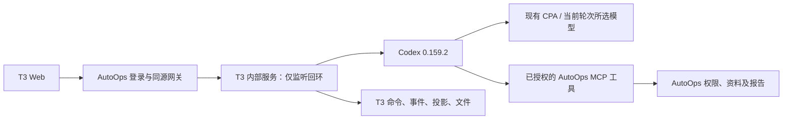

# T3 模块运行、迁移与恢复

实施基线：T3 Code v0.1.1 / `fe27e8e3dc12dcbb108e9a28fd9b8cb65f34ae92`。原 Demo 的 8787 入口已切换到本模块；当前发布证据见下一节，早期构建、数据迁移与恢复记录保留在历史章节。

## 当前发布：当前目录前缀筛选与共同前缀补全（t3-workspace-prefix-1）

2026-10-22，验收 18887 与正式 8787 已切换到 `releases/t3-workspace-prefix-1` 和 `releases/t3-workspace-prefix-1-static`。修复 `@d` 混入会话引用、`backend` 等路径中间匹配项的问题：固定版本工作区的输入候选只按当前目录的名称前缀筛选，输入第一个字符即更新查询。`@d`、`@do`、`@doc`、`@docs` 均只显示根层 `docs`；无需方向键，Tab 可补成 `@docs/` 并继续列出直系子项。

复用 T3 原生查询、菜单、输入替换、焦点与旧结果校验。仅输入区固定工作区查询在线路上添加 `./` 标记，原始查询仍用于范围和版本校验；等待时清掉旧候选，避免 Tab 使用旧查询。右侧跨目录关键词搜索、普通宿主和历史资料搜索保持原行为。Tab 区分默认视觉高亮与明确选择：唯一未截断匹配直接补全；多个未明确选择项只延长共同前缀，无法延长则保留菜单，例如 `@frontend/pack` 补至 `@frontend/package`，再次 Tab 不擅自引用首项。方向键或鼠标明确选择后按项补全，Enter/点击仍按原生方式引用。技能、斜杠命令、Shift+Tab 与代码块缩进继续沿用原流程。

Web 定向 142/142、资源适配 4/4、Web 类型检查、React Compiler 回归 2/2、实际输入组件编译及宿主网页/服务端构建通过。验收与正式 ZeroTier 隔离浏览器各 3/3 通过，覆盖内部、切换既有外部版本及 guest 的逐字 `@d` 筛选、唯一项 Tab、多级目录、共同前缀、歧义保留、方向键明确选择、文件 Tab、目录 Enter、Escape、Shift+Tab 和权限菜单。两份报告为 `.test-artifacts/workspace-prefix/stage-final/report.json` 与 `production-final/report.json`；页面错误、发送、模型输入、文件写入和工作区生成均为 0。首次验收脚本把视觉首项当成已明确选择，失败证据保留在 `stage-verified`；最终脚本实际发送方向键后才验证选中项。本轮未重复模型多轮、Windows 真机、实体手机或中文空格目录的浏览器联测。

增量归档 SHA-256 为 `e0dc5818646dbdf154069a2f08d1b2e61305e3098cd1c2d90d87ed2ca914c12b`，基础为保留的 `t3-workspace-tab-1`；完整发布清单为 `b4d294915094fa14b265e89fe92415e4e5b158f00ced2f7ba479b3f2114ef8cf`，原生依赖清单为 `ca910b4e392a6c9b811860e2dee02741e00ceb5c3361a0ceb51fd7c951e43b06`，3855 个文件、59 个相对链接以及原生 2038 个文件/21 个包校验通过。配对恢复点为 `backups/t3-workspace-prefix-1-stage-20261022T114307Z` 和 `backups/t3-workspace-prefix-1-production-20261022T114552Z`。原 146 条消息、51 个轮次及 188 个文件摘要一致；正式停写归档的 23 个会话、146 条消息和 51 个轮次与发布后逐条一致。一条会话元数据在较早摘要与停写归档之间变化，不将较早摘要写成全部一致；验收原两条暂停队列保持暂停。

网关与 worker 继续使用 `zzzzzzzz-workspace-chat.conf`。仅回退本轮时，空闲停写后同时恢复本轮恢复点内两服务保存的同名 drop-in，执行用户级 `daemon-reload` 并启动原 worker/网关，恢复 `t3-workspace-tab-1`；继续使用当前数据，不覆盖数据库或单独撤网页。

## 历史版本：工作区目录 Tab 补全（t3-workspace-tab-1）

2026-10-22，验收 18887 与正式 8787 已切换到 `releases/t3-workspace-tab-1` 和 `releases/t3-workspace-tab-1-static`。在 T3 原生 `@` 候选内，方向键选择目录后按无修饰 Tab，将输入补成 `@frontend/` 并继续展示直系子项；选择文件后 Tab 确认固定版本引用。Enter/点击仍可直接引用整个目录。技能、斜杠命令、Shift+Tab、代码块缩进和原生旧搜索结果校验保留。补全仅适用于当前工作区根下的目录，同范围附件与报告目录保持原引用行为。

沿用原生 `applyPromptReplacement`、焦点与菜单高亮，提示复用 `CommandFooter` 和 `Kbd`。含空格或引号目录采用现有 quoted mention 转义约定，以未闭合查询继续补全，确认引用时仍生成 canonical 标签。后端复用右侧目录列表的直系子项算法，在匹配和类型过滤后再截候选数量，不从已截断的递归结果推算下一层；普通关键词继续搜索所有层级。

Web 定向 125/125、shared trigger/inline token 64/64、资源适配 4/4、Web/shared 类型检查、React Compiler 回归及宿主网页/服务端构建通过。单元测试包含中文空格与引号、控制字符、跨项目/版本、超过 80 条子项及深层关键词查找。验收与正式 ZeroTier 隔离浏览器各 3/3 通过，覆盖内部三级目录、外部和 guest 的目录 Tab、文件 Tab、目录 Enter、方向键、Escape 与 Shift+Tab；页面错误、发送、模型输入、文件写入和工作区生成均为 0。报告为 `.test-artifacts/workspace-tab/stage-verified/report.json`、`production-verified/report.json`。首次脚本读取兼容层 `aria-selected`，未使用 T3 受控 `data-active` 高亮，失败记录保留；最终结果按真实受控高亮验证。中文空格目录的浏览器联测、Windows 真机、实体手机与本轮模型多轮未重复执行。

增量归档 SHA-256 为 `4b2dd63ec0c4de5bedad413778314ee20b93fc92d3e7ed2350778eb197912d2e`，基础为保留的 `t3-workspace-at-1`；完整发布清单为 `adea4c8e61fd5534e6c4d3fd8a7915558cb5fb3b58aba070a80cebc5dd038d89`，原生依赖清单为 `126a5d43b26704aec157317eff7c9adaae34633f3c370a4ac67d76e035b2e5a0`。成对恢复点为 `backups/t3-workspace-tab-1-stage-20261022T111148Z`、`backups/t3-workspace-tab-1-production-20261022T111421Z`，归档校验通过，原暂停队列保留。原 143 条消息、50 个轮次及 188 个文件摘要一致；正式配对归档的 23 个会话、143 条消息和 50 个轮次与发布后逐条一致。一条会话元数据在较早摘要与停写归档之间变化，不将较早摘要写成全部一致。

服务继续使用 `zzzzzzzz-workspace-chat.conf`。仅回退本轮时，空闲停写后同时恢复两服务在本轮恢复点中保存的同名 drop-in，执行用户级 `daemon-reload` 并启动原 worker/网关，恢复 `t3-workspace-at-1`；继续使用当前数据，不覆盖数据库。

## 历史版本：工作区文件 @ 选择（t3-workspace-at-1）

2026-10-22，验收 18887 与正式 8787 均已使用 `releases/t3-workspace-at-1`，网页为 `releases/t3-workspace-at-1-static`。修复只输入 `@` 显示无匹配的问题：复用 T3 `useProjectPathSearch` 现有 `allowEmptyQuery`，仅对业务资料目录开放空查询，普通宿主目录行为保持不变。工作区候选排除四级平台祖先，按项目相对路径匹配，返回引用仍含固定版本身份；同范围附件、报告及旧会话的资料行为保留。

定向文件查询测试 11/11、资源适配测试 3/3、Web 类型检查、宿主网页及服务端构建通过。独立验收与正式 ZeroTier 浏览器各 3/3 通过，覆盖内部默认范围、切换到既有外部版本及 guest 默认外部范围的裸 `@`、筛选、原生标签选择、固定版本身份和菜单权限。页面错误、消息发送、模型输入、文件写入及工作区生成均为 0。报告为 `.test-artifacts/workspace-mentions/stage-verified/report.json` 与 `production-final/report.json`；早期脚本在原生防抖尚未结束时点击旧候选、用 DOM fill 清理 Lexical 标签的失败证据保留，最终脚本等待结果并使用键盘删除流程。未重复模型多轮、窄屏及完整工作区生成验收，原记录见下一节。

增量归档 SHA-256 为 `54ac3c523153f5b0bef2bb3a25783cb7cd46585f3290af54c6465a219d18c8d3`，基础为保留的 `t3-workspace-chat-3`，不能独立解压运行。完整发布清单 SHA-256 为 `15048bf5dd400753137526917eca6cd1a42da8520336ef7d0d4d8e55ae737c5b`，原生依赖清单为 `c901676ddaea3afe30e8c34d4a124e8659ae82e11c7ee9cd5d113b0a41fbf3b2`。两套成对恢复点为 `backups/t3-workspace-at-1-stage-20261022T104957Z` 和 `backups/t3-workspace-at-1-production-20261022T105245Z`，归档校验通过；验收原两条队列继续暂停。正式成对归档中的 23 个会话、138 条消息、48 个轮次与切换后逐条摘要一致，原 188 个文件摘要一致。较早的运行中基线有一条会话元数据在停写归档前变化，归档与发布后该记录一致，不将较早基线写成全部一致。

网关与 worker 继续使用 `zzzzzzzz-workspace-chat.conf`。仅回退此次修复时，先空闲停写，同时恢复上述恢复点中两服务的同名 drop-in，执行用户级 `daemon-reload` 并启动旧 worker/网关，恢复 `t3-workspace-chat-3`；保留当前数据，不覆盖数据库或单独撤网页。

## 历史版本：T3 工作区与对话适配（t3-workspace-chat-3）

2026-10-22，独立验收 18887 和正式 8787 已切换到 `t3-workspace-chat-3`，开发分支为 `feat/project-agent-workspaces`，产品配置继续使用 `project-assistant-lite-v1`。正式地址为 `http://172.29.22.6:8787/agent-demo.html`，局域网地址为 `http://192.168.31.157:8787/agent-demo.html`。

### 工作区、会话与目录

项目只提供内部原始、外部脱敏两类 Agent 工作区，以及独立的部署包出口。内部版本保留 Git 身份与提交；外部版本从固定内部来源单向生成，移除 Git 元数据并执行凭据与项目规则替换。不能可靠检查的图片等文件先进入人工复核，全部明确保留或排除后才发布；失败、中断与取消不替换上一个可用版本。示例项目明确标识为示例，包含真实的小型前后端 Git 仓库及虚构敏感值，不能当作用户实际项目源码。

新对话从 T3 原生输入区的上下文栏选择项目工作区版本、业务环境、可见范围与助手，模型及思考强度仍使用原生菜单。资料范围变化时，已有文字、附件或预览的草稿另建干净草稿，原草稿留在侧栏；首条消息被服务端接受后固定会话绑定。提交结果不确定时保持确认状态，由服务端复核是否已接受，不因网络错误擅自解锁。离开、刷新和重新打开继续沿用 T3 的持久会话及执行状态，不用页面离开事件关闭 Agent 或重新发送已有消息。

管理页与对话文件面板共用 T3 的 `FileBrowserPanel`、`@pierre/trees`、路径导航和只读多格式预览。目录根直接展示 `frontend`、`backend`、`docs`、`prototypes` 等项目路径；资料引用仍保留项目、版本与相对路径组成的 canonical 身份。单击只打开预览；明确添加、拖拽或 `@` 选择才成为输入引用。窄屏沿用右侧抽屉及目录到文件的导航，不把聊天、文件树与正文硬塞成三列。Markdown、源码、图片及受限静态 HTML 的预览复用现有 T3 组件；HTML 响应与 iframe 保留沙盒约束，不能访问宿主会话或执行任意网络请求。

只读业务预览不挂载原生可编辑文件界面，不开放 Markdown 勾选写回、外部编辑器或宿主目录跳转。资源加载成功后才能显式添加引用。固定版本之外的资料链接在当前对话面板拒绝预览；缺少合法范围时显示真实错误，不退回宿主文件面板。旧已绑定内部对话的授权资料、附件和报告仍可只读预览，不自动获得新工作区版本或目录访问。

对话的目录、搜索、预览和 `@` 请求使用同一份当前 scope。scope 必须作为前端 CWD 计算的显式依赖，避免 React Compiler 缓存初始化前不含版本的 CWD；右侧旧面板保留的 CWD 不得覆盖新的会话范围。

### 权限与数据

成员授权区分工作区访问范围、项目角色与允许的业务环境。内部管理员管理来源、生成、复核和原始部署包；普通内部成员只读获授权版本，外部成员只看已发布外部版本。界面与服务端同时判断，权限覆盖 bootstrap、工作区 HTTP、原生资源 RPC、MCP 工具、会话引用及附件；不能仅通过隐藏按钮阻止读取。项目共享也必须与允许的工作区和环境受众一致。

工作区状态与不可变文件保存在 `DATA/project-workspaces/`，会话授权继续保存在 `DATA/t3-autoops.sqlite`，原生执行仍使用 `DATA/t3/userdata/statev2.sqlite` 与对应的原生 home。工作区导入、生成和打包由受控平台任务执行，任务状态持久化并支持幂等与取消；Agent 继续只读分析与交付报告，不获得通用 shell、源码写入或外部主机权限。外部版本未发布时的复核接口只对管理员开放，Agent 的资料索引与读取接口只接受可用的固定版本。

前后端 ZIP 直接从内部固定版本导出，排除 Git 与缓存，保留服务构建上下文、依赖声明与必要共享目录；清单记录来源和包 SHA-256，不注入平台凭据。生成或下载源码包只表示交付包就绪，不表示已在目标服务器解压、构建或部署成功；目标服务器部署、健康检查及回退须有独立任务与验收记录。

### 本次验证与切换记录

本轮定向验证覆盖项目/角色/环境/版本边界、首次接受后的锁定及失败恢复、空会话保持可编辑、排队输入范围指纹、外部 wire 路径元数据、跨版本预览拒绝、只读工具实际读取固定资料，以及 T3 目录/搜索/预览/输入联动。已有版本持久化、脱敏与二进制发布门槛定向测试继续通过；本轮没有重新执行所有 Git 导入及 ZIP 构建集成场景。

预发布与正式 ZeroTier 隔离浏览器各 7/7 通过：管理目录与搜索、源码只读预览、待复核图片与实际 HTML 正文、发布、对话侧栏预览及明确添加/`@`、切换范围保留旧草稿并新建干净草稿、真实 Grok 首次发送及选项锁定、深色 390px 与键盘导航、guest 仅外部已发布目录。页面运行错误均为 0，没有发起文件写入 RPC，测试专属会话均已删除。浏览器仍有既存兼容层的 `flushSync` 与未知焦点事件警告，不据此宣称控制台完全无警告。guest 验证宽度为 1440px，390px 覆盖目录与对话布局；Windows 真机、实体手机输入法和软键盘未测。

独立预发布的 API 验收 3/3 通过，使用现有 Grok 4.6 真实完成两轮问答，包含读取外部 `backend/.env.example`、首条消息锁定、第二轮固定资料范围，以及管理员可见的授权共享。外部账号无法读取内部目录、原始资料、原始包或未授权环境，外部投影不含宿主工作目录。早期重复 key、CWD 初始化及测试候选定位失败记录保留，最终报告如下，不用旧报告替代本轮结果。

| 发布证据 | 本轮记录 |
| --- | --- |
| 目标发布名 | `t3-workspace-chat-3` |
| 验收/正式程序目录与 `STATIC_DIR` | 两套均为 `/home/tao/autoops-agent-demo/releases/t3-workspace-chat-3` 与 `releases/t3-workspace-chat-3-static`；独立数据目录保持分离 |
| 发布包 SHA-256 | 增量归档 `596437d5a58e01e344eec39b4aeabb71a79ab4b582aa501c8dd56255ccf81406`，基础为保留的 `t3-workspaces-1`，不能独立解压运行 |
| 完整清单及原生依赖清单 SHA-256 | `77b2cc3b64f699347e0a3c9e7e564ca4fde4f4b6b4883b7b5a411d48792f369a`；`4b341a14205a4403b054e9d8efbb328c4ee539027e8386d44e82359e135d5b97`，3,855 文件、59 相对链接，原生 2,038 文件、21 包 |
| 独立验收成对恢复点 | `backups/t3-workspace-chat-3-stage-20261022T101656Z`，`paired-data.tgz` SHA-256 校验通过 |
| 正式成对恢复点 | `backups/t3-workspace-chat-3-production-20261022T101852Z`，`paired-data.tgz` SHA-256 校验通过 |
| 最终定向测试、类型检查与构建 | 宿主、Web、服务端类型检查，宿主网页与服务端构建，React Compiler、membership、范围、资源、工作区、reservation、wire/projection 定向测试通过；未重跑整个上游测试集 |
| 隔离浏览器与真实模型验收 | `.test-artifacts/workspace-scope/stage-verified/report.json`、`production-verified/report.json` 各 7/7；`stage-api-verified/report.json` 3/3、真实两轮；目录相对 `.test-artifacts/workspace-scope/` |
| 正式入口及存量会话/文件/队列核对 | health 为 T3 且 worker 可达；原 21 会话、133 消息、46 轮次逐条摘要一致；原 96 文件除追加工作区索引外字节一致，索引原 2 版本、1 包、2 任务全部保持，仅新增 1 个合成外部版本与 1 个任务；验收原两条队列继续暂停 |

切换前已按下文空闲停写流程保存数据库、工作区状态与文件、原生 home 及服务配置的成对恢复点，确认既有暂停队列不会被启动。先独立验收再更新正式入口，保留此前发布与旧哈希资源。原生与业务库仍使用既有数据目录；只在不可变发布目录将内容、权限与所有者均相同的文件硬链接去重，未删版本路径、备份或用户文件。

本轮网关与 worker 均由用户服务的 `zzzzzzzz-workspace-chat.conf` 选择版本。需要回退时，先在无活动执行的条件下停写，同时撤回对应网关与 worker 的这两个 drop-in、执行用户级 `daemon-reload` 并重启原 worker/网关。正式配置退回 `t3-workspaces-1` 及其旧静态覆盖；验收配置恢复到其成对恢复点保存的上一配置。继续使用当前数据，不能用旧库覆盖发布后的历史，也不能只撤网页而留下不匹配的 worker。下文其他撤销命令仅为历史恢复记录。

## 历史版本：项目助手精简版及其后续补丁

2026-10-22，正式 8787 与独立验收 18887 均已使用 `project-assistant-lite-v1`。能力范围和恢复约束见 [精简版能力边界](agent-demo-lite-profile.md)。保留 T3 核心问答流程及可用外观设置，收起外围入口；本轮不删除上游模块或裁剪运行依赖。

### 模型菜单滚动修复

该次发布时两个网关的网页资源为 `releases/t3-model-scroll-3-static`，通过各自的 `zzzzz-model-scroll.conf` 选择；当时的网关程序与 worker 使用 `releases/t3-models-3`。沿用 T3 的模型选择器与 LegendList，修复兼容层额外容器未传递高度、短窗口菜单裁切，以及搜索框阻止冒泡时键盘导航未执行的问题；内边距通过虚拟列表原生接口参与定位计算。仅更新网页资源并重启空闲网关，两个 worker PID 保持不变，未迁移会话数据。

独立验收与正式 ZeroTier 入口均 7/7 通过：真实滚轮到底并选择最后一项、Home/End 与 Enter、搜索/清空/空结果、浅深色、390px、480px 短窗口和浏览器模拟触屏滑动。页面错误与消息发送均为 0；测试只操作独立浏览器草稿，未操作用户当前标签页。报告在 `.test-artifacts/t3-model-scroll/stage-v3/report.json`、`production/report.json`；18 项模型选择单元测试、1 项定向兼容层浏览器回归、Web 类型检查与宿主前端构建通过。早期失败记录保留，浏览器模拟不等同于 Windows 或实体手机真机测试。

网页增量包 SHA-256 为 `db9fffe8e0723a20268e49d7345f8a04575b42ac0b47b843aa39f1ffe3ebeb7c`，基于保留的 `t3-models-3-static`；旧哈希资源继续可用。配置恢复点为 `backups/t3-model-scroll-3-stage-20261022T044526Z`、`backups/t3-model-scroll-3-production-20261022T044610Z`。仅回退本轮网页时，移出对应网关的 `zzzzz-model-scroll.conf`，执行用户级 `daemon-reload` 并重启网关，即恢复模型能力发布的网页资源；不停止 worker，不覆盖数据库。其他版本回退须先处理此层网页覆盖。

### 模型与思考强度

模型能力发布时，网关及 worker 使用 `/home/tao/autoops-agent-demo/releases/t3-models-3`，网页资源为 `releases/t3-models-3-static`，通过两个服务的 `zzzz-models.conf` 选择；该次后续网页资源覆盖见上文历史记录。产品配置与数据目录保持不变。独立验收成对恢复点为 `backups/t3-models-3-stage-20261022T035315Z`，正式恢复点为 `backups/t3-models-3-production-20261022T035641Z`。旧程序、静态资源与此前 drop-in 均保留。

该次模型目录来自当时 CPA 的 `/v1/models?client_version=0.159.2`，采用其 [官方能力目录协议](https://github.com/router-for-me/pi-cliproxyapi-provider#model-mapping)。当次接口返回 19 项，12 项对话/代码模型进入选择器，7 项图像/视频型号不进入问答流程。每个模型的思考档位、默认档位、输入类型与上下文容量取自该目录；不复制其系统指令或工具、权限设置。`DATA/t3/models-catalog.json` 只保存能力元数据，worker 启动时刷新，同一接口短暂不可达可用上次成功缓存；密钥继续在外部受控文件中。兼容字段 `bootstrap.fixedModel` 在启用目录选择后仅表示默认模型，发送链路不再覆盖用户选择。

复用 T3 的模型菜单、思考菜单、`/model`、快捷键、草稿与轮次配置。模型选择与运行器管理分别判断，仅展示当前 CPA 运行器；后端拒绝目录外模型和不属于所选模型的档位，原业务权限保持。真实 CPA 短请求全部获得完成响应；部分型号的返回模型为上游别名，例如 `grok-3-mini` 返回 `grok-4.3`，保留现有映射。Grok 4.6 的低档与极高档响应分别报告 `low`、`xhigh`；其余模型未据此声称每个档位的推理效果都已测量。两项 Grok 4.7 型号拒绝照抄测试口令，但正常返回了正文与完成事件，失败口令检查及复核内容分别保留在 `cpa-live-probes.json` 和 `cpa-live-probes-followup.json`。

本轮 Node 22 项与 Web 44 项定向测试通过，宿主/Web/服务端类型检查与相关构建通过。最终隔离浏览器 6/6 通过，包含菜单与 `/model`、草稿刷新、Grok 4.6 极高档、同一对话切至 Grok 3 Mini 高档后真实环境查询、非法选项提交前拦截、深色及 390px；页面错误为 0，专属测试会话已删除。原生记录逐轮核实了模型与强度，原有两条队列继续暂停。证据在 `.test-artifacts/t3-models/stage-ui-complete/report.json` 与 `native-stage-context-final.json`。最初测试的模型 ID 搜索假设、从目录直接回答数量未调用工具，以及切换期间提前访问得到 503 的记录分别保留，不覆盖最终报告。

正式 ZeroTier 入口同样 6/6 通过，报告为 `.test-artifacts/t3-models/production-ui/report.json`，页面错误为 0，专属私有测试对话已删除。正式原生记录确认同一线程先使用 `grok-4.6 / xhigh`，下一轮使用 `grok-3-mini / high`，并实际完成环境查询；参数核对见 `native-production-context.json`。发布前 20 个会话 ID、44 个轮次 ID 全部保留，129 条消息逐条摘要一致，见 `production-retained-check.json`。测试覆盖桌面 Chromium 与 390px 视口，不等同于 Windows 或实体手机真机验收。已校验并保留最新两份隔离模型成对恢复包及既有固定恢复点，仅清理重复上传包、增量临时目录和被覆盖的中间测试快照。

最终增量包 `t3-models-3.tgz` SHA-256 为 `ff2832e141f692d9671de590cbd476107dd29f42c19b35618192b858c53fc1a4`，依赖保留的 `t3-models-2`；完整发布清单为 `c57cf7139c6c8ee4a99e7adafb8d719ac1de97831eb31b7cf21cf5b7c0d15c8d`，原生依赖清单为 `e54aca1a6216c644af0fea638aa6b4042b7206ec4160fa4ae0d597c5719f53bc`。3,837 文件、59 相对链接，原生依赖仍与同版官方 2,038 文件、21 包逐字节一致。

代码回退须同时处理网关与 worker 的 `zzzz-models.conf`，保留当前成对数据和新能力缓存。若已有其他模型的原生历史推进，不应直接套用旧固定模型程序继续写入，应先在副本验证续接；不得用旧库覆盖新历史。下文技能、动效与精简配置的回退说明均须先处理本层配置。

### 技能适配恢复基线

技能适配发布时网关及 worker 使用 `releases/t3-skills-3`，网页资源为 `releases/t3-skills-3-static`。两个服务的 `zzz-skills-cleanup.conf` 同时固定程序、产品配置与原数据目录；保留此前 `z-lite.conf`、网关 `zz-motion-ui.conf` 和旧哈希资源。该次正式恢复点为 `backups/t3-skills-3-production-20261022T030317Z`，包含原服务配置、停写后的数据库与原生 home 成对归档及校验；独立验收恢复点为 `backups/t3-skills-3-stage-20261022T025211Z`。

最终增量包 `t3-skills-3.tgz` SHA-256 为 `d24ab5378ce04ec1211a54794be41740aba9ce8587da0daf54918670b543c2c3`，基于保留的 `t3-skills-2`，不能当作独立完整包解压运行。安装后完整发布清单 SHA-256 为 `e4df3383c38c71c06fa19448dd9a5c2dc2000fa4d870f473748853f11d3e1a29`，原生依赖清单为 `8272c3257c14adf79a4655476e588e1d4b906af867980b61c4cd0b0a2cd02eec`；3,835 文件、59 相对链接，原生依赖与官方同版的 2,038 文件、21 包逐字节一致。安装目录与旧发布目录分别校验，不覆盖旧程序。

技能使用 T3 原生 `$` 搜索、标签、说明预览与 Codex 技能输入，默认提供项目资料解读、环境健康检查和发布准备报告。常规页面支持管理员导入 `SKILL.md` 正文及启用/停用，所有项目成员可查看说明；不安装附带脚本、资源和依赖，不扩大项目或工具权限。新管理数据保存到 `DATA/t3/skills-library.json`；不存在时读取未改写的旧 `skills-registry.json`，两者都不存在时才使用默认技能。显式为空或自定义的旧目录不自动覆盖。

停用或导入后沿用原生项目工作区快照刷新技能目录，新调用在服务端再次校验可用性。修复了未创建草稿提前订阅详情造成真实回复未及时展示的问题；普通对话不展示空详情、无内容预览按钮或未适配的复制链接，只读历史不展示失效输入控件，实际历史关联与产物继续可读。字体预览改为当前业务场景，保留可用外观设置。

本轮定向 Node 14 项、Web 27 项、服务端 17 项测试通过，宿主/Web/服务端类型检查与两端构建通过；未重跑整个上游测试集。隔离服务浏览器 9/9 通过：真实自定义技能正文调用、停用与旧输入拦截、管理员/成员权限、报告生成/预览/下载、中文入口、深浅色及 390px。模型为现有 `grok-4.6`，页面错误为 0，专属测试会话已删除；报告为 `.test-artifacts/t3-lite/skills-stage-complete/report.json`。早期失败证据单独保留，不覆盖最终报告。

正式 ZeroTier 入口 5/5 通过：三项默认技能进入原生目录、登录与常规页面、真实 Grok 技能及回复、原只读历史、已有历史关联。真实轮次完成资料列表、资料读取和环境查询，具备原生线程身份；页面错误为 0，测试私有对话已删除。报告为 `.test-artifacts/t3-lite/skills-production/report.json`；另以 0 模型请求验证完整技能目录及管理操作在 390px 下无横向溢出，见同目录 `layout-report.json`。发布前的 19 个会话 ID、43 个轮次 ID 均保留，126 条消息逐条摘要一致，见 `skills-production-retained-check.json`。验收环境原两条队列保持暂停，仅移除本轮五个带唯一校验词的测试技能，原有自定义技能与三项业务技能保留。

只回退本轮时，在无活动执行和队列的条件下停写，移出网关与 worker 的 **两个** `zzz-skills-cleanup.conf`，执行用户级 `daemon-reload` 并启动原 worker/网关，保留 `z-lite.conf`、网关 `zz-motion-ui.conf` 与当前数据。旧程序读取未改写的旧技能目录，新技能库及切换后历史继续保全；不要用旧数据库覆盖。

### 此前精简与动效发布的恢复基线

此前程序为 `releases/t3-lite-2`。首次精简版发布归档 SHA-256：`500f17ec342acbab683ece5e063e54967ca8f1d4012082ad329288facbea7c9f`，发布清单 SHA-256：`e87fcdfb4b53d3ba1a463e96b7e00cb3646c6cc615ff11316c08c82515f18ba5`，原生依赖清单 SHA-256：`2616d06a18a0f4f0d06e76759f1e5bc15b9a147f905828e4f3eaa6632076fc10`。

此前网页资源为 `releases/t3-motion-ui-1-static`，通过两个网关各自的 `zz-motion-ui.conf` 选择；保留旧哈希资源，未覆盖 `t3-lite-static-2`。该次增加“外观 → 动画 → 界面动效”的跟随系统、开启、关闭三档选择，沿用浏览器原生偏好持久化，无服务端数据迁移。网页归档 SHA-256 为 `d869ab3a3d9c7ed4e27eb2f13ccd68614846b3d6df58853cd40849aed7153959`。当次仅重启网页网关，两个 worker PID 保持不变；配置恢复点为 `backups/t3-motion-ui-1-stage-20261022T002615Z`、`backups/t3-motion-ui-1-production-20261022T002841Z`。回退层级应先移出本轮两个 `zzz-skills-cleanup.conf`，再按需要撤销网关 `zz-motion-ui.conf`，不能在后者被新配置覆盖时声称已回退。

动效定向验收：174 项单元测试、宿主及 Web 类型检查、前端构建通过。验收及正式 ZeroTier 地址均完成六种系统/项目动效组合、刷新保存、系统偏好即时变化、搜索、深浅色及 390px 布局；真实模型轮次在系统要求减少动画时仍可独立开启，并在同一轮次关闭和重新开启，页面错误为 0，专属测试会话均已停止并删除。记录为 `.test-artifacts/t3-lite/motion-preference-stage-pass/report.json`、`motion-preference-production/report.json`。首次脚本在空会话编辑器初始化前填入文字导致发送未触发，其失败记录保留；动效验收改用真实原生命令启动轮次，不据此声称完成 Windows 真机输入验收。

正式切换前再次确认没有活动轮次或队列，先停网关并复核，再停 worker 保存数据库与原生 home 成对备份。恢复点为 `backups/t3-lite-production-20261021T165520Z`；包含原服务配置、成对数据归档与 SHA-256、切换前数据摘要、健康检查和切换后的配置。独立验收恢复点为 `backups/t3-lite-stage-20261021T163557Z`，原有两条暂停队列继续暂停。

上一轮精简验收证据，作为保留流程的回归基线：

| 范围 | 结果与记录 |
| --- | --- |
| 正式页面 | `test/t3-lite-ui.mjs` 8/8；常规两项可编辑、深链接/搜索过滤、外观实际应用及刷新、本地主题导入/导出/复制、归档、许可、390px；页面错误与模型请求均为 0。`.test-artifacts/t3-lite/ui-production/report.json` |
| 真实问答体验 | `test/t3-lite-chat-ui.mjs` 7/7；段落输出、排队编辑取消、同轮引导、真实 wheel 上读锚点、回到底部、停止并等待原生收尾、草稿切换/刷新；专属私有会话已删除。`.test-artifacts/t3-lite/chat-stage-final-pass/report.json` |
| 业务与策略 | 真实资料/快照、Markdown 报告及私有下载、多轮、基础整理通过；12 类合法形状的禁用操作在执行前被产品策略拒绝，未新增历史。`.test-artifacts/t3-lite/live.json` |
| 正式运行器 | 当次配置真实执行资料列表、读取资料和环境查询，原生身份有效；新建私有测试会话已删除。`.test-artifacts/t3-lite/production-smoke.json` |
| 存量数据 | 正式原 9 个会话的内容摘要一致，3 个旧文件字节与 SHA-256 一致；验收原 53 个历史含 2 个计划、2 个子任务、11 条 HTML 工具记录均保持。`*-retained-check.json` 与 `production-files-after.json` |
| 偏好与原生配置 | 原始偏好 full→lite→full 恢复、失败持久化重试、后台恢复门禁与产品 RPC 的定向测试通过；真实 Codex full/lite 配置元数据读取、相关类型检查与构建通过。定向日志在 `.test-artifacts/t3-lite/validation/` |

首次脚本对项目弹窗时序、队列取消、引导意图字段和富文本换行的错误假设已按原生实现修正，失败报告保留；最终完整流程报告以上述通过路径为准。独立 `draft-stage/report.json` 还用 0 模型轮次验证了多行草稿。测试是桌面 Chromium 与 390px 视口，未将其写成实体手机输入法/软键盘验收，也未重复全部上游测试或此前 100 轮压力测试。

需要回退整个精简版本时，先按空闲切换流程停写，移出本轮两个 `zzz-skills-cleanup.conf`、网关的 `zz-motion-ui.conf` 及两个服务的 `z-lite.conf`，执行用户级 `daemon-reload` 并启动原 worker/网关，即恢复原 stage10 程序及原中文静态配置，继续使用当前数据；不把旧数据库覆盖回来。不应只撤网关配置而保留 lite worker。恢复完整产品能力也应同时修改两个服务的产品配置，在独立环境验证后重启 worker，详见能力边界文档。

## 历史网页发布：T3 风格与简体中文

开发分支为 `feat/t3-ui-standard-zh-cn`，后续 UI 规范与可复用提示词见 [T3 UI 统一规范](t3-ui-standard.md)，仓库 `AGENTS.md` 已设为必读。该次开放的对话、设置、导航、菜单与提示采用简体中文，品牌、模型名、代码、许可证原文及用户内容保留原文；未开放的桌面、云端管理与提供方面板没有作为本轮中文化验收范围。

正式网关的 `STATIC_DIR` 通过用户服务 drop-in `autoops-agent-demo.service.d/t3-ui.conf` 指向 `/home/tao/autoops-agent-demo/releases/t3-ui-zh-1`。原网关与 core 程序仍来自 `t3-stage-10`，数据目录仍为 `t3-production-data`；本次只重启网页网关，worker PID 核对不变。新静态目录同时保留旧哈希资源，避免已有浏览器的懒加载请求失效；不改原 stage10 发布包。

最终网页归档 `releases/t3-ui-zh-final.tgz` SHA-256 为 `9154309a99fe8e4db3aecfabc47d68a4af02b83c4dc491c28d469eaefe7227cd`。配置前后副本、worker PID、网页全文件 SHA-256 清单及原发布包只读验证结果位于 `backups/t3-ui-zh-units-20261021`。

已撤销 Agent 入口的 Solid Glass 全局覆盖，登录与加载页也使用 T3 控件和 token。原生 Base UI 的既有 Radix 兼容实现仍保留，不宣称本轮已全部换回 Base UI。外观页的终端字体预览按现有 workspace 能力开关显示，避免未开放功能触发 WebAssembly CSP 错误；保留原 CSP 和可用代码预览。

本地相关定向测试 581 项通过，宿主与 T3 Web 类型检查、构建通过；正式入口 `test/t3-ui-chinese.mjs` 7/7 通过，覆盖英文浏览器环境下的中文、设置搜索、选项及焦点、浅深色、快捷键、归档、许可证和 390px 视口。报告为 `.test-artifacts/t3-ui-zh/production-final/report.json`，页面错误与模型请求均为 0；这不是重新执行全部模型流程或实体手机软键盘验收。

需要仅回退网页时，将 `t3-ui.conf` 移出 `.conf` 后缀，再执行用户级 `daemon-reload` 与网关重启，即恢复主 unit 的 stage10 静态目录；不停止 worker、不改对话数据库。下文的完整数据迁移与恢复流程仍适用于后端和数据回退。

## 运行边界



- `agent-demo/server.mjs` 在 `AGENT_DEMO_ENGINE=t3` 时提供登录及透明 HTTP/WebSocket 转发；旧发送、队列、SSE、历史读取链路返回 410。旧文件链接按迁移映射转向新授权端点。
- `scripts/start-t3-worker.mjs` 启动原生 T3 core，使用宿主约束的模型目录、轮次模型选择和命名权限配置；不启动旧 bridge。仅网关对用户网络监听。
- `DATA/t3/userdata/statev2.sqlite` 是对话事实来源。`DATA/t3-autoops.sqlite` 保存项目、环境、会话和附件授权及旧 ID 映射；`DATA/t3-business.sqlite` 保存实际业务产物。`DATA/t3/codex-home` 保存原生状态。
- CPA Key 沿用外置权限为 0600 的专用文件，启动时只注入子进程，不写入设置、仓库或构建包。登录会话不从迁移包继承。
- 原生工具调用采用当前会话授权的唯一 `t3-code` MCP server。未知 server、宿主路径、shell、任意网络和任意写入均不开放。内置子任务仍受固定模型、父会话项目/环境、只读工具和只读子视图约束。

## 构建与发布

项目根运行前端构建；`vendor/t3code/apps/server` 运行上游 `vp pack`。使用仓库现有锁文件和已安装依赖，不在 VM 上复制整个开发用 `node_modules`。

```sh
node scripts/package-t3-release.mjs .deployment/t3-release-<唯一版本>
```

脚本生成全文件 SHA-256 和相对依赖链接清单，拒绝覆盖现有目录。Linux x64 的服务端外部原生依赖来自同一官方 T3 0.1.1 发布包；Office/PDF 动态依赖按锁定的 pnpm 闭包打入。字体来源、哈希和 OFL 许可见 `agent-demo/t3-adapters/business-documents.sources.json`。

附加 Linux 依赖后运行 `node scripts/verify-t3-release.mjs RELEASE --native-source OFFICIAL/node_modules`，逐文件和相对链接对比同版官方目录，首次成功以独占创建写入 `native-dependencies-manifest.json`。后续不带该选项只读验证，拒绝清单外文件、缺失、篡改或重新登记变化。macOS 打 tar 使用 `COPYFILE_DISABLE=1`，避免混入未列清单的 AppleDouble 文件。

测试 VM 的现有用户级服务：

| 用途 | 网关 / core | 数据 |
| --- | --- | --- |
| 当前用户 Demo | 8787 / 8788（T3 core 仅回环） | `t3-production-data` |
| 原代码及成对数据，停止保留 | 旧 bridge 8791 已停用 | `app`、`data` 及固定恢复点 |
| 新模块真实模型验收 | 18887 / 18888 | `t3-staging-data` |
| 真实旧库迁移副本 | 18987 / 18988 | `t3-preflight-imported-data` |
| 官方 T3 独立对照 | 8795 | `t3-code-comparison` 独立目录 |

所有目录位于 `/home/tao/autoops-agent-demo`，官方对照位于 `/home/tao/t3-code-comparison`。原 Demo 正式切换后不得重新启动其 bridge；新 core 不允许和旧 bridge 同时操作同一原生 home。

## 旧数据导入

先完成或明确停止活动轮次，暂停队列，再停止旧网关和 bridge。下面的 `--quiesced` 表示协调者已经完成停写，不会替调用方停止服务。

```sh
node scripts/t3-migrate-data.mjs snapshot DATA/demo.sqlite BACKUP \
  --native-dir DATA/runner --quiesced
node scripts/t3-migrate-data.mjs verify BACKUP
node vendor/t3code/apps/server/dist/autoops/legacyImportCli.mjs \
  --snapshot BACKUP --target NEW_DATA --model grok-4.6
```

目标必须是新的空目录。导入使用原生 T3 Schema、EventSink、命令回执和投影，不启动 provider/outbox，不通过伪造原生 rollout 导入。完整 runner 恢复包中的 `codex-home` 子树由真实 `session_meta` 证明识别，不能把 runner 注册表当作 CODEX_HOME。

导入后核对会话、正文顺序、文件字节/哈希、权限、队列 hold、草稿、个人偏好、父子关系及原生身份。只有原生会话 ID、历史头和应用修订证据全部匹配的会话可续接；其他会话保留只读历史及清楚原因。旧注册动态工具只对白名单且已验证原生绑定的线程转接到真实 MCP，不把工具调用伪装为成功。

迁移预演记录：9 个会话、3 个文件、7 行草稿和 6 行偏好；7 行草稿中仅 1 行有实际内容，空草稿不生成空 Stash。1 个会话有续接证明，8 个保留只读。预演与模型续接的结果分别记录，不能仅凭这组计数判定验收完成。

## 切换与回退

正式切换前重新停写并生成**最新**恢复包，不能将预演后的旧数据增量丢弃。停旧服务 → 导入新目录 → 核对 → 配置新网关/core → 检查后开放。原代码、数据库和原生 home 保留在迁移前恢复点。

回退分两种情况：

1. 新系统尚未写入任何数据，也未推进原生历史：停止新写入，验证备份和原生头后恢复旧代码及成对数据。
2. 新系统已有消息、文件、队列操作或原生线程推进：先停写，将**完整新 DATA 与对应原生 home 成对保存并校验**，记录新命令/事件水位和 ID 映射。不得直接用旧 SQLite 覆盖新数据，也不得让旧 bridge 操作已推进的原生 home。未验证无损反向映射前，保留新系统只读与全部增量；这属于数据保全，不宣称旧系统已可无损继续。

D07 历史编辑先冻结、保存原生 fork 和应用水位，再执行真实回退；结果未知或失败时继续冻结。不得自动解冻或在相对边界上盲目重试。由管理员核对实际原生头、应用水位及恢复副本后恢复，不能只修页面投影。

常规保留最近两份滚动恢复包，另固定保留本次迁移前恢复点至验收及回退窗口结束。清理时核验依赖，不删除唯一原生状态或仍被历史/分支引用的文件。

## 存储与排障

```sh
node scripts/t3-storage-audit.mjs DATA - first.json
node scripts/t3-storage-audit.mjs DATA first.json second.json
```

审计仅输出行数、字节分类和增长，不输出消息/附件/凭据内容，不删除数据。2 GiB 是当前测试机 DATA 的预警预算；达到阈值须定位分类并扩容或执行经过依赖核查的归档，不能清空事件表。

- 使用原生 `ProjectionMaintenance` 合并有安全边界的重复更新，不以年龄清除对话事实；首/末状态、原生边界和历史引用继续保留。
- 上游 provider 诊断日志总量上限 512 MiB、保留 14 天；trace 默认每段 10 MiB、10 个轮换文件。它们与命令/事件库分开。
- 原生 pending 上传清理沿用上游：24 小时未认领上传、1 小时 `.part`，由签名上传生命周期触发；已经认领的文件不能按 pending 规则删除。
- 原生 rollout、应用事件、报告和已认领文件随保留历史增长，不能承诺总存储永久固定。用实际轮次和字节报告预测容量，不以删掉测试历史证明有界。
- 断网先恢复原生 RPC/快照，不重发模型请求。进程重启后核对原生终态，旧请求失效，队列 hold；连接恢复与继续执行是两个动作。

## 交接记录

2026-10-21 正式切换到 `/home/tao/autoops-agent-demo/releases/t3-stage-10`，服务为 `autoops-agent-demo.service` 与 `autoops-t3-worker.service`。新 core 仅监听 `127.0.0.1:8788`；旧 `autoops-agent-demo-bridge.service` 已 disable/inactive。登录沿用演示账号，旧登录 session 不继承，需重新登录。

- LAN：`http://192.168.31.157:8787/agent-demo.html`；ZeroTier：`http://172.29.22.6:8787/agent-demo.html`。两入口 health 均为 `engine=t3`、`workerReachable=true`。
- 最终发布校验：3,834 文件、59 相对链接；Linux 外部依赖与官方同版目录的 2,038 文件、21 包逐字节一致。release manifest SHA-256 为 `7b9dc97207f225460a5d00257c13cc9dd802be6caecbdaaf7b457e42408f430a`，native manifest 为 `7e02ba974da14631c769a2650eac9048282e2bff7423895f8b5a9382b9454104`。
- 迁移来源固定为 `backups/t3-final-baseline-20261021`，水位 76110。9 个会话、3 个文件、7 行草稿、6 行偏好完整对账；仅 1 份草稿有正文，原生 Stash 不生成其余空项。1 个会话具备原生续接证明，8 个保留只读原因；不是 9 个都可继续。
- 原用户域与预演前逐行 hash/修订一致；仅额外 3 条 `cid=null` 的 runtime.updated 记录。最终快照保留这 3 条记录，并采用与用户历史匹配的原生成对基线。测试推进过的原生头另行配对留存，未混入用户旧历史。
- 独立离线核对写在新 DATA 的 `final-cutover-verification.json`，状态 passed；原生索引指向当前新 HOME，启动前检查无跨目录引用。原代码、数据库、原生头及保护性恢复包均保留；旧 unit 另存在 `backups/t3-final-units-20261021`，不向已验快照目录添加文件。
- 正式切换过程及依赖证明：`.test-artifacts/t3-final/production-cutover.log`、`production-release-verify.log`。运行后验证另记 `production-smoke.json` 与覆盖表的正式入口只读报告，不能仅用 health 当作完整验收。

切换后新建的私有验证会话已真实完成 `list_project_materials`、`read_project_document`、`query_environment`，具备真实 native ID，并明确回答演示数据来源；随后仅删除该测试会话。原有活跃列表数量 5 → 5（另 4 份历史仍归档），旧执行/SSE 路由返回 410，未续写原用户会话。证据 `.test-artifacts/t3-final/production-smoke.json`。正式 DATA 初次审计约 39.0 MiB，低于 2 GiB 预警；该数字不包含独立的测试数据及发布包，不代表长期存储固定。

正式入口只读核验另见 `.test-artifacts/t3-live/production-readonly-release10-summary.json`：9 份原历史及绑定、3 文件逐字节、1 有效 Stash 刷新、4 份归档列表、真实代码块高亮和 390px 布局均通过；消息/run/providerTurn 数量保持，只有个人 visit，不发模型。原生归档列表提供恢复/删除，直接打开归档 URL 会回草稿；这是上游归档流程，不能为测试把用户归档取消。最初把该行为与普通路由混同的失败及对应纠正证据均保留。

真实 CPA/Grok 长测累计 100 轮（其中单会话 60 轮）；另有 1000 轮无模型的合成历史浏览器验证。最终 30 次 Queue 提交以单调时钟测量，本地反馈 p95 13.7ms、WebSocket 发送至持久接受回执 p95 74.971ms；不把队列取消计为完成的模型轮次。进程崩溃恢复、问题失效、引导、停止、分支/回退、计划和文件的具体证据见覆盖表。

实体手机目前 disconnected，真机软键盘项尚未执行；CPA 未给可信额度重置时间，业务 Secret/MCP App 尚无对应注册数据源。上述范围不填真实通过。放宽 WASM CSP 的方案被自动审批拒绝，最终采用 Shiki 官方 JavaScript 引擎，保留现有页面策略；PDF 原生预览沿受授权的同源资源处理。

逐项状态与来源见 [完整模块覆盖表](agent-demo-t3-module-coverage.md)，模型原始证据在 `.test-artifacts/t3-live/`，1000 轮合成历史证据在 `.test-artifacts/t3-history-1000-20261021-v2/`。失败记录保留，修复后另记复测，不以删除失败文件替代验收。
