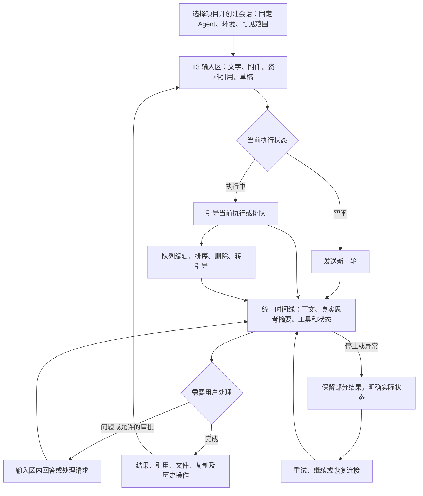
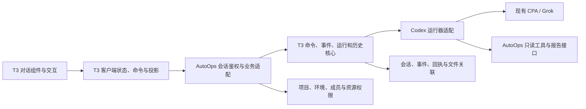

# Agent 对话模块完整迁移 T3 Code 方案

状态：**用户已批准，代码已迁入并部署原 Demo；逐项验收及真机待验边界见[覆盖表](agent-demo-t3-module-coverage.md)**。编写日期：2026-10-21。

本方案把 T3 Code 定为 AutoOps Agent 对话的统一交互来源。迁移对象是从输入到历史恢复的完整对话模块，以及支撑这些交互的客户端状态、服务端命令、事件和运行器接口。完成标准是完整流程与 T3 对齐，不能以增加几个按钮、复制局部样式或迁入几个算法作为完成依据。

用户已批准按本方案完整迁移。实现、数据迁移和真实验收均以本方案为范围；全部适用模块及验收通过后才标记完成，切换前保存现有 Demo、用户数据和原生状态的恢复包。

## 1. 方案结论与边界

建议采用“**迁入 T3 的完整对话模块，AutoOps 通过业务接口接入**”的路线。输入区、执行控制、过程时间线、结果、历史操作及异常反馈使用同一套 T3 流程；项目、环境、成员权限、资料和报告继续由 AutoOps 提供。旧 Demo 的交互实现可以替换，不要求兼容其内部代码结构；用户会话、附件、报告及访问权限必须迁移和保留。

固定迁移源为 [T3 Code v0.1.1，提交 `fe27e8e3dc12dcbb108e9a28fd9b8cb65f34ae92`](https://github.com/pingdotgg/t3code/tree/fe27e8e3dc12dcbb108e9a28fd9b8cb65f34ae92)，与已经安装对照的版本一致。实施期间不混入其他提交或其他开源项目的交互。需要升级 T3 时，先列出上游行为变化，再更新基线。

这里的“完整”包含以下要求：

1. 一个模块的界面、状态、命令、回执、持久化、失败处理和恢复一起迁移，不能只移植界面。
2. 上游对话功能逐项登记。除本方案明确列出的业务差异外，全部进入迁移和验收范围；不能在开发时自行降级为“后续再做”。能力过滤只允许反映运行器/业务权限的真实差异，不能通过隐藏未完成的控件缩减交付。
3. 同一个行为只保留一套实现。新模块接管后，退出旧的输入分派、活动聚合、Markdown、滚动、队列和消息操作链路。
4. 每个差异注明原因、替代接口、用户可见变化和验收方式。涉及范围变更的决定需要补充审查，不能以“暂不支持”掩盖未迁完。
5. 最终交付包括可以实际运行的完整模块、来源清单、协议、数据迁移脚本和对照证据，为以后自研工作台保留可复用能力。

T3 的 Git 工作区、终端和多提供方管理属于其代码开发产品范围，与完整对话范围分开登记，见第 4 节。它们不因复制聊天组件自动成为 AutoOps 第一轮需求。

## 2. 完成后的用户流程

过程区不再自行添加“读取资料完成”“报告交付完成”等重复的助手气泡。模型正文、公开的 reasoning 摘要、真实工具事件各自进入 T3 对应记录；工具结果按上游规则收束、展开。没有对应事件就不模拟过程，没有可用能力就不显示可点击的假入口。

## 3. 完整模块清单

下列编号也是交付和验收编号。来源编号对应文末固定版本源码索引。“业务适配”仍属于本次完整迁移，只有第 4 节明确登记的产品能力例外可以不启用。

### 3.1 输入与上下文

| 编号 | 整体迁入内容 | AutoOps 目标行为与适配 | T3 来源 |
| --- | --- | --- | --- |
| I01 | 输入区容器、展开/收起、富文本/纯文本编辑、光标与选区、占位、长度校验 | 迁入 Tiptap 编辑器及序列化逻辑，不用普通 textarea 模仿。保留格式、列表、代码块、中文输入法、粘贴、撤销、快捷键及提交中保护。 | S01、S02 |
| I02 | 图片和文件上传、粘贴、拖放、预览、移除、失败重试、大段粘贴转文本附件 | 使用 AutoOps 授权附件 ID；上传中、失败、过期和已发送状态完整对应，不能文字发出而附件悄悄丢失。视频等预览和文件夹能力按上游/运行器实际能力过滤；能预览不代表模型能理解。 | S01、S03 |
| I03 | `@` 引用搜索、文件/文件夹标签、上下文记录及删除 | 文件来源映射项目资料、环境资料、会话附件和产物；按权限搜索和预览。文件夹引用要保留范围身份，不能只塞一段文件名。 | S01、S03 |
| I04 | 会话引用、回答选文引用、引用评论、跳回原文 | 保留 T3 的选择、添加评论、编辑、移除和发送语义；引用其他会话时既检查发起者读权，也检查目标会话受众是否获授权，不能把私有资料借引用传入共享会话。 | S01、S10 |
| I05 | `/` 命令菜单、技能选择、菜单搜索与键盘导航 | 沿用上游入口及能力过滤；接管理员开放的命令/技能目录。没有注册项时不伪造技能；不把任意服务器命令混入菜单。 | S01、S02 |
| I06 | 模型、推理选项、运行模式及 Plan/Build 控件 | 保留完整控制结构和能力判断；当前固定 Agent 的可选模型/参数由管理员限定，默认沿用现有 CPA/Grok 配置。权限与计划模式的适配见 D03、D04。 | S01、S04 |
| I07 | 每会话草稿、输入历史、草稿暂存与恢复、上下文共同保存 | 草稿按用户隔离。Stash 暂存保留可保存的文字、附件和引用，并明确容量/过期/失败。上下键 Prompt history 按上游只召回文本，剥离无支撑记录的引用标签；两者不能混称为完整恢复历史附件。 | S01、S05 |
| I08 | 提交策略、快捷键、焦点恢复、移动端输入与工具栏 | 对齐 T3 Web 的发送及修饰键切换、移动端折叠/展开。共享会话切换、请求弹出和队列编辑不能覆盖正在输入的新草稿。 | S01、S06 |
| I09 | 上下文用量、模型参数、手动压缩、恢复后发送前的压缩选择 | 迁入 ContextWindowMeter 与 `/compact`、保留历史/先压缩的真实流程。只显示可靠的 token/容量/成本，压缩须调用运行器实际能力；服务端未提供的数据不估造。 | S01、S06、S20 |

### 3.2 发送、引导、队列与执行控制

| 编号 | 整体迁入内容 | AutoOps 目标行为与适配 | T3 来源 |
| --- | --- | --- | --- |
| E01 | 空闲发送、提交反馈、乐观消息、服务端确认与失败还原 | 使用同一个 commandId 去重；提交失败保留原输入，确认旧提交不能清空随后输入的新内容。 | S06、S15 |
| E02 | 执行中选择 Queue / Steer、快捷切换、能力和阶段判断 | 引导绑定当前 run/native turn。默认建议与已安装 T3 一致使用 Queue，用户可显式选择引导；压缩或无有效原生轮次时按上游规则禁用引导。 | S06、S07 |
| E03 | 队列列表、编辑、附件编辑、删除、拖柄排序和提交保护 | 迁入完整 QueuedRunsControl 与编辑状态。保留键盘可操作入口；其他成员修改或队列项已开始时给出真实冲突反馈，未提交编辑按 D12 留存。 | S07、S15 |
| E04 | 已排队消息转为当前执行的引导 | 服务端原子命令携带 queuedRunId、targetRunId 和预期原生轮次。成功确认后消耗队列项；不得“先删除再发送”，不得误投下一轮。 | S07、S15、S17 |
| E05 | 停止、停止中、真实终态、队列暂停和恢复 | 按运行器实际终态结束动效；保留部分输出。停止后不偷偷启动排队项。恢复执行与恢复网络连接是两个不同操作。 | S06、S17、S19 |
| E06 | 继续、失败后的恢复入口、提供方不可用/额度反馈 | 采用上游阶段与可恢复性判断；保留错误原因、原输入和部分结果。继续是后续运行，不能承诺回到模型中断前的内部执行位置。 | S06、S14、S19 |
| E07 | 后台发送、发送后进入新会话 | 迁入草稿页 background send 和已有会话 send-and-new-thread 的区别、反馈和跳转条件；后台提交失败保留可恢复的原草稿，不把消息错发到刚打开的会话。 | S02、S21 |

### 3.3 过程时间线与结果

| 编号 | 整体迁入内容 | AutoOps 目标行为与适配 | T3 来源 |
| --- | --- | --- | --- |
| T01 | 统一的用户消息、助手正文、实时工作项、工作组、生命周期、轮次/替代尝试折叠 | 使用 T3 的投影和时间线结构，代替当前多个独立组件猜测阶段。相同事件序列应得到相同分组、排序、折叠和终态；被中断或替代的片段不能显示成另一条完整成功回复。 | S08、S15 |
| T02 | 思考轨迹、活动摘要、工具标题/图标/状态、展开详情 | 只显示运行器实际提供的公开摘要及工具数据；不编写“思考过程”。读取项目资料显示实际资料和结果，禁止无依据的进度假象。 | S08、S09、S17 |
| T03 | Markdown 全管线、代码高亮、表格复制、数学、Mermaid、链接/图片、流式与最终正文 | 本次完整迁入 T3 ChatMarkdown 和增量解析依赖，替换旧独立渲染管线。授权文件链接通过适配器打开；不能混用两套解析器导致流式与刷新不一致。 | S09 |
| T04 | 流式展示策略、正在工作状态、耗时、完成及失败反馈 | 迁入上游设置和呈现方式。默认建议使用已实测的“完成段落后展示”；执行状态由事件驱动，不能用额外逐字动画假装模型速度。 | S08、S14 |
| T05 | 虚拟列表、自动跟随、新轮定位、自由阅读、回到底部、折叠锚定 | 整体迁入 LegendList 与滚动锚点逻辑。保存行 ID 和行内偏移，切会话和加载历史不抢滚动；不保留旧的第二套 scroll hook。 | S08、S09 |
| T06 | 历史分页、跳转到引用、会话内查找和定位 | 客户端虚拟化与服务端分页同时落地。查找不能只搜索已渲染 DOM；需能够加载目标历史并定位，不把未加载记录误判为不存在。 | S10、S18 |
| T07 | 工具结果中的文件、来源、代码/输出详情与错误 | 沿用 T3 的工具展示规则；项目资料走授权预览，报告走真实产物入口。保留文件原始类型和工具结果语义，不伪装成本机路径写文件。 | S08、S17 |
| T08 | 计划卡片、展开/复制/下载/保存、步骤列表、任务进度和压缩记录 | 完整迁入已有显示与交互；保存工作区映射为保存授权项目资料，文案同步更正。只在运行器提供对应数据时出现，任务列表不是新增工作流编辑器。 | S04、S14 |
| T09 | 提供方子任务/子 Agent 状态、父子导航、工作流阶段/结果展开及整体停止 | 完整迁入上游模块；原生子 Agent 视图遵循其只读限制，已启用的内置工作流保留 Stop entire workflow 和真实终态。后代任务同样受项目授权；不因此增加外部 Agent 注册或工作流设计产品。 | S13 |
| T10 | HTML 渲染与 MCP App 富工具结果、宿主交互及失败反馈 | 纳入完整模块迁移，连同上游宿主协议接入授权工具。必须验证来源、隔离和动作权限，不能只挂 iframe；没有对应工具事件时不显示。服务端授权链仍需 P0 专项核查。 | S08 |

### 3.4 提问、审批和待处理请求

| 编号 | 整体迁入内容 | AutoOps 目标行为与适配 | T3 来源 |
| --- | --- | --- | --- |
| R01 | 输入区问题组、问题进度、选项说明、键盘选择、上一题/下一题 | 保留完整 requestId/questionId、选项和能力，不再把原生问题组拆成丢失描述的字符串问答。支持上游允许的自填及附件回答。 | S11、S16 |
| R02 | 回答草稿、提交状态、关闭异步问题、失效、多人抢答冲突 | 一组答案一次提交；只接受第一个有效响应。Dismiss 表示不回答地关闭允许关闭的异步问题，不等同停止运行或提交答案。重连恢复可恢复请求，绑定已退出进程的旧请求显示失效。 | S11、S19 |
| R03 | 审批类别、详情、允许/拒绝等动作、操作中和失效状态 | 整套迁入请求处理 UI 和生命周期；可操作范围由服务端策略决定。第一轮仍是只读业务工具，不启用任意 shell/文件写入或全权限切换。 | S12、S17 |
| R04 | 凭据请求和敏感回答处理 | 迁入上游请求组件；能力启用需有专用安全提交接口。密钥不进入普通消息、共享历史、复制、日志或导出；不支持时不显示入口。 | S12 |

### 3.5 消息操作与会话管理

| 编号 | 整体迁入内容 | AutoOps 目标行为与适配 | T3 来源 |
| --- | --- | --- | --- |
| H01 | 消息操作栏、文字复制、提示定位链接、选文后续提问、动作显隐和焦点 | 对齐 T3 操作位置与触发条件，移动端也可发现。定位链接遵守接收者权限，不是公开分享。删除当前自定义的重复分支入口和重复完成气泡。 | S08、S10 |
| H02 | 从指定边界分支、父子关系、返回来源 | 使用原生 thread/fork 及准确的 run/turn 边界，附件和引用身份随分支保留。继承原会话授权约束；新分支默认私有，需显式共享。 | S10、S13、S17 |
| H03 | 用户消息的 Edit from here（从这里编辑） | 按 T3 含义回到该输入边界，并处理后续历史；不再把同名操作悄悄实现为复制整段聊天。共享会话的影响确认、修订冲突和留存规则见 D07。 | S08、S10、S17 |
| H04 | 失败重试、继续与历史编辑的区别 | 跟随上游实际可恢复状态和边界；不新增每条答案都有的“重新生成”按钮。现有 Demo 的重试路径若与上游不同，要移除或明确映射，不能继续用拼接 transcript 冒充原生恢复。 | S06、S10、S17 |
| H05 | 新建、切换、重命名、生成标题、归档/恢复、删除、未读状态 | 保留完整菜单与运行中限制，支持删除失败重试和确认。列表只显示有权限的会话，后台标题请求与主对话状态/用量分开。 | S10、S13 |
| H06 | 置顶/排序、完成/恢复活跃、自动完成策略、暂时隐藏/唤回 | 迁入 T3 已有会话整理功能，中文命名清楚；完成不代表业务发布成功，暂时隐藏不停止后台执行。个人整理状态与共享会话执行状态分开存储。 | S13 |
| H07 | 项目过滤、会话标识复制、来源信息及上下文详情 | 项目指 AutoOps 项目；环境始终显示真实业务环境。不存在 Git 工作区时不显示复制路径/分支或打开 IDE 的空壳按钮。 | S10、S13 |

### 3.6 可靠性、设置及终端适配

| 编号 | 整体迁入内容 | AutoOps 目标行为与适配 | T3 来源 |
| --- | --- | --- | --- |
| X01 | 连接状态、重连、事件去重、有界重放、快照校准 | 采用 T3 的命令/事件/投影链路；断网与模型失败分开显示，重连不自动重复提交或新开轮次。 | S15、S18 |
| X02 | 进程重启后的运行、队列和请求恢复 | 旧进程上的请求失效；队列保持暂停并给出原因；实际中断的轮次不能仍显示运行中。恢复策略见第 6 节。 | S19 |
| X03 | 桌面/移动布局、快捷键、焦点、无障碍和触屏动作 | 迁入 T3 Web 对话布局及交互，基础控件按 [T3 UI 规范](t3-ui-standard.md) 复用；现存兼容层保留必要行为并逐项验证。覆盖软键盘、长文本、长文件名和菜单出屏。 | S01、S06、S08 |
| X04 | 对话偏好与显示设置 | 一并迁移发送默认行为、流式策略、工作记录显示及本次引入组件所依赖的设置。登录用户之间不能共用草稿和个人偏好。 | S01、S08、S14 |
| X05 | 错误、不可用、加载/空态、存储失败、权限变化 | 使用上游真实状态和反馈位置；每个失败都有可行的恢复动作或明确的不可恢复原因，不添加全屏技术日志给普通用户。 | S03、S05、S14、S19 |
| X06 | 用量到期自动恢复、稍后唤回、取消恢复 | 迁入上游完整流程及所需调度。仅当提供方报告可信重置时间且用户选择后生效；权限/会话状态变化后重新校验，不与手动停止或重启恢复策略冲突。CPA 不提供时间时明确不可用。 | S14 |

## 4. 业务差异与处理方案

以下是本方案需要审查的明确差异，不计作“漏迁”。未在此登记的新差异不能由实施者自行省略。

| 编号 | 不适配的原因 | 处理方案与边界 |
| --- | --- | --- |
| D01 | T3 以代码仓库、工作目录和 Git 工作区组织任务；AutoOps 以项目、固定环境、固定内置 Agent 和成员权限组织任务。 | 替换上下文与项目数据接口，保留对话布局/交互。Agent 或环境改变仍新建会话；不迁入切 Git 分支、worktree 创建、PR 合并、IDE 启动等代码产品功能。Git 数据源继续走现有只读业务入口。 |
| D02 | T3 可引用本机文件、终端片段、代码评审和预览内容；业务资料不能按任意宿主路径读取。 | 输入引用、工具详情和结果跳转统一接授权资源 ID。终端/代码预览专属入口本轮不启用；已有授权查询结果可以作为业务资源接入同一引用结构，不能伪装为原生终端能力。 |
| D03 | T3 的运行权限档位能影响原生工具执行；当前需求仅允许资料读取、只读环境查询和报告生成。 | 迁审批流程，但不启用 Full Access、任意命令、任意文件写入、部署/数据库写/机柜迁移。控件按真实能力过滤，详情可展示当前受限权限；未知工具请求由服务端拒绝，不能只靠按钮隐藏。未来扩大权限需独立需求。 |
| D04 | T3 的实施计划通常意味着修改代码；我们需要分析、只读检查和报告。 | 迁 Plan/Build、计划反馈、步骤状态和执行入口；执行仍受业务工具白名单约束。新会话执行计划保留父子关系与授权资料。不能把“执行计划”绑定为实际发布操作。 |
| D05 | T3 支持多个提供方/实例，草稿页还可选择多个模型；第一轮明确不做外部 Agent。 | 本次迁入单个内置 Agent 的完整交互及真实能力判断；外部 Agent 安装/注册/跨主机管理、多模型并行发起不启用。内部运行器已有子任务及工作流按 T09 完整迁入状态、导航和停止，与新增外部 Agent 产品分开。 |
| D06 | UI 基准已统一为 T3 原生主题与组件，原 Radix/Solid Glass 限制由 [T3 UI 规范](t3-ui-standard.md) 替代。 | 保留 T3 信息层级、间距、操作位置、显隐规则和动作时机，使用原主题 token。现有 Radix 兼容层不再扩展为新设计系统，后续原生控件替换逐组件核对焦点、菜单、弹窗、键盘、拖动和触屏，不借主题适配重新设计布局。 |
| D07 | T3 的 Edit from here 会撤回边界后的历史；共享会话中会影响其他成员，且当前 Demo 的“编辑”曾等价于复制分支。 | 保留 T3 的历史编辑语义；执行前说明将影响哪些后续轮次，共享会话明确提示影响所有成员。空闲时校验修订和授权；回退前先持久保存原生 fork/历史头和应用修订，才能提供可继续的恢复，只有应用快照时只能承诺阅读留存。保护性副本不自动成为另一条普通列表会话；想保留两条可见会话时使用独立“从此处分支”。不回退外部业务资源。原生回退不可用时禁用并说明原因，不偷偷改成文字重建。 |
| D08 | AutoOps 是多人系统，T3 部分草稿和会话整理偏好不具有相同的用户隔离语义。 | 草稿、暂存、未读、置顶、暂时隐藏等个人偏好按用户保存；会话正文、队列、实际运行和请求是共享事实。两人同时操作以服务端版本/回执为准，不能让本地 store 覆盖他人状态。 |
| D09 | 项目资料、PDF/Office、MD/PDF/CSV 报告及私有/共享产物是 AutoOps 已有需求，T3 不提供相同业务数据模型。 | 使用已有业务文件与产物接口接入 T3 的附件、工具结果和文件入口，不另建一套聊天结果卡片。Office 解析等尚未实现的能力明确列为业务补齐项；完整迁 UI 不代表已经能读取 Office，未实现前不能显示“已读取”。 |
| D10 | 当前历史并非都具备完整原生 run/turn/item 身份。 | 保存原始数据并建立映射。可恢复原生会话继续使用真实 native thread；无法证明边界的历史仅可阅读/导出，限制相应回退动作。必要的上下文重建必须明确提示为新上下文，不能标成无损恢复。 |
| D11 | 当前 Demo 自定义的继续、队列、重试、导出等入口与 T3 不一一对应。 | 按下方固定清单替换或删除；不把“业务必需”作为自由增删按钮的通行条款。清单以外的差异必须补充审查。 |
| D12 | T3 的队列脏编辑被别端取消/启动时，仅在普通草稿为空时回存；否则提示后会丢弃该编辑。多人共享工作台不宜丢失成员输入。 | 复用现有草稿/Stash 保存机制留存冲突编辑，不覆盖普通草稿；反馈队列项已改变并提供恢复入口。此处是明确的业务适配，须单独验收，不能改写为“上游原样行为”。 |
| D13 | HTML/MCP App、Secret、跨线程引用、子任务及用量定时恢复有完整宿主/授权依赖，不能仅靠复制前端开启。 | 通用流程和必要后端接口均在迁移范围；仅注册允许的工具/资源，动作复用 AutoOps 服务端授权。P0 核查完整链路后列出真实能力矩阵；缺少已授权的数据源可显示不可用，代码未迁完不能算能力差异。 |

D11 的具体处理如下：

| 当前入口/行为 | 迁移后的决定 |
| --- | --- |
| 显式继续、停止后恢复队列 | 使用 T3 Resume 和 held queue 恢复流程，去掉旧重复控制区；区分继续新一轮与只恢复队列。 |
| 独立手动暂停队列、空闲时“立即发送此项” | 新 UI 仅使用 T3 的停止/恢复、排序和 promote-to-steer，不额外保留旧按钮。旧持久队列的暂停状态照常迁移，用户可在新流程恢复。 |
| 自定义重新生成/重试按钮 | 按 T3 对应错误恢复流程收敛，不增加通用的每条回答重新生成。上传失败重试等已有上游入口完整保留。 |
| 多处“分支”、点击编辑自动复制会话 | 使用 T3 的消息边界分支和 Edit from here；移除重复入口与同名不同义的旧行为。 |
| 自定义聊天全文导出按钮 | 当前未核实 T3 Web 有相同入口，新对话 UI 不保留该自定义按钮。管理员的数据保全/迁移导出仍保留，不添加新的聊天交互。 |
| 报告预览/下载、保存项目资料 | 属于既定业务需求，接入 T3 工具结果、文件入口和计划保存动作；不保留额外“交付完成”助手气泡或第二套报告过程卡片。 |

T3 Web 未确认具备的功能不能作为“已复制”交付，例如原生移动客户端里的语音输入不自动算作 Web 输入区功能。仓库审计发现遗漏的上游对话能力时，应补充上述清单再实施，不能只实现目前已缓存的源文件。

尚需在 P0 补齐的核查项：所有影响对话的 Settings 及其默认值/保存作用域；已读自动更新和跨设备同步；富结果、Secret、跨线程引用和原生子任务的服务端权限链；现有 Codex/CPA 的参数、附件引导、问题组、fork/revert、压缩与用量能力。当前文档确认了对应源码入口，不把这些尚未完成的核查写成已通过测试。未知项应在实施清单中逐一关闭，不能默认为不迁移。

P0 冻结一张逐项能力表，记录“本次实现并启用 / 完整实现但当前提供方条件未满足 / 经审查明确排除”、当前能力证据和验收方法。第 3 节默认都需要实现；“未满足条件”仍须迁完整模块并通过协议/事件回放验收，不等于不开发。明确排除必须落到 D 编号，不能扩大解释。

## 5. 迁移结构与代码复用方法

建议把迁入源码保持为可追踪的独立目录，保留相对结构及上游测试；本地差异集中在适配层。以下目录为实施提案，不表示已创建：

| 层次 | 建议位置 | 实施要求 |
| --- | --- | --- |
| 固定上游来源 | `vendor/t3code/` | 按完整模块依赖闭包引入 UI、contracts、client-runtime、shared、服务端 orchestration 相关源码，记录提交、原路径、许可、复制/改动类型。不要用手抄简化版替代。 |
| 前端业务接入 | `web/src/agent-demo/t3/` | 只负责项目/环境头部、组件 API、授权资源、个人偏好和路由适配；对话内部交互由迁入模块负责。 |
| 服务端业务接入 | `agent-demo/t3-adapters/` | 承接现有认证、成员/项目权限、业务工具、附件、报告和运行器启动约束。统一 core 是执行事实的唯一写入者。 |
| 协议和迁移 | `agent-demo/migrations/`、相应 contracts 模块 | 记录 schema 版本和新旧 ID 映射；类型及序列化规则优先复用上游，不再并行维护一套猜测式 timeline JSON。 |
| 来源与验证 | 第三方声明、来源映射及专门测试目录 | 每个模块关联上游路径、适配理由、接口测试与真实浏览器验收。带入的依赖/字体/图标另核许可。 |

T3 的客户端和服务端有 Effect、状态层、RPC、数据库等依赖。**迁入完整流程需要一起接入必要基础设施，不能承诺仅复制几个 React 文件即可完成。** 实施第一阶段必须拉取固定版本完整源码，解析 import 依赖及运行依赖，包括生成的协议/Schema、Effect 服务、连接生命周期、数据库迁移、运行器二进制及版本、配置/设置、启动/关闭钩子、后台任务和动态加载。输出锁定版本的构建清单、服务启动图、数据库所有权和适配接口；最终构建范围不以本次调研缓存的文件数量为边界。

默认复用 T3 的命令调度、事件投影、历史、回执和运行器生命周期模块，保留所需依赖。网络接入优先沿用上游协议，由 AutoOps 对命令、读取和长连接全链路鉴权；不为了保留当前 SSE 表面接口重新发明整套传输。是否作为内部模块或受保护的内部进程启动，在依赖核查阶段给出可运行结果后确定；两种方式都不得形成两个独立执行同一轮次的调度器，旧 bridge 不再另行启动/恢复同一个原生会话。

业务权限和只读工具的适配是硬性要求。若完整导入存在无法安全隔离的 Git/桌面/权限耦合，应提交具体依赖及拆分方案再审查；不能自行退回“只照着外观重写”。这次决定是验证模块的复用路线，不替代工作台整体技术选型。

当前主要替换点：`Chat.jsx`、`Content.jsx`、`use-demo.js`、`use-draft.js`、`use-chat-scroll.js`、`use-history-window.js`、`timeline.js`、活动/思考/工具组件、Markdown 管线和消息操作组件。`server.mjs`、`codex-bridge.mjs`、`runtime-sessions.mjs` 按新 core 的边界拆出业务部分；现有鉴权、授权附件、只读工具、报告逻辑保留并通过适配器调用。旧 OpenChamber/Hermes 交互代码在接管完成后退出产品链路，其历史来源记录仍保留。

## 6. 必须一起迁入的数据与生命周期

| 对象/流程 | 必须满足的约束 |
| --- | --- |
| 身份 | 分清 conversation/thread、run、attempt/execution node、native thread/turn、message、item、request、attachment 和 command。原生身份由真实回执取得，不能根据数组下标推测。引用还需资源版本和可见范围，不能只存展示名称。 |
| 命令与回执 | 复用 T3 命令/outbox 结构，以事务记录状态、事件和执行意图。使用稳定 commandId、目标身份和预期版本；回执持久化。区分“命令接受”和“原生接受”，同命令重复提交返回原回执。结果未知时先查询/对账，不能盲重试。 |
| 事件与投影 | 复用 T3 类型化事件和客户端投影；事件有序去重，工具替换更新可按上游规则合并，正文和终态不得随意丢弃。命令回执不再复制整段历史。 |
| 队列提升 | 在会话串行命令边界内校验目标 run、队列版本、附件和原生 steer 能力。数据库与原生 RPC 不是同一事务；领取队列项后，按 outbox 和回执推进，只有明确拒绝才退回。响应丢失时记录不确定状态并核对，禁止重复 steer 或让同项再运行一轮。未执行队列占位 run 因转引导取消是正常状态，不算模型失败。 |
| 附件归属 | 上传临时文件、草稿、暂存、排队、已发送、分支及问题回答之间有明确引用和认领关系。失败/重试不能误清有效附件；清理必须检查活跃引用与保留策略。 |
| 请求 | 保存完整问题组、答案结构、审批类别、提供方请求身份与可恢复性。提交和停止竞争时只能产生一个终态；过期请求不可复活。 |
| 分支与历史编辑 | 原生 fork/revert 边界和可见历史同时对齐。失败不能出现页面已回退但模型仍读旧后半段；按 D07 保留原生恢复点及应用快照。任一步结果未知时冻结后续执行并核对，不能只更新页面。分支不扩大数据权限。 |
| 停止与继续 | interrupt 请求成功只是开始停止；以运行器完成/中断事件确定终态。继续和重试按上游规则建立后续运行，保留来源，不能伪装为原进程无缝续跑。 |
| 分页与重连 | 沿用上游有界历史/字节预算和重放预算，超过边界用快照恢复；大轮次按上游超限标记/加载策略处理，不把预算误当每轮绝对上限。游标稳定，活动轮和待处理请求独立保留。使用对应 thread 流水位，权限过滤掉其他会话事件不能误判为丢包；UI 分页不截断模型上下文。 |
| 重启 | 活动 run 与原生进程核对；失联轮次明确中断/不确定，队列 hold，旧请求失效。禁止服务一重启就重复业务工具或模型请求。 |
| 多人操作与鉴权 | 命令、全量/分页历史、全文搜索、导出、文件、引用、原生线程查询、长连接握手/订阅和共享事件均按成员授权，不只保护发送入口。退出登录、权限撤销/会话失效要撤销相关订阅并更新运行上下文，后续工具重新校验。发送、停止、回答、编辑、归档、删除均有并发校验；个人草稿/阅读状态不写入共享执行投影。 |
| 存储维护 | 事件、回执、附件、快照按依赖关系保留和清理；定量检查长期增长。不能再次依赖手动清空测试记录来证明长期存储可控。 |

## 7. 实施顺序与每阶段出口

阶段顺序用于处理依赖，**不是把最终范围改成 MVP**。第 3 节经审查纳入的模块全部通过后，才能称为完整迁移。

| 阶段 | 工作及产物 | 完成条件 |
| --- | --- | --- |
| P0 来源与差异冻结 | 完整拉取固定版本，建立模块/依赖/许可清单；录制 T3 基准流程；确认 D01–D13；关闭第 4 节待核查项，列出旧数据类型。 | 每项 I/E/T/R/H/X 都有上游实现、目标接口、验收项；没有未解释的裁剪。构建路线和内部进程边界可运行、可验证。 |
| P1 合同与核心 | 导入必要 contracts、client-runtime 和服务端命令/事件/运行核心，接入授权、只读工具与原生运行器。 | 相同输入事件可重放得到确定投影；回执、权限、原生身份、单一执行者、恢复机制成立。 |
| P2 完整输入与执行 | 输入区、附件/引用/草稿/暂存/命令、发送、引导、队列、停止、问题和审批一起打通。 | I01–I09、E01–E07、R01–R04 的适用能力可真实运行，包含失败和竞争路径，不用模拟按钮交差。 |
| P3 完整展示与阅读 | 迁入时间线、工作组、Markdown、虚拟列表、历史查找、计划/状态、结果文件与富结果宿主。 | T01–T10 的适用能力通过同事件对照；没有旧滚动或活动聚合链路同时接管。 |
| P4 完整历史与会话 | 原生分支/历史编辑、恢复、引用、会话菜单、个人整理状态与偏好。 | H01–H07、X01–X06 全链路成立；共享状态、私有偏好和授权资源隔离通过。 |
| P5 数据迁移与真实对照 | 在副本演练旧数据迁移，完成浏览器/长历史/异常/真实 CPA 多轮测试，形成问题及差异清单。 | 第 9 节验收通过；未通过项如实记录，影响完整范围的缺陷不能靠隐藏入口验收。 |
| P6 切换与交付 | 有备份地切换，检查新旧数据一致性和恢复方案；移除旧重复实现，交付模块文档。 | 用户可完整使用，关键数据可恢复，运行期间没有双写/双执行；交付完整来源和验收记录。 |

每阶段都允许反馈、修正，但不能在中途将旧 Demo 与部分 T3 混搭的状态称为最终交付。真实模型只在需要验证运行行为的阶段调用，界面与事件规则优先使用可重复的上游场景和事件回放验证。

## 8. 现有数据迁移与回退

1. **盘点与备份**：记录会话、原生线程、历史轮次、消息、附件、报告、队列、草稿、成员权限和引用关系，备份数据库、runtime-sessions 映射、Codex 原生会话状态及相关文件，校验并记录共同水位。常规滚动备份沿用“最近两份”；另固定保留迁移前恢复点至切换验收和回退窗口结束，不能提前删除唯一可恢复副本。
2. **在副本导入**：建立显式新旧 ID 映射及迁移版本，脚本可重复运行。迁移正文、时间、消息顺序和文件内容，保留原始记录用于对账；未知事件不伪造为已完成工具或思考。当前旧分支边界仍依赖 events 快照，须先转成独立可用的历史边界再制定清理水位，不能直接清空旧事件表。
3. **核验原生边界**：区分可继续、可原生分支/回退、只能历史阅读的会话。先验证运行器接口，不直接修改原生 rollout 文件冒充导入成功。D10 的限制需要在 UI 明确表达。
4. **切换单一写入者**：维护窗口内停止接受新提交，活动任务完成或明确停止，暂停队列，补齐最后数据，再切换新核心。可以并行比较页面读取，不允许两个核心同时执行同一会话。
5. **对账后开放**：核对记录数量、正文/附件内容、权限、父子关系、当前状态和待处理请求；对新旧会话分别做真实发送、文件读取和恢复检查。
6. **可逆回退**：迁移前备份只能覆盖切换前数据。切换后若已产生新消息/文件，应先停止写入并导出增量、验证反向映射及原生历史头，再恢复旧版本。原生线程已推进时，恢复旧 SQLite 不会使模型上下文倒退；必须对账，不能让旧页面直接操作不匹配的原生会话。无法无损回写时保留新系统只读和增量数据，这属于数据保全，不代表旧版本已恢复全部功能。回退演练必须包含这个场景。

## 9. 验收方案

### 9.1 验收依据

以固定版本 T3 的实际交互、源码和相同事件序列作为基线。每个模块记录“上游行为 → 适配原因 → 目标行为 → 操作证据”。覆盖率指经审查的模块和场景全部通过，不是复制代码行数或按钮数量。

交付双向追踪表：每个 I/E/T/R/H/X 编号及其子动作，对应精确上游位置、本地导入/修改文件、D 编号、正常/失败/恢复测试和证据路径。下表是验收组，不能用“A06 已测”代替逐项验证置顶、归档、删除等不同动作。

UI 规则先用同一事件夹具对照；运行器语义使用真实 Codex 回执核对；最后使用现有 CPA/Grok 做真实多轮。三类证据分开，不用模拟结果替代真实调用。两端系统指令、工具与上下文不完全相同，不能仅按整轮耗时认定 UI 更流畅。

| 验收组 | 必测场景 | 通过标准 |
| --- | --- | --- |
| A01 输入 | 中文输入法、长提示、粘贴/拖放、上传失败/重试、历史图片读取、引用、撤销、暂存、切会话、发送中再输入、手机键盘、压缩 | 无误发、丢稿、附件遗漏或选区异常；历史图片不能仅剩元信息；每项动作与 T3 对应流程一致。覆盖 I01–I09、X03–X05。 |
| A02 执行与队列 | 当前轮运行时直接引导、排队、编辑/删除/排序、带附件转引导；目标轮恰好结束；两人同时操作；后台发送和发送后新会话 | 确定结果下命令只执行一次，原生目标正确；RPC 结果未知时保留不确定状态并阻断盲重发，不承诺跨进程事务的 exactly-once。冲突可恢复，队列和正文一致。覆盖 E01–E07。 |
| A03 过程与结果 | 连续读多个资料、工具失败、文本/工具交错、真实 reasoning、引导/重试后的 attempt 折叠、长代码/表格、计划/步骤、报告文件、HTML/MCP App、工作流整体停止 | 对照 T3 分组和展开；无重复完成气泡、假思考、漏结果、Markdown 终态差异或无权文件链接；富结果不能越权执行宿主动作。覆盖 T01–T04、T07–T10。 |
| A04 阅读与历史 | 输出中上翻、回到底部、折叠工作组、切会话返回、加载旧页、查找旧消息、长图加载 | 阅读锚点稳定，不抢滚动；历史可定位，DOM 与网络体积有界。覆盖 T05–T06。 |
| A05 问题与审批 | 多题/选项描述/自填/附件、前后切题、草稿保留、dismiss、拒绝、停止竞争、重复回答、进程退出、Secret 提交 | 答案结构完整且只提交一次；过期请求不可操作，未知或超出业务权限的动作不执行；敏感输入不进入普通日志/历史/导出。覆盖 R01–R04。 |
| A06 会话与分支 | 指定边界分支、用户输入编辑回退、上下文核对、私有内容引用到共享会话、成员变更、消息定位链接、标题/归档/删除、个人整理状态 | 可见历史与原生上下文一致；没有复制全文冒充分支，没有引用越权，也没有个人操作错误改变他人偏好。覆盖 H01–H07、D07–D10。 |
| A07 异常恢复 | 断网、重复/乱序/缺失事件、刷新、运行器失联、服务重启、原生已接受但回执未落库时崩溃、提供方错误与限额、选择/取消到期恢复 | 不盲目重复推理/工具调用，不假完成；无法确认的外部结果保留不确定状态并提供恢复入口。正确恢复快照、队列和请求，到期恢复不覆盖用户已停止意图。覆盖 X01–X02、X05–X06。 |
| A08 长历史与并发 | 合成至少 1000 轮含大工具输出历史；5 个会话同时运行；共享会话多客户端操作 | 虚拟化和分页保持有界；浏览器不随已浏览总历史持续堆积 DOM；无跨会话串流、重复执行或权限串用。合成历史不计真实模型测试轮次。 |
| A09 真实模型长对话 | 现有 CPA/Grok 累计至少 100 轮，其中一条连续会话至少 60 轮；包括记忆、反复读文件、长输出、引导、队列、停止后继续 | 每轮有原生身份、终态和内容核对；异常全部记录。特别复核已发现的特殊标记、重复输出与不准确续写，不能通过展示过滤掩盖。 |
| A10 性能与布局 | 相同桌面及移动视口、相同事件回放速度；正常/减透明/高对比主题，键盘和触屏 | 点击到本地反馈 p95 ≤100ms、健康 LAN 命令持久接受回执 p95 ≤500ms 作为目标；不是原生 start/steer 必须 500ms。另记首 delta/首段可见/结束时间。阅读锚点漂移目标≤4px（明确改变目标的导航除外）。未达标定位具体链路，不以提前假确认达标。 |
| A11 数据与存储 | 旧库副本迁移、增量切换、切换后新增数据再回退、附件引用清理、长期事件增长 | 无正文/文件/权限丢失；回退不覆盖切换后新数据；存储增长有来源、预算及可验证清理规则。 |

性能报告注明样本数（关键发送路径至少 30 次）、环境和失败样本，分别记录提交、持久接受、原生开始/接受、首事件、首正文、DOM 可见和结束。单端用单调时钟；跨端用 commandId 关联并记录时钟偏差，不能直接相减未经校准的时间。队列等待、人工回答/审批、模型思考和前端渲染分别统计。

### 9.2 当前已知问题必须保留在验收里

既有[真实对照记录](agent-demo-t3-comparison.md)证明 T3 和 Demo 的基本多轮、文件读取、引导、排队、停止能够运行，但不证明完整迁移已完成，也不证明所有体验相同。

- 两端停止后都出现过未按最后完整段落准确续写的情况。迁入 T3 的“继续”入口不能直接宣布模型续写已修复。
- 此前 Demo 长对话发现过特殊控制标记和重复输出；本次少量对照没复现，不能因此结案。应核对提供方输出、原生历史和下一轮输入，不能只在前端隐藏文本。
- 已验证“运行器接受引导”不等于“模型立即改变输出”；两端都曾完成原内容再追加补充。附件引导、复杂问题/审批、原生 fork/revert 等在当前配置下尚未全面实测，必须分别验证原生协议与模型行为，不得静默降级为文本拼接。
- T3 的完整长历史阅读锚定、实体手机软键盘和 100 轮真实稳定性尚未由现有短测试全面覆盖，需要执行上表对应验收。

交付结论分开说明“交互迁移是否完整”和“当前模型链路是否达到使用标准”。模型问题不能一律归咎前端，也不能因为上游同样存在就省略修复或限制说明。

## 10. 审查项与最终交付

本方案建议按下表整体审查。若有不同意见，修改相应编号即可，不必重新选择参考项目。

| 审查项 | 建议决定 |
| --- | --- |
| 迁移范围 | 同意第 3 节完整模块及必要客户端/服务端依赖一起迁，不接受局部拼装作为最终结果。 |
| 交互与样式 | UI 与交互统一 T3，默认简体中文，按 [T3 UI 规范](t3-ui-standard.md) 复用原主题、组件及流程；撤销 Solid Glass 材质约束，不另设计聊天布局。 |
| 业务能力 | 同意 D01–D13 的明确适配；第一轮内置 Agent、只读工具、固定环境和业务权限保持既定需求。 |
| 历史操作 | 同意区分“原生分支”和“从这里编辑”；共享编辑明确影响并留存旧修订，不再用复制会话替代同名动作。 |
| 默认体验 | 队列作为运行中默认发送方式，提供显式引导；默认完成段落后展示，保留 T3 支持的可选设置。 |
| 旧数据 | 保留真实用户数据；先副本演练，原生边界不明的旧会话如实限制，切换和回退不丢增量。 |
| 完成标准 | 完整场景验收及真实模型测试通过；无法通过的项目明确列为未完成或模型限制，不填写虚假的“全量迁入”。 |

实施完成时交付：可运行的统一对话模块、上游源码与本地差异映射、完整第三方许可、业务适配接口、命令/事件协议、数据迁移与回退脚本、桌面/移动端对照录像或截图、自动化与真实测试报告，以及适合后续工作台复用的模块说明。正式更新现有需求/技术文档时，以本方案的审查结果为准，历史测试记录保留原结论。

## 附录：固定版本源码索引

所有链接均固定在上述提交；每组列出入口文件，实施时必须连同其依赖和相关测试迁移，不能把索引误当完整源码闭包。

| 来源 | 主要入口 |
| --- | --- |
| S01 输入主体 | [ChatComposer](https://github.com/pingdotgg/t3code/blob/fe27e8e3dc12dcbb108e9a28fd9b8cb65f34ae92/apps/web/src/components/chat/ChatComposer.tsx)、[ComposerPromptEditorTiptap](https://github.com/pingdotgg/t3code/blob/fe27e8e3dc12dcbb108e9a28fd9b8cb65f34ae92/apps/web/src/components/ComposerPromptEditorTiptap.tsx) |
| S02 输入辅助 | [composer-logic](https://github.com/pingdotgg/t3code/blob/fe27e8e3dc12dcbb108e9a28fd9b8cb65f34ae92/apps/web/src/composer-logic.ts)、[ComposerCommandMenu](https://github.com/pingdotgg/t3code/blob/fe27e8e3dc12dcbb108e9a28fd9b8cb65f34ae92/apps/web/src/components/chat/ComposerCommandMenu.tsx)、[composerTypingGuard](https://github.com/pingdotgg/t3code/blob/fe27e8e3dc12dcbb108e9a28fd9b8cb65f34ae92/apps/web/src/components/chat/composerTypingGuard.ts) |
| S03 附件与引用 | [composerAttachmentFiles](https://github.com/pingdotgg/t3code/blob/fe27e8e3dc12dcbb108e9a28fd9b8cb65f34ae92/apps/web/src/components/chat/composerAttachmentFiles.ts)、[composerAttachmentReferences](https://github.com/pingdotgg/t3code/blob/fe27e8e3dc12dcbb108e9a28fd9b8cb65f34ae92/apps/web/src/components/chat/composerAttachmentReferences.ts)、[composerDraftUploads](https://github.com/pingdotgg/t3code/blob/fe27e8e3dc12dcbb108e9a28fd9b8cb65f34ae92/apps/web/src/lib/composerDraftUploads.ts) |
| S04 模式与计划 | [runtimeModeConfig](https://github.com/pingdotgg/t3code/blob/fe27e8e3dc12dcbb108e9a28fd9b8cb65f34ae92/apps/web/src/components/chat/runtimeModeConfig.ts)、[ProviderModelPicker](https://github.com/pingdotgg/t3code/blob/fe27e8e3dc12dcbb108e9a28fd9b8cb65f34ae92/apps/web/src/components/chat/ProviderModelPicker.tsx)、[ProposedPlanCard](https://github.com/pingdotgg/t3code/blob/fe27e8e3dc12dcbb108e9a28fd9b8cb65f34ae92/apps/web/src/components/chat/ProposedPlanCard.tsx) |
| S05 草稿和暂存 | [composerDraftStore](https://github.com/pingdotgg/t3code/blob/fe27e8e3dc12dcbb108e9a28fd9b8cb65f34ae92/apps/web/src/composerDraftStore.ts)、[promptStashStore](https://github.com/pingdotgg/t3code/blob/fe27e8e3dc12dcbb108e9a28fd9b8cb65f34ae92/apps/web/src/promptStashStore.ts)、[composerPromptHistory](https://github.com/pingdotgg/t3code/blob/fe27e8e3dc12dcbb108e9a28fd9b8cb65f34ae92/apps/web/src/components/chat/composerPromptHistory.ts) |
| S06 分派和主操作 | [composerDispatch](https://github.com/pingdotgg/t3code/blob/fe27e8e3dc12dcbb108e9a28fd9b8cb65f34ae92/packages/client-runtime/src/state/composerDispatch.ts)、[ComposerPrimaryActions](https://github.com/pingdotgg/t3code/blob/fe27e8e3dc12dcbb108e9a28fd9b8cb65f34ae92/apps/web/src/components/chat/ComposerPrimaryActions.tsx) |
| S07 队列 | [QueuedRunsControl](https://github.com/pingdotgg/t3code/blob/fe27e8e3dc12dcbb108e9a28fd9b8cb65f34ae92/apps/web/src/components/chat/QueuedRunsControl.tsx)、[useQueuedRunEdit](https://github.com/pingdotgg/t3code/blob/fe27e8e3dc12dcbb108e9a28fd9b8cb65f34ae92/apps/web/src/components/chat/useQueuedRunEdit.ts)、[threadWorkflows](https://github.com/pingdotgg/t3code/blob/fe27e8e3dc12dcbb108e9a28fd9b8cb65f34ae92/packages/client-runtime/src/state/threadWorkflows.ts) |
| S08 时间线和工作记录 | [MessagesTimeline](https://github.com/pingdotgg/t3code/blob/fe27e8e3dc12dcbb108e9a28fd9b8cb65f34ae92/apps/web/src/components/chat/MessagesTimeline.tsx)、[WorkLog](https://github.com/pingdotgg/t3code/blob/fe27e8e3dc12dcbb108e9a28fd9b8cb65f34ae92/apps/web/src/components/chat/WorkLog.tsx)、[presentation](https://github.com/pingdotgg/t3code/blob/fe27e8e3dc12dcbb108e9a28fd9b8cb65f34ae92/packages/client-runtime/src/work-log/presentation.ts) |
| S09 渲染与滚动 | [ChatMarkdown](https://github.com/pingdotgg/t3code/blob/fe27e8e3dc12dcbb108e9a28fd9b8cb65f34ae92/apps/web/src/components/ChatMarkdown.tsx)、[markdown-incremental](https://github.com/pingdotgg/t3code/blob/fe27e8e3dc12dcbb108e9a28fd9b8cb65f34ae92/apps/web/src/markdown-incremental.ts)、[timelineScrollAnchoring](https://github.com/pingdotgg/t3code/blob/fe27e8e3dc12dcbb108e9a28fd9b8cb65f34ae92/apps/web/src/components/chat/timelineScrollAnchoring.ts) |
| S10 引用、历史操作与查找 | [AssistantSelectionToolbar](https://github.com/pingdotgg/t3code/blob/fe27e8e3dc12dcbb108e9a28fd9b8cb65f34ae92/apps/web/src/components/chat/AssistantSelectionToolbar.tsx)、[chatThreadActions](https://github.com/pingdotgg/t3code/blob/fe27e8e3dc12dcbb108e9a28fd9b8cb65f34ae92/apps/web/src/lib/chatThreadActions.ts)、[useThreadFindNavigation](https://github.com/pingdotgg/t3code/blob/fe27e8e3dc12dcbb108e9a28fd9b8cb65f34ae92/apps/web/src/components/chat/useThreadFindNavigation.ts) |
| S11 问题组 | [ComposerPendingUserInputPanel](https://github.com/pingdotgg/t3code/blob/fe27e8e3dc12dcbb108e9a28fd9b8cb65f34ae92/apps/web/src/components/chat/ComposerPendingUserInputPanel.tsx)、[usePendingThreadRequests](https://github.com/pingdotgg/t3code/blob/fe27e8e3dc12dcbb108e9a28fd9b8cb65f34ae92/apps/web/src/components/chat/usePendingThreadRequests.ts) |
| S12 审批和凭据 | [ComposerPendingApprovalPanel](https://github.com/pingdotgg/t3code/blob/fe27e8e3dc12dcbb108e9a28fd9b8cb65f34ae92/apps/web/src/components/chat/ComposerPendingApprovalPanel.tsx)、[ComposerPendingApprovalActions](https://github.com/pingdotgg/t3code/blob/fe27e8e3dc12dcbb108e9a28fd9b8cb65f34ae92/apps/web/src/components/chat/ComposerPendingApprovalActions.tsx)、[SecretRequestCard](https://github.com/pingdotgg/t3code/blob/fe27e8e3dc12dcbb108e9a28fd9b8cb65f34ae92/apps/web/src/components/chat/SecretRequestCard.tsx) |
| S13 会话整理与父子关系 | [threadActionMenu.logic](https://github.com/pingdotgg/t3code/blob/fe27e8e3dc12dcbb108e9a28fd9b8cb65f34ae92/apps/web/src/components/threadActionMenu.logic.ts)、[useThreadActions](https://github.com/pingdotgg/t3code/blob/fe27e8e3dc12dcbb108e9a28fd9b8cb65f34ae92/apps/web/src/hooks/useThreadActions.ts)、[ThreadLineageWorkflowRow](https://github.com/pingdotgg/t3code/blob/fe27e8e3dc12dcbb108e9a28fd9b8cb65f34ae92/apps/web/src/components/chat/ThreadLineageWorkflowRow.tsx)、[ProviderSubagentBar](https://github.com/pingdotgg/t3code/blob/fe27e8e3dc12dcbb108e9a28fd9b8cb65f34ae92/apps/web/src/components/chat/ProviderSubagentBar.tsx) |
| S14 活动、任务及错误反馈 | [ComposerActivityStatus](https://github.com/pingdotgg/t3code/blob/fe27e8e3dc12dcbb108e9a28fd9b8cb65f34ae92/apps/web/src/components/chat/ComposerActivityStatus.tsx)、[ComposerTasksBadge](https://github.com/pingdotgg/t3code/blob/fe27e8e3dc12dcbb108e9a28fd9b8cb65f34ae92/apps/web/src/components/chat/ComposerTasksBadge.tsx)、[ProviderStatusBanner](https://github.com/pingdotgg/t3code/blob/fe27e8e3dc12dcbb108e9a28fd9b8cb65f34ae92/apps/web/src/components/chat/ProviderStatusBanner.tsx)、[UsageLimitRecoveryBanner](https://github.com/pingdotgg/t3code/blob/fe27e8e3dc12dcbb108e9a28fd9b8cb65f34ae92/apps/web/src/components/chat/UsageLimitRecoveryBanner.tsx) |
| S15 状态与命令 | [threadCommands](https://github.com/pingdotgg/t3code/blob/fe27e8e3dc12dcbb108e9a28fd9b8cb65f34ae92/packages/client-runtime/src/state/threadCommands.ts)、[orchestrationV2Projection](https://github.com/pingdotgg/t3code/blob/fe27e8e3dc12dcbb108e9a28fd9b8cb65f34ae92/packages/client-runtime/src/state/orchestrationV2Projection.ts)、[ThreadCommandExecutor](https://github.com/pingdotgg/t3code/blob/fe27e8e3dc12dcbb108e9a28fd9b8cb65f34ae92/apps/server/src/orchestration-v2/ThreadCommandExecutor.ts)、[CommandReceiptStore](https://github.com/pingdotgg/t3code/blob/fe27e8e3dc12dcbb108e9a28fd9b8cb65f34ae92/apps/server/src/orchestration-v2/CommandReceiptStore.ts) |
| S16 附件与请求入口 | [ThreadMessageIntake](https://github.com/pingdotgg/t3code/blob/fe27e8e3dc12dcbb108e9a28fd9b8cb65f34ae92/apps/server/src/orchestration-v2/ThreadMessageIntake.ts) |
| S17 运行器与工具映射 | [CodexAdapterV2](https://github.com/pingdotgg/t3code/blob/fe27e8e3dc12dcbb108e9a28fd9b8cb65f34ae92/apps/server/src/orchestration-v2/Adapters/CodexAdapterV2.ts)、[CodexToolPresentation](https://github.com/pingdotgg/t3code/blob/fe27e8e3dc12dcbb108e9a28fd9b8cb65f34ae92/apps/server/src/provider/CodexToolPresentation.ts) |
| S18 历史和流 | [threadHistoryPaging](https://github.com/pingdotgg/t3code/blob/fe27e8e3dc12dcbb108e9a28fd9b8cb65f34ae92/apps/server/src/orchestration-v2/threadHistoryPaging.ts)、[ThreadStream](https://github.com/pingdotgg/t3code/blob/fe27e8e3dc12dcbb108e9a28fd9b8cb65f34ae92/apps/server/src/orchestration-v2/ThreadStream.ts)、[ThreadLiveEventCoalescer](https://github.com/pingdotgg/t3code/blob/fe27e8e3dc12dcbb108e9a28fd9b8cb65f34ae92/apps/server/src/orchestration-v2/ThreadLiveEventCoalescer.ts) |
| S19 重启恢复 | [ProviderRuntimeRecoveryService](https://github.com/pingdotgg/t3code/blob/fe27e8e3dc12dcbb108e9a28fd9b8cb65f34ae92/apps/server/src/orchestration-v2/ProviderRuntimeRecoveryService.ts) |
| S20 上下文与用量 | [ContextWindowMeter](https://github.com/pingdotgg/t3code/blob/fe27e8e3dc12dcbb108e9a28fd9b8cb65f34ae92/apps/web/src/components/chat/ContextWindowMeter.tsx)、[TraitsPicker](https://github.com/pingdotgg/t3code/blob/fe27e8e3dc12dcbb108e9a28fd9b8cb65f34ae92/apps/web/src/components/chat/TraitsPicker.tsx) |
| S21 对话完整编排 | [ChatView](https://github.com/pingdotgg/t3code/blob/fe27e8e3dc12dcbb108e9a28fd9b8cb65f34ae92/apps/web/src/components/ChatView.tsx) |

许可：固定版本 [LICENSE](https://github.com/pingdotgg/t3code/blob/fe27e8e3dc12dcbb108e9a28fd9b8cb65f34ae92/LICENSE) 为 MIT，版权声明为 `Copyright (c) 2026 T3 Tools Inc.`。实际复制或适配源码时随分发保留完整许可和版权声明；依赖及资产的许可按真实引入范围另行归档。

业务依据：[第二轮需求](workbench-v2-requirements.md)、[工作台设计](project-workbench-design.md)、[当前 Demo 协议](agent-demo-contract.md)。既有比较文档中“按差异决定是否替换 Markdown”等增量建议，随本次“完整模块迁移”决策调整为本方案路线；历史实测事实不变。
