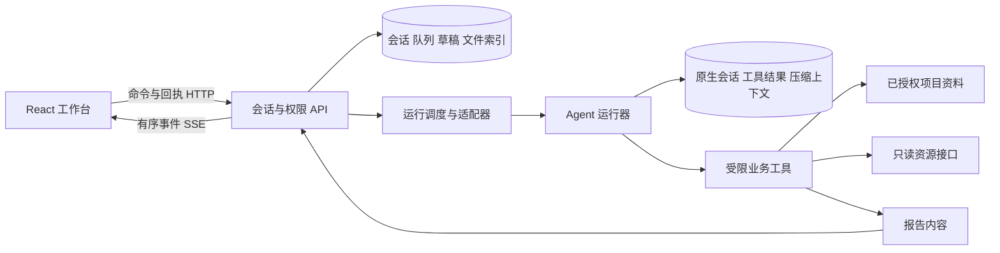

# AutoOps Agent 交互与项目集成技术方案

> 历史技术方案：以下独立会话状态机、SSE 和混合开源交互路线已被批准的 [T3 完整迁移方案](agent-demo-t3-migration-plan.md)替代。当前架构/接口见 [T3 协议](agent-demo-t3-protocol.md)，部署和数据保全见 [部署说明](agent-demo-t3-deployment.md)。历史问题与结果保留，不将旧测试结论自动用于新模块。

本方案面向约 20 位内部用户、最多 5 个同时执行的 Agent 任务。第一阶段把项目资料、只读环境查询、澄清和报告接入工作台，并把发送、引导、排队、停止、恢复做成可靠的交互基础。业务需求仍以 [工作台需求](workbench-v2-requirements.md) 和 [原始设计](project-workbench-design.md) 为准。

建议独立实现工作台的会话与权限层，通过适配器连接运行器。OpenChamber 的执行控制和 Hermes WebUI 的澄清、文件预览值得借鉴；它们的业务模型不直接替代 AutoOps 的项目、环境、共享权限和功能模块。是否采用 Codex 作为正式运行器，应在真实模型验收后确定。用户已选择通过现有 CPA 接入 `grok-4.6`，以 Codex App Server 作为运行器；接入结果必须以本次真实验证记录为准，不能以可控场景或注入协议测试代替真实 Agent 结论。

本次本地修复把模型上下文管理交回运行器的原生会话，并把文件改为按授权 ID 读取，验证将来可复用的适配边界。持久会话、按需附件、时序和删除改造已部署。当前原生会话复用、真实网页文件与滚动得到验证；长测出现 CPA/Grok 控制标记重复，暂不通过长会话稳定性门槛。最终结果见 [验收记录](agent-demo-validation.md)，下文早先验收仅保留原版本范围。

## 交付边界

Demo 使用 `/agent-demo.html`，不依赖旧原型的 localStorage 会话状态。服务端 API 为 `/api/agent-demo`。既有原型保留作业务设计参考，独立入口用于验证交互与后端协议。

| 本轮实现                               | 正式产品后续实施                           |
| -------------------------------------- | ------------------------------------------ |
| 项目、环境、内置 Agent 固定在会话上    | 接入真实项目、资料、环境和资源管理         |
| 私有及项目共享会话、个人草稿、文件授权 | 接入正式用户体系与成员变更                 |
| 持久化会话、事件、队列、幂等请求       | 数据迁移、保留周期与定期备份恢复演练       |
| 真实运行器适配接口与受限业务工具       | 确定运行器、模型、费用归属及服务端部署方式 |
| 明确标识的可重复测试场景               | 实际资料检索、监控接口与只读 MCP           |
| Markdown 等文本报告，授权预览下载      | PDF 导出、资料版本与引用定位               |
| LAN HTTP 测试部署                      | HTTPS、正式登录与会话安全策略              |

产品 Agent 不获得测试机的管理权限。测试机的全权授权用于安装、部署和验证 Demo；Agent 只可调用配置的业务工具，不能部署、修改数据库或执行机柜迁移。

## 用户交互

桌面保留三栏：左侧会话历史，中间对话和固定输入区，右侧当前项目资料与结果。工具过程默认折叠，关键的执行状态留在正文附近。窄屏使用历史和上下文抽屉，输入区保留在视口底部。组件统一采用项目现有的 shadcn/ui 与 Solid Glass 浅色主题，标题不附装饰性副标题。

移动端可编辑控件统一为 16px，输入框、原生选择框和按钮的触控高度至少 40px，保留多行输入原有的更大高度。Demo 独立页面优先使用可用的 PingFang SC，弹窗继承同一字体；登录容器随可见视口高度调整并允许自然滚动。本轮 iOS 模拟器已发现小字号聚焦放大、系统字体中文缺字及键盘遮挡，因此作这些针对性修复。公开登录页的证据不能替代登录后会话、抽屉和停止按钮的实际键盘验收。

### 发送和运行中补充

空闲时 Enter 发送，Shift+Enter 换行。中文输入法尚在选词时 Enter 不发送；手机 Enter 换行。附件上传完成、草稿读取完成后才能提交。点击提交先显示本地发送状态，收到服务端接受回执后才清除本次提交的草稿；晚到回执不能清除用户后来输入的内容。

执行中明确提供“引导本轮”“排队”和“停止”。引导携带预期轮次 ID，运行器返回接收后才显示已接收。同一轮已经结束时，返回冲突并保留输入，由用户重新选择动作；不自动转成下一轮，也不取消重开。

“运行器已接收”只表示控制信息送达。模型是否遵循指令，需要通过之后的输出和工具行为确认。例如补充“先检查当前环境的告警，暂时别生成报告”，验收既检查轮次 ID 没变，也检查之后没有生成报告。引导不改变会话固定的环境；要求切换环境时应提示新建会话。

### 队列和停止

队列存储在服务端。用户可修改、删除、调整顺序、暂停和恢复；浏览器离开不影响已接受的任务。队列修改带版本条件，冲突时读取最新内容后重试。

停止先进入“停止中”。主服务立即暂停后续队列，运行器终态确认之后才显示已停止。HTTP 接收到中断请求，不等于运行器已经终止。停止后保留原始输入、附件、部分输出、工具记录与引导。

“继续”使用原输入、附件、当前仍被授权的上下文和部分结果创建新轮次，并记录原轮次 ID。同一业务会话的正常继续可复用原生模型上下文，但不宣称恢复了原进程的内部执行位置。继续某轮与恢复队列是两个独立操作。

### 澄清和结果

Agent 缺少必要信息时调用 `ask_user`，会话进入等待回答状态；队列不得越过该问题。问题卡可选择选项或输入文字，回答提交失败时保留内容。当前问题用稳定 ID 标识，重复提交只投递一次。

结果与对话并列查看。文件来源、类型和范围由服务端管理，预览不会把任意 HTML 当可信页面执行。本次本地实现由资料服务提取文本型 PDF，并记录提取状态；扫描件、损坏或加密 PDF、不支持的 Office 等不能仅因上传成功就被声称已经读取。模型通过会话文件目录和授权读取工具取得正文，预览下载与正文可读性分别判断。

### 阅读和网络恢复

用户上翻时停止自动跟随；展开工具记录保持阅读位置；点击“回到最新”才恢复跟随。不同会话保存各自滚动位置和草稿。正文增量按动画帧合并，保持消息组件 ID 稳定，减少整段内容重新挂载。

浏览器断线时保留现有内容并显示重连。恢复后补读缺失事件，按序号去重，再校准会话快照。刷新或关闭浏览器不会取消服务端运行。服务重启后无法确认仍存活的轮次标记中断，不假装继续执行。

## 架构与技术选择

建议正式项目采用 TypeScript 模块化单体。前端和后端共享事件及 API 类型，后台执行单独封装，先避免拆成多个微服务。一人加 Codex 开发时，这样便于复现问题、做事务和保持部署简单。

| 层       | Demo 实现                                                   | 正式项目建议与理由                                                                          |
| -------- | ----------------------------------------------------------- | ------------------------------------------------------------------------------------------- |
| 前端     | React 19、Vite、Radix shadcn/ui、Tailwind、Solid Glass      | 沿用现有组件，业务代码逐步使用 TypeScript；不重新设计第二套基础控件                         |
| API      | Node.js 24 原生 HTTP                                        | Node.js 24 + TypeScript，API 层引入明确的请求校验和共享类型；框架选择服从模块测试与维护成本 |
| 实时更新 | SSE 事件流，命令使用 HTTP                                   | 保留；单向持续更新足够，控制请求使用可重试回执，暂不需要 WebSocket                          |
| 存储     | SQLite WAL，单进程状态机                                    | 单实例内部版本可保留 SQLite；需要多实例、较多并行写入或独立 worker 时迁移 PostgreSQL        |
| 执行     | 进程内最多 5 个执行器；服务端会话队列                       | 首阶段保留并发限额；正式上线增加任务租约、超时、执行心跳与失联回收                          |
| 运行器   | Codex app-server 适配桥；本地新增持久原生 session、增量输入 | 原生上下文/压缩由运行器管理；用同一行为契约验证将来替换 OpenCode 或其他运行器               |
| 文件     | SQLite 文件内容，8 MiB 限额；提取状态、按需授权读取         | 正式版使用独立文件存储和数据库索引；扫描、提取、版本、配额独立管理                          |
| 部署     | Linux 用户级 systemd，独立目录及端口                        | HTTPS 反向代理 + 服务进程 + 持久卷；当前规模无需 Kubernetes                                 |

本轮 Demo 使用 JavaScript 模块快速验证协议，完整快照以 JSON 保存。正式实现应把消息、轮次、队列、工具和事件拆成表，增加分页与检查点。不能长期给每个工具事件保存一份不断增长的完整会话快照，也不能让首次加载读取全部历史。

公开会话数据应与内部执行快照分开：前端按需读取当前项目上下文，历史轮次只传展示和操作所需字段；内部的资料正文与环境快照保留在执行记录中。本轮长历史测试中，单个 76 轮会话的完整响应约 407 KB，其中重复上下文约 149 KB。事件编码与写入已经减少重复处理，但这不替代正式版本的分页、增量更新和按需加载。

## 模块职责

- **工作台壳层**提供导航、项目选择、全局错误和主题；不直接操作运行器。
- **会话服务**负责可见性、固定上下文、消息、草稿、队列和生命周期。
- **运行调度**保证会话内单活动轮次、跨会话并发限制、停止与队列联动。
- **运行器适配器**转换会话创建/恢复/删除、启动、引导、中断、澄清回答和事件；把业务会话与原生身份关联，校验期望身份和上下文权限。业务代码不读取某家运行器的 rollout 或自行重写摘要。
- **资料服务**负责上传、提取、版本和访问权限。检索只返回当前项目内可读的片段。
- **业务工具网关**提供只读查询及报告，不接受任意命令、路径、SQL 或 URL。
- **文件服务**在授权后提供预览和下载，报告引用持久化到具体资料版本。
- **执行记录**保存谁在什么项目发起什么操作、工具摘要与结果；界面使用“执行记录”等易懂名称，不额外堆一个泛化的“任务与审计”导航。

发布、回退、机柜迁移等功能仍是各自明确的业务流程。将来需要从 Agent 发起写操作时，应新增结构化预览、独立授权和可回查结果，不能直接开放一个全权 shell。

## 状态和数据约束

核心业务实体为 Project、Membership、Conversation、Turn、Message、QueueItem、Draft、Attachment、Artifact、ToolExecution、Event、IdempotencyRequest。运行器另有 SessionBinding，保存原生身份、上下文 revision、权限指纹及用量基线，不成为第二份业务 transcript。Demo 形状与接口见 [实现契约](agent-demo-contract.md)，新增运行器字段见 [桥接契约](../agent-demo/bridge.md)。

1. 一个会话固定 projectId、environmentId、agentId、visibility；需要切换时新建会话。
2. 一个会话最多一个活动轮次；轮次固定上下文快照，并关联运行器 threadId/turnId。
3. 引导必须指定 expectedTurnId；排队消息只有实际出队时才获得新的 turnId。
4. 发送、引导、停止、澄清回答和继续等执行命令使用 requestId。同 ID 同内容返回原结果，不同内容返回冲突；草稿和队列编辑另用版本条件防止覆盖。
5. 草稿以 userId + conversationId 隔离，使用 revision 乐观锁。读取版本发生在完整请求体收到之后，防慢请求覆盖新内容。
6. 附件上传时仍是上传者的私有草稿文件；被已接受的消息或队列引用后，才按会话可见性共享。
7. 每个事件有持久 seq。快照带 eventSeq，客户端不再重复叠加已经包含在快照内的增量。
8. 删除事件保留授权所需的墓碑信息，断线客户端能补收到删除；公开事件不透出内部授权记录。
9. 停止暂停队列。澄清未回答、任务失败或中断时不会自动消费下一项。
10. 运行器不可用时不伪装成场景执行；真实模式返回明确错误并保留输入。
11. 普通追问、继续和队列出队保持上下文 revision；重试/重新生成递增 revision，分支使用新会话 ID。它与草稿 revision、队列 revision、可见快照 revision 含义不同。
12. 原生绑定已经确认后，后续请求固定 `expectedThreadId` 并只传新增输入。绑定缺失不静默丢弃历史；用户明确重试时才重新导入允许的历史。
13. 删除会话先清理已分发的原生上下文，包括 pending 绑定和旧 revision，再删除业务记录；删除过程阻止新轮次。原生删除失败保留可重试状态。

正式版应在事务里保存业务状态、命令去重结果和待发布事件，再由事件发布器送出。与外部运行器的投递无法通过本地数据库单独实现跨进程“绝对恰好一次”；需要两端 requestId、投递状态和恢复对账。Demo 的同步命令使用 SQLite 事务，桥接控制请求在两端合并与去重；桥接内存状态丢失后的自动对账尚未完成。

## 运行器接入

Grok 接入沿用关联 AI 工作台已有的 CPA Responses 配置。模型提供方是 CPA，模型为 `grok-4.6`，Codex App Server 负责轮次与动态工具协议。前端分别显示当前模型和运行器，不把当前配置归属到历史回复。桥接部署在测试机回环端口，主服务通过专用令牌访问；CPA API Key 只由桥接从权限受限的 Secret 文件读取并传给运行器进程，不进入浏览器、仓库或交付包。CPA 模式使用专用配置与状态目录，不读取个人 Codex 账号。配置就绪与真实模型验证分别记录；启动成功并不等于推理成功。早期版本已经取得三轮实际 Grok 合成场景证据，主服务已连接测试机上的桥接；本次本地修复不改变提供方、模型或思考档位。

[Codex app-server](https://learn.chatgpt.com/docs/app-server) 提供线程、轮次、增量事件、工具调用和执行控制接口。本轮桥接调用 `turn/steer` 并传 expectedTurnId，调用 `turn/interrupt` 停止；不把取消重启包装成引导。

主服务把已经授权的资料目录、固定环境快照和会话附件引用交给桥接。动态工具包括列出资料、读取指定文档、读取附件、查询固定环境、询问用户和生成报告。附件正文通过主服务固定的内部读取接口按需取得；桥接不根据模型提供的地址访问网络，不根据模型提供的路径读取磁盘。

当前 CPA 桥接与主服务都部署在测试机上，使用专用 Secret 与回环地址连接，不依赖开发电脑、桌面应用或临时 SSH 隧道。采用本机运行器时仍可使用反向转发作为开发方式；正式部署应使用专用服务身份和受限运行环境。

桥接配置、HTTP 契约、隔离条件与运行说明见 [bridge.md](../agent-demo/bridge.md)。本机 CLI 0.159.2 已通过无鉴权、无推理的启动检查，接受隔离配置和六个动态工具注册，返回预期权限配置；原始证据见 [启动检查](../.test-artifacts/agent-demo-api/codex-startup.json)。该检查未调用模型或工具。早先部署的 CPA Grok 和网页流程证据保留在各自验收记录中；本次新增原生上下文与文件协议仍须在部署后单独回归，越界文件和网络操作也必须按具体运行版本检验。初始化成功本身不代表账号有指定模型权限或隔离边界已通过运行时验证。

### 会话与运行器的分工

OpenChamber 将新增消息投递给稳定的 OpenCode session，并调用原生压缩接口。本次沿用这一分工，使用 Codex 的 durable `thread/start`、`thread/resume`、`turn/start` 和原生压缩事件；没有重新实现模型循环、上下文裁剪或摘要算法。`runtime-sessions.mjs` 是业务身份与原生身份之间的薄适配层。

| 层面         | 负责的状态                                          | 本次适配                                                                  |
| ------------ | --------------------------------------------------- | ------------------------------------------------------------------------- |
| 主服务       | 用户可见消息、会话权限、项目/环境、队列、文件与引用 | 生成稳定 session ID 和上下文 revision；决定首次迁移或重试允许导入哪些历史 |
| 原生运行器   | 模型可见历史、工具结果、上下文压缩、turn 执行       | 同一 thread 追加新 turn；重新连接后 resume；在原生能力内处理上下文容量    |
| 运行器适配层 | 会话绑定、权限指纹、期望 thread 身份、每轮计数基线  | 不存第二份 transcript；把控制回执、公开事件和诊断转换为工作台契约         |
| 资料服务     | 不可变文件 ID、正文提取、会话/轮次授权              | 目录先行，工具按需读取；新运行再次验证文件权限，当前图片才传视觉数据      |

正常追问和继续复用已加载 thread，重启后用 `excludeTurns:true` 恢复；主服务确认原生身份后传空 history 和 `expectedThreadId`，避免每轮重复传全部旧文本。首次迁移和新分支导入一次可见历史，重试使用新 revision 且排除被替换的回答。分支复制文件并改 ID，因此当前仍由主服务构建分支导入数据，不直接复制含旧文件 ID 的原生工具结果。未来若要使用原生 fork，需要先定义文件引用映射和分支授权，不应只调用 fork 就宣称完整适配。

撤销旧资料/附件授权必须隔离旧 thread，因为模型历史里可能已有读取结果；新 thread 也不能重新导入包含这些结果的旧 transcript。权限指纹使用文档版本、资源授权 ID、固定项目/环境和不可变附件身份。快照采集时间或 CPU 值改变、当前图片变为历史目录项，不构成权限撤销，不能因此每轮重建上下文。模型仍通过当前轮工具读取新的快照。

原生持久状态通过 `AGENT_DEMO_RUNNER_STATE_DIR` 保存，CPA 专用 `CODEX_HOME` 位于其下；临时 HOME 和工作目录继续隔离并在退出后删除。绑定索引不含正文，原生状态包含模型上下文，需与业务数据库一起纳入访问控制、备份和删除策略。没有专用持久目录时只保证当前进程内复用，不承诺重启恢复。首个 turn 前没有可恢复 rollout，适配层记录初始化是否确认；已确认身份却缺绑定或落盘不确定时明确失败，不自动换成空对话。

删除通过官方 `thread/delete` 清理当前及被重试/撤权替换的所有原生上下文，不手工猜测运行器文件路径。归档仅是个人列表偏好，停止只终止当前 turn，两者都不等同删除。原生持久会话也不恢复桥接的内存 run、控制请求去重缓存或 SSE 序号；故障轮次仍需标记失败/中断，用户之后的新轮次才能恢复其模型上下文。

删除是可恢复的逐项操作：先持久化 `deletionPending`，每删除一个 owned 原生 ID 就保存剩余清单，完整成功才移除业务绑定。未完成的删除阻止新轮次，重启后继续剩余清理。只有官方明确“该 ID 已不存在”的精确删除响应可以幂等接受；其他错误保留失败状态，原始 RPC 诊断不进入产品响应。该边界覆盖原生删除已生效而进度尚未落盘的崩溃窗口，后续运行器适配也必须验证部分成功、重试和重启场景。

### 留给自研项目的可替换接口

正式项目保留业务会话、运行器上下文和具体一次执行三种身份。更换 OpenCode、Codex 或另一运行器时，替换创建/恢复/删除上下文、启动/引导/中断 turn 和事件转换；项目权限、文件授权、草稿、队列、前端时间线不随运行器重写。运行器自己的历史存储格式不作为产品 API，不把浏览器绑定到它的磁盘目录。

必须共同满足的行为契约包括：同会话单活动轮次、重试隔离、引导目标校验、停止终态、公开过程与正文分离、上下文丢失显式报错、文件 ID 授权、每轮用量、删除完整性。运行器不支持的能力通过 capability 明示，不能用取消重开冒充引导，或用重放全部消息冒充原生恢复。现有注入测试可作为新适配器的共同行为回归；新增运行器仍需真实模型、界面和故障验证。

本次本地协议回归有 14 项、225 个注入 turn，覆盖连续 205 轮同 thread、240 条旧历史导入、重启绑定恢复、权限与文件边界、删除和期望身份校验；报告见 [原生会话适配测试](../.test-artifacts/agent-demo-api/native-sessions.json)。真实 CLI 无推理探针只验证协议和空线程边界，见 [持久线程启动探针](../.test-artifacts/agent-demo-api/codex-cpa-startup-durable.json)。受控协议不能代替真实提供方验收。真实长测 61 轮始终同 thread，57 轮完成、3 轮运行失败、1 轮主动停止，第10/30/60轮记忆正确；40轮出现控制标记。新鲜会话的8轮网页验收通过，长文首正文仍等待约52–67秒。原生自动压缩压力与105轮稳定通过尚未取得证据；最终部署的4轮独占故障验收已证明同thread跨进程恢复、事实记忆与旧附件读取，停止/继续和队列暂停保持正确。

## 权限与内容安全

正式账号使用单独用户身份和密码哈希或企业身份登录，不能沿用 Demo 的公开演示口令。会话 Cookie 为 HttpOnly；正式 HTTPS 开启 Secure。所有变更校验 CSRF，所有会话、草稿、附件、报告与 SSE 请求校验项目成员及会话可见性。管理员不因身份自动获得别人的私有聊天内容。

工具权限在服务端判断，模型提示词只补充行为约束。资料里的文本不能授权调用工具、扩大项目范围或执行写操作。文档 ID、资源 ID 和环境均由服务端限制，模型不能改成任意地址。

Markdown 预览不执行原始 HTML；外部链接限制协议，文件 URL 必须来自当前服务的授权路径。附件类型和文件名不是执行依据；未知类型下载，活动内容不直接运行。正式文件服务还需补齐恶意文件检测、内容提取隔离、压缩包展开限制及总配额。

日志记录用户、会话、轮次、requestId、结果码、耗时与工具类型。模型密钥、SSH 密码、完整授权头不进入前端、日志或报告。含敏感正文的运行记录按项目权限保护，并制定删除与保留周期。

## 性能与故障处理

工程目标为 LAN 控制请求确认 p95 ≤500 ms，界面反馈 p95 ≤100 ms。模型首字时间单独统计，它受模型服务、上下文和工具影响，不能拿本地确认速度代替。事件到 DOM 的测试需记录采样点；动画帧回调只是绘制附近的估计，不等同于用户主观感知。

本次增加主服务准备阶段和桥接 `threadReady`、`turnStarted`、`firstRunnerEvent`、`firstReasoning`、`firstText`、`firstTool`、`finished` 真实时序。`firstRunnerEvent` 可能只是执行开始回执，`firstText` 是桥接收到正文，两者都不是浏览器绘制或提供方内部首 token。诊断用于区分输入准备、运行器启动、模型等待、工具读取和前端显示；没有新事件时不补写假进度。原生 usage 为 thread 累计值，产品展示用本轮相对开始基线的差额，保留 `threadTotal` 供核对，未知值仍为 null。

| 故障                         | 预期行为                                                   |
| ---------------------------- | ---------------------------------------------------------- |
| 请求失败或超时               | 保留输入，使用相同 requestId 重试；不先清草稿              |
| 引导时本轮刚结束             | 返回409，保留输入，不另开轮次                              |
| 引导/回答重复提交            | 业务层与运行器桥接均合并；不重复投递                       |
| 浏览器断线                   | 服务继续，重连补事件，快照校准                             |
| 运行器事件连接意外结束       | 保留部分结果，标记失败/中断；提供继续                      |
| 原生会话绑定缺失或身份不匹配 | 明确报错，保留可见历史；显式重试可新建上下文，不静默丢历史 |
| 停止已接收但未确认           | 显示停止中，队列暂停，不宣称已停止                         |
| 停止失败响应迟到             | 只更新原轮次，不覆盖新轮状态                               |
| 服务进程崩溃                 | 恢复持久消息和队列，活动轮次标记中断并暂停队列             |
| 用户后续新轮恢复原生上下文   | 持久绑定校验后 resume；不宣称恢复上一轮进程位置或旧 SSE    |
| 原生上下文删除失败           | 保留会话与绑定供重试，不把部分清理报告为全部删除           |
| 多页面修改草稿或队列         | 版本冲突明确显示，不静默覆盖                               |
| 中英文字符跨网络分包         | 使用流式 TextDecoder，不产生替换字符                       |

后续容量优化顺序是历史分页、事件检查点、附件独立存储、任务租约，再考虑独立 worker 或 PostgreSQL。先用实际数据量和并发指标决定扩展，不因为“聚合工作台”提前引入分布式系统。

## 验收与开发顺序

当前证据集中于 [验收记录](agent-demo-validation.md)。可控场景验证状态机，注入桥接验证协议适配，真实模型验证 Agent 行为，截图与实际操作验证界面；四者不可互相替代。

1. CPA Grok 的三轮合成桥接验收及新版真实网页流程已完成，保留资料、报告、澄清、引导、队列启动和停止证据，详见验收记录中的各自版本范围。
2. 本次上下文与文件修复先完成本地契约回归，再部署，用原模型配置验证跨轮附件/PDF、增量多轮、重启后恢复、删除和长文等待；原生压缩需要实际触发容量边界后独立验收。继续扩大不同执行时刻的引导、正文中途停止和真实 continue 样本；旧单次流程不能替代新版本或全时刻覆盖。
3. 用桌面与手机实机体验，确认输入、上翻、抽屉、文件预览和软键盘；保留录像或截图及问题修复记录。
4. 根据 Demo 体验确认交互需求，再冻结运行器与正式数据模型。
5. 抽取经过验证的组件与会话模块接入项目，逐个接入真实只读业务工具。
6. 补齐正式账号、HTTPS、文件提取与配额、备份恢复、任务对账后，进入内部试用。

“商业级优秀体验”既需要量化门槛，也需要实际使用认可。协议测试通过说明指定的时序与权限场景正确；只有真实模型、界面和业务数据一同验证后，才能评价完整产品体验。

## 参考项目的取舍

- [OpenChamber](https://github.com/openchamber/openchamber/tree/6491f51dbcf05d1e3f7f823049f5f097c96c234b)：直接适配 `useStreamingTextThrottle.ts`、`followScroll.ts`、`timelineScrollIntent.ts`。流式更新窗口调整为32ms，首段及时显示、终态立即刷新；按滚轮、触摸、键盘和内部滚动区识别阅读意图。上下文层采用 `client.ts` 的稳定 session、增量消息、原生压缩分工，通过现有 Codex 官方协议实现对应能力；未复制 OpenCode 引擎。AutoOps 保留项目权限、服务端队列和停止后暂停语义。
- [Hermes WebUI](https://github.com/nesquena/hermes-webui/tree/3aa21f63387939dcff37baa141ad59a0e1e1147f)：适配持续 parser 的增量生命周期和安全链接规则，使用同版本 `streaming-markdown@0.2.15`。React 只拥有容器与独立代码工具条，parser 追加正文，已完成内容节点保持不变。个人助手的记忆、语音和定时任务不进入首轮范围。
- [Multica](https://github.com/multica-ai/multica/tree/47120a4131564175da044d63d897ed9b5d76979a)：参考请求可靠性、工作组织和草稿归属，不因为项目支持多种 Agent 就直接照搬其业务结构。

2026-10-21 的交互改造已将首版“仅借鉴概念”的实现改为上述代码适配。未引入上游的 OpenCode 运行时、完整应用状态库或浏览器队列派发器；运行器保持现有 Grok CPA/Codex bridge。MIT 原文、版权及精确源码路径见 `web/public/third-party/agent-demo-streaming-NOTICES.txt`，与 Solid Glass 许可一起随构建分发。

### 有序消息与等待反馈

每轮新增 `turn.timeline`，包含 `text/reasoning/tool/question/user`，保留桥接 `itemId`、稳定片段 ID 和事件顺序。旧 `messages.content/steps` 保留接口兼容。`message.delta` / `reasoning.delta` 携带紧凑 `timelineDelta`（id、offset、append/replace、增量和元数据）及真实 `phase/lastActivityAt`。客户端核对偏移更新，缺口冻结后续增量直至快照补齐；每轮 usage 独立更新，并保留原生 thread 累计诊断值，未变化轮次保持引用稳定。

引导与澄清回答以服务端接受为准；控制回执前到达的续文先按序缓冲，插入被接受的用户消息后再释放。发送中的本地消息使用 `clientRequestId` 与服务端回执去重。问题回答或取消后保留历史。刷新、中断和重启保留片段顺序。

等待区显示启动、等待模型、工具执行、生成回答、等待补充、停止等真实状态及用时。上游没有新内容时不伪造推理文字或进度。已采样 Grok 存在秒级等待后批量到达的情况；32ms 合并与 DOM 增量渲染改善呈现，不代表上游首字延迟已被消除。

### 完整会话操作与历史

迁移文件、来源版本及边界见 [逐项矩阵](agent-demo-open-source-flows.md)。运行中空输入只显示独立停止，有内容时显示用户选择的引导或排队，菜单保存个人偏好，Ctrl/Cmd+Enter使用另一动作。附件和不支持引导的运行器明确使用排队。空闲可立即执行指定排队项，其他项仍遵守暂停状态。

澄清草稿按用户/会话/问题保存在sessionStorage，刷新和失败保留，晚到回执只清对应问题。思考只展示提供方实际公开返回的内容，摘要优先；显示和自动展开偏好按用户保存，用户手动展开后不强制收起。

消息支持编辑后创建分支、从用户/助手消息分支和最新终态重新生成。分支默认私有，复制文件并重映射ID，不截断原对话。重试上下文不包含被重试的答案，“继续”则保留已有结果。

初次只挂载最近30个完整轮次，加载更早时再增加30轮并锚定阅读位置。搜索先揭示隐藏轮次再展开其中思考，CSS Highlight跨增量文本节点映射Range，不修改Markdown DOM。导出按时间线生成Markdown。服务端仍发送全量快照，后续需要持久层分页及大规模索引。

置顶/归档保存为个人偏好，成员互不影响；归档不删除或停止执行。列表正文检索仅使用当前项目已授权快照，不是服务端全文索引。

## 本次验证对技术选型的约束（2026-10-21）

本次可以保留并继续积累的技术资产是业务会话/轮次契约、运行器身份绑定、文件授权回调、可回放事件及快照、上游滚动/活动展示方案和这些行为的验收脚本。自研工作台不必复制 Codex 的原生存储格式，也不必把 OpenCode SDK 类型传进业务库。替换运行器时重写 adapter，保留相同的发送、引导、停止、澄清、恢复、删除、文件权限与事件验收。

模型提供方需要单独设通过条件：连续会话不能输出异常协议标记；流式 delta 与最终 output item 一致；原生历史可恢复；工具和附件在多轮及重启后可读；首反馈、首正文、完成耗时分别统计；断流不能重复或丢失尾段。当前 CPA/Grok 已有异常正文进入原生历史的证据，因此不能作为已确定的长期运行组合。它不否定本次 UI 与业务协议复用，但阻止以本次 Demo 直接确定模型链路。

OpenChamber 没有可直接套用的 EOS 文本清洗；Hermes 的[工具标记处理](https://github.com/nesquena/hermes-webui/blob/3aa21f63387939dcff37baa141ad59a0e1e1147f/api/streaming.py#L4862)针对已经解析成调用的 XML/DSML，不能拿来删除合法正文。CLIProxyAPI 公开实现的 [XAI 请求转换](https://github.com/router-for-me/CLIProxyAPI/blob/20c9095cac089c6a8e40554debe4dd8a19d4c14f/internal/runtime/executor/xai_executor_request.go#L159)移除不支持的 stop 参数，不能假定添加停止词可以修复。实际 CPA 部署版本尚未与该公开版本对应。

下一步应在提供方边界对同一请求核对原始 SSE、完整 output item 与下轮 input；定位后在写入原生历史前修复协议转换，并验证合法示例文本不被误删。Codex 的[原生记录路径](https://github.com/openai/codex/blob/rust-v0.159.2/codex-rs/core/src/stream_events_utils.rs#L93)会保留完整响应，故只在前端隐藏或在 Bridge 显示层删除标记并不能修复原生历史。当前证据支持异常内容可能加剧后续重复，尚不能证明这是最初根因。本轮未擅自修改外部 CPA 服务、模型、思考档位，也未用自制文本过滤掩盖结果。
