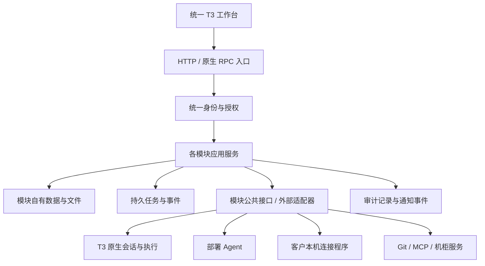

# AutoOps 全新模块化重建计划

本文件保留用户提供的完整业务计划。**2026-10-23 最新确认的执行顺序优先于早期阶段 0–7：先定规范，再深度优化全部现有模块，最后才新增功能。** 原有业务要求继续保留，实施范围按下表区分，不能把“完整计划”理解为现在就补建全部未来能力。

| 当前步骤 | 范围 | 完成依据 |
| --- | --- | --- |
| 第一步：完善规范 | 明确模块职责、依赖、权限、前后端风格与工程规则、故障隔离及验证方法；清理冲突 | 规则有唯一维护位置、可供后续 AI 执行；不要求提前实现所有接口或未来功能 |
| 第二步：现有模块深度优化 | 以当前 `feat/workspace-deployment-validation` 分支为唯一功能基线，逐模块改善结构、解耦、权限集成与 T3 呈现，保留已有功能和完整流程 | 按工程规范的模块优化完成条件验证，覆盖本模块及受影响调用方；包括此前提交的基础模块 |
| 第三步：在优化后开发功能 | 再从本计划及后续需求选择尚未实现的能力，逐批完成业务闭环 | 每批按确认的业务范围验收；未实现需求不计为第二步的功能退化 |

main 不再作为功能对照、补迁或更新来源。旧阶段号仅供追溯原计划和既有提交，不能覆盖以上顺序。此前“工程基座＋项目、环境与权限链路”属于原阶段 1 的后端批次，保留实际成果，不代表第一步或全模块优化曾经完成。当前状态统一见[开发与验证](../docs/development.md#当前状态)。

工程细则见[工程与 AI 协作规范](engineering-standard.md)、[后端规范](backend-standard.md)及 [T3 UI 规范](t3-ui-standard.md)。业务清单用于防止遗漏，具体已有/未实现状态以当前分支和实际验证为准；不凭计划文字宣称功能已存在。

## 1. 目标、范围与项目规范

本次按全新产品重建，目标是建立一套**模块职责明确、权限统一、业务流程完整、后续容易扩展和维护**的平台。

采用“按业务划分模块 → 明确数据归属 → 定义模块接口和权限 → 分批完成业务闭环 → 自动化检查边界”的方法。架构选择为**模块化单体**：各模块有独立职责，但中心统一部署，适合目前约 20 人、5 个并发 Agent 任务的规模。

**已确认的产品决策**

| 项目 | 确定方案 |
|---|---|
| 服务对象 | 内部团队使用的平台，支持外部人员按授权参与项目 |
| 组织模型 | 单个平台、多个项目；本轮不建设多租户体系 |
| 权限模型 | 固定角色模板＋项目、环境、资源范围授权 |
| 平台管理员 | 管理全部项目，但不能读取他人的私有会话、私有成果或控制其本机 |
| 项目创建 | 内部成员可以创建项目，创建者成为项目管理员 |
| 成员管理 | 平台管理员和项目管理员负责，普通成员不能授予权限 |
| 外部成员 | 只进入获授权项目，默认使用已发布的外部脱敏资料 |
| 全局机柜 | 内部成员可以操作；外部账号无权限；全局重置配置仅平台管理员维护 |
| 数据库 | SQLite，使用规范关系表、约束和事务；中心首版单实例运行 |
| 实施方式 | 完整规划、分批建成，每批形成可验收的业务闭环 |
| 实现与数据策略 | 新平台启用、现有功能保留及使用中数据保护统一遵循 AGENTS.md；不保留长期双写或隐式兼容回退 |

**原计划约束记录**

以下引文保留原计划语境，不再作为重新覆盖规范的指令。当前功能保留、实现替换及数据策略统一遵循 [AGENTS.md](../AGENTS.md)；新平台空库初始化不授权清空使用中的环境：

> 当前重构按全新产品建设。旧主分支、旧 Demo 和现有验证环境的数据、接口、路由、权限及存储结构不构成兼容约束。不得为保留旧实现新增双写、旧数据自动转换、双身份模型或运行时回退分支。\
> 先按目标业务流程、模块边界和统一权限模型设计；旧代码可以作为经过验证的业务能力参考。复用时必须纳入新架构和验收标准。\
> 保留已确认的业务需求、T3 公共框架和平台与客户本机的执行隔离。分批交付不得演变为长期保留两套实现。\
> 本条针对本次重建；新平台正式启用后的数据按版本管理，并提供正常的升级、备份与恢复机制。

UI 继续遵循 [T3 UI 规范](t3-ui-standard.md)：问答、工作区、部署及其他模块共用同一个页面框架。

本轮默认继续使用本地账号密码登录、手动发布和必要的操作确认；不新增组织审批流、SSO、自定义角色设计器、插件市场或中心多副本部署。

## 2. 目标架构与模块边界

**整体结构**

中心使用一个后端应用实例，加载 AutoOps 业务模块与 T3 宿主集成。反向代理负责入口和静态资源，Git 获取、资料处理、构建等耗时工作通过受控任务执行。

T3 继续负责原生会话、轮次、队列、流式事件和执行恢复；AutoOps 负责账号、业务范围、授权和各业务模块。两者通过明确接口连接。

**模块职责与数据所有权**

| 模块 | 负责的数据和行为 | 与其他模块的主要接口 |
|---|---|---|
| 身份与授权 | 账号、账号类型、登录会话、角色模板、授权记录、权限决策 | 识别操作者、判断动作是否允许、返回可用能力 |
| 项目与环境 | 项目、环境、项目成员、项目设置、资源归属关系 | 查询项目范围、管理成员和环境 |
| 资料与工作区 | 资料目录、仓库来源、内部固定版本、外部脱敏版本、处理规则和报告 | 提供获授权的版本、文件和来源信息 |
| 技能 | 中央技能库、不可变技能版本、助手与项目分配、停用和撤回 | 返回当前会话可使用的技能快照 |
| 助手与会话业务 | 助手配置、会话业务绑定、共享范围、附件和成果访问规则 | 将业务范围接入 T3，校验会话和工具调用 |
| 我的电脑 | 设备归属、配对、登记目录、设备能力、连接状态 | 提供获授权的本机执行目标 |
| 资源与连接 | Server/MySQL/Redis 资源、项目和环境绑定、连接状态、能力与指标 | 查询资源、检查连接、提供受控连接实例 |
| 凭证 | 加密凭证、版本、引用、替换与撤销 | 为已授权操作提供凭证使用能力 |
| 发布与部署 | 服务、部署位置、部署配置、源码包、发布任务、运行状态、历史版本和恢复 | 消费固定源码版本，调用部署 Agent |
| 工具与插件接入 | 预置 MCP、工具目录、模块注册、启停和能力声明 | 将获授权的工具接入业务和 Agent |
| 机柜 | 全局机柜业务、目标分配、二维码、照片、重置流程 | 调用机柜服务，关联项目环境目标 |
| 审计与通知 | 操作记录、任务汇总视图、站内通知 | 消费业务事件，提供获授权的查询 |

模块数量不等于导航入口数量。例如，凭证可以通过资源配置进入，身份与授权通过平台设置和项目设置进入。

**每个模块必须遵守的代码结构**

业务代码统一分为四层：

- **入口层**：解析请求、验证输入、调用应用服务、转换响应。
- **应用层**：完成一个业务操作，组织授权、事务、任务及外部调用。
- **领域层**：维护业务规则、状态变化和不变量。
- **基础设施层**：实现数据库、文件、网络及外部服务访问。

具体约束：

1. 一个业务操作只有一个应用服务入口，网页、RPC、MCP 和后台任务复用它。
2. 模块只能通过对方公开接口访问业务能力，不能读取内部对象或修改对方的表。
3. 数据表、文件元数据、任务状态均有唯一所属模块。
4. 跨模块事务由应用流程协调，仍通过各模块公开方法操作；事务中不等待网络或构建。
5. 公共层只放身份、范围、错误、时间、事务、日志等基础概念，不放不断增长的业务工具函数。
6. 模块依赖必须单向、无循环；第三方协议处理集中在适配器中。

**存储和技术栈**

- 继续使用 Node.js、TypeScript、React 和锁定的 T3 基线。
- 新业务代码启用严格类型检查，公开输入同时具备运行时校验。
- AutoOps 业务数据使用独立 SQLite 数据库；通过关系表保存，避免整份应用状态写入单个 JSON 字段。
- 开启外键、唯一约束、索引和版本化数据库升级；业务更新使用短事务。
- 文件内容通过受控存储访问，数据库记录所属模块、项目、内容校验值和引用关系。
- T3 原生数据由 T3 管理，业务模块不得直接修改其会话和事件表。
- 统一任务页只聚合任务视图，任务执行状态仍由所属模块管理。

## 3. 权限模型与公共接口

**角色模板**

角色与作用范围一起授予。同一用户可以在不同项目承担不同角色。

| 角色 | 默认能力 |
|---|---|
| 平台管理员 | 管理账号、全局配置、全部项目、中央技能和全局资源配置 |
| 项目管理员 | 管理本项目成员、环境、资料、资源、技能分配和发布 |
| 开发成员 | 管理获授权的内部资料和源码版本、生成源码包、使用问答；默认不能发布或管理成员 |
| 发布运维 | 在获授权环境配置部署位置、发布、回退及执行适用的运行操作 |
| 只读成员 | 查看获授权资料、服务状态、业务任务和记录，使用只读问答 |
| 外部协作成员 | 使用获授权的外部脱敏版本、对应技能和允许访问的会话；不获得内部源码、部署和凭证权限 |

内部账号默认可以创建项目和操作全局机柜。中央技能维护、账号管理、全局机柜重置配置由平台管理员负责。

项目管理员覆盖其管理项目的环境；普通成员的环境范围显式授予，新建环境不会自动扩大普通成员权限。

**统一授权规则**

每次操作都同时检查：

> 当前账号有效 → 功能已启用 → 存在匹配动作与范围的授权 → 资源真实归属正确 → 当前状态允许操作。

动作使用稳定标识，例如：

- `project.members.manage`
- `workspace.read`、`workspace.import`、`workspace.external.publish`
- `skill.library.manage`、`skill.assign`
- `deployment.read`、`deployment.execute`、`deployment.rollback`
- `credential.use`、`credential.manage`
- `cabinet.assign`、`cabinet.reset`

权限判断必须满足以下要求：

- 动作和资源范围必须来自同一条有效授权，不能把“测试环境发布权”和“生产环境查看权”拼成生产发布权。
- 内部/外部资料范围、会话私有/共享、环境范围分别检查。
- 平台管理员的业务管理权不覆盖他人的私有会话、私有成果和本机执行权。
- 凭证使用与凭证管理分离；界面和业务响应不返回已有凭证明文。
- 项目共享会话仍须检查环境和资料范围，外部成员不能借共享入口读取内部历史。
- 文件、附件、报告、下载、日志、搜索和任务汇总遵循同一授权。
- 功能启用只表示功能存在，不等于用户获得使用权限。

**前后端如何协作**

后端返回模块和资源的 `capabilities`，界面据此展示入口和操作。实际请求仍重新校验权限，不能依赖按钮显隐。

新增统一的 `/api/v1` 业务接口，不提供旧 Demo 路由别名。原生 T3 请求沿用其协议，由宿主集成执行同一业务授权。

跨模块合同至少包含：

| 合同 | 必需语义 |
|---|---|
| 操作者 | 当前用户、实际执行主体、请求关联标识 |
| 资源范围 | 项目、环境、资源、资料范围及必要的所有者信息 |
| 权限决策 | 是否允许、稳定原因码、可展示的说明 |
| 固定输入 | 来源版本、配置版本、内容校验值及凭证引用 |
| 任务收据 | 任务 ID、幂等标识、接受状态、所属模块 |
| 业务事件 | 事件 ID、对象、操作者、时间、结果和关联任务 |

HTTP、原生 RPC、模型工具和后台执行都从可信会话或任务上下文取得身份，不接受请求方自行声明操作者权限。

**运行中的权限变化**

- 提交任务、领取任务、执行外部动作前分别校验。
- 撤销授权后，未执行的任务和排队输入停止继续执行。
- 已发出的外部操作按真实回执追踪，不能因为撤权或断线显示“已经停止”。
- 已进入发布切换阶段的任务允许完成必要恢复，恢复动作使用明确记录的系统身份，不扩大原任务目标。
- 技能撤回后拒绝旧会话的新轮次。
- 权限变化使前端能力缓存和活动订阅重新校验，避免旧页面继续获取新增内容。

平台问答 Agent 保持只读外部查询与报告生成能力；用户有发布权限，也不会自动赋予模型部署或修改数据库的工具权限。客户本机执行继续由设备所有权、登记目录和本机权限共同约束。

## 4. 各模块的完整业务流程与界面组织

**账号、项目与环境**

实现真实账号持久化、初始化管理员、登录退出、改密、管理员重置密码和账号停用。

新安装不依赖 Demo 账号或演示数据。项目管理员添加已有账号、选择角色和范围后即时生效；账号停用及改密使相关会话按规则失效。

项目允许没有环境。删除项目前检查运行任务和受保护引用；删除平台记录不隐式删除外部服务器、数据库或服务。

**资料、工作区与源码包**

资料编辑和固定版本分开：

- 日常资料支持目录、上传、移动、改名、删除及文本编辑。
- Git 获取由平台任务执行，支持获授权的公私有仓库及固定提交。
- 多仓库、资料和原型共同组成内部版本，记录各自内容身份。
- 外部版本从固定内部版本生成，执行去 Git、脱敏、无法自动检查内容的人工复核，再发布。
- 失败任务不发布半成品，已有可用版本保持可用。
- 对话读取固定版本；切换内部/外部范围另建对话。
- 源码包由部署模块生成，来源是固定内部版本，保留完整构建上下文及校验清单。

运行任务和保留的部署版本保护其依赖。允许删除的历史资料删除后，旧会话和任务显示“来源已删除”，不能自动替换成最新内容。

**技能、会话与我的电脑**

保留完整技能流程：导入、版本、预览、分配、发现、输入标签、正文及参考资料读取、停用、撤回。

技能中央库、输入选择器、消息标签和实际执行使用同一授权快照。本机技能与平台技能分别来自各自宿主，不混合授权。

会话首次消息被持久接受后固定项目、环境、资料版本、助手和执行目标。网络结果未知时保持范围冻结，通过原生请求收据核对，不能重新绑定后再次发送。

继续复用 T3 的真实流式输出、引导、排队、停止和恢复。客户连接程序保留设备所有者校验、命令去重、可靠事件确认、目录占用和断线恢复。

**部署发布：保留当前分支的完整业务表达**

部署页继续使用公共框架，模块侧栏组织为：

| 区域 | 内容 |
|---|---|
| 服务发布 | 当前环境服务列表、部署位置、运行状态和发布入口 |
| 发布记录 | 按服务、环境、状态、操作者筛选任务 |
| 源码包 | 从内部固定版本生成、核对、下载、追溯 |
| 部署资源 | 当前项目可用服务器、接入、绑定、能力及运行指标 |

服务与部署位置分开建模：一个服务可以在多个环境、多个服务器上部署，配置归属明确。

发布主流程为：

> 选择服务与位置 → 选择固定输入 → 核对来源和配置变化 → 检查目标条件 → 确认发布 → 查看真实阶段 → 验证运行结果或恢复结果。

业务目标清单如下；第二步保留并优化当前分支已具备的部分，尚未实现的部分进入第三步，不以补齐清单作为结构优化前提：

- 接入清单：项目、仓库、环境、服务器、服务配置、首次发布。
- 前端静态服务与 Java 服务的配置、发布和回退。
- 当前运行配置、下次发布配置、历史配置分别展示。
- 完整发布工作台，核对当前版本与候选版本、目标主机、健康检查和恢复依据。
- 任务详情包含阶段进度、固定输入快照和完整日志；支持搜索、增量读取和下载。
- 发布历史支持分页、来源追溯、版本可恢复性和保留状态。
- 多位置、批量发布分别创建目标任务，分别展示成功、失败和恢复结果。
- 同一服务器的冲突任务串行执行，不同服务器按容量并行。
- 发布结果和实际运行状态分开，明确“发布失败但旧版本运行正常”。
- 静态站点发布不通过重启共用 Nginx 实现恢复。

需求中已有容器镜像发布、容器停止/启动属于后续新增能力，需要独立验收；不能标记为当前已有功能或本轮优化成果。静态站点不展示容器专用动作。

**资源、MCP 与机柜**

先完成预置 Server/MySQL/Redis 连接和受控工具，再形成可复用接入规范：

- 资源明确属于项目公共范围或指定环境。
- 项目管理员维护项目资源与凭证引用，跨项目共享服务器通过显式绑定。
- 只读工具使用只读凭证和限定动作；模型不能自行构造任意连接地址或宿主命令。
- 连接测试、超时、取消、输出限制、错误和审计由统一适配规则处理。
- 插件声明模块标识、配置合同、作用范围、所需权限、工具及健康状态。
- 本轮采用受控内置接入，不开放任意扩展包安装和执行。

机柜复用已经验证的路由业务能力，通过独立服务接口接入 AutoOps；权限和页面由统一平台提供。保留全局池、批量分配、下一次鉴权生效、二维码、照片及重置流程。

重置继续使用只读预览、完整 IMEI 确认、限时一次性凭据和状态冲突检查。未知结果进入待核查状态，不自动重复执行。

**统一 UI 和任务呈现**

- 所有模块接入同一个导航注册表、顶栏、侧栏容器、主内容头部和主题。
- 模块内部承载自己的目录、列表、筛选和业务详情。
- 页面状态按用户、项目、资源隔离；切模块不改变已提交任务的归属。
- 任务汇总只呈现获授权任务，私有会话标题、内容和成果不进入公共列表。
- 审计用于记录操作；站内通知用于告知结果，两者不承担任务状态管理。
- 空态、加载、错误、窄屏和键盘操作均使用同一框架，不引入第二套页面壳。

## 5. 分阶段实施、工程规范与验收

**原阶段 0–7 参考**

以下保留原计划的任务拆分和业务验收目标，当前执行顺序以上文三步为准。涉及已有能力的要求用于第二步回归，涉及新增能力的要求用于第三步开发；不能按此表提前启动新功能。替换后的实现不保留长期双写或隐式兼容回退。

| 阶段 | 主要工作 | 完成标准 |
|---|---|---|
| 0：确定规范与功能基线 | 整理模块、数据归属和工程规则；以当前分支为功能基线；区分已有能力与后续需求；修订冲突文档 | 规范可执行；具体模块优化时核对已有入口、流程和权限，不要求提前设计全部未来功能 |
| 1：工程骨架与真实身份 | 新模块结构、合同、数据库、初始化、账号、项目、成员授权、公共页面注册 | 从空目录启动，两个项目和内部/外部账号隔离验证通过 |
| 2：资料与问答闭环 | 资料、仓库、固定版本、脱敏、技能、会话业务绑定及成果权限 | 完成内部资料→外部发布→授权问答→成果保存的真实流程 |
| 3：前端部署闭环 | 服务与位置、源码包、服务器接入、发布工作台、日志、历史及恢复 | 全新环境完成首次发布、再次发布、失败恢复和手动回退 |
| 4：完整部署能力 | Java、多位置、批量发布、配置管理、存储保留；再增加镜像和停启能力 | 每种服务类型的成功、失败、重试和恢复分别验收 |
| 5：客户本机与统一运行管理 | 新账号体系下的设备、配对、目录、宿主权限、可靠传输、任务汇总 | 本机真实执行与断线恢复通过，平台范围不会被扩大 |
| 6：资源、MCP 与机柜 | 真实资源连接、预置工具、机柜服务接口及统一页面 | 真实外部系统验证通过，内外部权限隔离通过 |
| 7：完整验收与交付 | 全流程回归、性能与故障验证、安装包和运维文档；清理旧实现 | 新安装可用，生产构建不依赖旧 Demo 或兼容层 |

进入第二步后，每批优化同时落实对应审计、权限测试和模块检查，不集中留到最后。原阶段表不要求一次重写全部模块或预建空架构。

**自动化工程约束**

持续检查以下内容：

1. 禁止跨模块导入内部实现、循环依赖和越权访问数据。
2. 业务入口必须绑定动作权限和运行时输入合同。
3. 生产构建不能依赖演示账号、模拟资源、旧存储或旧运行时。
4. API 合同和客户端类型由同一来源维护。
5. 相同幂等请求返回原结果；相同标识、不同参数返回冲突。
6. 模块写入与必要审计、待发送事件在同一业务事务内记录。
7. T3 修改集中在宿主集成位置，记录锁定版本与必要差异。
8. 新增或修改代码注释、提交标题和正文使用简体中文。

检查以实际依赖、请求和业务行为为依据，不使用只匹配字符串的测试代替权限和流程验证。

**必须覆盖的验收场景**

| 类别 | 关键场景 |
|---|---|
| 权限 | 跨项目、跨环境、越权下载、外部读取内部资料、直接访问隐藏接口、撤权后旧页面与后台任务 |
| 私有数据 | 管理员不能读取他人私有会话和成果；公共审计、通知、搜索不泄露内容 |
| 角色组合 | 测试发布权与生产查看权不能组合成生产发布权；普通成员不能自我提权 |
| 工作区 | 多仓库固定输入、嵌套 Git 清理、二进制复核、失败保留旧版本、删除后引用显示 |
| 技能 | 固定版本、标签与实际输入一致、读取参考资料、撤回生效、平台与本机技能隔离 |
| 会话 | 引导、排队、停止、断线、未知接受状态、共享权限变化、环境和版本不能暗中改变 |
| 部署 | 首次失败、构建失败、健康检查失败、恢复成功/失败、Agent 离线、重复请求、配置冲突、多目标部分失败 |
| 本机执行 | 非所有者访问、目录授权撤销、重复投递、未确认事件、停止与断线恢复 |
| MCP/机柜 | 只读限制、凭证范围、插件停用、过期确认、冲突及未知执行结果 |
| UI | 连续切模块、浅深色、窄屏、短窗口、内部滚动、深链、历史恢复和焦点 |
| 安装运维 | 空数据初始化、重启后任务恢复、发布包完整性、新平台数据备份恢复 |

使用隔离测试数据和专用测试目标完成真实联调。按本轮影响范围运行检查；交付版本执行完整关键业务回归。

性能以已确认规模建立基线：20 个登录用户、5 个并发 Agent 轮次，叠加资料处理和部署日志。验证长任务不会阻塞导航、授权和状态查询，日志与列表不会无限加载。

**长期保留的维护资料**

只维护少量具有明确用途的文档：

- 架构与模块边界：说明职责、依赖和数据归属。
- 权限矩阵：角色、动作、资源范围和特殊限制。
- 关键业务流程：版本固定、发布恢复、会话范围及设备执行。
- 架构决策记录：记录重要取舍及改变条件。
- 安装与运维手册：初始化、构建、发布、备份、恢复和故障定位。

`AGENTS.md` 保留强制规则和入口链接；T3 UI 规范维护界面约束；字段、接口细节和状态枚举以代码合同及测试为准，避免维护多份互相冲突的说明。

本计划完成的标志是：**一个新模块可以按照既定合同接入统一账号、权限、页面、任务和审计体系，同时现有模块的业务规则仍各自清晰、可独立验证。**
