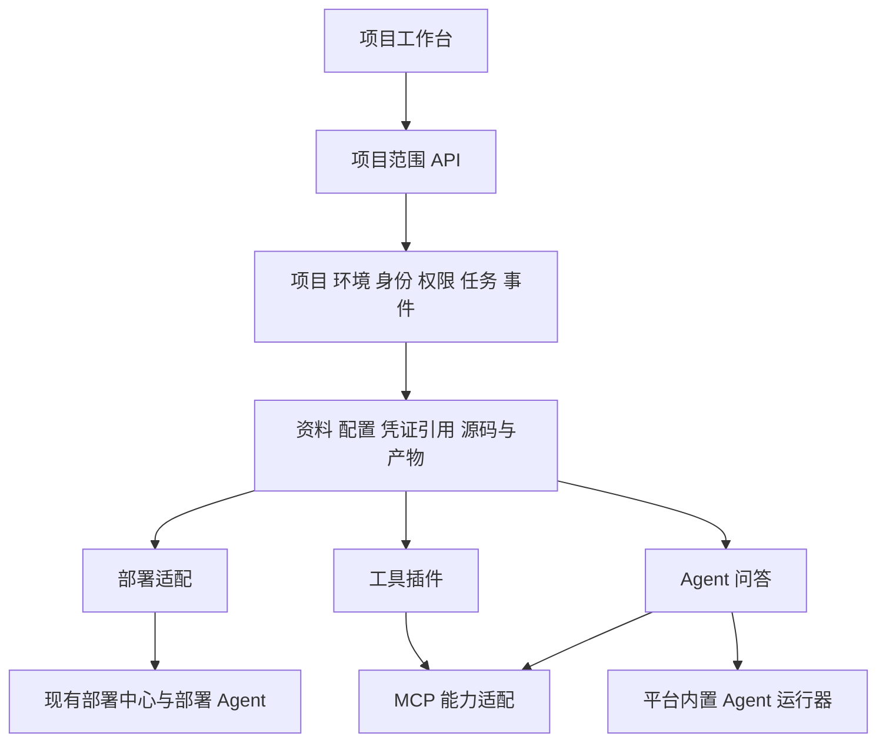

# 项目工作台设计与开发交接

> 本文仍是项目的信息架构、界面和交互设计依据，配合 [前端维护说明](frontend-guide.md) 及文内设计图使用。后续讨论调整了即时保存、文档仅保留最新内容、全局机柜工具、新项目无需兼容旧架构，以及第一轮仅平台内置 Agent 等业务规则，具体差异记录在 [需求补充](workbench-v2-requirements.md)。这些局部调整不意味着放弃本文的统一资料入口、产物来源追溯、发布工作台和 Agent 会话布局。原型的工程检查记录不代表 UI 已获验收；旧在线链接是独立的首版站点。

更新日期：2026-10-21。

本项目将现有源码交付与部署平台扩展为以项目为单位的工程工作台，统一组织资料、配置、源码产物、MCP、工具插件和 Agent 问答。本文汇总本轮已确认需求、交互原型状态及建议的实现边界，供跨电脑继续开发。

当前开发分支为 `feat/project-workbench-prototype`，尚未合并到 `main`。原型与设计图提交为 `6dd0828`，工具名称及旧缓存兼容修正为 `480758d`。本文中的新模块接口与数据模型属于后续实现设计，不能当作已上线的后端能力。

2026-10-21 范围补充：第一轮只实现平台内置问答 Agent；外部用户主机 Agent 的接入认证、心跳与能力上报、中继转发及相关主机执行隔离后置。原有页面结构与设计图继续作为 UI 依据；此调整不移除项目权限、私有会话隔离或既有正式部署 Agent。下列首版交付状态保留为历史记录，后续原型状态见 [工程检查记录](workbench-v2-validation.md)。

## 首版交付状态（历史记录）

| 内容 | 状态与入口 |
| --- | --- |
| 项目工作台交互原型 | 已提交，入口 `web/prototype.html`，代码 `web/src/prototype/` |
| 原型图与生成提示词 | 已提交，位于 `output/imagegen/workbench-prototype-20261020-v1/`，属于首版设计存档 |
| UI 规范 | 已提交到 `AGENTS.md` 和 `examples/frontend-guide.md` |
| 原型浏览器验收 | `test/prototype-browser-smoke.mjs`，最近一次 12 组交互验收通过 |
| 在线交互原型 | [打开原型](https://autoops-workbench-20261020.zjtstc.chatgpt.site)，公开访问，无需登录 |
| 现有真实部署与源码交付 | 已有实现，参考 `examples/workspaces-api.md`、`examples/deployment-guide.md` 与 `agent/README.md` |
| 新资料平台、插件协议、问答运行时、成员权限 | 后续开发范围，目前原型使用模拟数据 |

原型支持资料维护、插件启用与配置应用、源码处理产物预览及 ZIP 下载、Agent 澄清与流式展示、工具轨迹、报告回存、模拟部署以及项目切换。其数据库、服务器、MCP 和模型连接均为模拟。

浏览器数据保存在 `autoops:interactive-prototype:v1` 的 localStorage 中，不随 Git 同步。换电脑或换站点来源后，会重新生成示例数据。资料区里的“系统设计说明.md”等内容也是演示数据，正式开发依据应使用本文及仓库文档。

## 已确认需求

1. 以项目作为工作台的基本单位。项目之间的资料、配置、产物、对话和工具使用相互隔离；项目下区分测试、生产等环境。
2. 集成现有部署能力，使每个项目可以管理服务并自动化部署，复用已有源码快照、任务、日志、健康检查和回退能力。
3. 资料区是项目数据的统一维护入口，包含项目自定义资料、研发文档、原型、设计文档、Git 仓库和各模块配置。资料既供用户查看，也通过接口供其他模块使用。
4. 每个项目统一管理前后端代码、原型、需求和设计资料。面向 Agent 只提供内部原始工作区、外部脱敏工作区两种类型；去 Git 和脱敏组成外部工作区生成过程，前后端源码压缩包作为独立部署交付物。具体约定见本文“工作区与部署包”。
5. 工具插件与平台项目代码一起维护，由各业务项目选择启用并配置。开启插件后，资料区出现对应配置表单；插件引用资料区配置，不另建一份配置来源。
6. 插件机制必须可扩展。“机柜迁移”是本轮示例插件，后续参考 `cabinet-router` 接入真实功能；内部标识暂时保留 `cabinet`，仓库名仍为 `cabinet-router`。
7. MCP 提供数据库、Redis、服务器等外部能力，优先复用已有成熟实现，补齐项目、环境和权限适配。
8. 第一轮问答只使用平台内置 Agent，读取项目资料、源码产物及获准的只读 MCP 工具，重点完善网页与 Agent 的交互。用户其他主机提供的外部 Agent 作为后续范围保留。
9. 本版不实现项目工作流编辑器；基础任务、事件和产物接口需要便于后续工作流调用。
10. UI 统一采用 [T3 UI 规范](t3-ui-standard.md)，复用锁定版本 T3 Code 的组件、主题、布局与交互，默认简体中文；早期 Solid Glass 材质要求由该规范替代。页面、模块和卡片标题下不添加泛化说明性副标题。

## 建议架构

第一阶段采用模块化单体中心服务，复用现有 Node.js、SQLite 和部署 Agent，通过内部服务接口及项目范围 HTTP 接口组织能力。耗时的源码处理、部署和问答通过任务执行器运行，避免页面组件直接操作 Git、数据库或远程主机。



| 模块 | 负责内容 | 对上层的主要输出 |
| --- | --- | --- |
| 项目基础 | 项目、环境、成员、角色和资源归属 | 项目上下文、访问校验 |
| 资料与配置 | 项目信息、自定义字段、文档及版本、资源配置、插件配置 | 配置快照、文档内容、凭证引用 |
| 工作区与产物 | 内部原始工作区、外部脱敏版本、前后端部署包及来源追溯 | 两种 Agent 工作区与可校验的部署交付物 |
| 任务与事件 | 异步执行、进度、日志、取消、幂等与重连 | 任务状态、增量事件 |
| MCP 适配 | 连接管理、工具目录、连通检查、调用权限 | 项目范围内的工具能力 |
| 插件管理 | 插件定义、启用状态、配置校验、能力入口 | 页面入口、工具调用、执行结果 |
| 部署适配 | 对接现有服务、目标、源码与配置快照 | 发布任务、日志、版本、回退 |
| 问答与运行器 | 会话、上下文引用、Agent 路由、工具调用、结果回存 | 回答、引用、工具记录、报告产物 |

当前正式接口使用 `/api/workspaces/{workspaceId}` 表示项目工作空间，旧 `/api/projects/{id}` 部分接口表示源码仓库下载。新增工作台能力应遵循现有工作空间语义，避免复用名称导致归属混淆。

## 资料与配置

资料区统一维护数据，但后端需要区分不同类型：结构化配置、文档正文、文件或源码产物、敏感凭证。不能把所有内容塞入一个无版本的 JSON 或对话上下文。

- 项目信息支持标准字段及可扩展字段；插件通过配置 Schema 增加输入项。
- 文档保存原始文件、可读文本、版本与项目归属；原型图片和其他附件保留原件。
- 数据库、Redis、服务器等使用统一资源 ID，插件配置保存引用。环境覆盖值按明确规则解析。
- 凭证由服务端安全存储，资料区展示可编辑入口和脱敏状态；其他模块按授权解析凭证引用，不从页面或普通资料接口读取明文。
- 草稿与生效配置分开保存。应用配置产生新版本；任务、对话轮次和部署固定使用创建时的版本。
- 资源被删除、变更类型或停用时，要重新校验引用关系；页面切换和重启不能绕过服务端校验。

建议核心对象为 `Project`、`Environment`、`ConfigRevision`、`DocumentRevision`、`Resource`、`SecretRef`、`Artifact`、`Task`。所有对象明确记录项目归属；环境适用的对象额外记录环境范围。

## 工作区与部署包

2026-10-22 确认：采用“两种 Agent 工作区＋部署包出口”。本节替代此前把原始源码、去 Git、脱敏、压缩分别作为用户工作区入口的方案；处理步骤仍可在平台内部独立复用。该设计是工作台的需求基线。当前 Agent Demo 已实现只读工作区验证：真实 Git 示例、公开 HTTPS 仓库固定提交导入、脱敏生成与二进制复核发布、版本绑定读取和源码 ZIP 导出；目标服务器自动部署及多仓库连接配置仍由后续发布模块适配。Git 获取和处理由平台任务执行，不开放 Agent 任意 Git 操作、源码写入或外部主机接入。

### 类型与来源

| 对象 | 内容与用途 | 来源 |
| --- | --- | --- |
| 内部原始工作区 | 前后端代码、Git 信息及历史、原型、需求与设计文档等完整项目资料，供获授权的内部 Agent 使用 | 项目原始仓库与资料，是唯一原始来源 |
| 外部脱敏工作区 | 保持项目目录结构，去除 Git 历史与敏感元数据，按规则脱敏后的完整资料，供外部使用 | 从明确的内部版本单向生成，不自动反向覆盖内部内容 |
| 前后端部署包 | 分别面向对应服务与服务器的可构建源码 ZIP，以及来源、校验和配置引用 | 直接从内部固定版本导出，不从脱敏版本打包 |

“内部/外部”表示资料访问范围，与模型选择、运行器配置和会话可见性分别管理；外部工作区的存在不改变第一轮暂不接入用户外部主机 Agent 的约定。部署包是交付文件，不构成第三种 Agent 工作区。

参考目录如下；已有仓库的内部结构、构建文件和相对路径保持原样，多仓库分别保留自己的 Git 身份，不强行合成一个仓库：

```text
项目A/
├── internal/                    # 内部原始工作区，保留 Git
│   ├── frontend/
│   ├── backend/
│   ├── docs/
│   └── prototypes/
├── external/
│   └── v001/                    # 相同的相对目录，已脱敏且无 Git 历史
│       ├── frontend/
│       ├── backend/
│       ├── docs/
│       └── prototypes/
└── packages/
    └── release-001/
        ├── frontend.zip
        ├── backend.zip
        └── manifest.json        # 来源版本、校验值、部署配置引用
```

目录示例表达归属，不决定复制、快照、挂载或存储实现。Agent 只获得本次选定工作区的受控访问范围，不能因这些目录相邻而从外部目录访问内部资料或部署包。工作区根入口提供项目地图和平台维护的工作说明，版本身份放入元数据；原件与可读正文保持来源关系，避免在每个业务文件路径中嵌入冗长 ID。说明文件不代替服务端权限校验，也不覆盖仓库已有的项目说明。

### 外部工作区生成

```text
选择内部版本 → 导出文件 → 去除 Git 元数据 → 脱敏 → 检查结果 → 发布外部版本
```

- 固定来源版本。多仓库分别记录完整提交号，资料与原型记录对应内容身份；生成过程不受源分支后续变化影响。
- 处理所有嵌套仓库的 `.git` 目录或文件、历史与敏感元数据；`.gitignore`、`.gitattributes`、CI 等正常项目文件按用途保留，内容仍接受脱敏检查。
- 代码、文档和原型均进入规则范围，支持常见凭据检查及项目自定义替换。图片、PDF 等不能可靠检查的内容列为待确认项，处理完成或明确确认后才发布，不能悄悄原样带出。
- 保存处理规则版本与报告。外部可读的报告和元数据不得携带被替换的敏感明文、内部凭据或不应公开的宿主路径；完整内部追溯信息保留在平台受控记录中。
- 初版采用手动生成、手动更新。每次成功生成新版本，完成检查后才成为可选版本；失败或中止不发布半成品，并保留上一个可用版本。原始内容不被覆盖。
- 外部版本的修改和输出不自动同步回内部。第一轮以只读分析与报告交付为范围，未来代码修改另行设计独立任务副本与明确的变更合入流程。

### Agent 会话绑定

新建对话时选择内部原始工作区，或一个已发布的外部脱敏版本；同时固定项目、环境及输入版本。内部原始资料仅在明确授权下提供；外部使用固定为脱敏版本，没有可用版本时要求先生成或处理待确认项，不回退为原始资料。

2026-10-22 追加确认：选项放在 T3 输入框下方的原生上下文栏，统一选择工作区版本、业务环境、仅自己/项目共享与内置助手。模型及思考强度继续使用输入框原生控件。内部成员默认内部工作区；外部成员只可选已发布且获授权的外部版本。成员身份按项目授予，同时限制环境，不由全局账号角色或前端默认值代替授权。导入、生成、复核发布及原始部署包只向内部项目管理者开放。

首次用户消息被服务端持久接受后锁定上述范围；仅创建原生空会话或预留草稿不锁定。提交中临时冻结，明确未接受才恢复可编辑；网络结果未知时读取原生投影核对，不能以超时或断线认定失败并更换范围。已有旧会话默认按内部范围授权。项目共享还须同时具备工作区与环境权限，不能把内部共享历史开放给外部成员。

文件浏览复用 T3 的目录树、预览页签、面包屑、搜索、分栏及窄屏侧栏；对话页与工作区管理页共用只读数据源适配。浏览显示项目相对路径，实际引用保留不可变版本身份。点击只预览，显式添加、拖动或 `@` 才进入待发上下文。不开放文件编辑、Markdown 勾选写回、宿主终端、IDE 或 Git 操作。切换工作区/环境时，已有正文、附件、引用或预览的草稿保留在侧栏，新开干净草稿，不能自动携带到另一资料范围。

`@` 路径候选按当前层的名称前缀筛选，不混入会话或路径中间包含关键词的结果。唯一匹配时 Tab 补全目录或确认文件引用；多个匹配且尚未明确选择时，Tab 只延长共同前缀，无法继续延长则保留候选。上下方向键或鼠标选择候选后，Tab 将选中的工作区目录补成带 `/` 的相对路径并继续列出该层内容，文件 Tab 则确认引用；Enter 或点击仍可直接引用文件或整个目录。跨目录关键词搜索保留在右侧文件搜索中。沿用 T3 的搜索、输入替换、焦点与版本校验，不执行终端命令，也不实现独立的 Shell。

开始对话后，源资料更新不在后台替换当前输入。切换内部/外部范围时另建对话，不能把已经读取原始资料的消息、附件、工具结果或缓存自动带入外部会话。Agent 启动、恢复、引导/排队和时间线继续复用 T3，工作区生成与部署由平台任务执行器负责。只读输入与会话输出分开管理；私有成果仅显式保存后进入项目公共资料。

### 部署包与发布

```text
内部固定版本 → 按服务构建上下文导出 → 前端/后端源码 ZIP
             → 对应服务器下载并校验 → 独立版本目录解压
             → 构建 → 部署 → 健康检查或失败回退
```

部署包不经过内容脱敏替换，避免占位符破坏构建与运行。按服务声明的构建上下文确定范围，保留共享依赖、依赖声明、锁文件、模块及必要构建文件，排除 Git 历史与缓存；不能只截取 `src` 目录。运行环境配置通过项目/环境部署配置引用管理，不把平台凭据库复制进包。

前后端可独立选择版本、生成包和部署，也可批量提交，各服务分别记录结果。每个发布记录绑定仓库提交、源码包 SHA-256、配置快照、目标服务器与任务；先验证包身份再解压构建，失败沿用已有健康检查与回退语义。优先复用现有固定源码归档、下载校验、服务器解压构建及发布能力，具体适配须在独立环境验收。

每个生成结果记录稳定 ID、项目归属、父来源、来源提交或资料内容身份、配置与处理规则版本、内容校验值、创建任务和状态。内部来源记录和外部可见元数据分别控制访问；生成结果不覆盖输入。资料页面只保留最新内容的约定与任务固定输入分开处理，输入快照的具体保存和清理实现留待技术设计。

### 页面与接口边界

初版只提供“内部工作区”“外部工作区”“部署发布”三个业务入口。去 Git 与脱敏出现在外部工作区生成任务的真实阶段和处理结果中，不要求用户手动拼装通用加工流程。保留按需生成前端包、后端包或两者的操作。

下列接口是建议契约，尚未实现，实际开发时结合现有路由约定确定；现有 `/api/workspaces/{id}` 继续表示项目范围，不将其 ID 混同于某个派生目录或版本：

| 项目范围下的能力 | 建议接口示例 |
| --- | --- |
| 项目信息与配置版本 | `GET /api/workspaces/{id}/config` |
| 保存草稿与应用版本 | `PUT /api/workspaces/{id}/config/draft`、`POST /api/workspaces/{id}/config/apply` |
| 文档列表与版本内容 | `GET /api/workspaces/{id}/documents`、`GET /api/workspaces/{id}/documents/{documentId}/versions/{versionId}` |
| 获取与固定内部来源 | 沿用仓库获取能力，固定提交和资料输入身份 |
| 生成外部工作区 | 项目范围内提交来源、规则版本和幂等请求，返回任务 ID；独立处理器在平台内部组合 |
| 生成部署包 | 项目范围内提交服务、来源版本和配置引用，分别生成前端或后端包 |
| 工作区版本、内容和产物下载 | 按项目、使用范围与具体版本授权；复用产物详情、文件和下载能力 |
| 异步处理状态 | 复用或扩展项目任务与事件接口，并区分任务类型 |

耗时请求返回任务 ID。处理器之间传来源引用，不重复传输整份源码。任务需支持幂等请求；运行任务和保留部署版本保护依赖，已完成任务及历史会话引用的删除规则继续按需求补充执行。

## 插件与 MCP

插件定义建议包含稳定 ID、版本、名称、配置 Schema、配置迁移规则、依赖能力、页面入口和工具声明。项目保存插件的启用状态与配置版本。初版可以在仓库内注册受控插件，后续再考虑独立分发，不需要先实现插件市场。

启用流程为：选择插件 → 在资料区生成配置入口 → 选择资源或文档引用 → 校验并应用配置 → 项目工具可用。停用后保留历史配置和产物，阻止后续新调用；执行中任务的处理策略需明确。

“机柜迁移”的真实业务以 `cabinet-router` 的实现及后续需求核对结果为准。目前原型只有设备列表、筛选和问答等演示，名称调整不代表迁移执行能力已经实现。

MCP 连接配置由资料区维护，连接模块负责状态和能力，插件与 Agent 通过同一授权入口调用。现有成熟 MCP 的代码位置、接口和认证方式需要在正式接入前核对。不要将原型里的 `connected` 字段作为真实连通性判断。

## 研发资料与检索

资料区是资料的持久来源，RAG 是读取资料的一种方式，两者无需二选一。

建议第一阶段采用“资料存档 + 文本提取 + 按项目过滤的搜索 + 用户选择引用”。少量文档按预算直接放入上下文；大文件先检索相关片段。上下文显示文档或产物名称、版本及引用位置。

当资料规模、上下文成本或搜索效果确有需要时，再增加向量索引与混合检索。索引属于可重建的派生数据，绑定项目与文档版本；资料删除或权限变更后，检索结果也要同步失效。图片原型保留原图，按模型能力读取，必要时增加 OCR。

## Agent 问答与后续主机接入

区分现有“部署 Agent”和新增“问答 Agent 运行器”。第一轮仅平台内置问答 Agent；既有部署 Agent 的职责与使用说明保持，不将它直接当作已具备问答能力。

本轮流程为：管理员配置平台内置 Agent → 用户在授权项目中选择 Agent → 固定会话环境、工作区使用范围与输入版本 → 只读问答分析、流式回传 → 按可见范围保存回答和报告。私有/项目共享权限按 [需求补充](workbench-v2-requirements.md) 执行；内部原始与外部脱敏的访问边界以上文“工作区与部署包”为准。

网页交互至少覆盖：

- 会话历史、所选 Agent、运行状态和本轮上下文可见；换 Agent 或环境另开会话。
- 澄清问题、流式回答、只读工具参数与结果、资料引用。
- 停止、继续；运行中可明确选择引导当前执行或排队到下一轮，防止重复消费。
- 浏览器断线后恢复执行状态与事件，区分任务仍在执行、已结束与连接中断。
- 输出文件与分析报告进入资料产物区，保留来源和任务引用，并遵守私有/共享保存规则。

当前原型演示其中部分交互。2026-10-21 确认参考 Multica 的前端会话体验，并采用 Codex 的引导/排队语义；具体规则及待评审建议见 [需求补充中的会话交互方案](workbench-v2-requirements.md#会话交互参考与已确认方向2026-10-21)。随后优先打磨 Agent 交互小模块：已加入模拟引导、队列编辑、草稿保留与停止保留，供用户体验验收。正式服务端事件持久化、鉴权和真实模型仍待技术选型及实现；原型交互通过不代表这些后端能力已经接入。

复杂的 Agent 运行能力优先安装、复用成熟项目，避免从零实现执行器。后续技术选型比较整套 Multica 适配与现有运行器接入；共享会话、只读工具、真实引导及许可证是需要核对的差异，初步源码评估见需求补充中的“实现可行性与复用原则”。当前尚未决定具体复用路径。

### 后置范围：外部用户主机 Agent

此前讨论的主机登记、Windows/macOS/Linux 主动接入、接入认证、能力声明和心跳、中心中继与会话转发，以及相应的主机身份、工具授权、多主机执行隔离，不属于第一轮。暂不为本轮要求实现远程接入协议或外部运行器。

后续重新讨论时可参考原目标流程：用户登记主机及 Agent → 主机认证连接中心并上报能力与心跳 → 按项目授权使用 → 会话选择 Agent → 显式传入允许的上下文与附件 → 执行并回传结果。统一运行器接口、任务有效期和远程工具/文件授权均在该阶段核对，不默认开放用户主机上的所有工具或文件。

### 任务与操作记录的含义

任务展示一次执行进行到哪一步、最终结果以及详细日志，例如源码处理或发布；操作记录记下谁在什么时间、对什么对象做了什么、结果如何，例如修改配置或删除资料。耗时操作可同时产生任务与操作记录。“审计”在当前原型中指操作追溯，不代表需要审批。当前入口为“任务与审计”，包含“任务”和“操作审计”两个页签。

用户指定的参考项目：

| 参考 | 用途与阶段 |
| --- | --- |
| [multica](https://github.com/multica-ai/multica) | 第一轮参考 Agent 与前端的会话交互、输入保护、流式阅读和工具展示；多主机接入仍为后置范围 |
| [ai-workbench](https://github.com/coco-ari/ai-workbench) | 参考现有本地 Agent 半成品及脱敏文件使用流程，重点改进网页交互 |
| `cabinet-router` | 机柜迁移插件的实际业务参考；原开发机路径为 `D:\work\cabinet-router` |

这些参考仓库未随本仓库作为子模块提交。其他电脑需要另行获取；使用前核对版本、许可证、配置与实际接口。

## 部署集成与实现顺序

保留现有项目、环境、服务、服务器和目标身份，通过适配层接入资料配置及产物服务。既有部署功能继续可用；新增配置不能改写正在执行任务或已部署版本的快照。

当前正式平台采用管理员会话，尚无完整项目成员账号与权限体系。原型中的“项目成员”和浏览器项目隔离不能替代正式多用户授权；应在接入真实资料和平台内置问答前完成服务端项目范围校验；外部个人主机接入的额外校验后置。

建议按以下顺序交付，每一步均可独立验收：

1. 明确项目与环境模型、成员权限、配置版本、凭证引用及任务事件契约。
2. 落地资料维护与资源配置接口，将原型模拟数据替换为真实持久化。
3. 落地内部原始工作区、外部版本生成和前后端部署包；内部复用源码快照、去 Git、脱敏和压缩处理器，验证来源追溯、范围隔离及现有部署适配。
4. 建立插件注册与配置 Schema 机制，接入一个真实机柜迁移业务流程及 MCP 能力。
5. 接入平台内置问答运行器，完成上下文、只读工具授权、浏览器断线恢复和报告回存。

后续阶段再讨论用户远程主机与 Agent，届时核对接入认证、能力/心跳、中继转发、离线重连及主机执行隔离；这些不作为第一轮完成条件。

工作流编辑器留到后续版本。第一阶段只保留可组合的操作接口、任务事件与产物依赖。

## 在另一台电脑继续开发

准备 Node.js 24 或更高版本，以及 `package.json` 指定的 pnpm 11.25.0。使用可访问该 GitHub 仓库的账号，在新目录执行：

```bash
git clone --branch feat/project-workbench-prototype https://github.com/coco-ari/CodeMinificationRepository.git
cd CodeMinificationRepository
pnpm install --frozen-lockfile
pnpm dev:prototype
```

打开 `http://127.0.0.1:5173/prototype.html`。若机器已有仓库，在确认本地改动已妥善保存后执行：

```bash
git fetch origin
git switch feat/project-workbench-prototype
git pull --ff-only
```

建议先读 `AGENTS.md`、本文和 `examples/frontend-guide.md`。原型相关代码分工如下：

| 文件 | 内容 |
| --- | --- |
| `web/src/prototype/context.jsx` | 示例数据、项目状态、配置草稿与应用、浏览器存储 |
| `web/src/prototype/App.jsx` | 导航、项目概览与页面组织 |
| `web/src/prototype/materials.jsx` | 项目资料、仓库及插件配置 |
| `web/src/prototype/artifacts.jsx` | 源码处理演示、产物、预览及下载 |
| `web/src/prototype/operations.jsx` | 项目工具、MCP、主机、成员及模拟部署 |
| `web/src/prototype/chat.jsx` | 问答交互与模拟执行 |
| `src/workspaces.mjs`、`src/workspace-http.mjs` | 现有正式项目工作空间逻辑与 HTTP 接口 |
| `src/deployment.mjs`、`src/source-archives.mjs`、`agent/` | 现有部署、源码档案与部署 Agent |

修改前端后运行 `pnpm build:ui`。需要完整原型交互验收时，保持开发服务运行，再开一个终端执行 `pnpm test:prototype`；测试需要本机 Chrome 或 Edge，也可使用 `BROWSER_PATH` 指定浏览器。

所有新增或修改的代码注释、Git 提交标题与正文使用简体中文。UI 继续遵守仓库规范；不要将对话中的方案直接当成已实现能力。

在线站点是独立静态发布副本，源码推送不会自动更新站点。发布时导出 `dist/web/prototype.html` 为站点首页并携带其引用资源，使用现有 Sites 身份更新，保持公开访问。仓库不包含浏览器个人数据、运行凭证、参考仓库或独立站点发布凭据。
