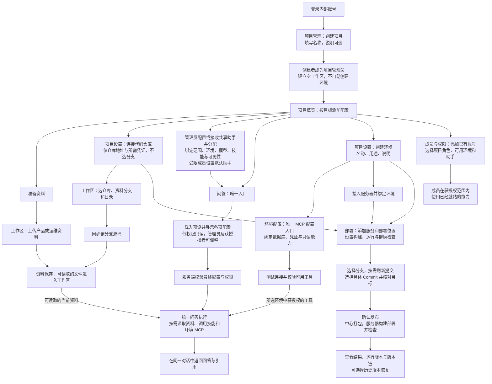
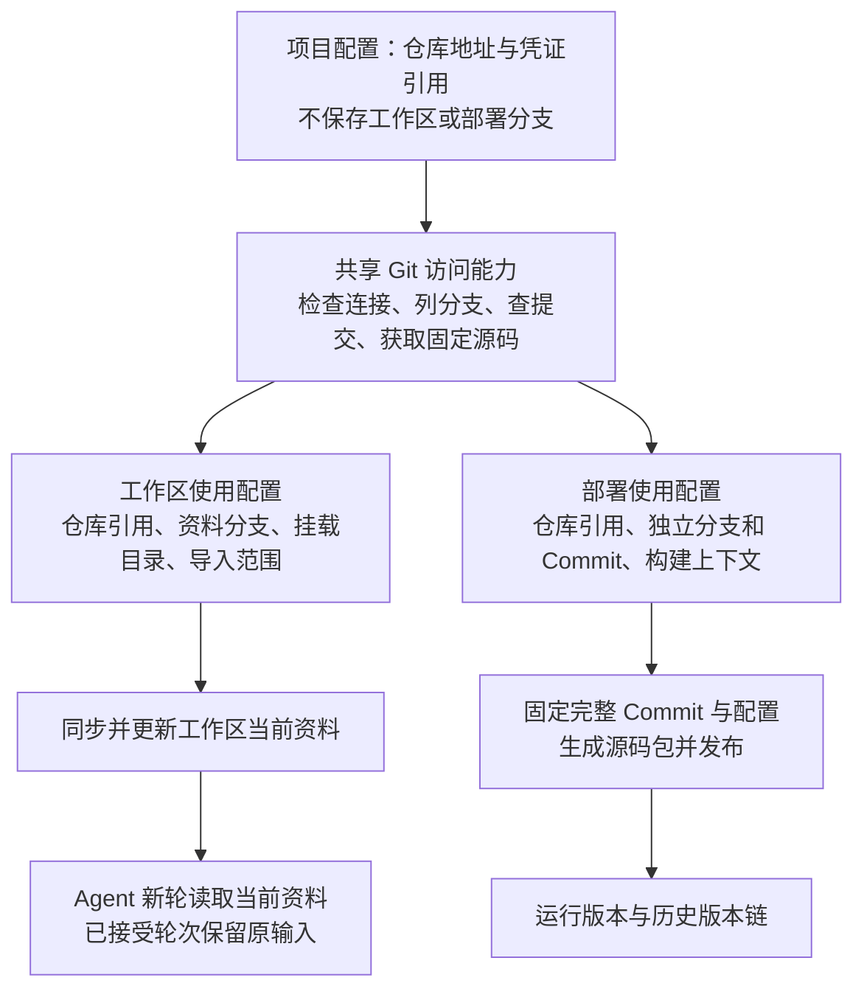
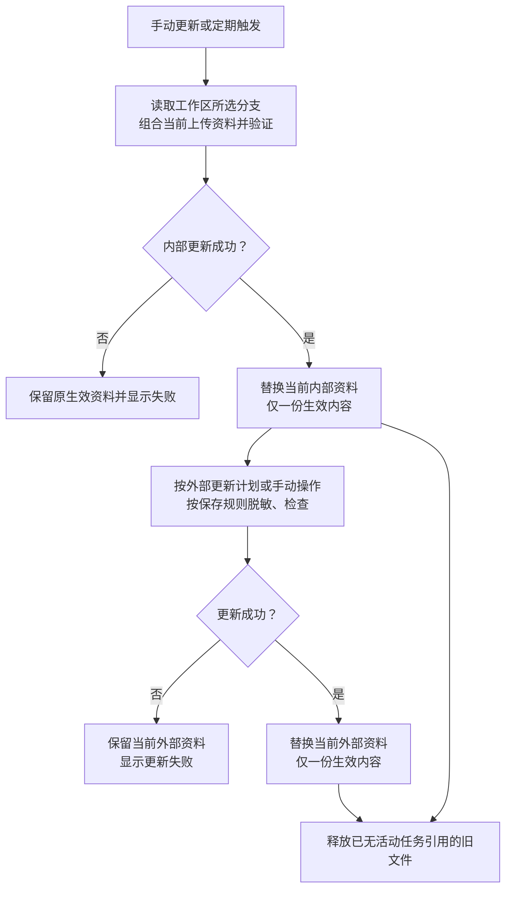
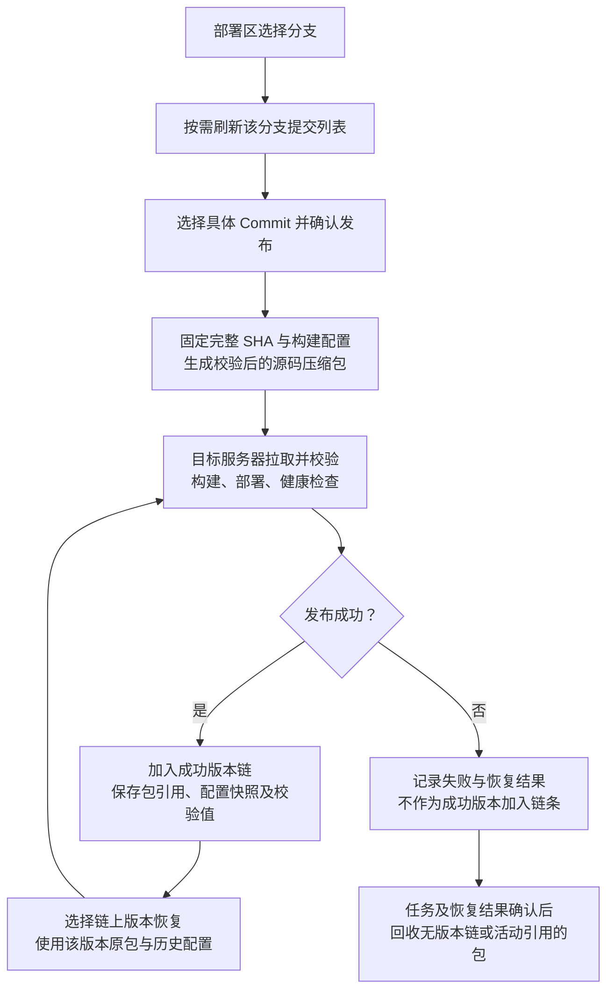
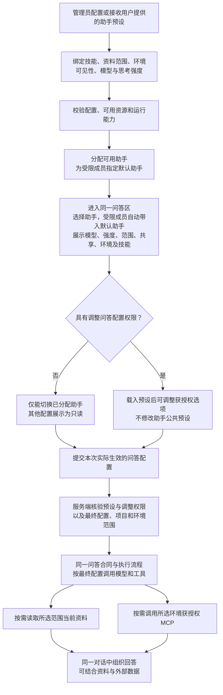
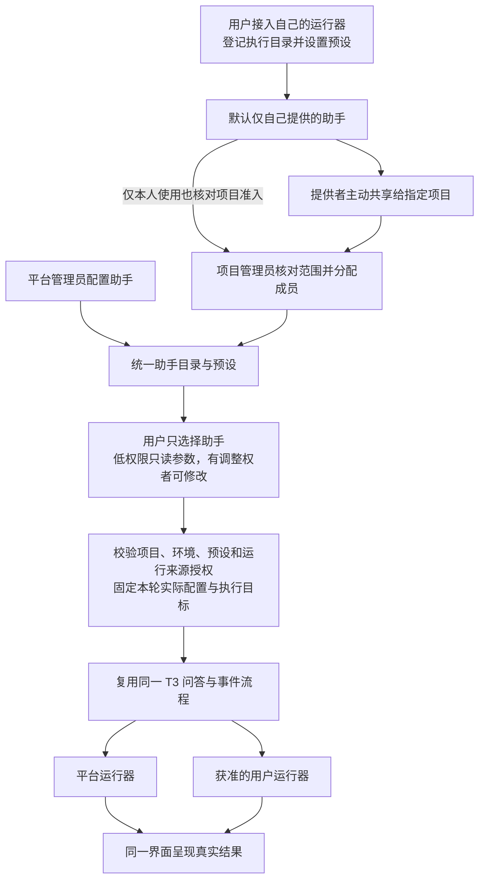
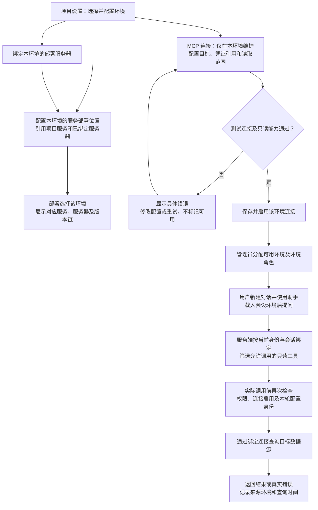
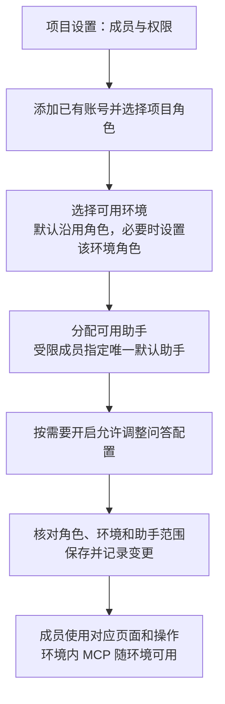
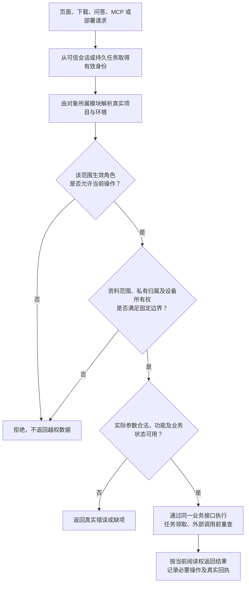

# 项目工作台设计与开发交接

> 本文记录业务设计及历史验证。当前重建遵循 [项目全局规范](../AGENTS.md)、[后端架构与模块规范](backend-standard.md) 和 [T3 UI 规范](t3-ui-standard.md)：优先复用成熟开源能力；现有功能保留、内部实现替换和新平台数据策略统一遵循 AGENTS.md。业务规则见 [需求补充](workbench-v2-requirements.md)；旧原型图、选型评估和部署记录不构成新架构约束，未验收功能不能标记为已实现。

更新日期：2026-10-27。总体顺序遵循 AGENTS.md 和[重建计划](autoops-rebuild-plan.md)；当前实施阶段及本轮已接受范围以[开发与验证](../docs/development.md#完整交付实施清单)和用户最新指令为准。已确认事项持续完成，历史阶段不重新启动；未纳入本轮的远期目标不自动扩入。

本项目按全新产品建设以项目为单位的工程工作台，统一组织资料、配置、源码产物、MCP、工具插件和 Agent 问答。现有部署能力作为经验证的业务参考，按新模块边界复用；本文供跨电脑继续开发。

首版原型分支为 `feat/project-workbench-prototype`，原型与设计图提交为 `6dd0828`，工具名称及旧缓存兼容修正为 `480758d`。当前工作区部署与项目导航验证在独立分支 `feat/workspace-deployment-validation` 进行，未合并到 `main`。各模块实际开放范围以相应运行记录为准，本文中的后续接口与数据模型不能当作已上线的后端能力。

历史范围（2026-10-21，客户接入已由后续确认更新）：当时第一轮只实现平台内置问答 Agent；外部用户主机 Agent 的接入认证、心跳与能力上报、中继转发及相关主机执行隔离后置。原有页面结构与设计图继续作为 UI 依据；此调整不移除项目权限、私有会话隔离或既有正式部署 Agent。下列首版交付状态保留为历史记录，后续原型状态见 [工程检查记录](workbench-v2-validation.md)。

## 创建与删除闭环（2026-10-29）

当前删除规则统一见[创建与删除闭环](resource-deletion-design.md)：删除前确认，清理对象及所属关系、文件、版本和任务。历史会话、收据及已完成任务不再作为阻止显式删除的理由；其他独立对象及外部资产按归属保留。下文固定输入和历史版本说明适用于对象仍存在时，不能用来保留用户已确认删除的原件。后台已开始的动作先收口，失败沿原请求继续。

## 当前导航与配置体验（2026-10-29）

[工作台导航与配置体验](workbench-navigation-design.md)是本次入口归属的当前设计：全局工作台集中全部项目、我的助手、全局 skills、平台节点及账号；进入项目后只展示该项目的问答、工作区、部署、skills、助手和项目设置。全局页面不借用最近项目标题。项目设置侧栏仅为本项目配置分组，助手配置进入统一管理页；助手编辑使用整页表单，启停在列表行直接操作。共享、撤回、实际权限与原请求恢复合同保持。下方历史“更多”“我提供的”等入口名称按本节替代，不代表另存一套管理页。

## 当前会话交互补充（2026-10-29）

- 问答输入区只保留助手、资料/运行位置、环境三个等宽紧凑摘要；长名称截断并可聚焦查看全文。接受首条消息后全部保持原绑定，助手不再提供选择或刷新菜单；名称优先显示实际助手，历史缺名时按来源显示“本机助手”或“项目助手”。
- skill 仅通过输入框 `$` / `¥` 唤起选单，移除底部重复下拉；已选预设的 skill 配置保留。界面统一使用小写 `skill`，会话同步、刷新及错误提示用中文，用户自定义名称不改写。
- 会话创建者在已有会话的侧栏更多或右键菜单随时调整“仅自己 / 项目共享”，不再要求问答参数调整权限。其他成员不能修改这项设置；原生子任务跟随父会话。此设置只改变共享范围，不解除助手、电脑、目录、环境和已接受输入的绑定。
- 共享自己的电脑会话即授权当前项目成员在原会话内继续操作原电脑，实际发起人单独记录；不要求成员再次分配同一个助手，不开放新建其他电脑会话或改绑目录。共享其他提供者的来源继续使用原提供者授权规则，不能替他人开放电脑。
- 改回“仅自己”后其他成员不能继续读取、发送或启动排队中的任务；已开始的工作及其结果不会被伪装成撤销。模型下线保留当前目录与明确原因，恢复后可沿原会话继续。

本节覆盖下文历史描述中“会话开始后可见性不可改”或“一律只允许私有电脑会话”的限制；下文预设参数限制仍适用于新草稿，平台资源权限继续按原合同检查。

## 项目建立与功能启用总图

本总图于 2026-10-25 开始评审，2026-10-26 已按用户确认的仓库分支分离、工作区与部署保留规则、助手预设、环境 MCP 及简化权限方案修订。业务规则以本版为准，页面细节及实现另行推进；图不代表相关能力已完成接入，实际状态仍以[开发与验证](../docs/development.md#当前状态)为准。

2026-10-26 用户明确：项目配置只连接仓库与凭证，不选择或保存业务分支；工作区与部署分别选择自己的分支和使用配置。下图和[Git 仓库与使用配置分离](#git-仓库与使用配置分离)已按此修订，其余待确认设计保持原范围。

同日进一步明确：每个项目的内部、外部工作区各保留一份当前资料，可手动或定期更新；部署长期保存版本链所需源码包。助手可由平台或用户提供预设，并由项目管理员配置及分配，受限用户只能选择已分配助手，开放问答前须有唯一可用默认助手。对应生命周期与授权细化见[工作区更新与部署归档](#工作区更新与部署归档)和[助手预设与问答准入](#助手预设与问答准入)。当时仅评审设计，后续实施按当前交付清单推进；数据清理仍须遵循现有授权和引用保护，不能由设计文档单独授权。

环境配置进一步确定为 MCP 连接的唯一维护入口，并关联该环境的部署服务器与服务配置。问答通过所选环境使用获授权 MCP，部署通过所选环境定位服务及服务器；两者引用同一环境身份，不各自维护环境副本。

从创建项目开始，可以分别准备工作区资料、环境连接和部署配置，不设“所有配置完成”开关。产品只有一个问答入口和一条问答执行流程；工作区资料读取与环境 MCP 查询是同一问答可按需组合的能力，不是两个问答页面、模式或助手类型。每项能力同时检查配置条件与当前用户权限；配置完成不会自动授予权限。无依赖的资源故障不关闭整个项目。

### 从创建项目到使用功能

图中分支表示按需要配置，可以并行，也可以以后补充；不是要求按从左到右的顺序完成全部配置。每个使用终点还需满足下方启用条件表。



这是 Git 源码发布主链。目标中的直接镜像发布不强制补 Git 仓库，但须按自身合同独立实现和验收，不能视为本次 Git 迁移已经交付。部署的固定源码获取不依赖工作区所有仓库同步成功；无关资料、未连接的 MCP 不阻止发布。

### 项目管理的页面与配置归属

全局“项目管理”展示有权查看的项目，左上角项目菜单保留进入管理及创建项目的入口。项目卡片显示名称、说明、环境、仓库和服务器数量，以及当前用户可见能力的就绪情况；不混入所有服务的部署面板。点击进入项目后，模块始终受顶部唯一项目范围约束。项目配置与业务页面共用锁定 T3 的外壳，不创建另一套后台导航。

项目概览保留“配置项目”和已可用业务入口。缺项可直接跳到对应表单，保存后回到原任务；不要求用户完成一次性长向导。卡片上的资源数量也按当前权限过滤，不能用数量泄露不可访问资源。

| 入口 | 用户配置或操作 | 唯一数据所有者与使用者 |
| --- | --- | --- |
| 项目设置 → 基本信息 | 名称、说明 | 项目模块；所有页面使用同一项目身份 |
| 项目设置 → 成员与权限 | 添加已有账号，分配项目角色、可用环境及环境角色、助手和默认助手 | 项目模块拥有成员事实，授权模块拥有授权记录 |
| 项目设置 → 代码仓库 | 名称、地址、凭证引用、连接检查；不选分支或工作区目录 | 现有 Git 来源能力拥有唯一连接记录；工作区与部署共用其公开接口 |
| 项目设置 → 凭证 | 创建、替换、撤销项目内凭证，查看授权后的使用关系 | 凭证模块拥有秘密，授权模块裁决使用和管理；不返回已有明文 |
| 项目设置 → 环境 | 环境名称、类型、说明，集中展示 MCP 连接、部署服务器和服务配置入口 | 项目与环境模块拥有环境；类型不自动改变服务配置或授予生产权限 |
| 项目设置 → 环境 → 环境连接 | 唯一 MCP 配置入口：MySQL、Redis 等预置连接、数据库范围、只读工具、检查与停用 | 资源与连接模块拥有连接及唯一所属环境；工具接入模块拥有工具声明；不复制配置到助手 |
| 项目设置 → 环境 → 服务器 | 登记或选择已接入服务器，绑定环境、检查执行器状态 | 资源与连接模块拥有节点和绑定；部署模块引用，不复制节点主记录 |
| 项目设置 → 环境 → 服务 | 查看本环境的服务、部署位置及运行版本，进入同一份服务配置 | 发布与部署模块拥有服务和部署位置；环境页面通过公开接口展示和进入，不再保存一份配置 |
| 项目设置 → 项目助手 | 管理预设、分配可用助手与默认助手；绑定技能、资料范围、环境、会话可见性、模型与强度 | 助手模块拥有预设与分配，技能模块拥有技能内容，授权模块拥有调整权限；不复制环境连接或凭证 |
| 工作区 | 选仓库及资料分支、挂载目录和导入范围；上传、编辑、手动或定期更新、浏览及外部脱敏更新 | 资料与工作区模块拥有使用配置和当前内容；内部、外部各一份，仓库连接编辑链接到项目设置 |
| 部署 → 服务配置及发布 | 服务引用仓库，独立选择分支与 Commit，配置各环境部署位置、构建、运行和健康检查 | 发布与部署模块拥有使用配置、服务、位置和版本链；不读取工作区分支作为默认来源 |

项目管理只组合这些公开能力，不新建汇总配置数据库或第二套 CRUD。凭证仅在需要的连接中选择；公开仓库不强制创建凭证。已存在的项目公共服务器节点可保留，部署使用前须明确绑定环境；MCP 连接必须归属一个具体环境，不存在绕过环境直接调用的项目公共 MCP。同一数据源需要在多个环境使用时，分别配置环境连接并继承各自环境授权，可在管理员允许时引用同一凭证，不将一个环境的成员范围传播到另一个环境。首批接入仍限已约定的预置类型，不因“环境连接”入口扩展成任意 MCP 安装市场。

### Git 仓库与使用配置分离

仓库回答“从哪里获取、用什么身份访问”；工作区回答“日常资料使用哪条分支、放在哪里”；部署回答“本次发布哪个提交、怎样构建、发到哪里”。项目配置保存仓库和凭证引用后即可供两个模块使用，不要求先同步工作区。



- **项目配置**：仓库名称、地址和凭证引用；连接检查可以读取远端分支列表和默认分支信息，但不据此保存一个全局业务分支，也不自动创建工作区跟踪配置。公开仓库可不使用凭证。
- **工作区**：选择项目内仓库，再选择资料分支、挂载目录及导入范围；这些值归工作区使用配置。初次可以建议远端默认分支，但由工作区确认和保存。多仓库分别选择。改变项目共享工作区的分支属于资料管理操作，影响之后的新轮资料，不是个人临时浏览筛选；上传资料、已经接受的轮次和已发布外部资料不被改写。
- **工作区引用选择**：添加或编辑源码来源时，通过当前项目仓库的公开接口读取远端分支及标签，支持搜索选择、刷新和局部失败重试，默认分支显示实际名称；提交 SHA 保留手动输入。分支、标签仍可手填，列表截断或暂时不可用不丢弃草稿，也不伪装已验证。切换仓库或引用类型清空不再适用的引用；旧请求不能覆盖新仓库候选。选择引用只更新表单，保存和同步沿用原授权及流程。
- **源码容量**：Git 同步保留完整历史；默认允许检出源码 1 GiB、100,000 个文件、单文件 64 MiB。包含 `.git` 的导入临时目录与完整快照另限 4 GiB、200,000 个文件，不把 Git 对象包当作单个源码文件限制。额度由启动环境配置，非法值拒绝启动；超限提示具体维度、已扫描量和上限，失败不发布半成品。手动上传资料及文档提取使用各自已有额度，不随 Git 额度自动放宽。
- **部署**：服务引用同一仓库，在部署区选择任何当前凭证可读取、项目权限允许且实际可获取的分支及具体 Commit。可以记住本服务及环境自己的选择，但不能继承或回写工作区分支。没有历史选择时可读取远端默认分支作为候选，最终提交必须固定用户确认的完整 SHA，分支后续移动不改变该任务。
- **数据隔离**：工作区目录与部署构建目录分别配置；服务构建上下文不受工作区导入子目录限制。两边可以复用受控 Git 对象缓存和读取能力，不能共用会被 checkout 改写的工作目录。缓存仍检查仓库身份、授权与内容校验，不能通过共用缓存跨项目读文件。
- **失败处理**：切换工作区分支时，先获取并验证候选内容，再更新当前生效分支及资料。失败保留原生效分支与原资料，并明确提示本次切换失败；不能用旧文件冒充新分支。若原分支或来源已被撤权，则不继续提供原内容。部署失败不改变工作区资料，工作区同步失败也不自动改写发布来源。
- **共享变更**：仓库地址、凭证属于共用连接，修改或撤销前展示工作区与服务引用；后续获取按新配置和当前权限检查，既有任务仍按固定身份核对，不能把新仓库内容套进旧收据。凭证失效阻止新的凭证使用，不把已保存源码包的恢复强制改成重新访问 Git。

示例：同一 `backend` 仓库，工作区使用 `develop` 做代码问答，测试服务部署 `feature/order` 的某个 Commit，生产服务部署 `release/1.2` 的另一个 Commit。三者有各自使用配置和固定内容身份；切换其中一个，不修改另外两个。

管理仓库连接、修改工作区资料分支、发布到目标环境分别授权。拥有工作区维护权不自动获得仓库凭证管理权或发布权；拥有发布权不自动获得修改项目共享资料的权限。权限允许的分支不受工作区选择限制，但“任意分支”不绕过仓库读取及目标环境发布授权。

### 工作区更新与部署归档

“各一份”以项目和内部/外部范围为单位：一份当前内部资料、一份当前已发布外部资料。它们可以包含多个仓库及上传文件，不按用户、助手或环境复制整套工作区，也不保留可供用户挑选的旧工作区。部署归档独立于这两份资料，不用于日常问答的资料版本选择。



- 管理员或具有工作区维护权的人配置手动/定期更新。内部更新和外部更新分别设置周期、时区、启停及必要来源；具体周期由管理者选择，默认不擅自开启定时任务。上传资料由明确的上传/编辑更新，Git 同步不能覆盖它们。外部更新从当前有效内部资料生成，不直接拉取未验证内部内容。
- 定时与手动操作复用同一更新应用服务和任务收据，按项目及范围限制并发，避免定时任务覆盖刚提交的手动更新。每次触发重查任务配置和当前授权，失效则停用或拒绝该次执行；不以永久管理员身份绕过撤权。界面只保留“更新”和“更新设置”等必要入口、最近结果及下次执行时间。
- 外部保存一套替换规则，手动及定时更新共用。当前仅对 `.yml` 文件执行默认脱敏和自定义替换，后缀匹配忽略大小写，暂不包含 `.yaml`；其他文本文件逐字节保留，二进制排除及 Git 元数据清理继续执行。后缀范围集中维护，后续按确认需求扩展。内部来源增删后，外部按当时有效内部资料生成，不重复要求确认来源。页面仅展示当前文件与更新入口，不显示外部版本名、版本详情或任务历史；系统仅保留执行和幂等恢复所需状态，不以任务收据保留历史正文。
- 工作区移除会话创建入口，问答统一在问答模块发起。搜索仅筛选文件名；文件工具栏保留一个刷新入口，同时刷新工作区状态及目录，不在标题栏重复提供刷新。
- 新内容先在临时区域准备，通过后一次切换当前指向。失败保留原生效内容及其真实提交，不把旧文件标成新分支；已撤权内容仍不可读。外部按保存的脱敏规则自动处理，成功即整体替换；不设待复核或确认发布。无法按文本规则处理的二进制文件自动排除，并在更新结果说明数量。
- 更新期间的候选文件，以及已接受轮次、排队任务、恢复和未知结果收据所需的旧输入，可以临时保留，不能让运行中读取漂移。对应任务确认结束且无其他活动引用后，由资料所有者回收。用户不管理这些临时输入，不能用“历史会话引用”无限保留整套旧工作区。
- 历史消息保留已发生的文字、来源名称和内容身份；普通工作区文件标签按下文“文件浏览”的稳定定位规则显式打开当前文件，内容变化时提示“当前文件已更新”，不冒充当时原件。用户显式要求旧原件而原件已清理时如实说明，不自动换成新文件。会话附件、显式保存的报告按自身生命周期处理，不因清理工作区旧文件而删除整个对话。

部署使用独立流程与保留条件：



长期保存的中心源码包仅为保留版本链提供恢复依据；同一包可被多个版本引用，不重复复制。刷新提交只更新候选，不打包所有提交，也不改变已选定的完整 SHA。活动发布、恢复和未知结果的必要包临时保护；失败、取消或仅预览下载的临时包在确认终态、完成交付且无引用后自动回收。既有独立源码包下载入口保留，产物不因此成为永久版本历史。

版本链必须同时保存仓库与 Commit 身份、源码包校验值、构建/运行配置快照、目标和结果，只有 ZIP 无法可靠恢复。每次成功恢复新增一条版本记录，不覆盖旧记录；当前版本、恢复基线及活动引用继续保护。服务器当前运行文件、镜像和必要恢复产物由部署执行器按既有策略维护，不在工作区清理中删除。应用升级备份沿既有有限保留策略处理，不把业务旧资料恢复到当前状态。

## skills 启用范围

2026-10-29：中央目录在界面命名为 `skills`，单个条目称 `skill`；自定义名称不翻译。启用范围采用以下三个名称，不再把业务身份“项目助手／报告助手”当作真实助手。

| 名称 | 生效范围 | 管理者 |
| --- | --- | --- |
| 所有项目 | 当前与以后创建的全部项目中可用 | 平台管理员 |
| 当前项目 | 顶部选定项目的所有对话中可用，不需要逐个助手启用 | 平台或该项目管理员 |
| 指定助手 | 当前项目中选择指定真实助手的对话可用 | 平台或该项目管理员 |

同一 skill 按“所有项目 → 当前项目 → 指定助手”取最高已启用范围及其版本，只装载一次。上层启用时下层显示实际继承来源，不能用下层关闭覆盖上层；关闭上层仅取消该范围，按仍保存的下层配置继续判断。skill 本身停用会在所有范围停止新调用，独立于范围开关。范围启用不授予项目成员身份、资料、环境、电脑或工具权限，不自动执行 skill。

项目页的助手目录来自当前项目真实助手预设，显示实际名称和唯一标识，不展示内部业务身份或其他项目助手。刷新、切项目与深链都按相同归属重新读取，已停用助手不作为新分配候选。共享到多个项目的同一助手按项目分别设置，不能从一个项目改变另一个项目的专用配置。

中央 skill 的启用与固定包版本由 skills 模块统一管理。对话每一新轮和行内 `$`／`¥` 菜单复用同一生效目录，既有助手保存的空清单不能过滤掉上层启用内容；已开始轮次固定输入保持，停用和撤权继续检查。界面按范围显示开关与继承状态，低频版本选择、导入及包校验留在原菜单或弹窗。当前阶段旧的测试业务身份分配不作为真实助手分配继续执行；保留包及项目配置，不建立两套长期写入口。

## 助手预设与问答准入

助手配置不再展示“业务助手”选择项及其“项目助手／报告助手”角色选项，避免与用户创建的真实助手混淆。新建助手沿用通用业务身份，查资料与生成报告按用户请求完成；既有配置的内部身份保留，不因编辑其他设置而隐式改写。

助手只是一组问答预设，可以由平台管理员配置，也可以由用户接入自己的运行器后提供，再按项目范围配置和分配。选择助手会填入模型、思考强度、工作区范围、是否共享、环境和技能，并在同一问答界面展示这些实际值；受限用户不能调整，有“调整问答配置”权限的管理员或成员可以在合法范围内修改。两类用户的参数含义、提交合同和执行流程相同，配置是否可调整由权限决定；不因使用预设创建另一种问答模式或执行器。助手不携带管理员身份，不隐式授予资料、环境、数据库或客户电脑权限。

发送时以服务端校验通过的最终配置调用问答：受限用户使用所选预设的配置，有调整权限者使用预设加本次明确调整后的配置。助手标识与预设修订用于记录来源及核验配置调整权限，不能在执行时重新取预设默认值覆盖已经获准的调整。平台助手的工作区读取按最终资料范围，环境 MCP 按最终环境解析；各运行来源的模型、思考强度、技能与可见性使用对应实际值；当前项目、环境和固定访问边界仍须检查。修改当前问答参数不会写回公共助手预设，编辑公共预设是独立管理操作。

| 预设内容 | 管理方式与边界 |
| --- | --- |
| 名称、用途、角色指令 | 用名称说明适用任务；不靠长说明补救选择困难 |
| 提供者与运行来源 | 预设绑定平台或用户提供的运行器及已登记执行目录；用户只选助手，接入管理与使用权限分离 |
| 项目与工作区范围 | 平台助手在当前项目预选内部/外部资料范围，读取最终范围的当前内容，不绑定旧工作区版本；客户运行器不接入平台资料读取 |
| 环境 | 平台助手预选一个环境或明确不使用环境，MCP 根据最终环境和当前权限解析；客户运行器不接入环境 MCP |
| skills | 平台 skill 在 skills 模块按三级启用范围统一管理，预设旧清单不再过滤继承；电脑本地 skill 继续按运行器真实能力配置，是否接入中央范围待用户确认。skill 停用即时影响后续调用 |
| 会话可见性 | 新会话默认“仅自己”或“共享到当前项目”；“自己”指发起用户，不是预设创建者 |
| 模型与思考强度 | 从助手所绑定运行器的真实能力目录预选；有调整权限者可从该目录修改，低权限者只读；无效配置不能标记就绪，不默默换模型或降低强度 |
| 可用人员与默认助手 | 分配到项目内角色或成员；每名受限成员必须解析出唯一默认助手，成员明确指定优先于角色默认，冲突在管理端解决 |

助手分配对象与会话可见性是两个字段：多人使用同一助手，仍分别创建自己的会话；预设为“仅自己”不会变成所有使用者共享历史。共享会话继续检查每个访问者当前的资料及环境资源阅读权。管理员配置预设时不能通过修改默认可见性把既有私有会话转为共享。



受限成员开通问答前，管理端必须配置有效默认助手，并验证其所需权限与模型可用性；缺项显示给管理者补齐。进入问答区自动带入默认助手，有多个可用助手才提供切换。成员正常输入问题、上传附件、引用预设可读资料及停止/继续会话；不能自行增删预设技能、切换资料范围、环境、可见性、模型或思考强度。预设摘要继续展示，具有语义标签和可访问状态，不做可点击但无响应的假选择器。

受限成员缺少有效默认助手、默认助手被停用或分配被撤回时，不允许新发起问答，不随机换成其他助手或内部资料。管理者可以先替换默认助手再移除旧项；受限成员已有其他有效分配时仍可查看候选，但开通状态须由管理者解决默认配置。既有获授权历史保留可读；继续提交同样检查当前助手分配、开通状态和权限。

管理员在管理范围内具有预设管理和问答配置调整能力；其他角色可以单独获得“调整问答配置”，不必升级为项目管理员。该权限只允许调整当前用户本就有权使用的选项，不扩大环境、资料、模型或工具范围。服务端对受限成员以绑定预设为准校验请求；伪造模型、环境、共享或技能参数均拒绝，不能只锁前端控件。

新草稿切换助手时整体载入其配置，替换上一助手的未提交覆盖值；若有不兼容引用，明确提示处理，不将内部引用、附件上下文或已读消息带入外部范围。首次消息接受后保存助手来源、预设修订及最终配置；项目、环境、资料范围与执行目标按最终配置固定，不按预设原值重新绑定。已建立会话继续遵循既有范围及助手切换另开会话的规则，不能通过调整预设改写已经接受的任务。有调整权的人仍按现有规则在新轮选择模型和强度，受限成员使用该会话保存并核验的预设值。管理员更新预设作用于新建会话，不静默重绑旧会话；停用、撤回和资源撤权立即阻止后续不再获准的调用。

示例预设“客户资料助手”绑定外部当前资料、无环境、已分配说明技能、指定模型和强度、仅自己；客户进入后直接提问。预设“测试环境排障”绑定内部当前资料、测试环境、诊断技能及指定模型；只有同时具有对应资料和测试环境范围的成员可以使用。用户提供的运行器仍由提供者管理；跨用户使用须满足下节明确的共享与项目分配，不能仅凭助手预设控制未共享电脑。

### 统一助手与用户提供的运行来源

2026-10-26 用户确认：“我的电脑”接入的运行器也属于用户提供的助手，统一进入助手选择；提供者可以主动共享给指定项目，再由项目管理员分配给成员。用户选择的是助手，不再先学习或选择“平台模式 / 客户模式”。运行来源属于助手预设与管理信息，不新增另一套问答入口或运行器。

| 内容 | 统一设计 |
| --- | --- |
| 平台提供的助手 | 管理员预设平台运行来源、项目资料与环境、技能、模型及思考强度 |
| 用户提供的助手 | 提供者接入自己的电脑或受支持运行器，选择已登记执行目录及运行能力，形成助手预设；默认仅自己，不自动共享 |
| 问答入口 | 同一个助手选择器列出当前用户在项目内可用的助手；不再单独选择运行位置或电脑，已接受会话的真实执行绑定保持固定 |
| 低权限成员 | 无论助手由谁提供，均自动带入预设并显示实际模型、强度、资料范围、环境、共享状态等；不能调整，只有多个已分配助手时才切换 |
| 管理员及有调整权限的成员 | 选择助手后可以修改合法问答参数；模型与思考强度来自这个助手的实际运行器，而非固定展示平台模型目录 |
| 来源与状态 | 用助手名称、提供者及必要的在线/不可用状态识别；来源详情按需查看，不向普通用户展示设备 ID、协议或接入步骤 |
| 管理入口 | “更多 → 助手”统一承载当前项目可用助手及“我提供的”接入管理；项目设置的助手入口进入同一管理界面。问答无需经过管理页，旧“我的电脑”功能并入接入管理，不删除配对、目录登记、状态、撤回和恢复功能 |

“我提供的”是当前账号的资源，项目切换不转移设备所有权；共享和分配始终明确目标项目。用户可以维护自己提供的接入与预设，但项目内的使用资格由项目管理员分配；不能通过自行创建助手绕过低权限成员的参数限制或环境范围。已有自用电脑和会话要按原身份映射到用户助手并验证迁移，不因入口更名自动共享、断开或改绑。



**运行能力与参数。** 模型、思考强度、图片/附件、本机文件与技能能力按所选运行器报告的实际目录展示；中心缓存须区分助手来源及能力修订，本机在执行前再核验。模型改变后重新校验对应强度，支持则保留用户选择，不支持则明确要求选择有效值，不默默降档。低权限用户的预设失效时由提供者或管理者修复，不允许偷偷改用平台模型、其他电脑或另一助手。离线、能力读取失败与确实不支持分别显示真实状态，有结束条件和重试入口，不无限加载。

**使用与管理分开。** 提供者保留接入凭据、目录登记、权限上限、断开和撤回权；共享给项目只允许管理员在该项目分配使用，不转让设备管理权，也不开放提供者的其他目录、私有会话或凭证明文。平台及项目管理员不能代替提供者开启共享或放宽本机权限。低权限调用者使用预设，管理员可调整已支持的模型和强度等参数，两者都不能修改共享设备的根目录和执行上限。目录及运行器身份在创建助手时确定，改变这些身份生成新的绑定，旧会话不会跟随迁移。

**请求的真实身份。** 除项目角色、环境范围与助手参数校验，用户来源还检查“提供者共享仍有效＋项目分配仍有效＋当前执行目录与能力仍允许”。本人与项目共享使用均复用同一业务入口；调用者是实际发起成员，不能改成提供者或项目管理员。提供者共享的是运行能力，不转授自己的项目、数据库或平台权限。发布任务仍走部署模块，不能把用户助手混作部署服务器 Agent。

**执行和数据隔离。** 平台助手保持现有只读业务工具边界；用户助手按提供者明确开放且实际可强制执行的本机策略运行。共享前必须验证工作目录、附件和原生会话按项目及会话隔离，受限调用者不能读取其他人的附件、恢复收据或执行上下文。登记路径不是操作系统沙盒；运行器无法落实共享需要的隔离时，不开放跨用户使用，保留已验证的自用功能。需要超出预授权上限的动作仍由提供者通过本机/T3 权限机制处理，不能由受委托成员自行扩大权限或超时自动批准。

2026-10-27 用户取消 C7 客户运行器受控读取平台资料与环境 MCP：这两项能力继续由平台助手提供，不向客户运行器开放对应工具桥。客户运行器原有的本机文件、图片、附件、技能、已交付资料、共享与隔离、原收据恢复均保留；附件和已交付资料仍按原助手及会话授权交付，不扩展为平台资料库或环境工具访问，不下发提供者的平台身份或数据库秘密。外部成员仍只能使用获授权的外部资料，无法隔离内部内容的用户助手不能分配给外部成员。

“助手共享给谁”与“会话是否共享”仍是两件事：不同成员使用同一助手各自创建会话，提供者不因此获得平台中的私有会话查看权。但用户主机实际承载输入和执行，平台的“仅自己”不能承诺防止主机所有者从本机读取执行数据；助手详情应明确提供者及执行位置，项目管理员分配前应核对资料是否允许在该主机处理，不增加每次提问的人工搬运或重复确认步骤。

**撤回与恢复。** 提供者撤回共享、管理员取消分配或成员失去环境权限后，禁止新提交及尚未发出的工具调用；不自动换设备、换运行身份或重发。已发出的执行保留原收据核对真实结果，断网不伪报停止。新的预设和能力目录只影响后续获准请求，不覆盖已接受任务的来源及模型参数。

### 配置完成后具体可以使用什么

以下条件均以身份有效、功能已实现并启用、当前动作获授权为共同前提。“有权限但缺配置”可以进入已实现模块补齐配置；未实现的能力不进入正式导航，不能用占位页面冒充可用。表中普通问答、资料问答、环境数据查询和外部资料问答描述同一问答入口的使用任务，不新增类型选择器；同一轮可同时读取工作区与查询环境数据。

| 要完成的任务 | 最小配置与成功条件 | 从哪里继续配置 | 不需要的前置条件 |
| --- | --- | --- | --- |
| 进入工作区、添加文件 | 项目创建成功；内部维护者有资料管理权限 | 工作区 → 上传资料 | 环境、Git、部署服务器、MCP |
| 读取上传资料 | 文件保存成功；原件可读取，所需正文或图像能力可用 | 失败文件就地重试解析或重新上传，保留原件 | Git 或数据库 |
| 浏览及分析源码 | 已在工作区选择资料分支，至少一个获授权来源具有完整可读源码；分析还需助手可用 | 项目设置连接仓库；工作区选择分支、同步和刷新 | 全部仓库同步成功、部署服务器 |
| 普通问答 | 项目工作区入口及获分配的可用助手；受限成员已配置唯一有效默认助手；空资料不伪装成已读内容 | 项目设置 → 项目助手 | 非空资料、环境、技能、MCP |
| 资料问答 | 相关资料可读、助手和相应读取能力可用 | 工作区或项目助手 | 环境和 MCP；技能仅按任务需要 |
| 环境数据查询 | 明确环境、可用助手、问答使用权及该环境范围；连接启用且只读工具真实可用 | 项目设置 → 环境 → 环境连接 | 工作区非空、Git、部署服务器 |
| Git 源码发布 | 来源和选定 Commit 可获取；环境、在线执行器、部署位置、服务配置有效 | 项目设置配置来源和服务器；部署配置服务 | 工作区最新同步、上传文档、数据库 MCP |
| 镜像类型发布（目标能力，须独立验收） | 对应合同要求的镜像身份、环境、节点和运行配置有效 | 部署 → 服务配置 | Git 源码仓库及源码包 |
| 历史版本恢复 | 版本链目标和历史配置可用，已核验本机产物或中心源码可恢复，目标执行器可用 | 部署 → 已发布版本 | 重新同步当前分支、当前工作区最新内容 |
| 外部协作资料问答 | 当前生效的外部脱敏资料、外部范围授权、可用助手及获授权技能 | 工作区 → 外部资料；成员与权限 | 内部源码访问、部署权、MCP 数据查询权 |

测试连接成功只证明对应时刻及检查范围可用，不等于之后每次调用成功。MySQL 登录成功还须校验目标库和只读工具；服务器在线还须验证服务所需执行能力。Git 更新超时按已有当前资料合同保留合法可读内容和真实来源时间，不把旧内容称为远端最新；撤权、来源改变或完整性失败不能使用该回退。

### 环境配置与问答调用

环境是项目内的统一使用范围。进入「项目设置 → 环境 → 某个环境」后，可配置该环境的 MCP 连接、绑定部署服务器，并查看及进入该环境的服务配置。MCP 的新增、编辑、测试、停用和移除只能在这里操作；问答、助手、工作区和部署不提供另一套 MCP 配置，缺少连接时仅让有管理权限者跳转到对应环境。

项目服务定义可复用于多个环境；每个环境的部署位置分别绑定服务器，拥有自己的运行配置、当前版本和版本链。例如同一个 API 服务在测试、生产环境分别部署，切换环境后只展示该环境的服务器、服务状态和版本。环境页面与部署页面引用同一份服务配置；环境关联这些资源，不接管连接模块或部署模块的数据所有权。

问答与部署使用同一环境目录，并按当前用户权限过滤。部署在主内容顶部醒目展示环境及管理入口；问答先载入助手绑定环境，在原生上下文栏展示，只有具备调整权限者可选择其他获授权环境，不另加 MCP 选择步骤。草稿确定项目和环境后可发现其可用工具；首次消息持久接受后固定会话环境，换环境另开会话。浏览其他页面、改环境名称或修改默认选择均不改绑旧会话与任务。



无环境的问答不自动选测试或生产连接；获分配该环境且可使用问答的成员，可以使用其中全部已启用只读 MCP，不再增加数据库查询授权。一个环境有多个数据库时，Agent 根据可用连接的名称和用途选择，无法确定业务对象时再澄清，不让用户每轮手工勾选全部工具。测试连接失败不会转用其他环境。结合资料与实时数据回答时，分别记录本轮资料身份和查询来源，不能把工作区静态说明说成服务器实时状态。

会话固定环境 ID；每个新轮解析当前允许使用的连接及配置修订，并在该轮固定，原请求恢复不改用新目标。停用连接、撤销凭证及撤权立即阻止后续调用；已发出的调用根据真实回执收尾，迟到结果在返回及保存前重查权限。权限缓存、连接池和工具候选都不能绕过撤权。平台问答保持只读，数据库写入不属于本轮设计。

### 就绪状态与下一步入口

就绪情况按“能力、环境、资源、当前用户”分别计算，服务端由各模块公开事实聚合，不保存可随意设置的全项目 `ready` 开关。

| 情况 | 界面行为 | 影响范围 |
| --- | --- | --- |
| 有权限但未配置 | 显示一项明确缺失条件及直接配置入口 | 只限制依赖该条件的能力 |
| 配置或连接检查中 | 显示检查状态，保留正在填写的内容 | 不提前宣布可用 |
| 可用 | 展示主要业务操作，省略常驻成功说明 | 关键提交仍检查当前条件 |
| 运行异常 | 显示实际错误、上次检查时间及恢复入口 | 保留其他资源、合法资料与历史 |
| 主动停用 | 显示停用；管理者可进入原配置恢复 | 不接新调用，已接受任务按实际生命周期处理 |
| 无权限或权限已撤回 | 隐藏未授权资源和操作，直链按统一策略拒绝；失效本地数据与订阅 | 不泄露名称、数量、凭证引用或历史内容 |

空工作区允许上传资料，不得要求“已有资料”才能进入上传页面；无服务器可先进入项目环境完成接入，不得要求“可发布”才能打开配置。外部协作者没有维护入口，由内部管理者补齐外部可用资料。恢复配置不会自动重发未知写入结果，仍使用原持久收据核对。

## 项目权限设计

2026-10-26 已确认采用“固定角色＋页面与操作权限＋项目和环境范围”。本节是角色、成员配置及权限产品行为的唯一详细来源；[后端规范](backend-standard.md#账号角色与资源授权)维护服务端裁决与执行约束。此方案替代之前逐个 MCP、数据库、工具、文件、服务和服务器目标分配权限的草案，不代表线上角色与接口已经完成适配。

### 角色决定动作 范围决定对象

角色预置可见页面和业务操作，成员不逐个勾选按钮。查看能力统一覆盖该模块中允许范围内的列表、详情、搜索、预览和下载；维护、发布等写操作另由角色决定。服务端动作标识可以区分发布、回退和重启以校验与审计，但不因此增加同等数量的用户授权开关。唯一额外的成员能力开关是“允许调整问答配置”，与管理公共助手预设分开。

| 角色 | 可见页面 | 主要操作 |
| --- | --- | --- |
| 平台管理员 | 全部项目及系统管理 | 管理账号、全局配置、中央技能及全部项目；仍受私有内容和设备所有权限制 |
| 项目管理员 | 本项目业务页面及项目设置 | 管理成员、环境、MCP、仓库连接、凭证、服务器绑定、助手和项目技能分配；维护资料、对外发布及部署；不因此获得中央技能和全局共享节点管理权 |
| 开发成员 | 问答、工作区、技能库、部署查看 | 维护内部工作区资料和仓库使用配置、同步源码、上传和整理资料、生成源码包；默认不能部署、管理仓库凭证或对外复核发布 |
| 发布运维 | 问答、工作区查看、技能库、部署 | 在获分配环境配置服务部署位置、发布、回退及适用的重启、停止/启动、取消操作；不管理环境 MCP、项目仓库连接或成员 |
| 只读成员 | 问答、工作区查看、技能库、部署查看 | 使用助手、读取资料、在获分配环境查询只读数据及查看状态与记录；不能维护资料或部署 |
| 外部协作成员 | 问答、外部工作区、获分配技能 | 仅使用已发布外部资料及已分配助手；不开放环境、内部源码、部署和凭证入口 |

页面只有在功能已经接入、角色允许且有对应范围时展示有效内容。模块权限不足时不返回其数据；有模块查看权但尚无可用环境时显示真实空态，不泄露其他环境。项目设置及其中管理操作只给管理员，普通成员的环境选择不要求项目设置查看权。技能库只显示当前可用分配，中央技能维护仍由平台管理员负责；项目管理员维护本项目分配及助手，不复制中央库所有权。

内部账号可以创建自己的项目并成为该项目管理员，不受其在其他项目角色影响。平台管理员管理全部项目，项目管理员管理本项目全部环境；普通成员显式选择环境，新环境不自动加入。外部账号只能采用外部角色且不能绑定环境；内部成员需要仅对外资料时也可在该项目使用外部角色，不能把角色名称当成绕过账号类型的途径。

项目级动作使用项目角色，例如工作区维护和成员管理。环境内动作只使用该项目、该环境唯一生效的环境角色；默认沿用项目角色，可为特定环境设置开发、发布运维或只读角色。显式环境角色替代该环境的默认角色，不与项目角色或其他环境角色做权限并集；环境内的发布运维角色也不能反向授予项目工作区维护或成员管理权。管理员的管理范围按前段确定，不通过普通环境角色获得或撤销管理员身份。

资料范围仍区分内部与已发布外部：内部角色默认可读取本项目这两类资料，外部角色仅可读取已发布外部资料。没有逐文件、逐目录或逐仓库分支的成员授权表。仓库凭证可访问范围、工作区导入范围、技能分配、会话最终资料范围及环境绑定依然限制实际可用内容，这些是资源配置或上下文边界，不是新增一套细粒度成员权限。

管理员默认可以调整问答配置，其他角色按一个成员开关控制；环境角色变化不暗中改变此开关。关闭时只能选择已分配助手，预设参数可见但只读；开启时也不能超出项目、资料及环境范围。受限成员必须有唯一有效默认助手才能发起问答；默认助手准入不重复约束具备调整权限者，但所选助手仍须有效且可用。

### 环境 MCP 与部署的授权边界

问答 MCP 的使用条件只有：**可以使用问答，且当前会话环境在该用户可用范围内**。符合条件后，获得该环境所有已启用、通过能力校验的只读 MCP，不再单独分配连接、数据库、表或工具权限。助手预选环境而不拥有 MCP 授权表；切换助手或修改参数都不能绕过环境范围。

管理员仅在环境配置中设置数据源、凭证引用、数据库读取范围及可用只读能力。连接的读取限制对该环境的问答用户一致，底层使用只读账号和受控接口，不依赖提示词或简单 SQL 字符串检查。环境允许查询不等于允许编辑连接或取出密码；问答不执行数据库写入、任意主机命令或部署，即便发起者拥有管理或发布权限。

给普通成员分配某环境，就包含该环境的问答只读数据使用权；“生产只读”包括通过 MCP 查询生产数据，不是仅看环境名称。给环境新增或扩大 MCP 读取范围，也会扩大该环境问答用户可读取的数据，管理员保存前应能看清这一影响。若不应向这些成员开放某数据源，应调整环境及其统一读取范围，不临时补回逐人逐工具授权。

部署按环境角色决定查看或操作，同一环境的服务和部署位置继承这一范围，不逐服务或逐服务器目标授权；目标仍必须真实属于该项目和环境，服务器必须已绑定。跨环境共用的服务身份、仓库关联等字段由项目管理员管理；环境运维仅修改本环境的部署位置、构建及运行配置，不能借编辑共享服务影响其他环境。部署服务引用本项目仓库时可调用服务端 Git 能力，运行凭证的受控使用不等于可编辑仓库或读取秘密。服务器节点可跨环境共享，但只能查看和操作本环境服务；跨项目撤销节点、共享存储策略等全局动作由平台管理员负责，项目管理员仅管理本项目已获准的绑定。

### 成员授权如何操作



管理表单主要是项目角色、可用环境、可用助手、默认助手，以及一个“允许调整问答配置”开关。无环境问答不强迫选择环境，外部角色不展示环境授权选项。管理员只能在自己的管理范围内分配，项目管理员不能授予平台身份。保存时验证受限成员的默认助手有效，且预设资料范围和环境可用；减少环境或变更角色导致默认助手失效时，在管理端明确补齐，不能让使用者靠错误提示猜测原因。

例如李明的项目角色为开发成员，测试环境为发布运维，生产环境为只读，并获准调整问答配置：可以维护内部工作区、发布测试服务、查询测试及生产环境开放的只读 MCP、查看生产状态；不能发布生产服务、编辑环境 MCP、管理成员或取出密码。同名的其他项目环境不在范围内。

### 每次请求如何判定



| 请求 | 统一判定依据 |
| --- | --- |
| 浏览、预览、下载工作区 | 项目角色具有工作区查看权，资料属于允许的内部/外部范围 |
| 上传资料、调整资料分支、同步源码 | 项目角色具有内部工作区维护权，使用配置属于该项目；不能夹带修改仓库地址或凭证 |
| 修改仓库地址、凭证或环境 MCP | 项目管理权，所属项目及环境真实匹配，使用对应配置管理入口 |
| 发送问答 | 问答使用权；所选助手可用；最终配置符合资料、环境范围和调整权限，受限成员不能篡改预设参数 |
| 问答调用 MCP | 会话已固定的实际环境在授权范围内，连接属于该环境且只读能力可用；不查独立 MCP 授权表 |
| 查看部署、日志和版本源码包 | 目标环境角色允许查看；文件、记录及目标确实属于该项目和环境 |
| 发布、回退、重启等运行操作 | 目标环境角色允许部署操作，服务和位置归属正确、节点已绑定；逐目标检查批量任务 |
| 删除部署档案或更改保留策略 | 归相应项目或全局管理能力；显式删除按所属关系清理配置、任务和版本，已领取的远端执行先收口；普通部署操作权不自动包含清理权 |

角色和范围来自服务端事实，不信任请求自报的用户、项目、环境、管理员标记或 capabilities。UI 按服务端能力展示页面和按钮，手工请求同样校验。问答先核验助手来源和调整权限，再保存最终实际配置；MCP 调用从该会话配置取得环境，不能由模型工具参数临时换到其他环境。网页、HTTP/RPC、工具、下载及后台执行复用同一裁决，不能只保护可见按钮。

项目创建、平台管理、全局机柜和客户电脑按既有专用范围路由，不强制套用项目成员条件。四项固定保护规则仍须执行：外部角色不能读内部资料；私有会话和成果仅本人可读；客户电脑由所有者自用、主动共享自己的会话供项目成员在原会话内协作，或通过提供者共享与项目分配供成员建立独立会话；已有凭证明文不返回用户。平台管理员也不能越过这些边界。项目共享会话及其附件、报告、工具结果只向同时具有该会话资料与环境范围的成员开放；取消环境授权后共享历史也不继续暴露该环境数据。

提交、后台领取和实际外部调用前重查当前授权；读取或返回结果时检查当前阅读范围，撤权同步失效候选、订阅和客户端缓存。已发出的外部动作按原任务回执处理，不虚报停止；必要恢复限定原目标并审计。已下载到用户设备的数据不能声称可被远程收回。

电脑所有者共享自己的本机会话时，共享本身授权成员使用这段会话绑定的原电脑、目录、助手和能力，无需另行分配；只允许创建者改变可见范围，其他成员不能改绑来源。消息、排队和恢复保留实际操作者；改回私有拒绝其新操作和未开始轮次，既有副作用不回滚。平台会话及其他提供者来源的共享会话的可读与可继续分别判定：阅读只要求满足该会话的资料、环境和共享范围，不因默认助手失效删除合法历史；继续、引导或排队按同一问答准入校验。受限成员只能以自己获分配预设允许的配置发起新执行，管理员曾调整并共享的配置不自动成为其可用预设；不符合时可以阅读，不能用共享入口绕过参数限制。

权限方案启用前须逐项对照现有成员授权。旧“只看环境”或某个 MCP 的授权不能直接批量转换成可读整个环境；有扩大或缩小范围的账号应由管理员在迁移清单中明确确认。受影响账号在确认前保持原授权边界，不静默扩权；迁移应一次完成所选范围并验证，不建立长期双授权引擎。本次文档调整不修改线上授权、会话或业务数据。

### 设计验收与后续版本流程

以下为待实现的验收场景，不是本次通过记录。简化权限及业务总图已确认，页面和接入仍须验证；后续每批产品版本在本文对应模块段落补充“起点与前置条件 → 配置或操作 → 成功 → 失败与恢复 → 权限拒绝”，链接到本总图，不复制另一份权限矩阵。版本指产品迭代批次，不重新引入用户选择整套工作区历史版本。

| 场景 | 必须观察到的结果 |
| --- | --- |
| 新建只有名称的项目 | 创建者有管理权，空工作区可进入；环境和外部资源不会自动创建 |
| 只上传资料并选择助手 | 可分析该资料，无 Git、环境、MCP 和服务器也可完成 |
| 只有环境数据库连接 | 可用获授权助手查询该环境；空工作区不阻塞，不改查其他环境 |
| Git 与部署准备齐全，另一仓库同步失败 | 仅使用本次服务所需来源，按固定 Commit 正常校验或明确失败 |
| 项目只保存仓库地址及所需凭证 | 不要求分支；工作区与部署均可独立读取分支和提交候选 |
| 工作区使用 develop，部署选择 release 分支 | 两边资料分别对应自己的真实提交，发布不要求切换工作区分支 |
| 工作区分支切换失败或成功 | 失败保留合法的原生效资料并报错；成功只更新工作区，新旧部署任务和运行版本保持原身份 |
| 工作区只导入子目录，部署需要仓库根及共享包 | 部署按自身构建上下文获取固定提交，不被工作区目录裁剪 |
| 已有本机客户会话 | 保持原入口与权限，不被平台 Git、环境或 MCP 前置条件阻断 |
| 测试发布运维加生产只读 | 测试发布通过；直接请求生产发布仍拒绝 |
| 获分配生产只读环境且能使用问答 | 可调用环境全部启用的只读 MCP；不可发布生产、修改连接或读取凭证明文 |
| 环境新增或停用 MCP | 新增已启用连接随环境可用，停用后禁止新调用；没有逐连接成员授权步骤 |
| 外部账号或跨项目同名环境 | 原始资料、生产连接、发布和跨项目读取均拒绝 |
| 管理员打开他人私有会话或调用未共享电脑 | 拒绝；管理身份不越过私有内容及提供者授权 |
| 切环境、撤权或停用后的迟到结果 | 不改绑已接受任务，不恢复已失效数据，不伪造任务终态 |
| 共享会话中有环境查询结果 | 失去相应阅读范围后不能继续读取历史结果、附件或报告 |
| 新建生产环境 | 普通成员不自动获权；凭证和连接不从测试环境隐式复制 |
| 连续手动与定期更新内部、外部资料 | 各范围仅一份当前内容；失败不替换，已无活动引用的旧内容回收 |
| 更新时旧轮次仍运行，之后确认结束 | 运行中输入不漂移；结束后释放引用，历史消息不永久保留旧原件 |
| 刷新部署提交但不发布，或发布失败 | 不为每个提交长期存包；无版本链和活动引用的临时包回收，失败记录保留 |
| 低权限成员进入问答 | 自动使用默认助手；配置可见但不可改，只能切换已分配助手 |
| 受限成员伪造环境、模型、技能或共享参数 | 服务端拒绝；分配助手不绕过实际资源授权 |
| 默认助手缺失、停用或已撤回 | 不接受新问答，不随机回退；管理端可补齐，合法历史不消失 |
| 有调整权限者修改当前问答参数 | 仅改变允许调整的当前草稿或新轮；执行与结果可见性使用实际值，不被预设默认值覆盖，不写回公共预设或越过资源范围 |
| 两类角色提交相同有效配置且具有相同资源使用权 | 经各自配置调整权限校验后进入同一问答合同与执行流程；可用资料和工具范围相同，不要求模型生成逐字一致的回答 |
| 一轮问题同时需要源码与数据库数据 | 在同一问答内按最终资料范围和环境按需读取、查询并回答，不切换问答类型或另建专用助手 |
| 项目角色为发布运维，生产环境显式只读 | 生产发布拒绝，不能把项目默认角色与环境只读做并集 |
| 测试环境运维编辑跨环境共用服务字段 | 拒绝修改共享仓库关联等项目级字段；仅允许本环境部署配置 |
| 开发成员修改资料分支并尝试夹带仓库凭证 | 分支维护按项目角色允许；凭证和仓库地址修改拒绝 |
| 受限成员继续管理员调整过参数的共享会话 | 阅读按共享及环境范围；新执行仍需符合其获分配预设，不因共享绕过限制 |
| 存量仅看环境或单连接授权升级 | 无明确迁移确认不扩大成全环境只读 MCP；保留可核查映射及拒绝用例 |
| 用户助手已共享但未分配，或已分配但未共享 | 跨用户调用拒绝；管理员身份不能补齐提供者同意 |
| 已共享并分配用户助手，低权限成员发送 | 同一问答入口，按预设实际参数执行；不要求另选电脑或运行模式 |
| 管理员调整用户助手模型与强度 | 候选来自该运行器，真实执行保持所选值；不被平台默认值覆盖 |
| 两名成员使用同一用户助手 | 会话、附件、原生运行和回执隔离，不能读取彼此私有内容 |
| 提供者撤回共享或设备离线 | 拒绝新调用并核对在途收据，不自动换来源、换模型或重发 |
| 预设从仅自己改为共享、模型或范围发生变化 | 只影响后续新建会话，不把旧私有会话公开，不改绑已接受执行 |

本轮仅更新设计与交叉引用。后续实现再按照工程规范核对相关调用者、最小修改、单元与接口回归，并执行上述权限负例。界面交付还需以相同数据和角色记录前后完整操作步骤与次数，以及浅深色、窄屏短窗、键盘和焦点等实际交互；不能以本图或原型模拟代替真实接入验收。

### 方案一致性审查（2026-10-26）

本次审查覆盖总图、助手与会话、工作区生命周期、环境与部署、业务需求、后端规范、T3 导航规则及重建计划。只修订设计和规范，不运行授权迁移、不更改线上数据，不把下列待接入项标为已实现。

| 冲突或歧义 | 本次统一后的规则 | 状态 |
| --- | --- | --- |
| MCP 随环境使用，但旧矩阵仍逐连接、数据库和工具授权 | 删除细粒度成员分配；问答使用权加环境范围即可使用全部启用只读 MCP | 已统一总图、权限、需求和后端执行规则 |
| 项目角色和环境角色可能做并集，生产只读被项目发布权覆盖 | 环境内只使用唯一生效角色；显式环境角色替代默认值 | 已明确规则及拒绝场景，实际授权实现待适配 |
| 工作区维护与仓库连接、凭证管理混在一起 | 开发成员管理资料分支、同步和上传；管理员管理项目仓库地址与凭证 | 已统一页面归属与角色，旧原型入口保留为历史记录 |
| 环境运维修改跨环境共享服务可能间接改变生产配置 | 项目管理员管理共享字段，运维只改获分配环境的部署配置 | 已明确对象边界及拒绝场景 |
| 助手被当成另一种执行模式，资料问答与环境问答有两个终点 | 一个问答入口，助手只填预设，服务端按获准的最终参数执行 | 已统一总图和需求；原型与真实提交链路另行验收 |
| 私有或共享会话的阅读权与低权限继续执行混淆 | 阅读按共享及资料/环境范围，继续仍经过同一预设及参数权限校验 | 已明确，不增加共享特权或新权限开关 |
| 项目公共连接及独立 MCP 页面可能绕过环境配置 | MCP 唯一归属环境，只有环境配置入口；服务器主记录可复用，但部署显式绑定 | 已统一总图、后端、重建计划和 T3 导航要求 |
| 当前资料只留一份，但“文档版本”可能被解读为永久留旧文件 | 内容修订用于校验和活动输入；无活动引用的旧资料回收，部署版本链独立保护 | 已澄清；历史引用保留身份，不保证旧原件永久可读 |
| 直接镜像、早期客户功能及 main 迁移的阶段描述互相覆盖 | 目标能力、历史验收、当前状态分开；main 仅按已确认固定范围适配 | 已修正当前结论，不重写历史测试数据 |
| “我的电脑”单独选运行模式，与助手仅作预设的方向冲突 | 用户运行来源形成助手，问答统一选择；模型及强度来自所选运行器 | 已写入目标，管理入口及能力链路待实现 |
| 原客户仅本人执行，与提供者共享到项目的最新决定冲突 | 提供者主动共享加项目管理员分配，使用不转移管理权；共享隔离验证后启用 | 已统一目标，原自用实现继续保留为迁移基线 |
| 角色与权限表在总体规划、后端和重建计划重复维护 | 产品角色与成员规则集中本节；后端只维护裁决约束，其他文档链接引用 | 已统一权威来源 |

尚未闭环的是实施与验证，不应靠文档宣称已解决：

- **存量授权迁移**：需列出当前账号、项目角色、环境范围及新规则差异；尤其旧环境查看权转换为整个环境 MCP 读取能力，必须明确确认范围后启用，不能自动扩权或直接套用旧 `manager` 标记。
- **真实请求接入**：现有运行链路与独立后端切片需分别核对，助手实际参数、环境角色覆盖、MCP 调用、下载/日志及后台执行要接入同一裁决并通过上述正反例；旧权限单测不能证明新增规则已经生效。
- **用户助手的共享执行**：统一入口之外，还须实现提供者共享、项目分配、真实模型/强度与会话隔离；未通过真实运行验证前不开放跨用户使用。
- **新版界面与交互**：旧可点击原型尚未反映集中配置、简化授权与统一助手；正式实现前更新原型，按同一角色和数据重新记录操作步骤，执行成功、拒绝、撤权和恢复交互。历史截图与模拟结果不作为新版验收证据。

## 首版交付状态（历史记录）

| 内容 | 状态与入口 |
| --- | --- |
| 项目工作台交互原型 | 已提交，入口 `web/prototype.html`，代码 `web/src/prototype/` |
| 原型图与生成提示词 | 已提交，位于 `output/imagegen/workbench-prototype-20261020-v1/`，属于首版设计存档 |
| UI 规范 | 已提交到 `AGENTS.md` 和 `examples/frontend-guide.md` |
| 原型浏览器验收 | `test/prototype-browser-smoke.mjs`，最近一次 12 组交互验收通过 |
| 在线交互原型 | [打开原型](https://autoops-workbench-20261020.zjtstc.chatgpt.site)，公开访问，无需登录 |
| 现有真实部署与源码交付 | 已有实现，参考 `examples/workspaces-api.md`、`examples/deployment-guide.md` 与 `agent/README.md` |
| 新资料平台、插件协议、问答运行时、成员权限 | 后续开发范围，目前原型使用模拟数据 |

原型支持资料维护、插件启用与配置应用、源码处理产物预览及 ZIP 下载、Agent 澄清与流式展示、工具轨迹、报告回存、模拟部署以及项目切换。其数据库、服务器、MCP 和模型连接均为模拟。

浏览器数据保存在 `autoops:interactive-prototype:v1` 的 localStorage 中，不随 Git 同步。换电脑或换站点来源后，会重新生成示例数据。资料区里的“系统设计说明.md”等内容也是演示数据，正式开发依据应使用本文及仓库文档。

## 已确认需求

1. 以项目作为工作台的基本单位。项目之间的资料、配置、产物、对话和工具使用相互隔离；项目下区分测试、生产等环境。
2. 集成现有部署能力，使每个项目可以管理服务并自动化部署，复用已有源码快照、任务、日志、健康检查和回退能力。
3. 项目管理是项目配置总入口，工作区负责自定义资料、研发文档、原型、设计文档和源码的日常使用。仓库、凭证、环境连接、服务器与助手分配集中在项目设置；具体页面和启用条件按本文总图评审，数据仍由所属模块拥有。
4. 每个项目统一管理前后端代码、原型、需求和设计资料。面向 Agent 只提供内部原始工作区、外部脱敏工作区两种类型；去 Git 和脱敏组成外部工作区生成过程，前后端源码压缩包作为独立部署交付物。具体约定见本文“工作区与部署包”。
5. 工具插件与平台项目代码一起维护，由各业务项目选择启用并配置。配置入口归项目设置；环境工具归对应环境的连接入口，插件引用所属模块配置，不另建一份来源。
6. 机柜迁移保留本项目已定义的业务流程与现有实现，通过公开模块合同维护；内部标识沿用 `cabinet`，不再依赖旧外部参考项目或原开发机路径。
7. MCP 提供数据库、Redis、服务器等外部能力，优先复用已有成熟实现，补齐项目、环境和权限适配。
8. 平台内置 Agent 读取获授权资料、固定源码与只读 MCP 工具；客户本机执行作为独立宿主能力，按所有者、登记目录和本机权限约束。两者共用 T3 原生执行与协议，不能互相扩大权限。
9. 本版不实现项目工作流编辑器；基础任务、事件和产物接口需要便于后续工作流调用。
10. UI 统一采用 [T3 UI 规范](t3-ui-standard.md)，复用锁定版本 T3 Code 的组件、主题、布局与交互，默认简体中文；早期 Solid Glass 材质要求由该规范替代。页面、模块和卡片标题下不添加泛化说明性副标题。
11. 2026-10-23 用户验收通过的“顶部项目选择与模块导航＋独立满高业务页面”作为全项目结构基线。后续内置功能、MCP 管理及插件页面必须遵循 [新增模块与插件的结构规范](t3-ui-standard.md#新增模块与插件的结构规范)，不沿用旧原型的全局纵向功能导航，也不为插件另设页面壳。

## 项目导航与区域

2026-10-23 确认：问答、工作区、部署发布是项目下三个同级的独立页面，统一使用全宽 `52px` 顶部栏切换授权项目。桌面三个常用模块使用 T3 原生 `ToggleGroup`，“更多功能”使用可搜索 `Combobox`；窄屏将模块入口合并为“切换模块”。顶部栏下的剩余空间全部交给当前模块，左侧仅保留该模块自己的会话、文件或服务列表，工作区与部署页使用公共模块侧栏，空态也保留骨架，不常驻问答列表，不再把部署嵌在工作区分类中。内部/外部资料、脱敏与复核留在工作区；源码包生成、下载、服务发布与回退集中到部署页。

常用模块、更多功能和窄屏菜单来自同一授权功能注册表，当前仅展示已闭环的问答、工作区、部署发布、技能库及常规、外观、归档；新产品部署入口及动作按服务端能力授权展示，当前 Demo 的角色限制不构成新权限模型。环境 MCP 完成接入后仅进入项目环境配置及问答工具，其他插件按其实际能力接入页面或现有工具入口，完成权限与操作闭环后再开放，不要求所有工具都进入页面导航，也不为尚未实现的能力提供占位入口。外观、组件和焦点流程继续以锁定的 T3 Code v0.1.1 为唯一参考；顶部项目/模块编排是 AutoOps 的业务适配。

此结构已获用户确认，不再只是本轮 Demo 的临时布局。新增模块默认进入“更多功能”及窄屏“切换模块”，不随功能数量扩大全局左侧导航或无限追加顶部按钮。需要页面的模块使用共享壳内的独立路由与满高内容，模块内部按需设置自己的目录、列表、工具栏和详情。仅提供工具能力的插件复用配置与调用流程，不要求空页面；全局设置须明确作用域，不另设项目数据来源。

项目选择同时约束三个区域；部署独立选择环境，问答从助手预设载入环境、内部/外部资料范围和会话可见性，仅有调整权限者可以修改。新建对话使用当前项目，已开始对话和已提交发布任务的归属不能随导航变化。切换页面或项目不停止后台执行，草稿与查看状态按用户、项目和资源保存。原生会话直接链接以实际项目归属为准，页面链接校验明确的项目及版本；无效项目显示不可用，不静默改用其他项目。设置页同样保留顶部项目选择，切项目时留在当前设置页；返回时在当前项目下恢复原区域及合法位置，部署权限不足则回工作区，不把旧会话重新归属给新项目。工作区“新建对话”带入项目并载入默认助手；入口中的资料引用必须匹配本次最终配置的资料范围，不得覆盖受限助手配置。每个新轮读取当前已更新资料；部署选择独立 Git 来源，发布记录查看当次源码清单，不把部署提交当作当前工作区版本。

## 架构与模块归属

采用单中心模块化单体，使用 Node.js、严格 TypeScript、SQLite 关系表与事务；优先复用已有成熟能力。源码处理、构建等长任务在受控执行进程中运行，界面和协议入口不能直接操作数据库、Git 或远程主机。

模块划分、数据唯一归属、四层职责、公共合同及授权执行规则以 [后端架构与模块规范](backend-standard.md) 为唯一维护来源；角色、页面与成员配置的产品规则集中维护在本文[项目权限设计](#项目权限设计)。HTTP、RPC、MCP 与后台执行复用应用服务；模块之间只依赖公开接口。T3 管理原生会话、队列、轮次和事件，统一任务页只聚合各模块的获授权视图。

新业务 HTTP 接口采用 /api/v1；Project 表示项目，Environment 表示环境，工作区表示项目当前资料及源码的授权范围。旧 API 对“工作空间”和“源码下载项目”的命名不约束新设计，不建立旧新 ID 映射或兼容路由。

## 资料与配置

项目管理统一提供配置入口，工作区提供文件和源码日常入口；后端数据仍由所属模块独立管理，并区分结构化配置、文档正文、文件或源码产物、敏感凭证。具体归属见[项目管理的页面与配置归属](#项目管理的页面与配置归属)。不能把所有内容塞入一个无版本的 JSON 或对话上下文。

- 项目信息支持标准字段及可扩展字段；插件通过配置 Schema 增加输入项。
- 文档保存当前原始文件、可读文本、内容修订标识与项目归属；原型图片和其他附件保留当前原件。内容修订用于校验和活动输入追溯，不构成长期保留所有旧文件的要求，回收按工作区生命周期执行。
- 数据库、Redis、服务器等使用稳定资源 ID。MCP 连接唯一归属环境，不通过项目公共连接加环境覆盖值隐式合成；服务器主记录可复用，部署按显式环境绑定引用。
- 凭证由服务端安全存储，项目设置展示管理入口和脱敏状态；其他模块按授权解析凭证引用，不从页面或普通资料接口读取明文。
- 草稿与生效配置分开保存。应用配置产生新版本；任务、对话轮次和部署固定使用创建时的版本。
- 资源被删除、变更类型或停用时，要重新校验引用关系；页面切换和重启不能绕过服务端校验。

建议核心对象为 `Project`、`Environment`、`ConfigRevision`、`DocumentRevision`、`Resource`、`SecretRef`、`Artifact`、`Task`。所有对象明确记录项目归属；环境适用的对象额外记录环境范围。

## 工作区与部署包

2026-10-22 确认：采用“两种 Agent 工作区＋部署包出口”。2026-10-24 用户进一步确认：日常工作区始终使用当前资料，Agent 不选择历史版本，部署独立选择 Git 提交。以下历史实现记录不覆盖这一决定。本节替代此前把原始源码、去 Git、脱敏、压缩分别作为用户工作区入口的方案；处理步骤仍可在平台内部独立复用。该设计是工作台的需求基线。当前 Agent Demo 已实现只读工作区验证：真实 Git 示例、公开 HTTPS 仓库固定提交导入、脱敏生成与二进制复核发布、版本绑定读取和源码 ZIP 导出。独立部署验证分支进一步打通固定前端包、现有部署 Agent、Docker 静态构建、站点健康检查、失败恢复及手动回退，入口与边界见 [独立部署验证](agent-demo-t3-deployment.md#独立验证工作区部署发布28887)；原 8787 Demo 未切换。后端发布、多仓库连接和服务器自助接入仍待适配。Git 获取和处理由平台任务执行，不开放问答 Agent 任意 Git 操作、源码写入或外部主机接入。

### 类型与来源

| 对象 | 内容与用途 | 来源 |
| --- | --- | --- |
| 内部原始工作区 | 当前前后端代码、来源提交身份、原型、需求与设计文档等资料，供获授权内部 Agent 使用；历史提交按需通过 Git 能力查询 | 项目原始仓库与上传资料，每项目仅一份当前内容 |
| 外部脱敏工作区 | 保持项目目录结构，去除 Git 历史与敏感元数据，按规则脱敏后的完整资料，供外部使用 | 提交时自动捕获当前内部资料，单向脱敏审核后发布；不自动反向覆盖内部内容 |
| 前后端部署包 | 分别面向对应服务与服务器的可构建源码 ZIP，以及来源、校验和配置引用 | 独立固定服务需要的各仓库 Git 提交，不从脱敏资料打包或夹带上传资料 |

“内部/外部”表示资料访问范围，与模型选择、运行器配置和会话可见性分别管理；客户本机执行继续遵循已开放能力及独立宿主边界。部署包是交付文件，不构成第三种 Agent 工作区。

参考目录如下；已有仓库的内部结构、构建文件和相对路径保持原样，多仓库分别保留自己的 Git 身份，不强行合成一个仓库：

```text
项目A/
├── internal/                    # 内部原始工作区，保留 Git
│   ├── frontend/
│   ├── backend/
│   ├── docs/
│   └── prototypes/
├── external/
│   └── current/                 # 唯一当前外部资料，已脱敏且无 Git 历史
│       ├── frontend/
│       ├── backend/
│       ├── docs/
│       └── prototypes/
└── packages/
    └── release-001/
        ├── frontend.zip
        ├── backend.zip
        └── manifest.json        # 来源版本、校验值、部署配置引用
```

目录示例表达归属，不决定复制、快照、挂载或存储实现。Agent 只获得本次选定工作区的受控访问范围，不能因这些目录相邻而从外部目录访问内部资料或部署包。工作区根入口提供项目地图和平台维护的工作说明，版本身份放入元数据；原件与可读正文保持来源关系，避免在每个业务文件路径中嵌入冗长 ID。说明文件不代替服务端权限校验，也不覆盖仓库已有的项目说明。

### 仓库来源与日常资料维护

2026-10-24 第三步修订：用户确认工作区维护最新内容、Agent 每轮使用当前资料，部署单独管理 Git 提交；旧资料允许按保护引用规则清理。本节细化既有业务需求；上线状态与验证范围以运行记录为准。固定版本、任务收据、只读文件浏览、外部生成与源码包出口继续复用；实际实现状态见[开发与验证](../docs/development.md#第三步工作区来源与资料维护)。

模块名称保留“工作区”，因为它同时承载资料、源码和固定输入的生成。当前实现的内部导航按“文件”“源码来源”组织；2026-10-26 的目标设计将仓库地址和凭证引用集中到“项目设置 → 代码仓库”，工作区自己维护资料分支、挂载目录、导入范围和同步状态，部署自己选择分支与提交。共享连接与各自使用配置的完整规则见 [Git 仓库与使用配置分离](#git-仓库与使用配置分离)。移除日常固定版本列表及手动更新整套版本的步骤。外部只提供最近成功审核发布的脱敏资料，内部更新不会自动流入外部。前端、后端是源码用途，产品资料、运维文档是目录，不增加四种平行工作区。

| 业务对象 | 唯一所有者与用途 | 与其他对象的关系 |
| --- | --- | --- |
| 仓库连接 | 现有资料与工作区模块的 Git 来源能力；维护项目仓库名称、地址、凭证引用与连接修订，不包含业务分支 | 一个项目可有多个连接，同一连接可供工作区及多个服务使用；不因配置入口改变而预建新服务 |
| 工作区使用配置 | 资料与工作区模块；维护仓库引用、资料分支、导入范围、挂载位置及同步结果 | 独立于部署的分支和构建上下文；修改后仅影响工作区后续内容 |
| 日常资料 | 资料与工作区模块；维护目录、原件、当前内容身份和正文提取结果 | 上传或编辑更新当前资料，下一轮 Agent 即可使用；任务与历史引用保护当时内容身份 |
| 任务资料输入 | 资料与工作区模块；以原命令保存资料引用、来源配置与 Git 提交，不创建用户维护的整套版本 | 每轮和外部生成自动捕获；恢复沿用原输入，新轮重新取当前资料 |
| 服务与构建上下文 | 发布与部署模块；维护服务及其仓库引用、独立分支选择、构建目录和构建配置 | 引用仓库连接并独立固定所选 Git 提交，不另存一份可编辑的 Git 连接配置，不继承工作区分支或导入范围 |
| Git 凭证 | 凭证模块；管理加密秘密、版本、撤销与归属事实；授权记录和裁决归统一授权模块 | 仓库只保存引用，授权后的服务端获取操作才能使用秘密 |

#### 仓库定义与服务映射

仓库配置采用连接列表，提供“前端”“后端”的便捷名称，也允许共享库、文档仓库和其他用途；不要求每个项目恰好两个仓库。项目中每项仅配置名称、Git 地址及所需凭证引用；工作区再选跟踪分支、挂载目录及导入范围，部署独立选择分支/标签/完整提交。按指定子目录导入时明确显示获取范围；目录只影响工作区导入，不限制服务的完整构建上下文。来源名称或用途不决定构建语言，也不凭 `frontend`、`backend` 目录名猜测服务类型。

- **分仓项目**：工作区中两个仓库分别挂载到 `frontend/`、`backend/`，各自跟踪选定分支并保留原始目录结构和 Git 身份；部署服务独立选择各仓库提交。
- **单仓多服务项目**：工作区将仓库挂载到 `repo/`；前端、后端服务引用同一仓库中的 `apps/web`、`apps/api` 等目录，不把工作区挂载前缀当成仓库内路径。构建需要仓库根目录、共享包或锁文件时，部署构建上下文保留相应范围，不把同一仓库复制两份冒充独立来源。跨仓构建依赖同样须显式声明来源范围。
- **项目资料**：上传内容默认进入 `docs/产品资料/`、`docs/运维文档/`，原型可放在 `prototypes/`。这些是可调整的普通目录。Git 中已有的文档继续属于只读仓库内容，上传、移动及改名不能覆盖仓库挂载目录。

挂载位置必须是项目内相对路径，互不重叠，也不能占用平台元数据和资料目录；服务端同时校验路径、链接及大小边界。既有固定版本保持原始路径，新设计不批量改写旧文件引用。删除或调整仓库连接先检查工作区使用配置、服务配置及活动任务引用；当前配置变化不改写历史版本。

完整需求继续覆盖 GitHub、Gitee、自建 Git 的公私有仓库。首批凭证接入沿现有 HTTPS 获取机制设计，具体认证方式随实际目标仓库验证，不因当前仅支持公开仓库而缩减目标。私有凭证只在专属写入入口提交，后续仅返回名称和可用状态；禁止把令牌放入仓库 URL、同步日志或版本清单。凭证使用和管理分别授权，撤销后拒绝新的获取。自建地址必须经过连接范围与协议校验，不能由导入表单开放任意本机文件、协议或内部服务访问。

保存仓库连接只检查访问能力，不同步某条业务分支。工作区选定并保存自己的分支及目录后同步，后续手动或定期更新；生效配置与待切换配置按前述失败规则区分。Agent 新轮核查当前资料的授权、来源身份与完整性，不强制每次提问重新拉 Git；同一请求恢复也不重新解析新提交。工作区来源列表显示跟踪分支、实际提交、同步时间及失败；Git 网络更新失败时，新轮仍可读取当前生效配置下最近一次完整同步的源码，记录真实提交与更新警告，不能称为已确认远端最新；没有完整同步内容的仓库单独标记不可用。来源配置已改变、撤权、取消或完整性校验失败不能借此沿用旧内容。部署必须验证本次所选 Commit 可获取；外部生成验证捕获的当前内部资料完整且满足脱敏规则，不因问答可读而跳过发布检查，也不把外部更新偷偷改为切换内部源码分支。工作区和部署各自获取远端默认分支信息作为初始候选，不硬编码 `main`，也不互相读取业务选择。

当前资料里的 Git 文件展示最近一次成功获取的内容，并标明对应配置与提交；尚未获取时显示未同步，不实时浏览远端，也不让旧文件冒充新配置的同步结果。上传资料展示当前保存内容和正文提取状态，保存成功后无需另行发布整套工作区。

#### 上传、整理与读取资料

资料支持多级目录、批量上传、替换、改名、移动、删除及 Markdown/纯文本编辑；Git 内容始终只读。上传、同名处理、原件读取、目录整理与文本编辑都直接作用于当前资料，不增加手动发布内部版本的步骤。实际已验证范围见开发文档。

上传前显示目标项目、目录、文件清单、大小和同名冲突；同名时明确选择替换、保留两份或跳过。逐项显示传输、保存、正文处理和失败结果。只有字节接收完整、大小及校验值核对成功、权限再次通过后才更新资料目录；失败或取消的临时文件不替换原件。多人替换或移动采用版本条件，冲突不静默覆盖。

上传成功与正文可读分别表达。Markdown、文本、代码、图片、PDF 沿用现有原件预览；Office 至少提供下载，并用已有文档解析能力提供可读正文，不把提取文本冒充原版排版预览。PDF/Office 由工作区公开接口提供已授权字节，再调用现有文档 Worker；解析失败显示“原件已保存，正文不可提取”及原因，不能声称问答已读全文。原件、提取正文及其解析器版本绑定同一内容身份，不能替换原件后继续使用旧正文。原件上传上限和正文提取上限分开显示，超过提取预算的原件不伪装为全文可读。

项目资料与 T3 会话附件有不同的所有者。复用成熟上传机制、预览和文档提取能力，但不把项目资料保存到个人会话附件目录，也不直接修改 T3 附件认领状态。上传、下载、正文读取、搜索和后台解析均校验同一项目权限；未发布的内部资料不能通过预览或解析接口绕过外部边界。搜索先按既有需求提供文件名搜索，不为首批上传引入向量库。

用户切换页面不改变已接受上传的目标。服务端已接受但响应未知时按原请求收据核对；浏览器尚未传完的文件不承诺关闭页面后继续上传，恢复时明确显示是否需要重新选择原文件。资料替换不改写活动输入，旧原件按[工作区更新与部署归档](#工作区更新与部署归档)在活动引用释放后回收，不保留独立的日常编辑历史。

#### 每轮资料输入、源码同步与部署来源

```text
上传/编辑资料 + 同步跟踪分支 → 工作区当前内容
  → 每个 Agent 新轮自动捕获当前输入 → 按问题读取产品资料与源码
  → 外部生成自动捕获当前输入 → 去 Git/脱敏/审核 → 外部当前可用资料
服务选择仓库和 Git 提交 + 构建上下文 → 独立源码包 → 发布与回滚
```

会话只固定项目、环境、内部/外部范围、助手和执行位置，不要求用户选择历史版本。每轮任务接受时通过资料公开接口保存可用资料集合、内容修订与摘要、各仓库提交及来源配置引用；同一 command/run、排队、子任务、重试与恢复使用同一输入。下一新轮重新获取当前内容；运行中的读取不能跟随上传、同步或下一轮而漂移。T3 仍拥有轮次与队列，业务层不建立第二套执行状态机。

任务输入只记录必要引用并保护原件与源码，不为每轮复制完整项目历史或生成 v001/v002 列表。资料更新后旧消息仍指向当时出处，模型必须重新读取本轮最新资料，不把旧对话事实当成当前事实；正文未提取或同步失败准确表达，不伪装为空文件或最新内容。授权在捕获及每次读取重新裁决，异步提取返回后再次检查。

部署由服务选择一个或多个仓库及各自的分支、标签或完整 SHA，接受任务前固定完整提交、挂载位置、构建根目录、工作目录和配置修订。只获取本次构建需要的源码及共享依赖，上传产品/运维资料不自动进入源码包；部署配置与秘密通过各自受控引用提供。源码获取、ZIP、任务和恢复复用现有公开能力。

工作区当前内容、活动输入和未知结果收据所需文件不得提前清理；任务确认结束后，历史消息不再阻止旧工作区原件自动回收，普通文件预览遵循下文稳定当前定位，历史来源记录不被重写；原件明确不可恢复时如实显示。部署版本链保留的是独立源码包与配置，不依赖保存旧工作区。清理经数据所有者公开接口及引用预检执行，不通过运维脚本跨模块删表；正式切换存储规则时按既有升级备份与恢复流程实施。本轮设计不授权立即删除线上数据。

新元数据遵循后端规范的模块自有 SQLite 表和版本化升级，原件与暂存文件仍由资料模块拥有。现有工作区版本索引保持唯一来源；如需调整其存储，必须一次明确升级并切换调用方，不能增加第二份可独立修改的索引或长期双写。任务继续复用既有执行、幂等、取消及收据恢复机制。升级不启用独立账号后端，不初始化空库或清空现有资料。

目标角色权限以本文[项目权限设计](#项目权限设计)为准，服务端执行约束见[后端规范](backend-standard.md#账号角色与资源授权)。当前运行链路的写入权限由内部项目管理者持有，首批接入沿现有服务端裁决，不借上传功能放宽角色；开发成员管理资料的目标权限须随相应授权接入单独验证。来源与资料的写权限不等于凭证管理权，也不赋予问答 Agent 写代码、推送或发布能力。

#### 页面组合与验收范围

保持公共顶栏、模块侧栏和满高文件浏览。内部侧栏组织文件与源码来源，不展示历史版本选择。工具栏提供“上传资料”“同步源码”和“新建对话”，来源配置及任务记录通过紧凑菜单及 Dialog/Sheet 打开；外部保留生成、复核与发布动作。上传资料可维护，仓库文件只读，历史出处只在对应消息或发布记录按需查看。

文件区域继续组合 `ReadOnlyWorkspaceFiles`、`FileBrowserPanel`、`AttachmentFilePreview` 和既有阅读恢复；不能把只读适配器直接改成宿主文件写入口。来源配置参考锁定 T3 的 `AddProjectToMachineDialog`、设置行及原生 Dialog 提交流程。上传清单复用 T3 附件队列的进度、取消、重试交互，但项目目录、权限和持久收据使用资料模块的公开接口；先确认复用边界再抽取公共机制，不复制另一套上传状态系统。

首批完整验收应以“配置前后端来源 → 上传产品和运维资料 → 浏览原件及可读正文 → 新轮读取最新资料 → 外部生成与审核 → 部署独立选择提交打包”为一条链路。分仓及单仓多服务分别验证来源身份与完整构建上下文；私有仓库需验证真实凭证使用、拒绝和撤销。更新资料后同一会话下一新轮读取新内容，进行中的任务与原收据仍读取原内容，外部成员不能取得内部目录、原件或正文。任一来源失败、上传中断、同名冲突、越权、取消、重启及未知响应都须有明确结果，不能破坏已有可用版本。

页面验收按 T3 UI 规范覆盖浅深色、桌面与 390px 窄屏、短窗口、长路径、加载/失败、内部滚动、菜单及弹窗、Esc 和焦点恢复；截图与真实操作分别记录。后续目录整理和文本编辑还须验证未保存离开保护及并发修改冲突。未完成的入口不提前展示占位菜单，设计文档和静态截图不计为功能通过。

### 外部工作区生成

```text
手动或定期捕获当前内部资料 → 导出文件 → 去除 Git 元数据 → 脱敏 → 检查及必要复核 → 替换唯一当前外部资料
```

- 固定本次生成输入。多仓库分别记录完整提交号，资料与原型记录对应内容身份；生成过程不受源分支后续变化影响。
- 处理所有嵌套仓库的 `.git` 目录或文件、历史与敏感元数据；`.gitignore`、`.gitattributes`、CI 等正常项目文件按用途保留，内容仍接受脱敏检查。
- 代码、文档和原型均进入规则范围，支持常见凭据检查及项目自定义替换。图片、PDF 等不能可靠检查的内容列为待确认项，处理完成或明确确认后才发布，不能悄悄原样带出。
- 保存处理规则版本与报告。外部可读的报告和元数据不得携带被替换的敏感明文、内部凭据或不应公开的宿主路径；完整内部追溯信息保留在平台受控记录中。
- 支持手动和定期更新。成功并完成检查及必要复核后替换唯一当前外部内容；失败、中止或待复核时保留原生效内容，旧文件在活动引用释放后回收，不形成可浏览的外部历史版本列表。内部原始内容不被外部生成反向覆盖。
- 外部版本的修改和输出不自动同步回内部。第一轮以只读分析与报告交付为范围，未来代码修改另行设计独立任务副本与明确的变更合入流程。

### Agent 会话绑定

新建对话先载入已分配助手的预设，按[助手预设与问答准入](#助手预设与问答准入)确定环境、内部/外部资料范围、可见性、模型及强度；受限成员只选助手，有调整权者才修改获授权参数。预设选择当前工作区范围，不选择整套工作区历史版本。外部成员只能使用当前已审核发布且获授权的脱敏资料；缺少外部资料时明确要求更新，不回退读取内部原件。

配置摘要复用 T3 输入框下方原生上下文栏；有调整权者使用原生选择控件，受限成员看到相同配置的只读呈现。首次消息被服务端持久接受后锁定项目、环境、资料范围、助手及执行位置，并保存预设修订及实际配置；每个新轮读取工作区当前内容，不要求每轮强制访问远端 Git，资料更新由手动/定期更新服务统一负责。提交结果未知时按原收据恢复原输入，不重新抓取或更换范围后重发。共享会话仍同时检查资料与环境权限。

文件浏览复用 T3 目录树、预览、面包屑、搜索、分栏及窄屏侧栏。普通工作区文件标签由系统沿项目、内部/外部区域、可靠来源和文件身份定位当前文件，不依赖已结束轮次的临时输入继续存活；预览明确标为当前文件，内容身份变化时提示“当前文件已更新”。上传资料沿所属模块的稳定文件ID解析，删除重建不能沿旧标签误认；Git沿原输入记录的来源ID、仓库身份及相对路径解析实际已同步当前内容，同名其他来源、同ID更换仓库、不可证明的旧外部来源不猜测替代。删除、改名、来源无法确认和撤权提供准确反馈，每次读取重新授权。原消息、来源文字与历史内容身份不重写；已提交或运行中任务继续读取保护的固定输入，部署源码包和显式版本预览仍读取固定版本。草稿引用当前文件身份，提交时解析为本轮固定内容；重新引用后模型实际读取本轮当前正文。点击只预览，显式添加、拖动或 `@` 才进入待发上下文。平台问答仍只读，不开放宿主终端、IDE 或任意 Git 操作。切换项目或内部/外部范围另建对话，不能携带原始消息、附件或缓存越界。

`@` 路径候选按当前层的名称前缀筛选，不混入会话或路径中间包含关键词的结果。唯一匹配时 Tab 补全目录或确认文件引用；多个匹配且尚未明确选择时，Tab 只延长共同前缀，无法继续延长则保留候选。上下方向键或鼠标选择候选后，Tab 将选中的工作区目录补成带 `/` 的相对路径并继续列出该层内容，文件 Tab 则确认引用；Enter 或点击仍可直接引用文件或整个目录。跨目录关键词搜索保留在右侧文件搜索中。沿用 T3 的搜索、输入替换、焦点与版本校验，不执行终端命令，也不实现独立的 Shell。

每轮接受后，源资料更新不在后台替换该轮输入；下一新轮自动取得当前资料。切换内部/外部范围时另建对话，不能把已经读取原始资料的消息、附件、工具结果或缓存自动带入外部会话。Agent 启动、恢复、引导/排队和时间线继续复用 T3，工作区生成与部署由平台任务执行器负责。只读输入与会话输出分开管理；私有成果仅显式保存后进入项目公共资料。

### 部署包与发布

```text
服务选择各仓库 Git 提交 → 按构建上下文导出 → 前端/后端源码 ZIP
             → 对应服务器下载并校验 → 独立版本目录解压
             → 构建 → 部署 → 健康检查或失败回退
```

部署包不经过内容脱敏替换，避免占位符破坏构建与运行。按服务声明的构建上下文确定范围，保留共享依赖、依赖声明、锁文件、模块及必要构建文件，排除 Git 历史与缓存；不能只截取 `src` 目录。运行环境配置通过项目/环境部署配置引用管理，不把平台凭据库复制进包。

前后端可独立选择版本、生成包和部署，也可批量提交，各服务分别记录结果。每个发布记录绑定仓库提交、源码包 SHA-256、配置快照、目标服务器与任务；先验证包身份再解压构建，失败沿用已有健康检查与回退语义。优先复用现有固定源码归档、下载校验、服务器解压构建及发布能力，具体适配须在独立环境验收。

部署区可以刷新自己所选分支的提交，再选择具体提交生成源码包；长期保留和回收规则统一见[工作区更新与部署归档](#工作区更新与部署归档)。只保留版本链所需源码包及恢复元数据，不将每次提交刷新、工作区同步或失败准备都变成永久代码归档。

每个生成结果记录稳定 ID、项目归属、父来源、来源提交或资料内容身份、配置与处理规则版本、内容校验值、创建任务和状态。内部来源记录和外部可见元数据分别控制访问；生成结果不覆盖输入。资料页面只保留最新内容的约定与任务固定输入分开处理，具体关系见上文“仓库来源与日常资料维护”，存储升级和保留规则遵循后端规范。

### 页面与接口边界

顶部以“问答”“工作区”“部署发布”作为三个同级业务模块；“内部工作区”“外部工作区”是工作区内的两类资料范围，不另立全局入口。去 Git 与脱敏出现在外部工作区生成任务的真实阶段和处理结果中，不要求用户手动拼装通用加工流程。源码包归部署页，保留按需生成前端包、后端包或两者的操作。

新增业务 HTTP 使用 `/api/v1`；项目、仓库来源、资料、版本和任务分别使用自身标识，不再沿用早期原型中 `/api/workspaces/{id}` 表示项目的建议。下面只定义应用能力与业务边界，实际字段和路由由同源代码合同维护，不构成已经存在的接口：

| 项目范围下的能力 | 应用边界 |
| --- | --- |
| 维护仓库来源 | 按项目查询及修改来源定义，版本条件防止覆盖；凭证只传引用 |
| 维护当前资料 | 授权目录操作、上传收据、原件和正文读取；文本保存使用内容版本条件 |
| 同步源码与捕获任务输入 | 同步跟踪分支并公开真实状态；按原请求捕获当前资料引用，复用任务及持久收据 |
| 生成外部工作区 | 项目范围内提交来源、规则版本和幂等请求，返回任务 ID；独立处理器在平台内部组合 |
| 生成部署包 | 部署模块提交服务、各仓库 Git 引用、构建上下文和配置引用，通过工作区公开读取能力生成包 |
| 当前内容、历史出处和产物下载 | 按项目、资料范围与内容身份授权；删除后的旧出处明确不可用，不隐式读取最新内容 |
| 异步处理状态 | 复用或扩展项目任务与事件接口，并区分任务类型 |

耗时请求返回任务 ID。处理器之间传来源引用，不重复传输整份源码。任务需支持幂等请求；运行任务和保留部署版本保护依赖，已完成任务及历史会话引用的删除规则继续按需求补充执行。

## 插件与 MCP

新增可视化入口与页面必须遵循上述“项目导航与区域”及 [统一结构规范](t3-ui-standard.md#新增模块与插件的结构规范)。第三方项目的业务能力可以复用，独立后台导航和设计系统不能直接带入。插件的启用、权限与深链必须和统一入口联动，停用后阻止新调用但按既有权限保留历史结果；这些是后续实现要求，不表示当前已经具备插件市场或动态安装能力。

插件定义建议包含稳定 ID、版本、名称、配置 Schema、配置迁移规则和依赖能力，按实际能力可选声明页面入口、配置入口或工具。项目保存插件的启用状态与配置版本。初版可以在仓库内注册受控插件，后续再考虑独立分发，不需要先实现插件市场。

启用流程为：在项目设置选择受支持的能力 → 选择环境及资源或文档引用 → 校验并应用配置 → 授权范围内工具可用。环境 MCP 的详细路径见[环境配置与问答调用](#环境配置与问答调用)。停用后保留历史配置和产物，阻止后续新调用；执行中任务按实际回执处理。

机柜迁移的业务范围以[需求补充](workbench-v2-requirements.md#全局机柜迁移)为准，实际接入与验证见当前运行文档；不再要求取得旧外部工程。历史原型展示不能替代真实业务验收。

MCP 连接在“项目设置 → 环境 → 环境连接”维护，连接模块负责配置、绑定和状态，工具接入模块声明能力，插件与 Agent 通过同一授权入口调用。现有成熟 MCP 的代码位置、接口和认证方式需要在正式接入前核对。不要将原型里的 `connected` 字段作为真实连通性判断。

## 研发资料与检索

资料区是资料的持久来源，RAG 是读取资料的一种方式，两者无需二选一。

建议第一阶段采用“资料存档 + 文本提取 + 按项目过滤的搜索 + 用户选择引用”。少量文档按预算直接放入上下文；大文件先检索相关片段。上下文显示文档或产物名称、版本及引用位置。

当资料规模、上下文成本或搜索效果确有需要时，再增加向量索引与混合检索。索引属于可重建的派生数据，绑定项目与文档版本；资料删除或权限变更后，检索结果也要同步失效。图片原型保留原图，按模型能力读取，必要时增加 OCR。

## Agent 问答与后续主机接入

区分部署执行器、平台问答运行器和客户本机运行器，保持各自执行范围与所有权。早期“第一轮仅平台内置”的阶段描述已经被客户本机接入的后续决定替代，不能用于关闭已上线客户能力。助手只是问答预设，不新增一种运行器。

平台问答目标流程为：管理员配置助手预设 → 用户选择助手并按权限调整参数 → 校验和固定最终会话配置及本轮输入 → 统一只读问答分析、流式回传 → 按可见范围保存回答和报告。私有/项目共享权限按 [需求补充](workbench-v2-requirements.md) 执行；内部原始与外部脱敏的访问边界以上文“工作区与部署包”为准。

网页交互至少覆盖：

- 会话历史、所选 Agent、运行状态和本轮上下文可见；换 Agent 或环境另开会话。
- 澄清问题、流式回答、只读工具参数与结果、资料引用。
- 停止、继续；运行中可明确选择引导当前执行或排队到下一轮，防止重复消费。
- 浏览器断线后恢复执行状态与事件，区分任务仍在执行、已结束与连接中断。
- 输出文件与分析报告进入资料产物区，保留来源和任务引用，并遵守私有/共享保存规则。

历史原型演示其中部分交互。2026-10-21 曾参考 Multica 的前端会话体验，并采用 Codex 的引导/排队语义；具体规则及待评审建议见 [需求补充中的会话交互方案](workbench-v2-requirements.md#会话交互参考与已确认方向2026-10-21)。随后优先打磨 Agent 交互小模块：已加入模拟引导、队列编辑、草稿保留与停止保留，供用户体验验收。这是当时原型阶段的验证记录；当前已采用锁定 T3，实际会话、身份和模型接入证据见开发与运行文档，不能沿用当时的“仍待选型”作为当前结论。原型通过也不能替代本次新增权限规则的真实验证。

Agent 运行能力复用已锁定的 T3 执行器、协议、队列和事件，不自行重建。此前 Multica 与其他运行器的比较保留为历史评估，不作为当前重新选型或混搭交互的依据。

### 客户本机执行的独立边界

客户接入已纳入能力范围，按 [客户 Agent 架构](agent-demo-customer-agent-architecture-plan.md) 与后端规范实现。配对、目录登记、能力上报、断线恢复和可靠事件仍由对应模块负责；目标设计将接入管理归入统一助手，设备仍归提供者所有，项目成员只在有效共享与分配范围使用，客户目录不传作中心 cwd。

平台与用户宿主复用 T3 原生执行和事件合同，各自的能力与实际文件来源保持明确。跨用户共享继续按隔离、身份及能力验证开放；2026-10-27 用户取消的 C7 客户运行器平台资料/MCP 工具桥不再属于本次目标。已有本机文件、图片、附件、技能、已交付资料、自用执行及原收据恢复保留，不能将界面归类完成当成共享执行已经验收。

### 任务与操作记录的含义

任务展示一次执行进行到哪一步、最终结果以及详细日志，例如源码处理或发布；操作记录记下谁在什么时间、对什么对象做了什么、结果如何，例如修改配置或删除资料。耗时操作可同时产生任务与操作记录。“审计”在当前原型中指操作追溯，不代表需要审批。当前入口为“任务与审计”，包含“任务”和“操作审计”两个页签。

当前前端与交互统一使用仓库锁定的 T3 Code；客户接入协议复用与既有运行机制见[客户接入架构](agent-demo-customer-agent-architecture-plan.md)。旧前端参考、原开发机绝对路径及“多主机接入仍后置”等过时要求已移除，接手开发不再以取得旧工程为前提。

## 部署重建与交付边界

项目、环境、服务和部署位置按后端模块边界组织，数据及替换策略遵循 AGENTS.md，不保留长期双轨实现。当前分支是唯一功能基线，已有源码快照、发布工作台、阶段日志、健康检查、失败恢复、历史及保留策略在所属模块优化时回归，避免遗漏流程；仅按[已确认部署核心适配方案](deployment-core-adaptation-plan.md)使用固定 main 基线，不自动补迁其他 main 功能。复用业务能力不等于维持旧接口，也不授权删除使用中的数据。

规范完成后，先围绕当前已有入口和依赖逐模块优化身份、项目、授权、资料、问答、部署及其他已实现模块；涉及跨模块流程时一起回归。上述目标清单中尚未实现的能力留到第三步开发，不把未来功能缺失算作本轮结构优化遗漏。镜像和容器停启等新增需求按各自范围另行验收。

每批同时验收权限、固定输入、幂等、审计与失败恢复。不能以原型交互证明真实后端完成，不能通过删减业务流程获得 UI 一致性。通用工作流编辑器与任意插件安装不属于本轮范围。

## 在另一台电脑继续开发（历史原型记录）

准备 Node.js 24 或更高版本，以及 `package.json` 指定的 pnpm 11.25.0。使用可访问该 GitHub 仓库的账号，在新目录执行：

```bash
git clone --branch feat/project-workbench-prototype https://github.com/coco-ari/CodeMinificationRepository.git
cd CodeMinificationRepository
pnpm install --frozen-lockfile
pnpm dev:prototype
```

打开 `http://127.0.0.1:5173/prototype.html`。若机器已有仓库，在确认本地改动已妥善保存后执行：

```bash
git fetch origin
git switch feat/project-workbench-prototype
git pull --ff-only
```

建议先读 `AGENTS.md`、本文和 `examples/frontend-guide.md`。原型相关代码分工如下：

| 文件 | 内容 |
| --- | --- |
| `web/src/prototype/context.jsx` | 示例数据、项目状态、配置草稿与应用、浏览器存储 |
| `web/src/prototype/App.jsx` | 导航、项目概览与页面组织 |
| `web/src/prototype/materials.jsx` | 项目资料、仓库及插件配置 |
| `web/src/prototype/artifacts.jsx` | 源码处理演示、产物、预览及下载 |
| `web/src/prototype/operations.jsx` | 项目工具、MCP、主机、成员及模拟部署 |
| `web/src/prototype/chat.jsx` | 问答交互与模拟执行 |
| `src/workspaces.mjs`、`src/workspace-http.mjs` | 现有正式项目工作空间逻辑与 HTTP 接口 |
| `src/deployment.mjs`、`src/source-archives.mjs`、`agent/` | 现有部署、源码档案与部署 Agent |

修改前端后运行 `pnpm build:ui`。需要完整原型交互验收时，保持开发服务运行，再开一个终端执行 `pnpm test:prototype`；测试需要本机 Chrome 或 Edge，也可使用 `BROWSER_PATH` 指定浏览器。

所有新增或修改的代码注释、Git 提交标题与正文使用简体中文。UI 继续遵守仓库规范；不要将对话中的方案直接当成已实现能力。

在线站点是独立静态发布副本，源码推送不会自动更新站点。发布时导出 `dist/web/prototype.html` 为站点首页并携带其引用资源，使用现有 Sites 身份更新，保持公开访问。仓库不包含浏览器个人数据、运行凭证、参考仓库或独立站点发布凭据。
