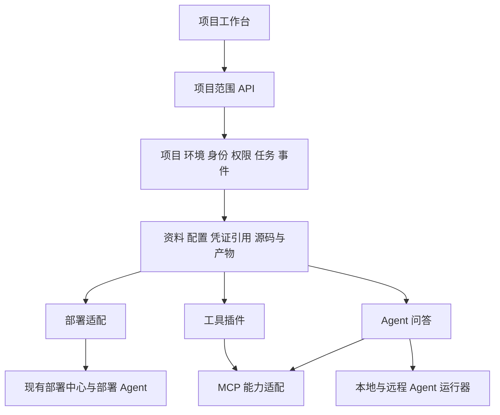

# 项目工作台设计与开发交接

更新日期：2026-10-20。

本项目将现有源码交付与部署平台扩展为以项目为单位的工程工作台，统一组织资料、配置、源码产物、MCP、工具插件和 Agent 问答。本文汇总本轮已确认需求、交互原型状态及建议的实现边界，供跨电脑继续开发。

当前开发分支为 `feat/project-workbench-prototype`，尚未合并到 `main`。原型与设计图提交为 `6dd0828`，工具名称及旧缓存兼容修正为 `480758d`。本文中的新模块接口与数据模型属于后续实现设计，不能当作已上线的后端能力。

## 当前交付状态

| 内容 | 状态与入口 |
| --- | --- |
| 项目工作台交互原型 | 已提交，入口 `web/prototype.html`，代码 `web/src/prototype/` |
| 原型图与生成提示词 | 已提交，位于 `output/imagegen/workbench-prototype-20261020-v1/`，属于首版设计存档 |
| UI 规范 | 已提交到 `AGENTS.md` 和 `examples/frontend-guide.md` |
| 原型浏览器验收 | `test/prototype-browser-smoke.mjs`，最近一次 12 组交互验收通过 |
| 在线交互原型 | [打开原型](https://autoops-workbench-20261020.zjtstc.chatgpt.site)，公开访问，无需登录 |
| 现有真实部署与源码交付 | 已有实现，参考 `examples/workspaces-api.md`、`examples/deployment-guide.md` 与 `agent/README.md` |
| 新资料平台、插件协议、问答运行时、成员权限 | 后续开发范围，目前原型使用模拟数据 |

原型支持资料维护、插件启用与配置应用、源码处理产物预览及 ZIP 下载、Agent 澄清与流式展示、工具轨迹、报告回存、模拟部署以及项目切换。其数据库、服务器、MCP 和模型连接均为模拟。

浏览器数据保存在 `autoops:interactive-prototype:v1` 的 localStorage 中，不随 Git 同步。换电脑或换站点来源后，会重新生成示例数据。资料区里的“系统设计说明.md”等内容也是演示数据，正式开发依据应使用本文及仓库文档。

## 已确认需求

1. 以项目作为工作台的基本单位。项目之间的资料、配置、产物、对话和工具使用相互隔离；项目下区分测试、生产等环境。
2. 集成现有部署能力，使每个项目可以管理服务并自动化部署，复用已有源码快照、任务、日志、健康检查和回退能力。
3. 资料区是项目数据的统一维护入口，包含项目自定义资料、研发文档、原型、设计文档、Git 仓库和各模块配置。资料既供用户查看，也通过接口供其他模块使用。
4. 资料基础模块提供独立的项目信息、源码获取、去 Git 信息、脱敏、压缩和产物读取接口。各步骤产生的中间结果均可独立使用。
5. 工具插件与平台项目代码一起维护，由各业务项目选择启用并配置。开启插件后，资料区出现对应配置表单；插件引用资料区配置，不另建一份配置来源。
6. 插件机制必须可扩展。“机柜迁移”是本轮示例插件，后续参考 `cabinet-router` 接入真实功能；内部标识暂时保留 `cabinet`，仓库名仍为 `cabinet-router`。
7. MCP 提供数据库、Redis、服务器等外部能力，优先复用已有成熟实现，补齐项目、环境和权限适配。
8. 问答 Agent 使用项目资料、源码产物及获准的 MCP 工具，支持服务器本地 Agent 和用户其他主机提供的 Agent。重点完善网页与 Agent 的交互。
9. 本版不实现项目工作流编辑器；基础任务、事件和产物接口需要便于后续工作流调用。
10. UI 沿用当前 CodeMinificationRepository 的风格，使用 shadcn/ui 与 Solid Glass。页面、模块和卡片标题下不添加泛化说明性副标题。

## 建议架构

第一阶段采用模块化单体中心服务，复用现有 Node.js、SQLite 和部署 Agent，通过内部服务接口及项目范围 HTTP 接口组织能力。耗时的源码处理、部署和问答通过任务执行器运行，避免页面组件直接操作 Git、数据库或远程主机。



| 模块 | 负责内容 | 对上层的主要输出 |
| --- | --- | --- |
| 项目基础 | 项目、环境、成员、角色和资源归属 | 项目上下文、访问校验 |
| 资料与配置 | 项目信息、自定义字段、文档及版本、资源配置、插件配置 | 配置快照、文档内容、凭证引用 |
| 源码与产物 | 固定提交源码、去 Git、脱敏、压缩、来源追溯 | 可独立读取和下载的产物 |
| 任务与事件 | 异步执行、进度、日志、取消、幂等与重连 | 任务状态、增量事件 |
| MCP 适配 | 连接管理、工具目录、连通检查、调用权限 | 项目范围内的工具能力 |
| 插件管理 | 插件定义、启用状态、配置校验、能力入口 | 页面入口、工具调用、执行结果 |
| 部署适配 | 对接现有服务、目标、源码与配置快照 | 发布任务、日志、版本、回退 |
| 问答与运行器 | 会话、上下文引用、Agent 路由、工具调用、结果回存 | 回答、引用、工具记录、报告产物 |

当前正式接口使用 `/api/workspaces/{workspaceId}` 表示项目工作空间，旧 `/api/projects/{id}` 部分接口表示源码仓库下载。新增工作台能力应遵循现有工作空间语义，避免复用名称导致归属混淆。

## 资料与配置

资料区统一维护数据，但后端需要区分不同类型：结构化配置、文档正文、文件或源码产物、敏感凭证。不能把所有内容塞入一个无版本的 JSON 或对话上下文。

- 项目信息支持标准字段及可扩展字段；插件通过配置 Schema 增加输入项。
- 文档保存原始文件、可读文本、版本与项目归属；原型图片和其他附件保留原件。
- 数据库、Redis、服务器等使用统一资源 ID，插件配置保存引用。环境覆盖值按明确规则解析。
- 凭证由服务端安全存储，资料区展示可编辑入口和脱敏状态；其他模块按授权解析凭证引用，不从页面或普通资料接口读取明文。
- 草稿与生效配置分开保存。应用配置产生新版本；任务、对话轮次和部署固定使用创建时的版本。
- 资源被删除、变更类型或停用时，要重新校验引用关系；页面切换和重启不能绕过服务端校验。

建议核心对象为 `Project`、`Environment`、`ConfigRevision`、`DocumentRevision`、`Resource`、`SecretRef`、`Artifact`、`Task`。所有对象明确记录项目归属；环境适用的对象额外记录环境范围。

## 源码处理与产物接口

源码获取后固定完整提交号。去 Git 信息、脱敏和压缩是可组合的独立操作，不把所有操作绑定成一个“下载按钮”。

```text
仓库与固定提交 → 原始源码快照
原始源码快照 → 去 Git 信息产物
原始源码快照或去 Git 产物 → 脱敏源码产物与处理报告
选定产物 → ZIP 压缩包
文档、源码产物、工具结果 → Agent 上下文 → 回答与报告产物
```

每个产物建议记录 `id`、`workspaceId`、`kind`、`parentArtifactIds`、来源提交或文档版本、配置版本、处理器与规则版本、内容校验值、创建任务及状态。生成新产物不覆盖输入；失败任务不发布半成品。

“去 Git 信息”需要明确规则，例如移除 `.git` 元数据、远端信息和指定 Git 配置；它不等同于脱敏，也不能证明源码中没有密钥。脱敏规则应独立版本化并输出处理报告。部署默认引用原始源码快照，AI 默认引用经过授权与脱敏检查的资料或产物。

下列接口是建议契约，尚未实现，实际开发时结合现有路由约定确定：

| 项目范围下的能力 | 建议接口示例 |
| --- | --- |
| 项目信息与配置版本 | `GET /api/workspaces/{id}/config` |
| 保存草稿与应用版本 | `PUT /api/workspaces/{id}/config/draft`、`POST /api/workspaces/{id}/config/apply` |
| 文档列表与版本内容 | `GET /api/workspaces/{id}/documents`、`GET /api/workspaces/{id}/documents/{documentId}/versions/{versionId}` |
| 获取固定提交源码 | `POST /api/workspaces/{id}/source-snapshots` |
| 独立处理步骤 | `POST /api/workspaces/{id}/artifact-transforms`，输入产物、处理器及规则版本 |
| 产物列表、内容和下载 | `GET /api/workspaces/{id}/artifacts` 及对应详情、文件、下载接口 |
| 异步处理状态 | 复用或扩展项目任务与事件接口，并区分任务类型 |

耗时请求返回任务 ID。处理器之间传产物引用，不重复传输整份源码。任务需支持幂等请求；清理策略应保护仍被部署、会话或其他产物引用的数据。

## 插件与 MCP

插件定义建议包含稳定 ID、版本、名称、配置 Schema、配置迁移规则、依赖能力、页面入口和工具声明。项目保存插件的启用状态与配置版本。初版可以在仓库内注册受控插件，后续再考虑独立分发，不需要先实现插件市场。

启用流程为：选择插件 → 在资料区生成配置入口 → 选择资源或文档引用 → 校验并应用配置 → 项目工具可用。停用后保留历史配置和产物，阻止后续新调用；执行中任务的处理策略需明确。

“机柜迁移”的真实业务以 `cabinet-router` 的实现及后续需求核对结果为准。目前原型只有设备列表、筛选和问答等演示，名称调整不代表迁移执行能力已经实现。

MCP 连接配置由资料区维护，连接模块负责状态和能力，插件与 Agent 通过同一授权入口调用。现有成熟 MCP 的代码位置、接口和认证方式需要在正式接入前核对。不要将原型里的 `connected` 字段作为真实连通性判断。

## 研发资料与检索

资料区是资料的持久来源，RAG 是读取资料的一种方式，两者无需二选一。

建议第一阶段采用“资料存档 + 文本提取 + 按项目过滤的搜索 + 用户选择引用”。少量文档按预算直接放入上下文；大文件先检索相关片段。上下文显示文档或产物名称、版本及引用位置。

当资料规模、上下文成本或搜索效果确有需要时，再增加向量索引与混合检索。索引属于可重建的派生数据，绑定项目与文档版本；资料删除或权限变更后，检索结果也要同步失效。图片原型保留原图，按模型能力读取，必要时增加 OCR。

## Agent 问答与主机接入

区分现有“部署 Agent”和新增“问答 Agent 运行器”。可以共享主机登记等基础能力，但任务类型、凭证和权限独立；现有部署 Agent 不能直接当作已具备问答能力。

目标流程为：用户登记主机及 Agent → 主机通过认证连接中心并上报能力与心跳 → 用户按项目授权使用 → 会话选择可用 Agent → 固定本轮资料和配置引用 → 执行、流式回传、回存结果。

建议使用统一运行器接口屏蔽本地与远程差异，包含启动任务、追加输入、取消、状态查询和事件订阅。传输协议在核对参考项目后确定。远程运行器应主动建立受认证连接；每个任务带项目、会话、权限和有效期，不默认开放主机上的所有工具或文件。

网页交互至少覆盖：

- 会话历史、Agent 切换、主机在线状态和本轮上下文可见。
- 澄清问题、流式回答、工具参数与结果、资料引用。
- 停止、继续、运行中补充和输入队列，防止重复消费。
- 断线后按事件序号恢复，区分任务仍在执行、已结束与连接中断。
- 输出文件与分析报告进入资料产物区，保留来源和任务引用。

当前原型已经演示其中的主要交互，但正式服务端事件持久化、鉴权、真实模型与远程运行器仍需实现。

用户指定的参考项目：

| 参考 | 本轮约定用途 |
| --- | --- |
| [multica](https://github.com/multica-ai/multica) | 研究多主机、用户提供 Agent 的连接与协作思路 |
| [ai-workbench](https://github.com/coco-ari/ai-workbench) | 参考现有本地 Agent 半成品及脱敏文件使用流程，重点改进网页交互 |
| `cabinet-router` | 机柜迁移插件的实际业务参考；原开发机路径为 `D:\work\cabinet-router` |

这些参考仓库未随本仓库作为子模块提交。其他电脑需要另行获取；使用前核对版本、许可证、配置与实际接口。

## 部署集成与实现顺序

保留现有项目、环境、服务、服务器和目标身份，通过适配层接入资料配置及产物服务。既有部署功能继续可用；新增配置不能改写正在执行任务或已部署版本的快照。

当前正式平台采用管理员会话，尚无完整项目成员账号与权限体系。原型中的“项目成员”和浏览器项目隔离不能替代正式多用户授权；应在接入真实资料和个人 Agent 前完成服务端项目范围校验。

建议按以下顺序交付，每一步均可独立验收：

1. 明确项目与环境模型、成员权限、配置版本、凭证引用及任务事件契约。
2. 落地资料维护与资源配置接口，将原型模拟数据替换为真实持久化。
3. 拆出源码快照、去 Git、脱敏和压缩处理器，验证产物追溯及已有部署兼容。
4. 建立插件注册与配置 Schema 机制，接入一个真实机柜迁移业务流程及 MCP 能力。
5. 接入本地问答运行器，完成上下文、工具授权、断线恢复和报告回存。
6. 接入用户远程主机与 Agent，验证权限、离线、重连和多用户隔离。

工作流编辑器留到后续版本。第一阶段只保留可组合的操作接口、任务事件与产物依赖。

## 在另一台电脑继续开发

准备 Node.js 24 或更高版本，以及 `package.json` 指定的 pnpm 11.25.0。使用可访问该 GitHub 仓库的账号，在新目录执行：

```bash
git clone --branch feat/project-workbench-prototype https://github.com/coco-ari/CodeMinificationRepository.git
cd CodeMinificationRepository
pnpm install --frozen-lockfile
pnpm dev:prototype
```

打开 `http://127.0.0.1:5173/prototype.html`。若机器已有仓库，在确认本地改动已妥善保存后执行：

```bash
git fetch origin
git switch feat/project-workbench-prototype
git pull --ff-only
```

建议先读 `AGENTS.md`、本文和 `examples/frontend-guide.md`。原型相关代码分工如下：

| 文件 | 内容 |
| --- | --- |
| `web/src/prototype/context.jsx` | 示例数据、项目状态、配置草稿与应用、浏览器存储 |
| `web/src/prototype/App.jsx` | 导航、项目概览与页面组织 |
| `web/src/prototype/materials.jsx` | 项目资料、仓库及插件配置 |
| `web/src/prototype/artifacts.jsx` | 源码处理演示、产物、预览及下载 |
| `web/src/prototype/operations.jsx` | 项目工具、MCP、主机、成员及模拟部署 |
| `web/src/prototype/chat.jsx` | 问答交互与模拟执行 |
| `src/workspaces.mjs`、`src/workspace-http.mjs` | 现有正式项目工作空间逻辑与 HTTP 接口 |
| `src/deployment.mjs`、`src/source-archives.mjs`、`agent/` | 现有部署、源码档案与部署 Agent |

修改前端后运行 `pnpm build:ui`。需要完整原型交互验收时，保持开发服务运行，再开一个终端执行 `pnpm test:prototype`；测试需要本机 Chrome 或 Edge，也可使用 `BROWSER_PATH` 指定浏览器。

所有新增或修改的代码注释、Git 提交标题与正文使用简体中文。UI 继续遵守仓库规范；不要将对话中的方案直接当成已实现能力。

在线站点是独立静态发布副本，源码推送不会自动更新站点。发布时导出 `dist/web/prototype.html` 为站点首页并携带其引用资源，使用现有 Sites 身份更新，保持公开访问。仓库不包含浏览器个人数据、运行凭证、参考仓库或独立站点发布凭据。
